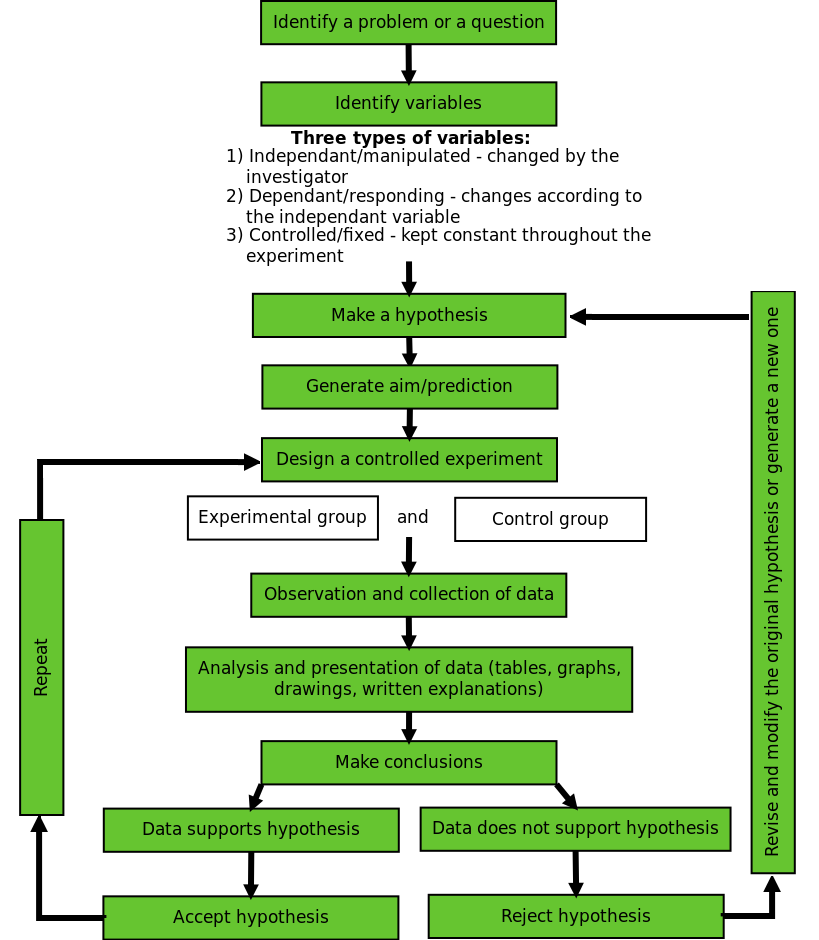

## The Scientific Method (ESGX)

### How science works (ESGY)

Science investigation and research requires many skills and processes to come together in order to be successful and worthwhile.

- To be accepted as a science, certain methods for broadening existing knowledge, or discovering new things, are generally used.
- These methods must be repeatable and follow a logical approach.
- The methods include formulating hypotheses and carrying out investigations and experiments to test the hypothesis.
- Crucial skills are making objective observations, taking measurements, collecting information and presenting the results in the form of drawings, written explanations, tables and graphs.
- A scientist must learn to identify patterns and relationships in data.
- It is very important to then communicate these findings to the public in the form of scientific publications, at conferences, in articles or TV or radio programmes.

<Callout type="note" title="Note">
Watch this interesting video about "The Times and Troubles of the Scientific Method"

<VideoPlayer src="https://youtu.be/i8wi0QnYN6s" title="Video: 2CMG" />
</Callout>

The scientific method is the basic skill process in the world of science. Since the beginning of time humans have been curious as to why and how things happen in the world around us. The scientific method provides scientists with a well structured scientific platform to help find the answers to their questions. Using the scientific method there are very few things we can't investigate. Recording and writing up an investigation is an integral part of the scientific method.

What follows is a step-by-step guide to the scientific method.

### 1. The question (ESGZ)

Scientists are curious people, and most investigations arise from a scientist noticing something that they don't understand. Therefore the first step to any scientific investigation is:

- Ask a question to which you want to find an answer.
  - What is happening?
  - How is it happening?
  - When is it occurring?
  - Why is it happening?
- **Example**: A farmer notices that his tomato plants that are shaded have smaller tomatoes than his plants that are in a sunny spot, which makes him wonder: 'Does the amount of sunlight a tomato plant receives affect the size of tomatoes?'

Figure 0.1: Overview of scientific method.

### 2. Introduction (ESG32)

Once you have a general question, background research needs to be undertaken. Your background research will ensure that you are not investigating something that has already been researched and answered. It will also tell you about interesting connections, theories, explanations and methods that people have used in the past to answer questions related to yours. Science always builds on the work of others, and it ensures that our theories are constantly improved and refined. It is important to acknowledge the work of the people upon whose work your theory relies in the form of *referencing*. It is also vital to *communicate* your findings so that future scientists can use use your work as a basis for future research.

### 3. Identify variables (ESG33)

Your background research will help you identify the factors that influence your question. Factors that might change during the experiment are called **variables**. Different types of variables are given special names. Below is a list of some important variable types:

- The **dependent variable** is the thing that you want to measure or investigate.
- The **independent variable** is a factor (or factors) that you control or change in your experiment. It will have an effect on the dependent variable.
- We call the the variables we keep constant **fixed variables**, or **controlled variables**.

**Example**: In this investigation, variables might include: the amount of sunshine, the types of soil in which the tomatoes are growing, the water available to each of the plants, etc. To which variable type does each factor belong?

- **Dependent variable**: mass of tomatoes
- **Independent variable**: how much light the tomato plants receive
- **Fixed/ Controlled variables**: all tomato plants will:
  - Be the same species of tomato
  - Get the same fertiliser (type and amount)
  - Grow in the same type of soil
  - Grow in the same type of container
  - Get the same amount of water
  - Can you think of more?

### 4. Hypothesis (ESG34)

Write down a *statement* or *prediction* as to what you think will be the outcome or result of your investigation. This is your hypothesis. The hypothesis should:

- be specific
- relate directly to the question you are asking
- be expressed as a statement that includes the variables involved (the `cause' and `effect')
- be testable
- not expressed as a question but rather as a prediction
- be written in the future tense

**Example**: During your background research you would have learnt that tomatoes need sunshine to make food through photosynthesis. You may predict that plants that get more sun will make more food and grow bigger. In this case your hypothesis would be: I think that the more sunlight a tomato plant receives, the larger the tomatoes will grow'.

<Callout type="note" title="Note">
A scientific investigation does not aim to *prove* a particular event occurs or a particular relationship exists. Rather, an investigation shows that it cannot disprove a particular suggestion or prediction. Therefore, it is important to note that an incorrect prediction does not mean that you have failed. It means that the experiment has brought some new facts to light that you might not have thought of before. Therefore, even if your hypothesis (prediction) turns out to be wrong, DO NOT go back and change the it!
</Callout>

### 5. Aim (ESG35)

- In the aim you need to state what you going to be investigating.
- Key words you can use are:
  - To determine...
  - To show that...
  - To investigate...
  - To find out...
  - To observe...
  - To measure...

**Example**: In this case, your aim would be: to investigate the effect of different amounts of sunlight on tomatoes.

<Callout type="note" title="Note">
In science we never `prove' a hypothesis through a single experiment because there is a chance that you made an error somewhere along the way, or there may be an alternate explanation for the results that you observe. What you can say is that your results SUPPORT the original hypothesis.
</Callout>

### 6. Apparatus (ESG36)

All the apparatus that you will need for the investigation needs to be listed.

- Sizes of beakers, test tubes and measuring cylinders
- Specialised equipment that you may need must also be included (make sure that this equipment is available for your research).
- Include all chemicals and quantities that are required for your investigation.

### 7. Method (ESG37)

The next step is to test your hypothesis. An experiment is a tool that you design to find out if your ideas about your question are right or wrong. You must design an experiment that accurately tests your hypothesis. The experiment is the most important part of the scientific method. We will discuss independent and dependent variables as well as controls later. These are all important concepts to know when designing an experiment. In science, another researcher may want to repeat your method, to verify your results, improve it or do a variation of your experiment. Listing the apparatus helps others to verify that you used a suitable method, and enables them to replicate the experiment.

- Write down the scientific method in bullet format for your investigation.
- The method should be written so that a complete stranger will be able to carry out the same procedure in the exact same way and get almost identical results.
- The method should be written in the past tense using the passive voice.
- The method must be clear and precise instructions including
  - the apparatus
  - exact measurements or quantities of chemicals or substances
- Ensure that your method is written out in the correct sequence, with each step of the experiment numbered.
- State the criteria you will look for or measure to get results.
- Give clear instructions how the results should be recorded (table, graph etc.)
- Include safety precautions where possible.

### 8. Results (ESG38)

- Record your observations from doing the investigation.
- It is important that you do not write out an explanation for the results.
- Present your results in a suitable format such as tables and graphs.
- It is also important to note that not getting the result you expected is still a result. Even if there is no change at all, this is still a  result that needs to be recorded.

### 9. Analysis of results or discussion (ESG39)

- The analysis of the results is stating in words what the results are often saying in tables/graphs.
- Discuss if there are there any relationships between your independent and dependent variables.
- It is important to look for patterns/trends in your graphs or tables and describe these clearly in words.

### 10. Evaluation of results (ESG3B)

- This is where you answer the question “What do the results mean?”
- You need to carefully consider the results :
  - Were there any unusual results?  If so then these should be discussed and possible reasons for them can be given.
  - Discuss how you ensured the **validity** and **reliability** of the investigation.
    - **Vailidity**: Was it a fair test and did it test what it set out to test?
    - **Reliability**: If the experiment were to be repeated would the results obtained be similar?
  - The best way to ensure reliability is to repeat the experiment several times and obtain an average.
  - Discuss any **experimental errors** that may have occurred during the experiment. These can include errors in the methods and apparatus used and what make suggestions what could be done differently next time.

### 11. Conclusion (ESG3C)

The conclusion needs to link the results to the aim and hypothesis. In a short paragraph, write down if what was observed is supported or rejected by the hypothesis by restating the variables that were tested. If your original hypothesis does not match up with the final results of your experiment, do not change the hypothesis. Instead, try and explain what might have been wrong with your original hypothesis. What information did you not have originally that cause  you to be wrong in your prediction.

- **Example**: after conducting your experiment you may have found that tomato plants that received more sunlight grew larger than tomato plants grown in the shade or without light. Therefore you might conclude your investigation with the following:
  - It was clear that tomato plants form bigger tomatoes when they are exposed to bright sunlight. The original hypothesis was supported.
