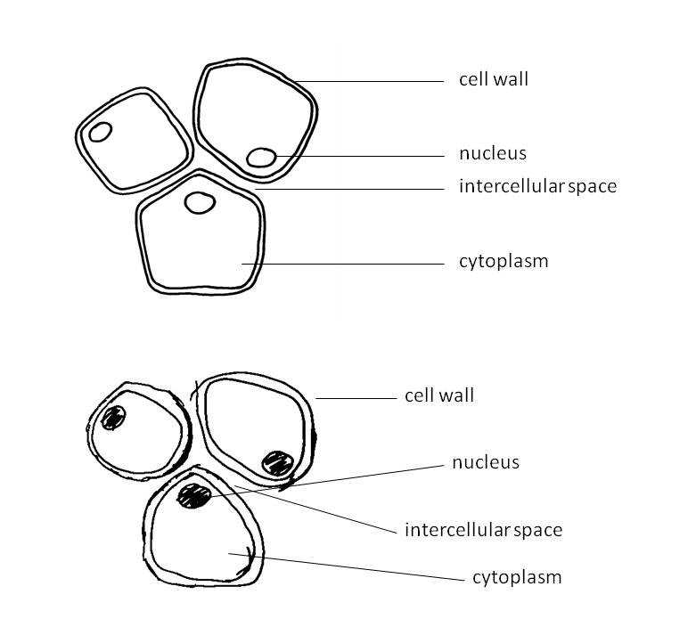
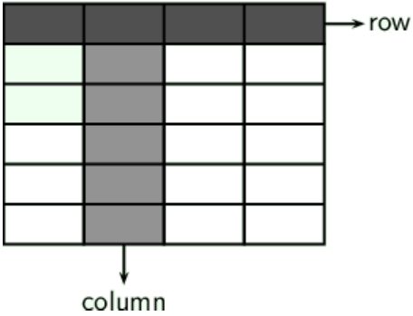
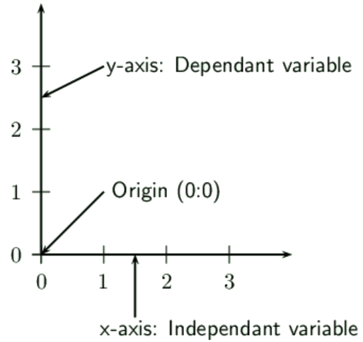
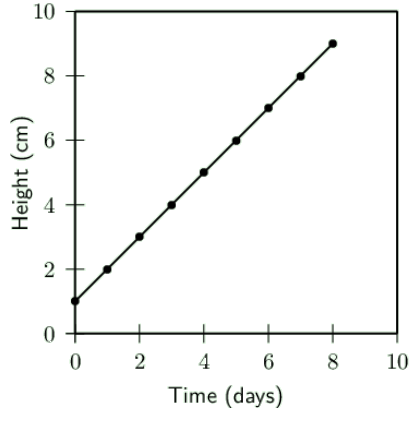
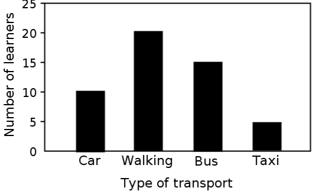
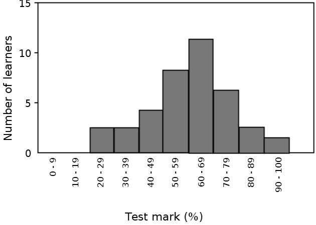
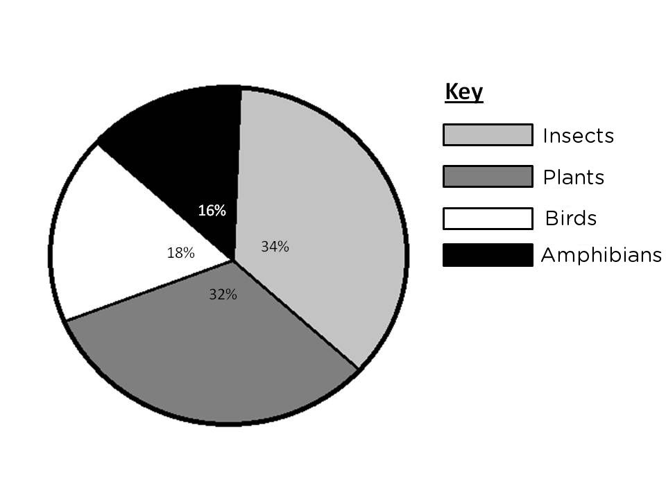
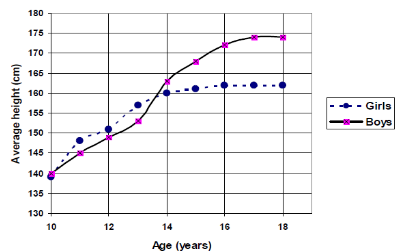
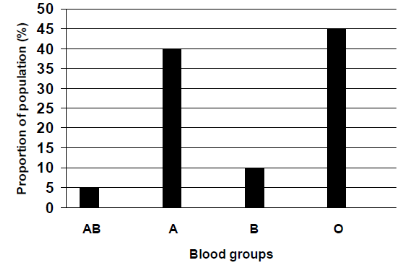

## Presenting data (ESG3H)

### Biological drawings and diagrams (ESG3J)

Drawings and diagrams are an essential part of communication in science, and especially Life Sciences. Remember it is not an artwork or sketch! But rather it is a clear representation of what you observe which can be used to interpret what you saw.

**Some rules to follow**

Drawings and diagrams must:

- Be drawn in a sharp pencil for clear, smooth lines.
- Be large so that all structures can be clearly seen (at least 10 lines of paper).
- Be drawn in the middle of the page.
- Be two dimensional (no shading)!
- Have a heading or caption.
- Specify the section in which the specimen was sliced, i.e. transverse section (T/S), cross section (C/S), or longitudinal section (L/S).
- State the source of the drawing or diagram, i.e. From a biological specimen, a micrograph or a slide.
- Indicate the magnification or scale of the drawing, either in the caption or in the corner of the drawing.
- Label lines should be drawn and they must:
  - be parallel to the top of the page and drawn with a ruler.
  - not cross each other or have an arrow at the end.
  - clearly indicate the structure which is being named.
  - be aligned neatly, one below the other and preferably on one side of the page, unless there are many labels in which both sides can be used.

## Identifying the key aspects of producing biological drawings

### Instructions

Make a list of what makes the above drawings good and bad.

Figure 0.2: Identify the features of the images that make each one good or bad.

**The top drawing is good because:**

- Cells are drawn neatly, with continuous lines, not sketched.
- The nuclei are circular and not coloured in or shaded.
- Label lines end on the part indicated.
- Label lines are parallel to each other and all end in one vertical line.

**The bottom drawing is bad because:**

- Cell walls are roughly sketched.
- The nuclei are shaded or coloured in.
- Label line for 'cell wall' doesn’t touch any part of the drawing.
- Label lines cross each other.
- Lines do not end in one vertical line.

### Two-dimensional (2-D) and three-dimensional (3-D) diagrams (ESG3K)

Diagrams of apparatus are generally drawn in two-dimensions so that the shape of each item of apparatus is simplified and looks similar to a section through the apparatus.

### Tables (ESG3M)

**What is a table?**

- A table is a summary of data, using as few words as possible.
- It is a grid divided up into rows and columns.
- The heading is placed above the table.
- The heading should include both variables under investigation- the dependent and independent variables.
- Independent variable is placed in the first column.
- The column headings should mention the units that were used, eg. grams, hours, km/hr, cm.

**When to use a table?**

- To summarise information.
- To compare related things or aspects.
- To record the results of an experiment.
- To illustrate patterns and trends.
- To record the data which will be used to construct a graph.

### Types of Graphs (ESG3N)

One of the clearest and most concise ways to represent data is via graphs. Graphs can immediately provide a graphical display of trends and patterns that words and numbers in a table don't necessarily convey.

### Line Graphs (ESG3P)

**Line graphs are used when:**

- The relationship between the dependent and independent variables is continuous.
- Both dependent and independent variables are measured in numbers.

**Features of line graphs:**

- An appropriate scale is used for each axis so that the plotted points use most of the axis/space (work out the range of the data and the highest and lowest points).
- The scale must remain the SAME along the entire axis and use easy intervals such as 10's, 20's, 50's, and not intervals such as 7's, 14's, etc, which make it difficult to read information off the graph.
- Each axis must be labelled with what is shown on the axis and must include the appropriate units in brackets, e.g. Temperature (°C), Time (days), Height (cm).
- Each point has an \(x\) and \(y\) co-ordinate and is plotted with a symbol which is big enough to see, e.g. a cross or circle.
- The points are then joined.
- With a ruler if the points lie in a straight line (see Figure 3) or you can draw a line of best fit where the number of points are distributed fairly evenly on each side of the line.
- Freehand when the points appear to be following a curve (see Figure 4).
- DO NOT start the line at the origin unless there is a data point for 0. If there is no reading for 0, then start the line at the first plotted point.
- The graph must have a clear, descriptive title which outlines the relationship between the dependent and independent variable.
- If there is more than one set of data drawn on a graph, a different symbol must be used for each set and a key or legend must define the symbols.

Figure 0.3: Graph showing change in plant height over 10 days

<Callout type="tip" title="Note">
Table headings are always written ABOVE the table. Graph headings are always written BELOW the graph.
</Callout>

### Bar Graphs (ESG3Q)

**Bar graphs are used when:**

- The independent variable is discontinuous (i.e. The variables on the x-axis are each associated with something different)
- Independent variables are not numerical. For example, when examining the protein content of various food types, the order of the food types along the horizontal axis is irrelevant.

**Bar graphs have the following features:**

- The data are plotted as columns or bars that do not touch each other as each deals with a different characteristic.
- The bars must be the same width and be the same distance apart from each other.
- A bar graph can be displayed vertically or horizontally.
- A bar graph must have a clear, descriptive title, which is written beneath the graph.

Figure 0.4: Bar graph showing how many learners use each type of transport

### Histograms (ESG3R)

**Histograms are used when:**

- the independent variable (\(x\)-axis) represents information which is continuous, such as numerical ranges, i.e. 0-9, 10-19, 20-29, etc.

**Histograms have the following features:**

- Unlike a bar graph, in a histogram the data are plotted as columns or bars that touch each other as they are related to each other in some way.
- The numerical categories **must not ** overlap, for example, 0-10, 10-20, 20-30, etc. The ranges must be exclusive so that there is no doubt as to where to put a reading, for example, 0-9, 10-19, 20-29, etc.
- The bars can be vertically or horizontally drawn.
- A histogram must have a descriptive heading with is written below the graph
- and the axes must be labelled.

Figure 0.5: A histogram showing the number of learners in a Grade 10 Life sciences class with a particular percentage test score

### Pie charts (ESG3S)

**Pie charts are used when:**

- You want to give a visual representation of percentages as a relative proportion of the total of a circle.

**Pie charts have the following features:**

- They are a type of graph even though they do not have any axes.
- A pie chart is a circle divided into sectors (think of them as the slices of a cake).
- \(\text{100}\%\) represents the whole complete circle, \(\text{50}\%\) represents a half circle, \(\text{25}\%\) is a quarter circle, and so on.

**Example:**

1. Count the number of each species and record it in a table.
3. Work out the total number of species in the ecosystem.
5. Calculate the percentage of each species.
7. Use the following formula to work out the angle of each slice:
           \[a = \frac{v \times 360^{\circ}}{t}\]

| Species | No of types | \(\%\) | Slice angle |
| --- | --- | --- | --- |
| Insects | \(\text{17}\) | \(\dfrac{17 \times 100}{50} = \text{34}\%\) | \(\dfrac{34 \times 360}{100} = \text{122,4}\text{°}\) |
| Plants | 16 | \(\dfrac{16 \times 100}{50} = \text{32}\%\) | \(\dfrac{16 \times 360}{100} = \text{115,2}\text{°}\) |
| Birds | 9 | \(\dfrac{9 \times 100}{50} = \text{18}\%\) | \(\dfrac{18 \times 360}{100} = \text{65}\text{°}\) |
| Amphibians | 8 | \(\dfrac{8 \times 100}{50} = \text{16}\%\) | \(\dfrac{16 \times 360}{100} = \text{57,6}\text{°}\) |

Table 0.1: Table showing recordings and calculations for construction of a pie chart

1. Use a compass to draw the circle and a protractor to measure accurate angles for each slice.
3. Start with the largest angle/percentage starting at 12 o' clock and measure in a clockwise direction.
5. Shade each slice and write the percentage on the slice and provide a key.

Figure 0.6: Pie chart showing the relative proportions of different categories of organisms in an ecosystem

## Converting tables to graphs

### Aim

It is very important to be able to convert tables to graphs, and vice versa. Below are some exercises to practice this.

### Questions

1. Convert the data in the graphs below into tables. Remember to identify which is the independent variable in the graphs and to place this in the first column of the table.

Figure 0.7: The average height in boys and girls between the ages of 10 and 18 years.

Figure 0.8: Proportion of each blood group in a small population.

2. Convert the data in the following tables into graphs. Look back at the features of each type of graph to decide which one you will use.

**Favourite take away restaurant in a class of learners**

| Take aways restaurant | Learners (\(\%\)) |
| --- | --- |
| Kauai | \(\text{40}\) |
| Anat Falafel | \(\text{15}\) |
| Nandos | \(\text{25}\) |
| Burger King | \(\text{20}\) |

**(1) Table to show the average height of boys and girls at different ages: **

| Age | Height (cm) Boys | Height (cm) Girls |
| --- | --- | --- |
| \(\text{10}\) | \(\text{140}\) | \(\text{140}\) |
| \(\text{11}\) | \(\text{145}\) | \(\text{148}\) |
| \(\text{12}\) | \(\text{149}\) | \(\text{151}\) |
| \(\text{13}\) | \(\text{153}\) | \(\text{158}\) |
| \(\text{14}\) | \(\text{163}\) | \(\text{160}\) |
| \(\text{15}\) | \(\text{168}\) | \(\text{161}\) |
| \(\text{16}\) | \(\text{172}\) | \(\text{163}\) |
| \(\text{17}\) | \(\text{174}\) | \(\text{163}\) |
| \(\text{18}\) | \(\text{174}\) | \(\text{163}\) |

**(2) Table to show the proportion of each blood group in a small population:**

| Blood group | Proportion of learners (\(\%\)) |
| --- | --- |
| AB | \(\text{5}\) |
| A | \(\text{40}\) |
| B | \(\text{10}\) |
| O | \(\text{45}\) |
