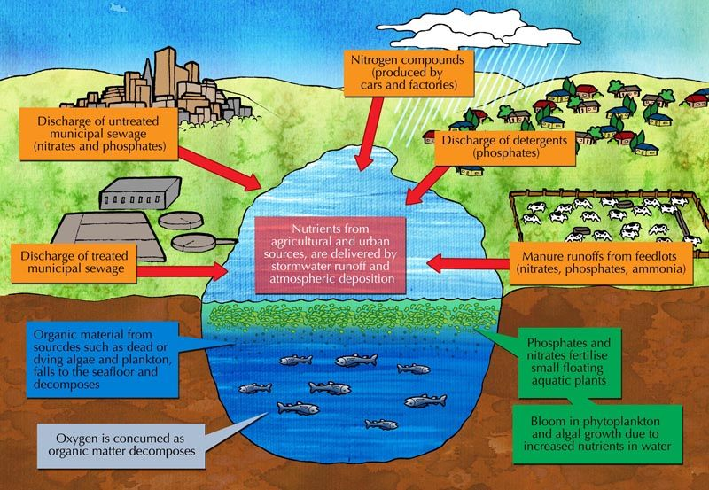

## 1.3 Inorganic compounds (ESG45)

The main focus of this section should be:

- **Water:** The functions of water in living organisms.
- **Minerals:** The difference between macro-nutrients and micro-nutrients. The main functions of the essential minerals in animals and plants, and the deficiency diseases.
- **Ferilisers:** The need for fertilisers, the undesirable consequences of fertilisers (eutrophication) and organic fertilisers.

### The role of water in the maintenance of life (ESG46)

<Callout type="note" title="Note">
Learn about some of the amazing life-supporting properties of water

<VideoPlayer src="https://youtu.be/HVT3Y3_gHGg" title="Video: 2CMJ" />
</Callout>

As mentioned in Table 1.1, up to \(\text{65}\%\) of our bodies are made up of water. Water is an inorganic compound made up of two hydrogen atoms and one oxygen atom. Its molecular formula is \(\text{H}_{2}\text{O}\). Water plays an important role in the maintenance of biological systems.

**Temperature regulation**: in humans, the sweat glands produce sweat which cools the body as it evaporates from the body surface in a process called *perspiration*. In a similar way, plants are cooled by the loss of water vapour from their leaves, in a process called *transpiration*.

**Form and support**: water is an important constituent of the body and plays an important role in providing form and support in animals and plants. Animals, such as worms and jellyfish, use water in special chambers in their body to give their bodies support. This use of water pressure to provide body form, and enable movement is called a * hydrostatic skeleton *. Plants grow upright and keep their shape due to the pressure of water (* turgor pressure) * inside the cells.

**Transport medium**: water transports substances around the body. For example, water is the main constituent of blood and enables blood cells, hormones and dissolved gases, electrolytes and nutrients to be transported around the body.

**Lubricating agent**: water is the main constituent of saliva which helps chewing and swallowing and also allows food to pass easily along the alimentary canal. Water is also the main constituent of tears which help keep the eyes lubricated.

**Solvent for biological chemicals**: the liquid in which substances dissolve is called a solvent. Water is known as the universal solvent as more substances dissolve in water than in any other liquid.

**Medium in which chemical reactions occur**: all chemical reactions in living organisms take place in water.

**Reactant**: water takes place in several classes of chemical reactions. During hydrolysis reactions,  water is added to the reaction to break down large molecules into smaller molecules. Water can also be split into hydrogen and oxygen atoms to provide energy for complex chemical reactions such as photosynthesis.

| Temperature | Structure and support | Lubrication |
| --- | --- | --- |
| Sweating helps human bodies cool down. | Jellyfish and worms use a hydrostatic (water pressure) skeleton to keep their body shape. | Water helps maintain the upright structure of plants. | Water is an important lubricant in the eye. |

Table 1.2: The role of water in living organisms.

### Minerals (ESG47)

Dietary minerals are the chemical elements that living organisms require to maintain health. In humans, essential minerals include calcium, phosphorous, potassium, sulfur, sodium, chlorine and magnesium.

**Macro-elements** (macro-nutrients) are nutrients that are required in large quantities by living organisms (e.g carbon, hydrogen, oxygen, nitrogen, potassium, sodium, calcium, chloride, magnesium, phosphorus and sulfur).

**Micro-elements** (micro-nutrients) are nutrients that are required in very small quantities for development and growth and include iron, cobalt, chromium, copper, iodine, manganese, selenium, zinc and molybdenum.

**Nutrients required for human health**

Table 1.3 below summarises some important minerals required for proper functioning of the human body. Proper nutrition involves a diet in which the daily requirements of the listed mineral nutrients are met.

| Mineral | Food Source | Main Functions | Deficiency Disease |
| --- | --- | --- | --- |
| Macro-nutrients |
| Calcium (Ca) | most fruit and vegetables, meat, dairy products | strong bones and teeth; muscle contraction; blood clotting; nerve function | rickets, osteoporosis |
| Magnesium (Mg) | nuts, meat, dairy products | strong bones and teeth; nerve and muscle function; energy production | osteoporosis, muscle cramps |
| Phosphorus (P) | nuts, meat, dairy products | strong bones and teeth; nerve function; part of nucleic acids and cell membranes | rickets, osteoporosis |
| Potassium (K) | bananas, meat, dairy products | growth and maintenance, water balance, heart function | muscle cramps; heart, kidney and lung failure |
| Sodium (Na) | table salt, fruit and vegetables | regulates blood pressure and volume; muscle and nerve function | muscle cramps |
| Sulfur (S) | meat, dairy products, eggs, legumes | part of proteins; detoxifies the body; good skin; hair and nails | disorder unlikely |
| Micro-nutrients |
| Iron (Fe) | meat, legumes | part of haemoglobin (the oxygen transport protein); part of some enzymes | anaemia |
| Iodine (I) | seafood, iodated salt | production of hormones by the thyroid gland; strong bones and teeth; good hair; skin and nails | goitre, stunted growth, mental problems |
| Zinc (Zn) | seafood, meat | immune function; male reproductive system | stunted growth, prostate problems |

Table 1.3: Minerals required by humans.

**Nutrients required for plant growth**

The previous section examined the key nutrients important for animal growth. In Table 1.4 we will now look at the key nutrients required for plant growth.

<Callout type="note" title="Note">
**Chlorosis** is the yellowing of the leaves due to low production or loss of chlorophyll.
</Callout>

| Mineral | Source | Main Functions | Deficiency Disease |
| --- | --- | --- | --- |
| Macro-nutrients |
| Calcium (Ca) | inorganic fertilisers; Ca ions in the soil | part of the plant cell wall; transport and rention of other elements | chlorosis (yellowing of the leaves due to low production or loss of chlorophyll) |
| Magnesium (Mg) | inorganic fertilisers; Mg ions in the soil | component of chlorophyll (pigment for photosynthesis); activates many enzymes required for growth | chlorosis |
| Nitrogen (N) | inorganic fertilisers in the form of nitrates; symbiotic nitrogen-fixing bacteria in roots | component of chlorophyll; nucleic acids and proteins; seed and fruit production | stunted growth; smaller leaves |
| Phosphorus (P) | inorganic fertilisers in the form of phosphates; low amounts in the soil | photosynthetic process; part of nucleic acids and cell membranes; root growth | stunted growth, blue/green leaves |
| Potassium | inorganic fertilisers; K ions in the soil | needed for protein synthesis, photosynthesis, enzyme activation, opening and closing of stomata; | chlorosis; curling leaf tips; brown scorching, poor fruit quality |
| Sulfur (S) | inorganic fertilisers | protein synthesis; root growth; chlorophyll formation; promotes activity of enzymes | chlorosis |
| Micro-nutrients |
| Iron (Fe) | inorganic fertilisers; Fe ions in the soil | component of the enzyme that makes chlorophyll | chlorosis |
| Zinc (Zn) | inorganic fertilisers; Zn ions in the soil | part of growth-regulating enzyme systems | poor leaf growth |
| Sodium (Na) | inorganic fertilisers; Na ions in the soil | maintains salt and water balance | reduced growth |
| Iodine (I) | inorganic fertilisers; I ions in the soil | needed for energy release during respiration | poor growth |

Table 1.4: Nutrients required for plant growth.

### Fertilisers (ESG48)

**Use of fertilisers **

When crops are regularly grown and harvested on the same piece of land, the soil becomes depleted of one or more nutrients. Fertilisers are natural or non-natural mixtures of chemical substances that are used to return depleted nutrients to the soil, improve the nutrient content of the soil and promote plant growth. Inorganic nutrients (such as nitrates and phosphates) are added to the soil in the form of inorganic fertilisers.

**Effect of fertilisers on the environment**

Using large amounts of fertilisers can be harmful to the environment. Fertilisers wash off into rivers where they are poisonous to plant and animal life. The accumulation of fertilisers in rivers can lead to a process known as **eutrophication**. This process occurs when excessive nutrients (nitrates and phosphates) from the land (typically from fertilisers) run off into rivers and lakes. This leads to high growth of water plants. Plants grow and produce food by photosynthesis which requires high quantities of oxygen. The high oxygen demand of the rapidly growing water plants removes oxygen available to other organisms in the rivers and lakes. The overgrowth of water plants also blocks sunlight from entering the water, so that plants underwater can no longer photosynthesise and stop producing oxygen. These two processes combine to deplete the water of oxygen and cause aquatic organisms to suffocate and die. The biodegradation of the dead organisms results in a massive increase in
bacteria, fungi and algae degrading the dead organic matter, which also require oxygen. This further depletes the available oxygen, and further contributes to the death of fish and other aquatic species.

Figure 1.1: Schematic diagram showing the processes that lead to eutrophication.

| Figure 1.2: Algae and dead fish in a lake that has undergone eutrophication. | Figure 1.3: Algal bloom in a river following eutrophication. |
| --- | --- |

**Natural fertilisers: an application of indigenous knowledge systems **

The fertilisers discussed above are non-natural inorganic compounds such as nitrates, phosphates etc. However, as a means of reducing the negative impact of the inorganic fertilisers discussed earlier, organic fertilisers that occur naturally can be used. Natural fertilisers consist of organic compounds derived from manure, slurry, worm castings, peat, seaweed etc.

Natural fertilisers supply nutrients to the soil through natural processes such as composting. This means that the nutrients are released back to the soil slowly, and excessive nutrients do not wash off into rivers causing over-fertilisation and eutrophication. However, the use of organic fertilisers is more labour-intensive and the nutrient composition tends to be more variable than the inorganic fertilisers. As a result it is difficult to know for sure whether the particular nutrient required by the plant is actually being supplied by the natural fertiliser.

| Figure 1.4: Sample of compost created through processes involving degradation of dead organic matter by bacteria and fungi. | Figure 1.5: A homemade compost tumbler. |
| --- | --- |
