## 1.4 Organic compounds (ESG49)

Learners will study carbohydrates, lipids, proteins and nucleic acids under the following headings:

- **Molecular make-up**: the main elements that make up the class of compounds.
- **Structural composition**: how the monomers join up together to form polymers.
- **Biological role**: importance of these molecules to animals and plants.
- **Chemical test**: how to detect the presence of each class of compounds.

There is also an explanation of enzymes in the section of proteins. This section of the chapter contains the most practical work, and therefore plenty of time should be allocated to covering this section.

An organic compound is a compound whose molecules contain C, and usually at least one C-C or C-H bond. Very small carbon-containing molecules that do not follow the above rules, such as \(\text{CO}_{2}\) and simple carbonates, are considered inorganic. Life on earth would not be possible without carbon. Other than water, most molecules of living cells are carbon-based, and hence are referred to as organic compounds. The main classes of organic compounds we will investigate in this section include carbohydrates, lipids, proteins and nucleic acids.

Each of these classes of compounds consists of large molecules built from small subunits. The smallest of these subunits is called a **monomer**. Several monomers bond together to form **polymers**. Each of these polymers is characterised by a specific structure owing to the chemical bonds formed. These structures are related to the function of the compound in living organisms. We will therefore study each class of compounds under the following headings:

- **Molecular make-up**: the main elements that make up the class of compounds.
- **Structural composition**: how the monomers join up together to form polymers.
- **Biological role**: importance of these molecules to animals and plants.
- **Chemical test**: how to detect the presence of each class of compounds.

### Carbohydrates (ESG4B)

**Molecular make-up**

Carbohydrates consist of carbon (C), hydrogen (H) and oxygen (O).

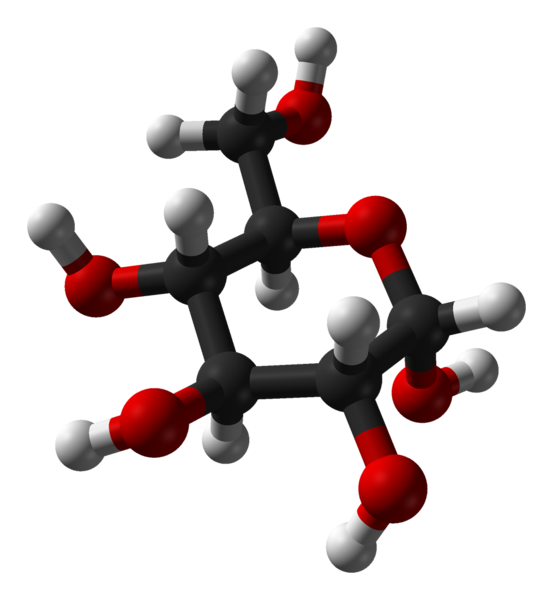

Figure 1.6: A glucose molecule is made up of carbon (gray spheres), hydrogen (white spheres) and oxygen (red spheres).

**Structural composition**

Carbohydrates are made up of monomers known as **monosaccharides**. The monosaccharide that makes up most carbohydrates is glucose. Other monosaccharides include fructose, galactose and deoxyribose (discussed later). These monomers can be joined together by **glycosidic** bonds. When two monosaccharides are chemically bonded together, they form **disaccharides**. An example of a disaccharide is sucrose (table sugar), which is made up of glucose and fructose. Other dissacharides include lactose, made up of glucose and galactose, and maltose, made up of two glucose molecules. Monosaccharides and dissachardies are often referred to as sugars, or simple carbohydrates. Several monosaccharides join together to form **polysaccharides**. Examples of polysaccharides you will encounter include glycogen, starch and cellulose. Polysaccharides are usually referred to as complex carbohydrates as they take longer to break down.

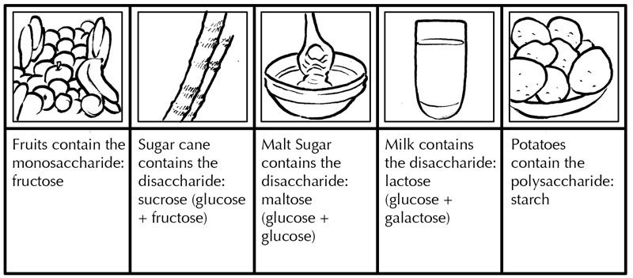

Figure 1.7: Examples of food sources of various monosaccharides, disaccharides and polysaccharides.

**Role in animals and plants**

The main function of carbohydrates is as energy storage molecules and as substrates (starting material) for energy production. Carbohydrates are broken down by living organisms to release energy. Each gram of carbohydrate supplies about 17 kilojoules (kJ) of energy. **Starch** and **glycogen** are both storage polysaccharides (polymers made up of glucose monomers) and thus act as a store for energy in living organisms. Starch is a storage polysaccharide in plants and glycogen is the storage polysaccharide for animals. Cellulose is found in plant cell walls and helps gives plants strength. All polysaccharides are made up of glucose monomers, but the difference in the properties of these substances can be attributed to the way in which the glucose molecules join together to form different structures. Below are images of glycogen and starch.

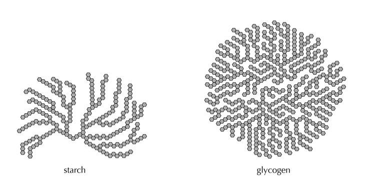

Figure 1.8: A comparison between starch and glycogen. Glycogen is more extensively branched than starch.

**Chemical tests to identify presence of starch**

Substances containing starch turn a blue-black colour in the presence of iodine solution. An observable colour change is therefore the basis of a chemical test for the compound.

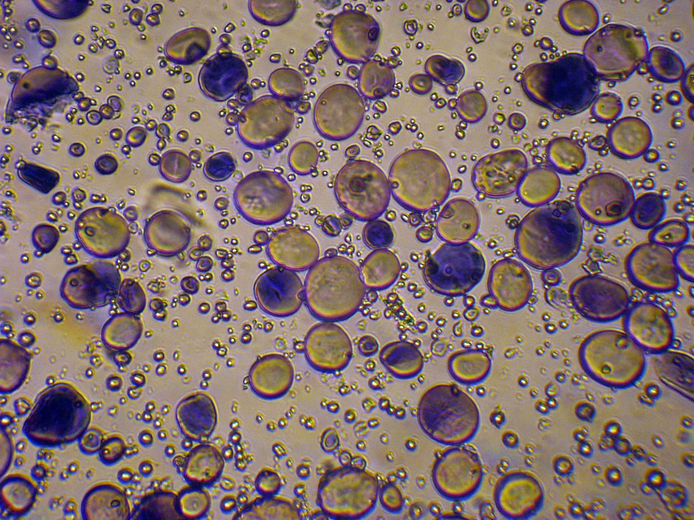

Figure 1.9: Granules of wheat starch stained with iodine solution and photographed through a light microscope.

In the following investigation we will test a few different foods for the presence of starch.

## Test for the presence of starch (Essential investigation-CAPS)

### Aim

To test for the presence of starch.

### Apparatus

- piece of potato or bread
- lettuce leaf
- petri dish
- iodine solution
- dropper
- other food items of your choosing

### Method

1. Place a piece of potato or bread, the lettuce leaf, and your other food samples in separate petri dishes.
3. Using the dropper add a few drops of iodine solution to the food item in each petri dish.

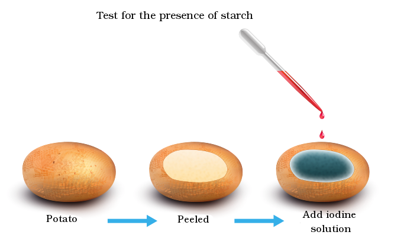

Figure 1.10: Experimental set-up: test for the presence of starch using iodine solution.

### Observations

Record your observations.

The potato or bread turns blue-black in the presence of iodine solution, but the lettuce leaf does not.

### Questions

Can this method be used to determine **how much** starch is present? Explain your answer.

Yes. The deeper the blue-black colour, the higher the starch content. If only a little starch is present, the resulting colour looks paler and more purple than black. If there is no starch at all, the only colours visible are the original colour of the material (e.g. green leaf) and the yellow-brown colour of the iodine solution.

<Callout type="note" title="Note">
Watch a video demonstration of the test for starch.

<VideoPlayer src="https://youtu.be/aOmLmauw2D8" title="Video: 2CMK" />
</Callout>

<Callout type="note" title="Note">
Watch a video demonstration of the test for starch.

<VideoPlayer src="https://youtu.be/3o7_7Us9Pck" title="Video: 2CMM" />
</Callout>

<Callout type="note" title="Note">
Watch a video demonstration of the test for starch.

<VideoPlayer src="https://youtu.be/HO_q8GPl3bE" title="Video: 2CMN" />
</Callout>

**Chemical test to identify presence of reducing sugars**

Certain monosaccharides, such as glucose, are known as **reducing sugars**. These are defined as sugars that can easily undergo oxidation reactions (i.e. lose an electron or gain an oxygen atom) and act as a **reducing agent**. In order to test for carbohydrates we typically test for the presence of reducing sugars using either the **Benedict's** or **Fehling's test**. Both solutions (Benedict's and Fehling's) contain copper sulphate which reacts with reducing sugars to produce a colour change.

<Callout type="note" title="Note">
Watch a video demonstration of the test for glucose.

<VideoPlayer src="https://youtu.be/2YH183H-BcE" title="Video: 2CMP" />
</Callout>

## Testing for the presence of reducing sugars (Essential investigation-CAPS)

### Aim

To test for presence of sugars using Benedict's or Fehling's test.

### Apparatus

- 4 heat resistant test tubes
- 1 beaker
- Bunsen burner or water bath with hot water (+50 \(^{\circ}\)C)
- test tube rack (if using a water bath)
- glucose solution
- albumen solution or egg white
- starch solution
- water
- Benedict's solution OR Fehling's solution
- marking pen to mark the test tubes
- thermometer
- \(\text{10}\) \(\text{ml}\) syringe or measuring cylinder

### Safety precautions

- Follow the safety procedures (listed in Chapter 1) when lighting your Bunsen burner. Do not light it in a shelf or enclosed space. Remove all notebooks, papers and excess chemicals from the area. Tie back any long hair, dangling jewelry and loose clothing and never leave an open flame unattended while it is burning.
- When heating your test tubes in the heated water in the beakers ensure that the mouth of the test tubes point away from you and fellow learners.
- When handling the test tubes, especially when they are hot, use a test tube holder and wear goggles.

### Method

Prepare a water bath by filling a beaker to the halfway mark with water. Place the beaker on a tripod stand over a Bunsen flame as shown in Figure 1.11. This will serve as your water bath.

**TEACHERS NOTE:** It is not essential that a water bath be used for this practical. Test tubes can be heated directly. It is however necessary to have a water bath if the teacher does not have gas available and has to use a hot plate.

Whilst waiting for the water to reach the desired temperature, carry out the following instructions:

1. Label the test tubes 1–4.
3. Using the syringe or measuring cylinder, add the following to the test tubes:
   - test tube 1: \(\text{5}\) \(\text{ml}\) of \(\text{1}\%\) starch solution
   - test tube 2: \(\text{5}\) \(\text{ml}\) of \(\text{10}\%\) glucose solution
   - test tube 3: \(\text{5}\) \(\text{ml}\) \(\text{1}\%\) albumen solution
   - test tube 4: \(\text{5}\) \(\text{ml}\) water.
5. Add \(\text{5}\) \(\text{ml}\) Benedict's solution to each tube.
7. Place the test tubes in the beaker of hot water on the tripod.
9. Use a thermometer to monitor the water temperature and adjust the flame to maintain the water temperature at approximately 50\(^{\circ}\)C.
11. If using the water bath, place the test tubes into the test tube rack and place into the water bath with temperature set to 50\(^{\circ}\)C.
13. After about \(\text{5}\) minutes, when a colour change has occurred in some of the test tubes, extinguish the flame, or remove the test tubes from the water bath.
15. Place the four test tubes in a test tube rack and compare the colours.

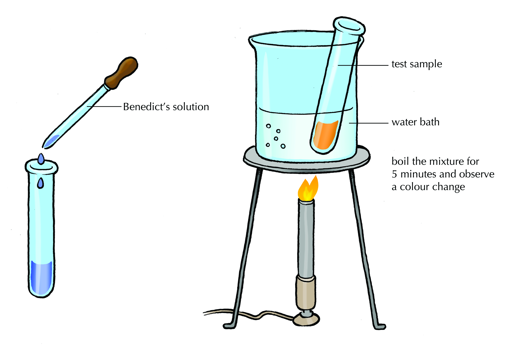

Figure 1.11: Test for reducing sugars using Benedict's test

### Results

Construct a table to record the results of this experiment. It is important to observe and record any changes that have taken place.

| Tube number | Observations in each tube |
| --- | --- |

### Questions

1. What colour changes (if any) did you observe after heating the samples with Benedict's solution?
3. The three solutions tested are examples of the chemical substances found in cells: glucose, starch, protein (albumen). Which of the samples tested positive when the Benedict's solution was added and the test tube was heated?
5. Other than the colour, what change took place in the consistency of the Benedict's solution?
7. What can you conclude from the investigation?
9. Why was water included in test tube 4?

**Answers**

1. The contents of test tube 2 goes yellow / orange, the others stay blue.
3. Only glucose.
5. It became a bit thicker / it coagulated.
7. Any other substance we test that also goes yellow / orange when heated with Benedicts solution, contains glucose or a reducing sugar.
9. It is a control, to show that the Benedicts solution reacts with another substance in the test tube, not with the water in which the glucose was dissolved.

<Callout type="note" title="Note">
Watch a video demonstration of the test for reducing sugars.

<VideoPlayer src="https://youtu.be/SYgsxZg1330" title="Video: 2CMQ" />
</Callout>

<Callout type="note" title="Note">
Watch a video demonstration of the test for reducing sugars.

<VideoPlayer src="https://youtu.be/Lt7RCIfudYQ" title="Video: 2CMR" />
</Callout>

### Lipids (ESG4C)

**Molecular make-up**

Lipids contain carbon (C), hydrogen (H) and oxygen (O) but have less oxygen than carbohydrates. Examples of lipids in the diet include cooking oils such as sunflower and olive oil, butter, margarine and lard. Many nuts and seeds also contain a high proportion of lipids.

**Structural composition**

Triglycerides are one of the most common types of lipids. Triglyceride molecules are made up of glycerol and three fatty acids (Figure 1.12). The fatty acid tails are made up of many carbons joined together. The number of carbons in the fatty acid chains can differ.

<Callout type="note" title="Note">
When drawing organic molecules, it can easily get confusing writing out all of the 'C's and 'H's for carbon and hydrogen respectively. Scientists overcome this by drawing the carbon backbone, and leaving out the hydrogens. Carbon will always make 4 bonds with other atoms, so it is easy to figure out how many hydrogens there must be. The carbon is indicated by a point, and the bonds between carbon molecules are indicated by lines joining the points.
</Callout>

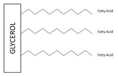

Figure 1.12: A triglyceride molecule.

**Role in animals and plants**

Lipids are an important energy reserve and contain 37.8 kilojoules (kJ) of energy per gram. Triglyceride lipids are broken down to release glycerol and fatty acids. Glycerol can be converted to glucose and used as a source of energy, however the majority of energy provided by lipids comes from the breakdown of the fatty acid chains. Some fatty acids are essential nutrients that cannot be produced by the body and need to be consumed in small amounts. Non-essential fatty acids can be produced in the body from other compounds.

Lipids are important for the digestion and transport of essential vitamins, help insulate body organs against shock and help to maintain body temperature. Lipids also play an important role in cell membranes.

<Callout type="tip" title="Note">
You will learn about the important role that lipids play in cell membranes in the following chapter on **the basic units of life**.
</Callout>

**Saturated and unsaturated fats**

Carbon can form four bonds with other atoms. Most carbons in a fatty acid chain are bonded to two adjacent carbons, and to two hydrogen atoms. When each carbon atom in a fatty acid chain forms four single bonds and has the maximum number of hydrogen atoms, the fatty acid chain is called **saturated** because it is "saturated" with hydrogen atoms. However, sometimes two adjacent carbons will from a double bond. In this case the carbons taking part in the double bond are each joined to only one hydrogen. Fatty acids that have carbon-carbon double bonds are known as **unsaturated**, because the double bond can be 'broken' and an additional bond with hydrogen can be made. Double bonds are stronger than single bonds and they give the fatty acid chain a 'kink'. These kinks mean that the molecules can not pack together tightly, and the lipids are more fluid. This is why unsaturated fats tend to be liquid at room temperature, while saturated fats tend to be solid. Fatty acid
chains with many double bonds
are called **poly-unsaturated** fatty acids.

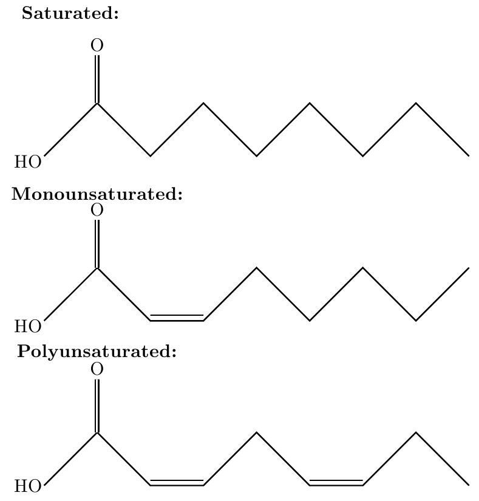

Figure 1.13: Fatty acids can be saturated, mono-unsaturated or polyunsaturated depending on the number of double bonds present. Double bonds result in "kinks" in the fatty acid chain.

**Cholesterol**

Cholesterol is an organic chemical substance known as a **sterol**. You are not required to understand its molecular makeup or its structural composition. It is an important component in cell membranes. The major dietary sources of cholesterol include cheese, egg, pork, poultry, fish and shrimp. Cholesterol is carried through the body by proteins in the blood known as **lipoproteins**. A lipoprotein is any combination of lipid and protein.

Cholesterol is carried in the blood through the body by **high density lipoprotein**, **low density lipoprotein** and through **triglycerides.**

1. **Low density lipoprotein (LDL)**: Low density lipoprotein transports cholesterol around the body. It has a higher proportion of cholesterol relative to protein. It is often known as "bad" cholesterol because higher levels of LDL are associated with heart disease.
3. **High density lipoprotein (HDL)**: High density lipoprotein is the smallest of the lipoproteins. It has a high proportion of protein relative to cholesterol and is therefore often known as the "good" cholesterol. HDL transports cholesterol away from cells and to the liver where it is broken down or removed from the body as waste.

<Callout type="tip" title="Note">
You will learn more about how cholesterol can clog arteries and lead to heart disease in the chapter on **transport systems in animals**
</Callout>

High levels of LDL can cause heart disease. Cholesterol builds up in blood vessels that carry blood from the heart to the tissues and organs of the body, called arteries. This leads to a hardening and narrowing of these vessels, which interferes with the transport of blood, and can potentially lead to a heart attack. The biggest contributor to the amount of cholesterol in your blood is the type of fats you eat. Saturated fats are less healthy than unsaturated fats as they increase the amount of LDL cholesterol in your blood.

**Test for lipids**

The test for lipids relies on the fact that lipids leave a translucent `grease spot' on brown paper bags, while non-lipid substances do not.

<Callout type="note" title="Note">
Watch a video demonstrating the test for lipids.

<VideoPlayer src="https://youtu.be/wpCtf2aqjs8" title="Video: 2CMS" />
</Callout>

<Callout type="note" title="Note">
**Translucent** means that an object lets some light through.
</Callout>

## Test for the presence of lipids (Essential investigation-CAPS)

### Aim

To test for the presence of lipids.

### Apparatus

- piece of paper or "fish-and-chips" paper bag
- food item e.g fries, piece of cooked meat, etc
- 10 ml of cooking oil (positive control)
- 10 ml water (negative control)

### Method

1. **Positive control**: add cooking oil to brown paper bag until it is soaked up. The part of the paper that soaks up oil should be translucent compared to the part that does not.
3. **Negative control**: wet the paper with water. The paper may become wet and soggy, but should not become translucent.
5. **Experimental samples**: stain the brown paper bag with the food item to be tested and hold it up to the light. If it is translucent, similar to the positive control, the food item contains lipid.

### Observations

Record your observations, noting any key differences between the controls and the experimental sample.

The paper became translucent when the oily food was placed onto it, the same as the translucent spot on the paper containing cooking oil. The paper containing water was wet, but it dried out easily and was never translucent, so we can conclude that the food contained oils or lipids, not water.

## Alternative methods for testing for lipids

An alternative method to test for the presence of lipids in a sample, is to crush or dissolve the sample in ethanol. Fats and lipids dissolve in alcohol. Once your ethanol solution has been prepared, there are two ways of testing whether this sample contains lipids:

1. **Filter the ethanol solution through filter paper:** lipids that have dissolved in the ethanol will cause filter paper to go translucent. Once the alcohol evaporates away, a translucent spot will remain.
3. **Add the ethanol sample to water:** lipids cannot dissolve in water. Therefore, if the ethanol solution contains lipids, the lipids will precipitate out of solution when mixed with water, causing the solution to go milky.

### Proteins (ESG4D)

**Molecular make-up**

Proteins contain carbon (C), hydrogen (H), oxygen (O), nitrogen (N) and may have other elements such as iron (Fe), phosphorous (P) and sulfur (S).

**Structural composition**

Proteins are made of **amino acids**. There are \(\text{20}\) common amino acids from which all proteins in living organisms are made. Nine of them are considered ** essential amino acids**, as they cannot by synthesised in the body from other compounds, and must be obtained from the diet. Amino acids are bonded together by **peptide bonds** to form **peptides**. A long peptide chain forms a protein, which folds into a very specific three-dimensional shape. This three-dimensional shape is completely determined by the identity and order of the amino acids in the peptide chain. We often refer to **four different levels ** of protein structure (Figure 1.14):

<Callout type="note" title="Note">
Because the sequence of amino acids determines the way that a protein folds, if you start with a certain peptide chain, you will always get the same three-dimensional structure!
</Callout>

- **Primary structure**: This refers to the sequence of amino acids joined together by peptide bonds to form a polypeptide chain. Some proteins have fewer than a hundred amino acids, while others have several thousand.
- **Secondary structure**: This is the first level of three dimensional folding. It is driven completely by *hydrogen bonding*. Hydrogen bonding usually results in regions of the chain coiling and other regions forming sheets.
- **Tertiary structure**: This is the second level of three dimensional folding and is the overall final shape of the protein molecule. The secondary structures and unstructured regions of the chain further fold into a globular shape, driven by hydrophobic interactions (non-polar regions trying to escape the water in the cell environment) and electrostatic interactions (polar and charged regions wanting to interact with the water environment and each other).
- **Quaternary structure**: Some proteins are complex: two or more peptide chains fold into their tertiary structures, then these complete structures associate together by hydrophobic and electrostatic interactions to form the final protein.

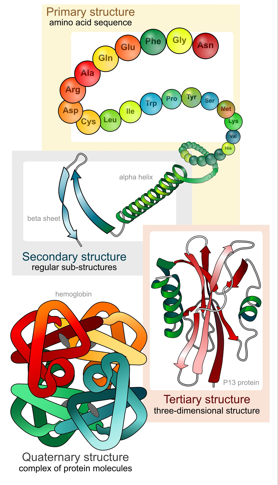

Figure 1.14: The primary, secondary, tertiary and quaternary levels of protein structure

**Role in animals and plants**

Proteins are important in several crucial biological functions. Proteins are found in hair, skin, bones, muscles, tendons, ligaments and other structures and perform key structural and mechanical functions. Proteins are also important in cell communication and in the immune system. Proteins can also act as an energy reserve when broken down through digestive processes. Each gram of protein can be broken down to release 17 kJ of energy. Certain proteins called ** enzymes ** are important in catalysing cellular reactions that form part of metabolism.

Proteins are essential to any diet. A lack of protein results in a disease called **kwashiorkor** (Figure 1.15) or **marasmus** (Figure 1.16). Marasmus is caused by a general nutritional deficiency (starvation), and kwashiorkor is caused by a deficiency in protein specifically.

| Figure 1.15: Child suffering from kwashiorkor | Figure 1.16: Child suffering from marasmus |
| --- | --- |

<Callout type="note" title="Note">
**Meat or vegetables: which is a better source of protein?**

Both animal protein and protein from vegetables is good for health. But each type comes with other nutrients. So which 'package' of nutrients-meat or vegetables is better for health?

- A 180 gram steak provides 40 g of protein BUT also provides 38 g of fat which is more than the Recommended Dietary Allowance
- The same amount of salmon gives 34 g of protein and 18 g of fat.
- A cup of cooked lentils has 18 g of protein and 1 g of fat.
</Callout>

**Test for proteins**

The **Biuret Test** for proteins using involves testing for the presence of the peptide bond. Biuret reagent is a copper-based reagent that turns purple when bound to protein in an alkaline solution (Figure 1.17). The more peptide bonds present, the greater the intensity of the purple colour, indicating a higher protein concentration.

The presence of protein can also be detected using **Millon's reagent**. Millon's reagent reacts with tyrosine amino acids, common to most proteins, and results in the formation of a reddish-brown precipitate when heated.

Table 1.5 below summarises the major tests and their expected results in the presence and absence of protein.

<Callout type="note" title="Note">
Watch a video demonstration of the Biuret test for protein.

<VideoPlayer src="https://youtu.be/ufec89A47uM" title="Video: 2CMT" />
</Callout>

| Test reagent | Positive result | Negative result |
| --- | --- | --- |
| Biuret reagent | Violet/purple colour | Blue colour |
| Millon's reagent | Red-brown colour | White colour |

Table 1.5: Observable colour changes when testing for the presence of protein.

## Test for the presence of proteins (Essential investigation-CAPS)

**WARNING: Millon's Reagent**

Millon's Reagent is wildly poisonous. Its use in the classroom is not encouraged unless no alternatives are available, or the teacher is confident of its use.

### Aim

To use the Biuret test or Millon's reagent to test for the presence of proteins.

### Apparatus

**Instructions on how to prepare Biuret Reagent Solution**

- Weigh 1.50 g of cupric sulfate pentahydrate with 6.0 g sodium potassium tartrate tetrahydrate.
- Dissolve in 500 ml of water.
- Add 300 ml of \(\text{10}\%\) NaOH.
- Make up to total volume of 1 liter.
- Store in a plastic bottle protected from light.

1. Bunsen burner and a beaker containing water
3. *or* water bath with hot water (50\(^{\circ}\) C)
5. Dropper or plastic pipette
7. Test tubes:
   - two with albumin solution (positive control)
   - two with sugar water (negative control)
   - test tubes with samples to be tested for the presence of protein
   - test tube with Millon's Reagent
   - test tube with solution for Biuret test

(** NOTE:** The Millon's Reagent and Biuret's solution in this experiment should be prepared for you by your teacher).

### Method

**Test for protein using Millon's reagent**

**WARNING! Millon's reagent is highly toxic! Avoid breathing in its fumes. **

1. Using the dropper or pipette, add a few drops of Millon's Reagent to the test tube containing albumin.
3. Using the dropper or pipette, add a few drops of Millon's Reagent to the test tube containing sugar water.
5. Using the dropper or pipette, add a few drops of Millon's Reagent to the test tube containing samples of your food to be tested.
7. Heat the mixtures in boiling water for 5 minutes.
9. Observe any colour changes.

**Test for protein using the Biuret test**

1. Using the dropper or pipette, add a few drops of the Biuret solution to the test tube containing albumin.
3. Using the dropper or pipette, add a few drops of the Biuret solution to the test tube containing sugar water.
5. Using the dropper or pipette, add a few drops of the Biuret solution to the test tube containing samples of your food to be tested.
7. Observe any colour changes.

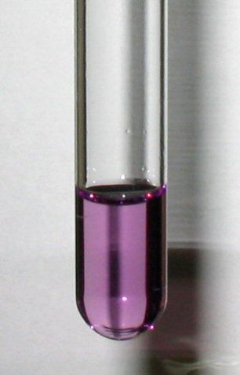

Figure 1.17: Biuret test: this is the expected colour change if protein is present

### Observations

Record your observations, noting any key differences between the positive control, negative control and experimental samples

**Observations: Millon's Reagent**

The albumen goes a brick red colour and becomes solid. The reddish colour indicates a positive protein test. The sugar water does not become red – it stays clear, indicating no proteins present. Any food samples that go reddish-brown when heated with Millons reagent also contain proteins.

**Observations: Biuret Test**

The albumen goes violet, indicating that proteins are present. The sugar water stays the blue colour of the copper sulphate that was added - it does not go violet, indicating no proteins present. Any food samples that go violet when the Biuret chemicals are added contain protein.

<Callout type="note" title="Note">
View a video demonstration of the experiment to test for proteins:

<VideoPlayer src="https://youtu.be/2IuN1SvHKM4" title="Video: 2CMV" />
</Callout>

### Enzymes (ESG4F)

Enzymes are protein molecules that help chemical reactions in living organisms to take place. The term enzyme has a specific meaning:
**an enzyme is a biological catalyst that speeds up the rate of a chemical reaction without being used up in the chemical reaction itself. ** Let us analyse this definition in greater detail.

<Callout type="note" title="Note">
Learn about what enzymes are and how they work.

<VideoPlayer src="https://youtu.be/smtCH5HX44o" title="Video: 2CMW" />
</Callout>

**Biological**: Enzymes are protein molecules which are made of long chains of amino acids. These fold into unique three-dimensional structures with a region known as an **active site** where reactions take place.

**Catalyst**: Enzymes speed up chemical reactions without being used up in the reaction themselves. All chemical reactions require a certain minimum amount of energy to take place. This energy is known as the **free energy of activation**. Enzymes lower the energy of activation thus speeding up chemical reactions (Figure 1.18).

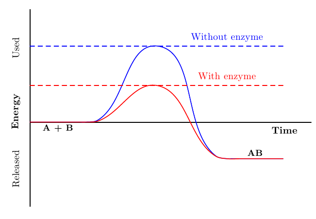

Figure 1.18: Enzymes lower the activation energy, thus making reactions occur faster.

**Enzymes are not consumed by the reactions they catalyse**: they do not alter the equilibrium of reactions, thus they catalyse both forward and reverse reactions. The direction in which a reaction proceeds is determined by concentration of the substrates and the products of the reactions.

Enzymes may be involved in reactions that break down or build up molecules. The breakdown reactions are known as **catabolic** reactions. The building up reactions are known as **anabolic** reactions.

**The `lock and key' model of enzyme action**

Enzymes are highly specific regarding the reactions they catalyse. The specificity depends on the bonds formed between the **active site** of an enzyme and its substrate. Active sites have a specific shape that allows binding of a very specific substrate. The highly specific nature of the enzyme-substrate binding has been compared to a "lock and key" with the enzyme as the 'lock' and the substrate as the 'key' (Figure 1.19). The substrate binds the active site to form an enzyme-substrate complex. The reaction takes place, then the product leaves the active site as it no longer fits the 'lock' in the same way as the substrate did. The enzyme remains unchanged.

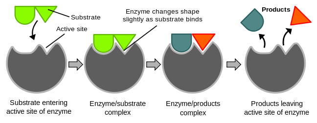

Figure 1.19: This diagram illustrates the `lock-and-key' model of enzyme action.

## Investigating how biological washing powders work (Essential investigation-CAPS)

### Aim

To test how enzymes in biological washing powders work.

### Apparatus

- two soft boiled eggs (hard boiled eggs contain denatured proteins that do not cause stains)
- two beakers
- biological washing powder (with enzymes)
- non-biological washing powder (older type of washing powder)
- water
- two measuring spoons

### Method

1. Label 3 beakers 'Bio', 'Non-Bio' and 'control' which will contain biological washing powder, non-biological washing powder and water (negative control) respectively.
3. In the beaker labelled 'Bio' dissolve \(\text{5}\) \(\text{g}\) of biological washing powder in \(\text{30}\) \(\text{ml}\) water.
5. In the beaker labelled 'Non-Bio' dissolve \(\text{5}\) \(\text{g}\) of non-biological washing powder in \(\text{30}\) \(\text{ml}\) water.
7. Pour \(\text{30}\) \(\text{ml}\) of tap water into the control beaker.
9. Scoop out a small amount of egg yolk.
11. Place a teaspoon with the egg yolk in each of the beakers.
13. Leave the spoons in the beakers for 1 to 2 hours.
15. Observe your results.

### Results

1. Write down your observations.
3. Suggest a reason for your observations.
5. Write a conclusion for the investigation.

**Results**

The egg yolk in the biological washing powder slowly dissolves off the spoon. The egg yolk in the non-biological washing powder partly lifts off the spoon, but does not break down and dissolve into the water. In the control beaker, there is no change – the egg yolk stays on the spoon.

**Reasons for observations**

The enzymes of the biological washing powder broke the egg yolk into smaller molecules that lift off the spoon and dissolve in the water. This did not happen in the non-biological powder or in the control.

**Conclusion**

Biological washing powders are better than non-biological washing powder at removing organic stains from clothing.

**Enzymes in everyday life**

The properties of enzymes to control reactions have been widely used for commercial purposes. Examples of some of these uses are listed below:

- **Biological washing powders** contain enzymes such as lipases (breaks down lipids) and proteases (breaks down protein), which assist in the breakdown of stains caused by foods, blood, fat or grease. These biological washing powders save energy as they are effective at low temperatures.
- **Meat tenderisers** contain enzymes which are obtained from fruits such as papaya or pineapple. When used in meat tenderisers these enzymes soften the meat.
- **Lactose-free milk** is manufactured primarily for people who are lactose intolerant. Lactose intolerant individuals lack the enzyme lactase that digests lactose (milk sugar). Lactose is pre-digested by adding lactase to the milk.

**Factors affecting enzyme action**

**1. Temperature**

In humans, enzymes function best at \(\text{37}\)\(\text{°C}\) (Figure 1.20). This is the optimum temperature. At very high temperatures proteins **denature**; this means that the hydrogen, hydrophobic and electrostatic interactions that result in the protein's three-dimensional shape break down, unravelling the protein into its primary structure, a long chain of amino acids. When a protein is denatured, the shape of its active site, as well as the rest of the protein shape is altered. The substrate can no longer fit in the active site of the enzyme and chemical reactions cannot take place. Low temperatures can slow down or even inactivate enzymes, as low temperature means less available kinetic energy, so that even the lower energy of activation that the enzyme allows is not available. The first graph shows the effect of temperature on enzyme activity.

**2. pH**

Enzyme activity is sensitive to pH. Enzymes have an optimum pH as shown on the graph, but they can function effectively within a pH range. The effectiveness of the enzyme falls sharply when the pH is outside its optimum range. An enzyme can become denatured when exposed to a pH outside its pH range, as pH affects the charge on some amino acids, and therefore affects the electrostatic interactions holding the tertiary structure together. The second graph shows the effect of pH on enzyme activity.

<Callout type="note" title="Note">
The optimal pH and temperature for an enzyme will be determined by the kind of living thing it is found in. The enzymes in the human body have an optimum temperature of 37 °C. Bacteria that live in compost heaps have enzymes with an optimal range in the 40's, and bacteria called hyperthermophiles (lovers of very high temperatures) that live in hot springs have enzymes with optimum temperatures above 80 °C.
</Callout>

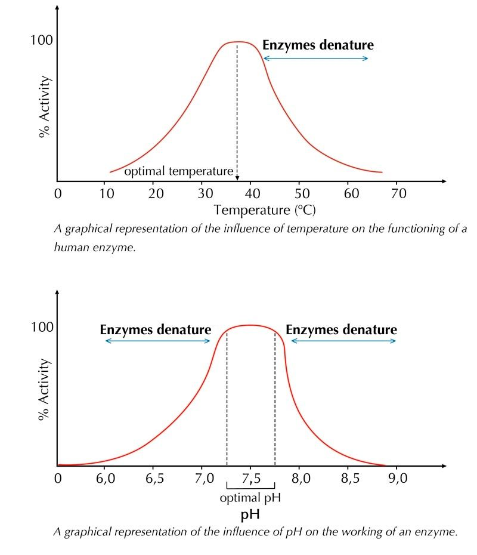

Figure 1.20: Graphs showing the effect of temperature and pH on enzyme activity respectively.

In the investigation that follows, the effect of temperature on catalase enzyme activity will be investigated. Hydrogen peroxide is potentially toxic and so living tissues contain an enzyme named catalase to break it down into non-toxic compounds, namely water and oxygen. You  will study the effect of the enzyme catalase on the breakdown of hydrogen peroxide. You will further examine  the effect of pH and temperature on enzyme activity.

## Investigating the effect of catalase from chicken liver on hydrogen peroxide (Essential investigation-CAPS)

### Aim

To demonstrate the effect of catalase on hydrogen peroxide.

### Apparatus

- 10 ml measuring cylinders
- pipette
- \(\text{3}\%\) Hydrogen peroxide solution
- scalpel
- forceps
- balance
- chicken liver at room temperature
- boiled chicken liver
- frozen chicken liver
- stirring rod

### Method

Follow the instructions below:

- Cut two square pieces weighing 0.1 g from the fresh liver sample and place each in a separate 10 ml measuring cylinder.
- Use a clean measuring cylinder to measure 3 ml water. Pour into one of the fresh liver-containing cylinders. This is your negative control.
- Use a clean measuring cylinder to measure 3 ml hydrogen peroxide. Pour into the remaining fresh liver-containing cylinder. This is your positive control.
- Wait for four minutes and then measure and record the height of the resulting oxygen bubbles in each cylinder.

### Questions

1. Name the three variables that must remain stable throughout these experiments and explain why they must be kept stable.
3. What kind of reaction is taking place?
5. How could you make this experiment more accurate?
7. In addition to temperature, what other factors influence the rate of reaction?

**Answers**

1. Factors kept the same: [any three of the following]
   - Use the same amount of chicken liver in each measuring cylinder to control the amount of enzyme present.
   - Use 3 ml of water and 3 ml of hydrogen peroxide in the two different cylinders to keep the amount of liquid constant.
   - Give the two cylinders the same amount of time for the reaction to occur, so that the bubble columns can be compared reliably.
   - The contents of both measuring cylinders must be at the same temperature, so that temperature doesn't interfere with the reaction being investigated.
3. This is a catabolic / breakdown reaction, since the hydrogen peroxide is broken down into oxygen (the bubbles) and water (the fluid left behind). The reaction is also exothermic, as the measuring cylinder got hot – heat was released during the reaction.
5. Improving accuracy:
   - Pour the liquid into both cylinders at exactly the same time.
   - Measure the amount of chicken liver more accurately.
   - It should be possible to calculate the volume of oxygen released by passing it through water and calculating the volume of oxygen more accurately by using the displacement principal. In the current method, some of the oxygen escaped into the air when the bubbles burst, so the height measurement is an approximation of the volume of oxygen released.
7. Other factors influencing the rate of reaction:
   - The amount of enzyme in the liver.
   - The amount of substrate available.
   - The pH of the medium.
   - The condition of the chicken liver – if not fresh, some of the enzymes may be inactive.
   - The temperature of the liver and liquid.

<Callout type="note" title="Note">
What are the best conditions for catalase enzyme? What happens when an enzyme or living tissue is put in hydrogen peroxide? Find out in this video.

<VideoPlayer src="https://youtu.be/bBd0Fdk8adA" title="Video: 2CMX" />
</Callout>

## Investigating the effect of catalase from chicken liver on hydrogen peroxide - PART B

### Aim

To demonstrate the effect of temperature on catalase activity.

### Method

- Add 3 ml of hydrogen peroxide to three separate 10 ml graduated measuring cylinders. Mark one cylinder "frozen chicken liver"; the second "boiled chicken liver" and the third "room temperature chicken liver".
- Cut a 0.1 g square from each of the frozen and boiled and room temperature chicken livers. Add the liver pieces to the correspondingly labelled measuring cylinder with hydrogen peroxide in it.
- Leave the pieces of liver for four minutes and measure the height of bubbles produced.

### Questions

1. Give reasons for the differences observed across the three measuring cylinders.
3. Name the dependent and independent variables in this experiment.
5. How could you make this experiment more accurate?
7. What would you conclude from your observations?

**Answers**

1. The liver at room temperature reacts very quickly and produces a large amount of large, frothy white bubbles, because the enzymes are very active – they are close to their optimum temperature and easily break down the hydrogen peroxide into  water and oxygen. The liver that was frozen reacts very slowly at first and forms very few bubbles, since the enzymes are inactive at such low temperatures – they lack activation energy. As the reaction releases heat, the enzyme speeds up a little later and forms bigger bubbles at a faster rate, but never as fast as the one at room temperature. The liver that was boiled does not show any reaction – no bubbles are formed, because the enzymes were denatured by boiling. Their shape was changed and they cannot catalyse the reaction at all.
3. - The dependent variable is the speed of the reaction, i.e. the amount of oxygen formed, which was measured as the height of the bubble column.
   - The independent variable is temperature – liver was at room temperature or frozen or boiled.
5. - Measure the amount of liver and the volume of the hydrogen peroxide more precisely and keep them exactly the same.
   - Ensure that all 3 measuring cylinders are identical – the same width.
   - Pour the hydrogen peroxide into the cylinders at exactly the same time.
   - Trap the amount of oxygen released and use the displacement principal to calculate the volume of gas more accurately.
7. Temperature has an effect on enzyme activity. Enzymes are most active at a temperature close to their optimum temperatures, but they denature and cannot function if the temperature is too high. At very low temperatures, enzymes cannot function effectively due to a lack of activation energy – they work very slowly.

### Nucleic acids (ESG4G)

Nucleic acids, such as DNA and RNA, are large organic molecules that are key to all living organisms. The building blocks of nucleic acids are called **nucleotides**. Each nucleotide is made up of a sugar, a phosphate and a nitrogenous base. Nucleotides are joined together by **phosphodiester** bonds, which join the phosphate of one nucleotide to the sugar of the next. The phosphate-sugar-phosphate-sugar strands form a "backbone" upon which the nitrogen-containing bases are exhibited. Nucleic acids are therefore **polymers** made up of many nucleotides. DNA is a double-stranded polymer, due to hydrogen bonding between the nitrogenous bases of two complementary strands. RNA is a single-stranded polymer. Nucleic acids do not need to be obtained from the diet because they are synthesised using intermediate products of carbohydrate and amino acid metabolism.

Nucleic acids include:

- Deoxyribonucleic acid (**DNA**): which contains the 'instructions' for the synthesis of proteins in the form of genes. DNA is found in the nucleus of every cell, and is also present in smaller amounts inside mitochondria and chloroplasts.
- Ribonucleic acid (**RNA**): is important in transferring genetic information from DNA to form proteins. It is found on ribosomes, in the cytoplasm and in the nucleus.

<Callout type="note" title="Note">
DNA can also be found inside chloroplasts and mitochondria.
</Callout>

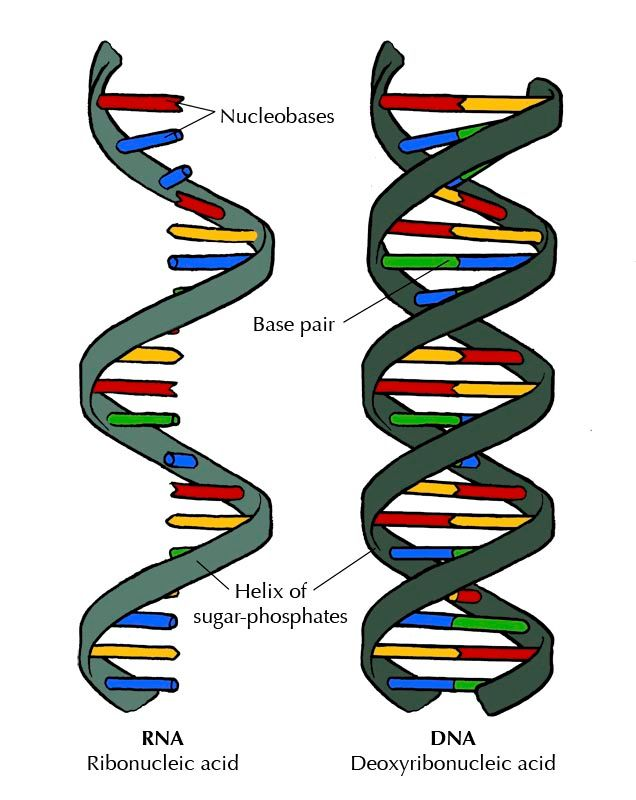

Figure 1.21: Schematic diagram of DNA and RNA: DNA is double stranded and RNA is single-stranded.

<Callout type="tip" title="Note">
The structure and function of the nucleus will be explained in details in the next chapter: **The basic units of life**.
</Callout>
