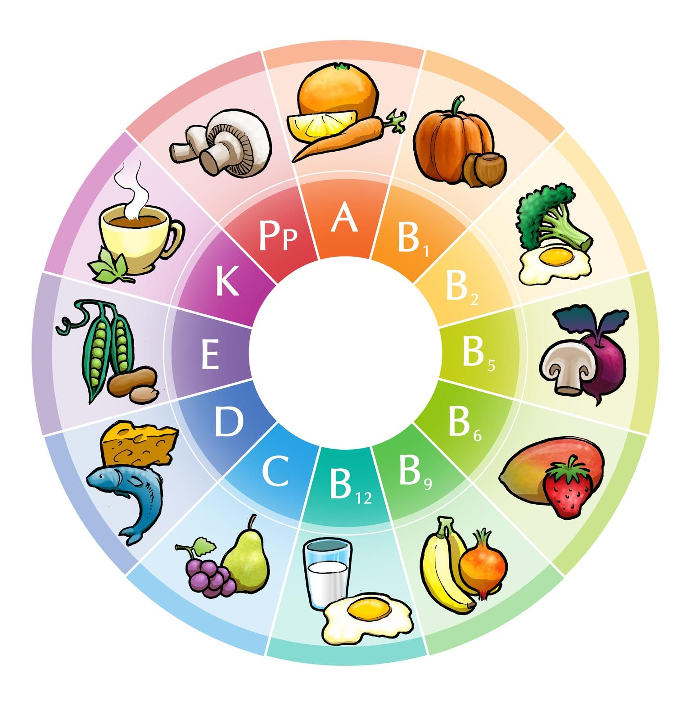

## 1.5 Vitamins (ESG4H)

This section should be linked to the digestive system and healthy diet that were covered in Grade 9 Natural Sciences.  Vitamins are organic compounds required by organisms as vital nutrients in limited amounts. Vitamins are therefore essential to a balanced diet. The sources, functions and deficiency diseases of the main vitamins should be revised.

Vitamins are organic compounds required by organisms as vital nutrients in limited amounts. Vitamins are therefore essential to a balanced diet. Vitamins have a variety of functions in the body. Some vitamins are coenzymes, which means that they help enzymes to catalyse a reaction efficiently. Some are responsible for regulating metabolism or act as regulators of cell and tissue growth and differentiation.

| Vitamin | Role | Food sources | Deficiency disease |
| --- | --- | --- | --- |
| Vitamin A | Needed for proper functioning of eyes | liver, carrots, egg | night blindness |
| Vitamin B (A group of vitamins with related functions) | Carbohydrate, protein, lipid, nucleic acid and alcohol metabolism; neurotransmitter synthesis and nerve function; red blood cell production | grains, potatoes, bananas | B1- beriberi, B3- pellagra, B6, B9, B12- anaemia |
| Vitamin C | Involved in iron metabolism; plays a role in the immune system; helps with the formation of collagen for wound repair | citrus fruit (oranges, lemons etc), tomatoes | scurvy (results in bleeding gums) |
| Vitamin D | Important in absorption of minerals from the gut (such as calcium and phosphate); works together with calcium and phosphorus in bone / teeth hardening | full cream milk, oily fish | rickets (resulting in soft bones, with bowed legs and widened wrists) |
| Vitamin E | Acts as an anti-oxidant | margarine, soybean oil, fortified cereals, condensed cow's milk, cheese, orange juice | depressed immune system, anaemia, poor nerve conduction |

Figure 1.22: Sources of essentials vitamins.
