## End of chapter exercises

### Exercise 1.1

**Problem:**
Which one of the following is not a biological role of water?

1. prevents deficiency diseases
3. dissolves biochemical compounds
5. provides a medium in which chemical reactions take place
7. involved in the hydrolysis of foodstuffs

**Solution:**
prevents deficiency diseases

**Problem:**
Which combination of the following substances is best to prevent rickets?

1. magnesium, phosphorus and carrots
3. phosphorus, calcium and fish liver oil
5. iron, calcium and liver
7. iodine, iron and oranges

**Solution:**
phosphorus, calcium and fish liver oil

**Problem:**
The diagram below is a **schematic drawing**, which means that the molecules represented may not resemble their actual chemical shape. Use the information provided in the diagram to answer the following questions:

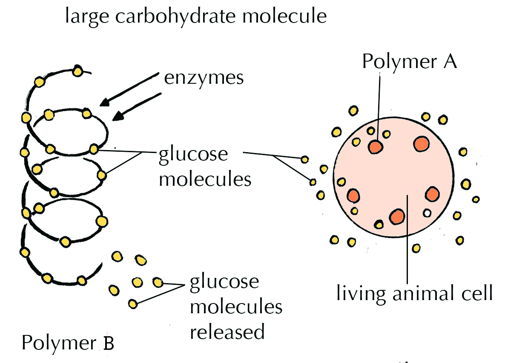

1. What is the polymer A that is found in an animal cell?
3. What is the function of polymer A in the body?
5. What could polymer B be?

**Solution:**
1. Glycogen.
3. Glycogen is an energy storage molecule.
5. Polymer B is starch.

**Problem:**
The table below gives nutrients present in various dry seeds.

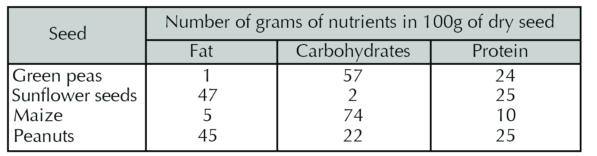

The following histogram shows the different amounts of nutrients found in one of the four seeds.

The chart shows the nutrients found in:

1. green peas
3. sunflower seeds
5. maize
7. peanuts

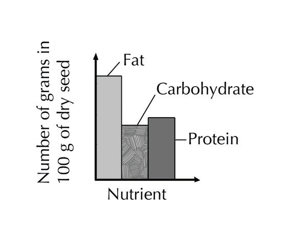

**Solution:**
peanuts

**Problem:**
The graph below illustrates that enzymes:

1. are pH-specific
3. catalyses a specific substrate
5. are denatured at high pH
7. are sensitive to low pH

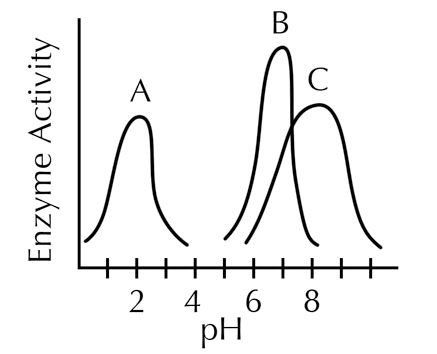

**Solution:**
are pH-specific

**Problem:**
The following diagrams show the enzyme lock-and key method of action.

Label each of the letters.

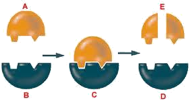

**Solution:**
- **A: **substrate
- **B: **enzyme
- **C: **enzyme-substrate complex
- **D: **enzyme
- **E: **products

**Problem:**
Explain briefly how you would test for glucose.

**Solution:**
Cut or crush the food or substance to be tested to expose a large surface area for the reaction. Add water to make a liquid medium. Add a few drops of Benedict's solution (or Fehling's solution) and heat it over a Bunsen burner or in a water bath. Watch whether colour changes occur.

Study the graph below. The graph shows total protein (in grams) present in a 100 grams of different food items. Use the graph to answer questions below.

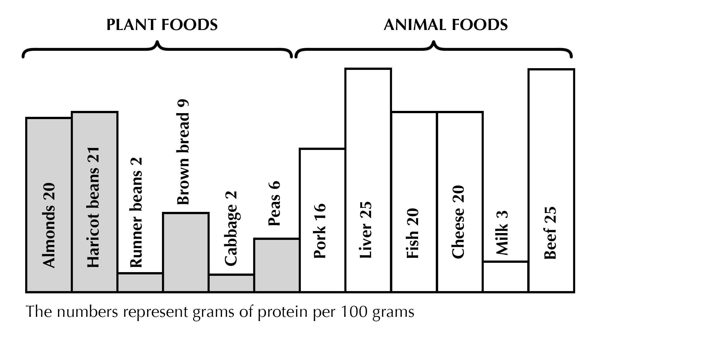

**Problem:**
Name the two foods from which vegetarians would obtain the most protein.

**Solution:**
Almonds and haricot beans

**Problem:**
Which foods contains only \(\text{2}\%\) protein?

**Solution:**
Runner beans and cabbage

**Problem:**
Which food would be the best for a non-vegetarian person who is suffering from kwashiorkor and anaemia?

**Solution:**
Liver and beef

**Problem:**
Name and explain the process which proteins undergo when heated excessively.

**Solution:**
Denaturing – the bonds holding the enzyme in the correct shape break down and the shape of the active site changes – the enzyme is no longer complementary to the substrate and can’t fit onto it, so it can’t catalyse the reaction.

Study the information in the following diagrams and the table below, for three different meals X, Y and Z.

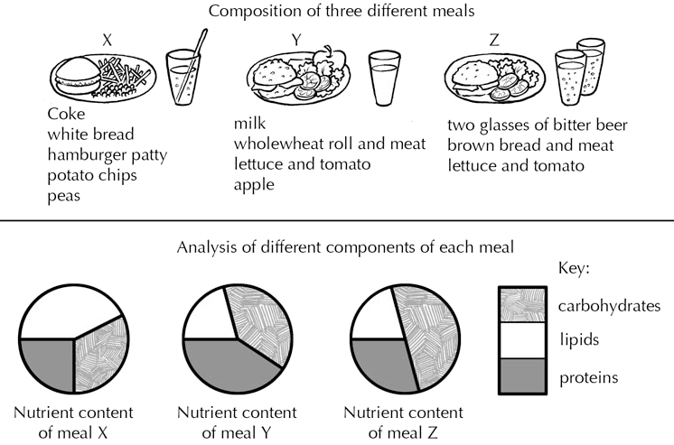

| Meals | Energy (in \(\text{kJ}\)) | Vitamin C (in \(\text{mg}\)) | Calcium (in \(\text{mg}\)) |
| --- | --- | --- | --- |
| X | \(\text{2 900}\) | \(\text{25}\) | \(\text{70}\) |
| Y | 2100 | 47 | 265 |
| Z | \(\text{2 600}\) | 40 | 170 |

**Problem:**
Name three polysaccharide carbohydrates in meal X.

**Solution:**
Starch, cellulose, glycogen (in the meat patty).

**Problem:**
Giving one reason for each answer, which meal will:

1. provide the greatest source of energy?
3. be most suitable for the development of healthy bones and teeth?
5. be least suitable for people who are prone to scurvy?

**Solution:**
1. Meal X, because it has the highest total amount of kilojoules (2900 kJ).According to the pie charts, the high energy content is due to its high lipid and carbohydrate content.
3. Meal Y, due to the calcium in the milk (265 mg according to the table).
5. Meal X,  because it doesn’t have tomato, which is a source of Vitamin C - the other 2 meals have tomato. (It has the least amount of vitamin C (70g) according to the table).

**Problem:**
Meal Z is relatively low in lipids (fat) yet high in energy content.

Which of the food components in Z provides the energy?

**Solution:**
Brown bread and bitter beer

**Problem:**
Which of the three meals can be regarded as the healthiest?

Give three reasons for your answer.

**Solution:**
Meal Y.

- It is the lowest in kilojoules, and therefore is unlikely to lead to weight gain.
- It has an excellent ratio of carbohydrates: fat: protein.
- It has the highest concentration of calcium, due to the milk, rather than beer or Coke, as in the other 2 meals.
- It has lettuce, tomato and apple, which contain many vitamins, and result in it having the highest concentration of vitamin C.
- It also has a wholewheat roll, which takes longer to break down to sugar than white bread or coke in the other meals.
- The wholewheat roll and lettuce, tomato and apple contain cellulose, which acts as roughage.

Any other logical answer.

The following information (given in the table below) appeared on a box of breakfast cereal. Use this information in the table to assist you in answering the questions that follow.

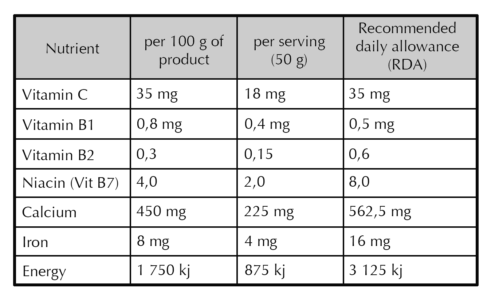

**Problem:**
How many servings does a person need to provide the RDA of energy?

**Solution:**
\(\text{3,6}\) servings

(3125 / 875)

**Problem:**
Which organic compounds are the most important energy providers?

**Solution:**
Lipids and carbohydrates

**Problem:**
How much energy do the vitamins in the cereal provide?

**Solution:**
None – vitamins are not a source of energy.

**Problem:**
What deficiency disease could result if a person does not obtain adequate amounts of vitamin B1?

**Solution:**
Beri Beri

**Problem:**
Explain the role of iron in the diet.

**Solution:**
Iron is essential for the formation of haemoglobin in red blood cells. It is also part of the structure of some proteins.

**Problem:**
Consider the RDA of energy (\(\text{3 125}\) \(\text{kJ}\)). Do you think this amount is realistic for your requirements? Explain your answer.

**Solution:**
No. Young adults need more energy than \(\text{3 125}\) \(\text{kJ}\). According to the RDA, young adults need at least:

- Carbohydrates: \(\text{230}\) \(\text{g}\) x 17 kJ/g = \(\text{3 910}\) \(\text{kJ}\)
- Protein: approximately \(\text{50}\) \(\text{g}\) x 17 kJ/g = \(\text{850}\) \(\text{kJ}\)
- Fat: \(\text{70}\) \(\text{g}\) x 38 kJ/g = \(\text{2 260}\) \(\text{kJ}\)

**TOTAL: **\(\text{7 020}\) \(\text{kJ}\)

The histograms below show the percentage of carbohydrates, fats, proteins and water in eight types of foods.

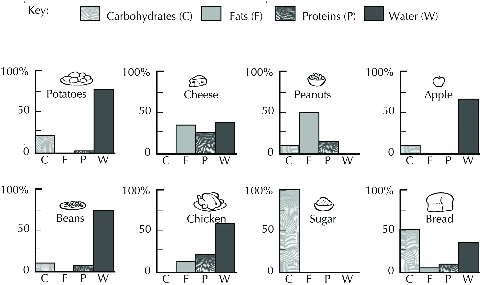

From the information provided in the histograms above, name two types of food that:

**Problem:**
Contain more than \(\text{25}\%\) of a nutrient that is involved in the formation of an insulating layer

**Solution:**
Cheese and peanuts

**Problem:**
Would best help to prevent kwashiorkor

**Solution:**
Cheese and chicken

**Problem:**
Will form only monosaccharides and amino acids after digestion

**Solution:**
Potato and beans

**Problem:**
Are not involved in the formation of cell membranes

**Solution:**
Apples and sugar

**Problem:**
Contain more than \(\text{50}\%\) of a nutrient which is the primary source of energy

**Solution:**
Sugar and bread

The diagram shows the apparatus used in various organic food tests. Study it and answer the questions that follow:

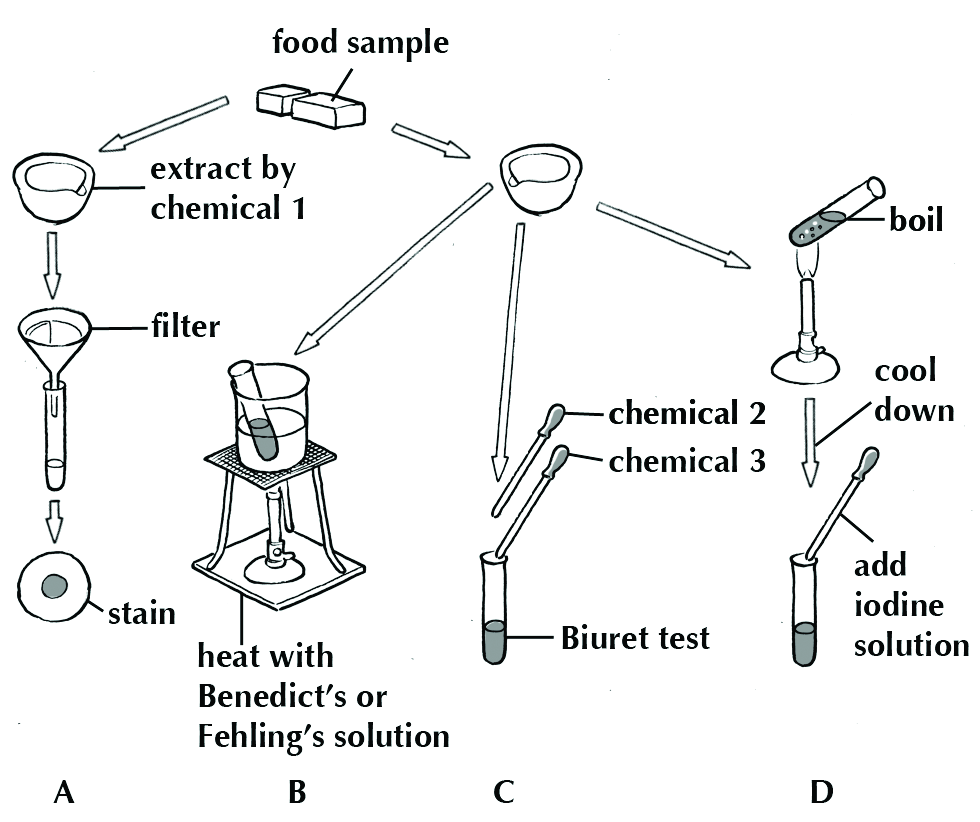

**Problem:**
Name the nutrients tested for in each of the experiments numbered A, B, C and D.

**Solution:**
- **A:**Fat/ lipids
- **B:**Glucose or reducing sugar
- **C:**Protein
- **D:**Starch

**Problem:**
Identify the chemicals numbered 1, 2 and 3.

**Solution:**
- **1: **ethanol
- **2: **Copper sulfate
- **3: **NaOH (sodium hydroxide)

**Problem:**
State the colour change for a positive reaction in each of the test tubes used in the experiments numbered B, C and D.

**Solution:**
- **B:** blue to brick red.
- **C:** blue to lilac through rose pink.
- **D:** brown/ orange to purple/ black.

**Problem:**
Identify each of the compounds A, B and C. In each case give a reason for your answer.

Which compound (A, B or C)

1. serves as a main source of energy in cellular respiration
3. is most likely to form part of an enzyme

**Solution:**
1. B
3. C

**Problem:**
The figure below shows the differences between the upper and lower basin of a water body.

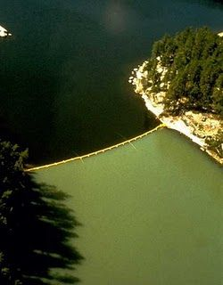

1. What has caused the key differences between the upper and lower basin?
3. What could have been added to the water in the lower basin to cause it to look milky-green?

**Solution:**
1. The lower basin has undergone eutrophication.
3. Fertilizers may have been added to the lower basin, causing it to turn milky-green from eutrophication .
