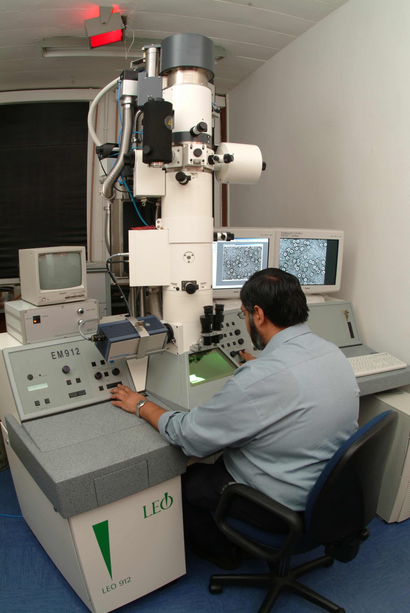
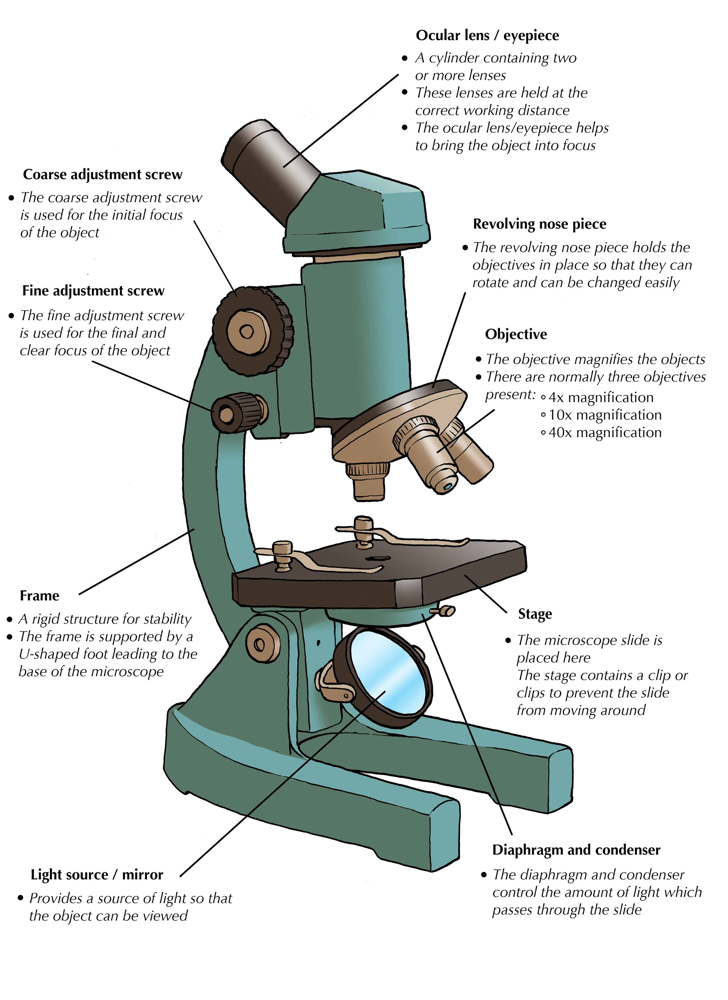
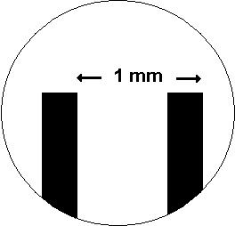
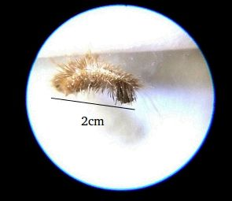
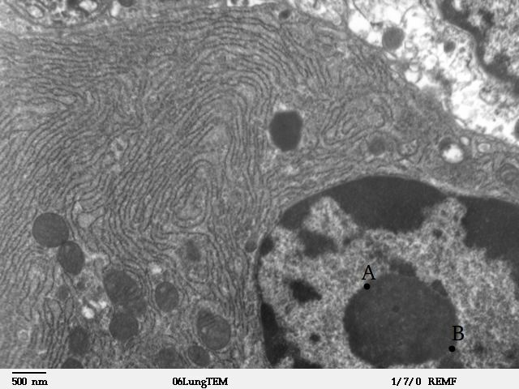

## 2.2 Molecular make up of cells (ESG4P)

**Section 2: Molecular make up of Cells**

The practical Life Science techniques are an important part of the Life Science assessment program. This section addresses some of these important skills. Learners are introduced to the various microscopes and this enables the skills of drawing, labelling and annotating diagrams and micrographs, using microscopes as well as calculating magnification of cells. (This will be covered later in this Chapter).

Cells are the basic structural and functional units of all living organisms. Cells are made up of the compounds you learnt about in the previous chapter: carbohydrates, fats, proteins, nucleic acids and water. The word 'cell' was first used by the 17th century scientist Robert Hooke to describe the small pores in a cork that he observed under a microscope. Cells are very small structures. The human body is made up of \(\text{10}^{\text{13}}\) cells. Each of these is too small to see with the human eye and it is through the development of microscopic techniques that we have been better able to visualise and understand them.

### Microscopy (ESG4Q)

Early attempts to magnify images of objects through grinding of glass lenses eventually gave rise to the earliest microscope. In 1600, Anton van Leeuwenhoek, a Dutch microbiologist used a simple microscope with only one lens to observe blood cells. He was the first scientist to describe cells and bacteria through observation under microscope. By combining two or more lenses, the magnification of the microscopes was improved, thus allowing scientists to view smaller structures.

The **dissecting microscope** is an optical microscope used to view images in three dimensions at low resolution. It is useful for low-level magnification of live tissue. The development of the **light microscope**, (Figure 2.5) which uses visible light to magnify images allowed for up to 1000X magnification of objects through which scientists were able to view individual cells and internal cell structures such as the cell wall, membrane, mitochondria and chloroplasts. However, although the light microscope allowed for 1000X magnification, in order to see even smaller structures such as the internal structure of organelles, microscopes of greater resolving power (with up to 10 000X magnification) were required.

With the development of **electron microscopes** the microscopic detail of organelles such as mitochondria and chloroplasts became easier to observe. The **Transmission Electron Microscope** (TEM) was developed first, followed by the **Scanning Electron Microscope** (SEM). TEM is used to view extremely thin sections of material. Beams of electrons pass through the material and are focused by electromagnetic lenses. In SEM the electrons are bounced off the surface of the material and thus produce a detailed image of the external surface of the material. They produce a 3D image by picking up secondary electrons knocked off the surface with an electron collector. The image is then amplified and viewed on a screen. Examples of each of the image types produced by these microscopes are given in Figures Figure 2.1 to Figure 2.3.

<Callout type="note" title="Note">
Sections for TEM have to be so thin that they have to be prepared using a special piece of equipment called an ultramicrotome.
</Callout>

| The world through a microscope |
| --- |
| SEM : A natural community of bacteria growing on a single grain of sand. | SEM : These pollen grains show the characteristic depth of field of SEM micrographs. | TEM : Image of chloroplast, showing thylakoid discs within a eukaryotic cell. |

<Callout type="note" title="Note">
Transmission electron microscopes can magnify an image 50 million times.

Figure 2.4: Transmission electron microscope in use.
</Callout>

The apparatus most commonly used in lab microscopy exercises is a simple light microscope. Table 2.1 shows an annotated diagram of a light microscope  with a description of the function of each part. The main parts are described in the table that follows and the function of each part is explained.

Figure 2.5: Light microscope

| Part of the microscope | Description |
| --- | --- |
| Ocular lens/ eyepiece | - A cylinder containing two or more lenses. - These lenses are held at the correct working distance. - The ocular lens/eyepiece helps to bring the object into focus. |
| Revolving nose piece | The revolving nose piece holds the objectives in place so that they can rotate and can be changed easily. |
| Objective | The objective magnifies the objects. There are normally three objectives present: 4X magnification 10X magnification 40X magnification |
| Coarse adjustment screw | The coarse adjustment screw is used for the initial focus of the object. By moving the stage up and down, bringing the object closer to or further away from the objective lens. |
| Fine adjustment screw | The fine adjustment screw is used for the final and clear focus of the object. |
| Frame | - A rigid structure for stability. - The frame is supported by a U-shaped foot leading to the base of the microscope. |
| Light source / mirror | - Provides a source of light so that the object can be viewed. |
| Diaphragm and condenser | The diaphragm and condenser control the amount of light which passes through the slide. |
| Stage | - The microscope slide is placed here. - The stage contains a clip or clips to prevent the slide from moving around. - There is a hole in the stage which allows light through. |

Table 2.1: The parts of a microscope.

<Callout type="note" title="Note">
The ocular, rotating nosepiece and objectives are held above the stage by the arm.
</Callout>

**How to use a microscope correctly**

1. When handling or carrying the microscope, always do so with both hands. Grasp the arm with one hand and place the other hand under the base for support.
3. Turn the revolving nosepiece so that the lowest power objective is in position.
5. Place the microscope slide on the stage and and fasten it with the stage clip(s).
7. Look through the eyepiece and adjust the diaphragm for the greatest amount of light.
9. While looking at the slide on the stage from the side, turn the coarse adjustment screw so that the stage is as close to the objective lens as possible. **WARNING: Make sure you do not touch or damage the slide.**
11. Slowly turn the coarse adjustment screw until the image comes into focus.
13. Now use the fine adjustment screw to move the stage downwards until the image is clearly visible. **Never move the lens towards the slide. **
15. You can readjust the light source and diaphragm for the clearest image.
17. When changing to the next objective lens use the fine adjustment screw to focus the image.** WARNING: Never use the coarse adjustment screw for the strongest objective lens.**
19. Do not touch the glass part of the lenses with your fingers.
21. When finished, move the stage and objective as far away from each other as possible and remove the slide.
23. Disconnect the power source and cover the microscope.
25. Carry the microscope by holding it firmly by the "arm" and "base" and when walking it should be near your chest.

<Callout type="note" title="Note">
Remember that microscopes are expensive scientific equipment and need to be handled with care to prevent damaging them. Proper lens paper should be used when cleaning dust or dirt off any lenses. Avoid getting moisture on the objective lenses. Dust and moisture are the biggest enemies of microscopes.
</Callout>

<Callout type="warning" title="Note">
If using a mirror for illumination instead of a light bulb, never reflect direct sunlight as you could damage your eyes.
</Callout>

**Differences between the light microscope and transmission electron microscope**

| Property | Light Microscope | Transmission Electron Microscope |
| --- | --- | --- |
| Source | Light | Beam of electrons |
| Resolution (how far apart two objects must be in order to be distinguished as separate) | Under optimal conditions (clean lenses, oil immersion), the resolution is \(\text{0,2}\) micrometres or 2 thousands of a millimetre | Resolution of a transmission electron microscope is about \(\text{0,05}\) nanometres (\(\text{nm}\)) which is about \(\text{0,5}\) millionth of a millimetre. This means that a transmission electron microscope has about \(\text{10 000}\) times the resolving power of a light instrument |
| Material (alive/ dead) | Alive or dead. Bright field or phase contrast microscopes enable viewer to observe living cells. Specimens need to be stained. | Dead. Electron microscope images are produced by passing an electron beam through tissues stained with heavy metals. |
| Example of microscope image | Bacterial spores as seen under light microscope. | Chlamydomonas reinhardtii , a single celled green algae, as seen under the transmission electron microscope. |

### Calculating magnification (ESG4R)

Microscopes magnify an image using a lens found in the eye-piece, which is also known as the **ocular lens.** The image is further magnified by the **objective** lens. Thus the magnification of a microscope is: **magnification power of the eye-piece x the power of the objective lens**

** Example:** if the eyepiece magnification is 5X and the objective lens' magnification is 10X, the image of the object viewed under the microscope is 50X bigger than the object:

\begin{align*}
          \text{overall magnification} &= \text{power of eyepiece} \times \text{power of objective} \\
                                   &= 5 \times 10  \\
                       &= 50 \times \text{the original size}
\end{align*}

**Calculating the field of view**

When viewing an object through a microscope, the diameter of the circle through which you view the object is known as the **field of view.**

**As the magnification increases, the field of view decreases. **

To measure the field of view, use a microscope slide with a tiny ruler printed on it. For example, the size of the field of view shown below under low power magnification is approximately 1 mm.

Figure 2.6: Field of view is approximately 1 mm.

Once the size of the field of view is known, we can estimate the size of the objects being viewed under the microscope. At 10 X magnification, the field of view is \(\text{1,0}\) mm. If the magnification is increased to 100 X, what will the new field of view be?

\(\text{1,0}\) mm at 10 X magnification

\[\text{new field of view} = \frac{\text{current magnification}}{\text{new magnification}} \times \text{current field of view}\]

\(x\) mm at 100 X magnification

\begin{align*}
\text{new field of view} &= \frac{\text{current magnification}}{\text{new magnification}} \times \text{current field of view} \\
x &=\frac{10}{100} \times \text{1,0}\text{ mm} \\
&= \text{0,1}\text{ mm}
\end{align*}

If magnification is increased 10-fold, the field of view will decrease 10-fold. Thus it will become 0.1 mm. What this means is that at higher magnification, we are able to see objects of smaller and smaller size within our field of view. This is why at higher magnification, the field of view becomes smaller.

At 500 X magnification, the field of view of a microscope is \(\text{0,05}\) mm. What will the field of view be at 100X magnification?

\begin{align*}
  x &=\frac{500}{100} \times \text{0,05}\text{ mm} \\
&= \text{0,25}\text{ mm}
\end{align*}

**Calculating magnification and using scale bars **

When drawing cells or cellular structures, your diagrams will usually be much larger than the actual size of the structures you will be drawing. The magnification is given by:

\[\text{magnification} = \frac{\text{drawing size}}{\text{actual size}}\]

When a scale bar is provided with the diagram, the magnification is given by:

\[\text{magnification} = \text{drawing size} \times \frac{\text{scale given}}{\text{measured length of scale}}\]

<Callout type="tip" title="Worked example 1: Calculating overall magnification">
**Question:**
Calculate the overall magnification of a compound light microscope with a magnification of 10 X due to the eyepiece and a magnification of a 100X due to the objective lens.

Using the formula:

\begin{align*}
          \text{overall magnification} &= \text{power of eyepiece} \times \text{power of objective} \\
                                   &= 10 \times 100  \\
                       &= 1000 \times \text{the original size}
\end{align*}
</Callout>

<Callout type="tip" title="Worked example 2: Calculating size of object from its microscopic image">
**Question:**
If the measured length of the magnified beetle larva image shown below was 2 centimetres (20 mm), the ocular magnification of the microscope is 5 X and you are using an objective lens magnification of 10 X, what is the actual length of the larva in millimetres?

Figure 2.7: A beetle larva as seen under a light microscope.

**Calculate the total magnification:**
Use the same formula as above

\begin{align*}
          \text{overall magnification} &= \text{power of eyepiece} \times \text{power of objective} \\
                                   &= 5 \times 10  \\
                       &= 50 \times \text{the original size}
\end{align*}

**Now calculate the size of the object:**
If the image is 50 X larger than the object, what is the size of the object? Calculate this by simple proportion given in the formula below.

\begin{align*}
          \text{Size } &=  \frac{\text{size of image}}{\text{overall magnification}}\\
            &= \frac{\text{20}\text{ mm}}{50} \\
               &= \text{0,4}\text{ mm}
    \end{align*}
</Callout>

<Callout type="tip" title="Worked example 3: Calculating actual size given of a structure given scale bar on an image">
**Question:**
Calculate the actual length of AB from the image shown in the micrograph given with the scale bar given below.

Figure 2.8: Electron micrograph showing rough endoplasmic reticulum with a scale bar given

**Measure the length AB shown in the diagram:**
This should be approximately \(\text{20}\) \(\text{mm}\)

**Work out the length AB:**
Given that the measured length of the scale bar is approximately \(\text{5}\) \(\text{mm}\), work out the length AB:

\begin{align*}
          \text{Size} &=  \frac{\text{length of AB on diagram}}{\text{measured length of scale bar}} \times \text{number on scale bar}\\
            &= \frac{\text{20}\text{ mm}}{\text{5}\text{ mm}} \times {\text{500 nm}} \\
               &= \text{2 000}\text{ nm} \\
           &= \text{2}\text{  µm}
\end{align*}
</Callout>

**Activity 3.2: Investigation of cell size**

Learners to be given photomicrographs to practice this exercise.

**Activity 3.3: Drawing diagrams of scale**

Learners to prepare slides to view under the microscope. Using the skills from the previous activity they are to do cell calculations.
