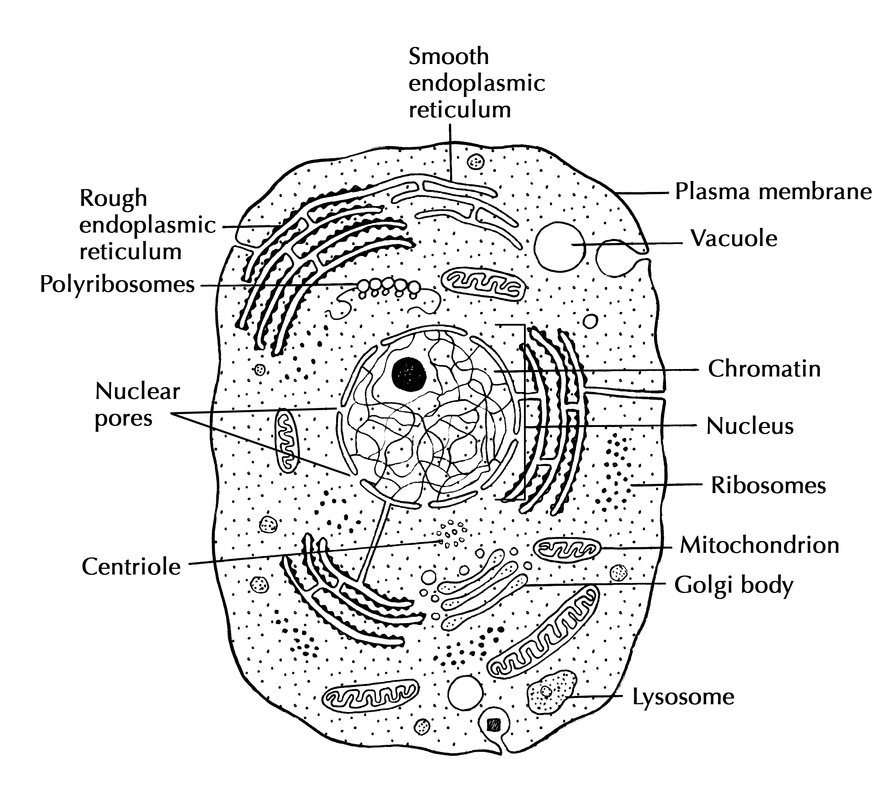
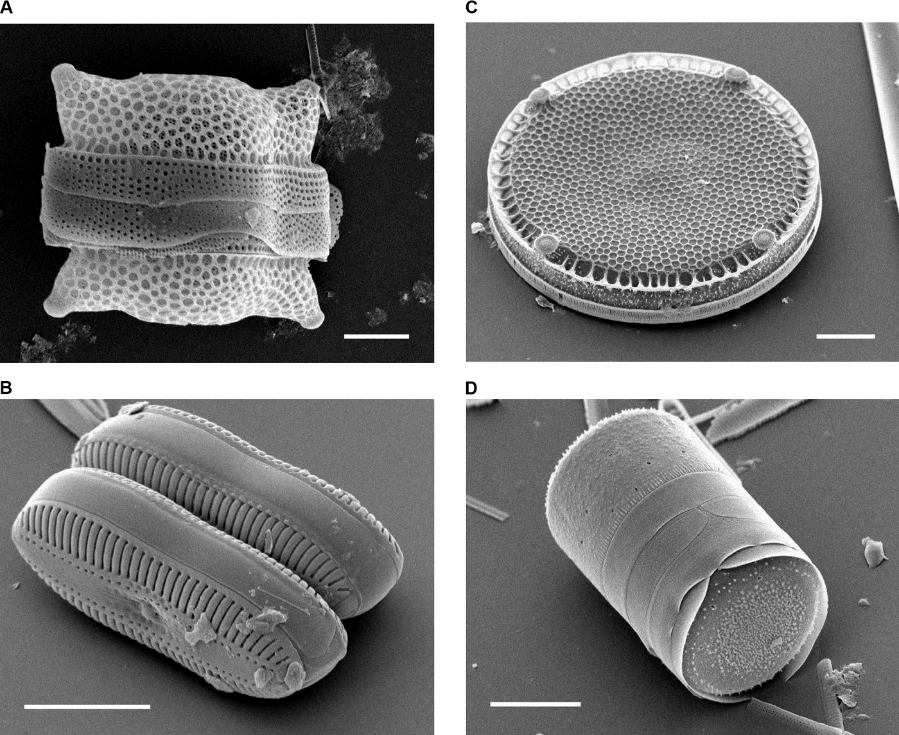
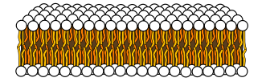
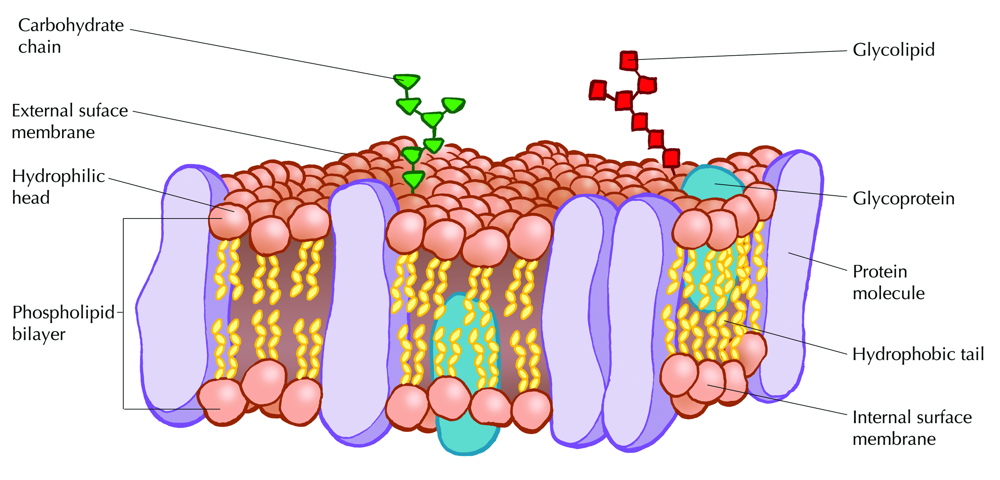
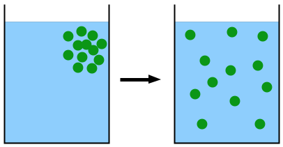
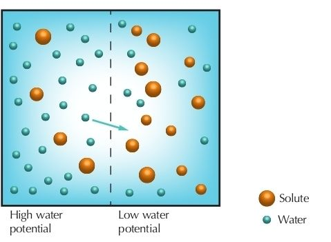
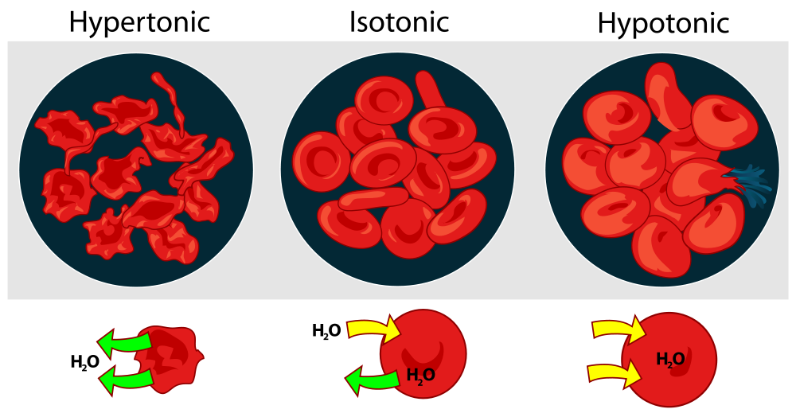
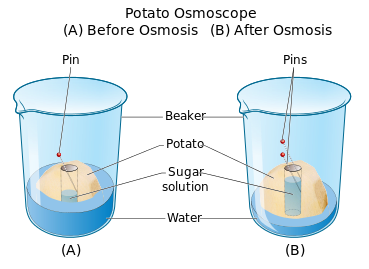
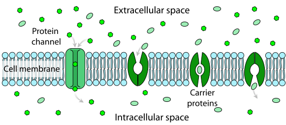
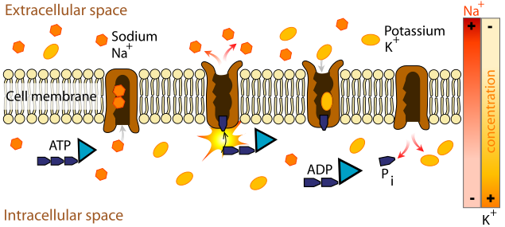

## 2.3 Cell structure and function (ESG4S)

**Section 3: Cell Structure and Function**

In this section the learners now expand their knowledge and learn the various cell structures and related functions. The roles of the organelles within the cells need to be introduced and relate structure and location of organelles to their function.

Cells differ in size, shape and structure and therefore carry out specialised functions. Link this to tissues. The differences between plant and animal cells can be linked to Grade 9.

### Cell theory (ESG4T)

The cell theory developed in 1839 by microbiologists Schleiden and Schwann describes the properties of cells. It is an explanation of the relationship between cells and living things. The theory states that:

- all living things are made of cells and their products.
- new cells are created by old cells dividing into two.
- cells are the basic building blocks of life.

The cell theory applies to all living things, however big or small. The modern understanding of cell theory extends the concepts of the original cell theory to include the following:

- The activity of an organism depends on the total activity of independent cells.
- Energy flow occurs in cells through the breakdown of carbohydrates by respiration.
- Cells contain the information necessary for the creation of new cells. This information is known as 'hereditary information' and is contained within DNA.
- The contents of cells from similar species are basically the same.

<Callout type="tip" title="Note">
DNA (the hereditary information of cells) is passed from 'parent' cells to 'daughter' cells during cell division. You will learn more about this in the following chapter: **Cell division**.
</Callout>

Cells are the smallest form of life; the functional and structural units of all living things. Your body contains several billion cells, organised into over 200 major types, with hundreds of cell-specific functions.

Some functions performed by cells are so vital to the existence of life that all cells perform them (e.g. cellular respiration). Others are highly specialised (e.g. photosynthesis).

Figure 2.9 shows a two-dimensional drawing of an animal cell. The diagram shows the structures visible within a cell at high magnification. The structures form the **ultrastructure** of the cell.

Figure 2.9: Diagram of the cell ultrastructure of an animal cell.

1. In pairs, discuss the different organs in the human body and the way in which they function.
3. How do you think cells function?

[Simulation: 2CP5](https://learn.genetics.utah.edu/content/begin/cells/insideacell/)

<VideoPlayer src="https://www.youtube.com/user/khanacademy#p/c/7A9646BC5110CF64/33/Hmwvj9X4GNY" title="Video: 2CP6" />

[Simulation: 2CP7](https://www.neok12.com/diagram/Cell-Structures-02.htm)

<VideoPlayer src="https://www.neok12.com/Cell-Structures.htm" title="Video: 2CP8" />

<VideoPlayer src="https://www.youtube.com/watch?v=rABKB5aS2Zg" title="Video: 2CP9" />

We will now look at some of the basic cell structures and organelles in animal and plant cells.

### Cell wall (ESG4V)

The cell wall is a rigid non-living layer that is found outside the cell membrane and surrounds the cell. Plants, bacteria and fungi all have cell walls. In plants, the wall is comprised of cellulose. It consists of three layers that help support the plant. These layers include the middle lamella, the primary cell wall and the secondary cell wall.

**Middle lamella**: Separates one cell from another. It is a thin membranous layer on the outside of the cell and is made of a sticky substance called pectin.

**Primary cell wall**: Is on the inside of the middle lamella and is mainly composed of cellulose.

**Secondary cell wall**: Lies alongside the cell membrane. It is is made up of a thick and tough layer of cellulose which is held together by a hard, waterproof substance called lignin. It is only found in cells which provide mechanical support in plants.

<Callout type="note" title="Note">
The human body cannot break down the cellulose in cell walls because we do not produce the enzyme cellulase.
</Callout>

Figure 2.10: Scanning electron microscope micrographs of diatoms showing the external appearances of the cell wall. Scale bar: ** A, B, D: ** 10 um, ** C** 20 um

**Functions of the cell wall**

- The main function of the wall is to protect the inner parts of the plant cell, it gives plant cells a more uniform and regular shape and provides support for the plant body.
- The cell wall is completely permeable to water and mineral salts which allows distribution of nutrients throughout the plant.
- The openings in the cell wall are called plasmodesmata which contain strands of cytoplasm that connect adjacent cells. This allows cells to interact with one another, allowing molecules to travel between plant cells.

### Cell membrane (ESG4W)

The **cell membrane**, also called the plasma membrane, physically separates the intracellular space (inside the cell) from the extracellular environment (outside the cell). All plant and animal cells have cell membranes. The cell membrane surrounds and protects the **cytoplasm**. Cytoplasm is part of the protoplasm and is the living component of the cell.

The cell membrane is composed of a double layer (bilayer) of special lipids (fats) called **phospholipids**. Phospholipids consist of a **hydrophilic** (water-loving) head and a **hydrophobic** (water-fearing) tail. The hydrophobic head of the phospholipid is **polar** (charged) and can therefore dissolve in water. The hydrophobic tail is **non-polar**  (uncharged), and cannot dissolve in water.

The lipid bilayer forms spontaneously due to the properties of the phospholipid molecules. In an aqueous environment, the polar heads try to form hydrogen bonds with the water, while the non-polar tails try to escape from the water. The problem is solved by the formation of a bilayer because the hydrophilic heads can point outwards and from hydrogen bonds with water, and the hydrophobic tails point towards one another and are 'protected' from the water molecules (Figure 2.11.

Figure 2.11: The lipid bilayer showing the arrangement of phospholipids, containing hydrophilic, polar heads and hydrophobic, non-polar tails.

<Callout type="tip" title="Note">
Recall the structure of lipid molecules from the previous chapter on **the chemistry of life**.
</Callout>

All the exchanges between the cell and its environment have to pass through the cell membrane. The cell membrane is **selectively permeable** to ions (e.g. hydrogen, sodium), small molecules (oxygen, carbon dioxide) and larger molecules (glucose and amino acids) and controls the movement of substances in and out of the cells. The cell membrane performs many important functions within the cell such as osmosis, diffusion, transport of nutrients into the cell, processes of ingestion and secretion.  The cell membrane is strong enough to provide the cell with mechanical support and flexible enough to allow cells to grow and move.

<Callout type="note" title="Note">
Watch a video about the cell membrane.

<VideoPlayer src="https://www.youtube.com/watch?v=-aSfoB8Cmic" title="Video: 2CPB" />
</Callout>

**Structure of the cell membrane: the fluid mosaic model**

S.J. Singer and G.L. Nicolson proposed the Fluid Mosaic Model of the cell membrane in 1972. This model describes the structure of the cell membrane as a **fluid** structure with various protein and carbohydrate components diffusing freely across the membrane. The structure and function of each component of the membrane is provided in the table below. Table 2.2 refers to the components of the cell membrane shown in the diagram in Figures Figure 2.11 and Figure 2.12.

Figure 2.12: Fluid mosaic model of the cell membrane.

| Component (see Figure 2.12 ) | Structure | Function |
| --- | --- | --- |
| Phospholipid bilayer | Consists of two layers of phospholipids. Each phospholipid has a polar, hydrophilic (water-soluble) head as well as a non-polar, hydrophobic (water-insoluble) tail. | It is a semi-permeable structure that does not allow materials to pass through the membrane freely, thus protecting the intra and extracellular environments of the cell. |
| Membrane proteins | These are proteins found spanning the membrane from the inside of the cell (in the cytoplasm) to the outside of the cell. Membrane proteins have hydrophilic and hydrophobic regions that allow them to fit into the cell membrane. | Act as carrier proteins which control the movement of specific ions and molecules across the cell membrane. |
| Glycoproteins | Consist of short carbohydrate chains attached to polypeptide chains and are found on the extracellular regions of the membrane. | These proteins are useful for cell-to-cell recognition. |
| Glycolipids | Carbohydrate chains attached to phospholipids on the outside surface of the membrane. | Act as recognition sites for specific chemicals and are important in cell-to-cell attachment to form tissues. |

Table 2.2: Structure and function of components of the cell membrane.

<Callout type="note" title="Note">
A further description of the fluid mosaic model can be viewed at:

<VideoPlayer src="https://www.youtube.com/watch?v=ULR79TiUj80" title="Video: 2CPC" />
</Callout>

### Movement across membranes (ESG4X)

Movement of substances across cell membranes is necessary as it allows cells to acquire oxygen and nutrients, excrete waste products and control the concentration of required substances in the cell (e.g oxygen, water, hormones, ions, etc). The key processes through which such movement occurs include **diffusion, osmosis, facilitated diffusion** and **active transport.**

<Callout type="note" title="Note">
Learn about the different ways that molecules can travel across cell membranes.

<VideoPlayer src="https://youtu.be/dPKvHrD1eS4" title="Video: 2CPD" />
</Callout>

**1. Diffusion**

Diffusion is the movement of substances from a region of high concentration to low concentration. It is therefore said to occur **down a concentration gradient**. The diagram below shows the movement of dissolved particles within a liquid until eventually becoming randomly distributed.

**Diffusion** is the movement of molecules from a region of higher concentration to a lower concentration. It is a passive process (i.e. does not require input of energy).

Diffusion is a **passive process** which means it does not require any energy input. It can occur across a living or non-living membrane and can occur in a liquid or gas medium. Due to the fact that diffusion occurs across a concentration gradient it can result in the movement of substances into or out of the cell. Examples of substances moved by diffusion include carbon dioxide, oxygen, water and other small molecules that are able to dissolve within the lipid bilayer.

<Callout type="note" title="Note">
Watch diffusion taking place by clicking on the following link.

<VideoPlayer src="https://www.youtube.com/watch?v=aCtzlQL3GaM" title="Video: 2CPF" />
</Callout>

## Observing diffusion

### Aim

To observe diffusion.

### Apparatus

- 1 x \(\text{500}\) \(\text{ml}\) beaker
- large funnel
- plastic straw
- potassium permanganate crystals

### Method

1. Fill a beaker with water and allow it to stand for a few minutes so that water movement stops.
3. Place a large funnel into the water so that it touches the bottom of the beaker. Drop a few small potassium permanganate crystals through the straw. Remove the funnel carefully and slowly.
5. Observe the size of the area that is coloured by the potassium permanganate at the beginning of the experiment, after 5 minutes and then after 20 minutes.

### Questions

1. What do you observe happening in the beaker?
3. What can you conclude based on your observations?
5. Explain how using hot water would affect the results of this experiment (remember that when you explain you need to give a reason for your answer).

**Observing Diffusion**

**Questions**

1. What do you observe happening in the beaker?
3. What can you conclude based on your observations?
5. Explain how using hot water would affect the results of this experiment (remember that when you explain you need to give a reason for your answer).

**Answers**

1. The purple colour slowly spreads (diffuses) throughout the entire beaker of water, until the colour is evenly spread out.
3. The molecules of water and potassium permanganate must be constantly moving in order for the purple colour to diffuse throughout the water and spread out evenly.
5. Using hot water would speed up the spreading process/ diffusion. The additional heat from the water gives the particles kinetic energy which enables them to move more quickly. The faster the particles move, the faster the colour spreads/ diffuses throughout the beaker.

**2. Osmosis**

When the concentration of solutes in solution is low, the water concentration is high, and we say there is a **high water potential**. Osmosis is the movement of water from a region of higher water potential to a region of lower water potential across a semi-permeable membrane that separates the two regions. Movement of water always occurs down a concentration gradient, i.e from higher water potential (dilute solution) to lower potential (concentrated solution). Osmosis is a passive process and does not require any input of energy. Cell membranes allow molecules of water to pass through, but they do not allow molecules of most dissolved substances, e.g. salt and sugar, to pass through. As water enters the cell via osmosis, it creates a pressure known as *osmotic pressure.*

Figure 2.14: Osmosis is the movement of water from an area of high water potential to an area of low water potential across a semi-permeable membrane.

<Callout type="note" title="Note">
Watch osmosis taking place by clicking on the following link.

<VideoPlayer src="https://youtu.be/tz8ja91C9_8" title="Video: 2CPG" />
</Callout>

In biological systems, osmosis is vital to plant and animal cell survival. Figure 2.15 demonstrates how osmosis affects red blood cells when they are placed in three different solutions with different concentrations.

Figure 2.15: The effect of hypertonic, isotonic and hypotonic solutions on red blood cells.

| Hypertonic (concentrated) | Isotonic | Hypotonic (dilute) |
| --- | --- | --- |
| The medium is concentrated with a lower water potential than inside the cell, therefore the cell will lose water by osmosis. | The water concentration inside and outside the cell is equal and there will be no nett water movement across the cell membrane. (Water will continue to move across the membrane, but water will enter and leave the cell at the same rate.) | The medium has a higher water potential (more dilute) than the cell and water will move into the cell via osmosis, and could eventuality cause the cell to burst. |

Plant cells use osmosis to absorb water from the soil and transport it to the leaves. Osmosis in the kidneys keeps the water and salt levels in the body and blood at the correct levels.

## Predicting the direction of osmosis

### Aim

To predict the direction of osmosis.

### Apparatus

- 1 x \(\text{500}\) \(\text{ml}\) beaker
- 1 x large potato
- potato peeler/scalpel
- 2 x pins
- concentrated sucrose/sugar solution. To obtain this, add 100 g of sugar to 200 ml of water.

### Method

1. Peel off the skin of a large sized potato with a scalpel/potato peeler.
3. Cut its one end to make the base flat.
5. Make a hollow cavity in the potato almost to the bottom of the potato.
7. Add the concentrated sugar solution into the cavity of the potato, filling it about half way. Mark the level by inserting a pin at the level of the sugar solution (insert the pin at an angle into the cavity at the level) (Figure 2.16 A).
9. Carefully place the potato in the beaker containing water.
11. Observe what happens to the level of the sugar solution in the potato.
13. After 15 to 20 minutes, mark the level by inserting the second pin at the level of the sugar solution (insert as the first pin) (Figure 2.16 B).

Figure 2.16: Using a potato to investigate osmosis.

### Questions

1. What do you observe happening to the level of the solution inside the potato?
3. What conclusion can you draw based on your observation?
5. What conditions were met in this experiment that makes this type of transport different to diffusion?

**Predicting the direction of osmosis**

**Questions**

1. What do you observe happening to the level of the solution inside the potato?
3. What conclusion can you draw based on your observation?
5. What conditions were met in this experiment that makes this type of transport different to diffusion?

**Answers**

1. The level of the solution inside the potato increases.
3. Water moves out of the potato into the cavity in the middle. At the same time, water is drawn into the potato from the beaker. This means that the solution in the cavity is hypertonic and the water is hypotonic.
5. The semi-permeable membranes of the cells in the potato prevented the sugar molecules from moving. Only the water moves. In diffusion, all molecules are able to move. In osmosis, only water moves, and it moves across a semi-permeable membrane.

<Callout type="note" title="Note">
Watch an illustration of diffusion and osmosis.

<VideoPlayer src="https://www.khanacademy.org/video/diffusion-and-osmosis?playlist=Biology " title="Video: 2CPH" />
</Callout>

**3. Facilitated diffusion**

Facilitated diffusion is a special form of diffusion which allows rapid exchange of specific substances. Particles are taken up by carrier proteins which change their shape as a result. The change in shape causes the particles to be released on the other side of the membrane. Facilitated diffusion can only occur across living, biological membranes which contain the carrier proteins. A substance is transported via a carrier protein from a region of high concentration to a region of low concentration until it is randomly distributed. Therefore movement is *down a concentration gradient*.

Figure 2.17: Facilitated diffusion in cell membrane, showing ion channels and carrier proteins.

Examples of substances moved via facilitated diffusion include all polar molecules such as glucose or amino acids.

**4. Active transport**

Active transport is the movement of substances *against* a concentration gradient, from a region of *low concentration* to *high concentration* using an input of energy. In biological systems, the form in which this energy occurs is **adenosine triphosphate (ATP)**. The process transports substances through a membrane protein. The movement of substances is selective via the carrier proteins and can occur into or out of the cell.

<Callout type="note" title="Note">
ATP and ADP are molecules involved with moving energy within cells. You do not need to know these names in full and will learn more about them later.
</Callout>

Figure 2.18: The sodium-potassium pump is an example of primary active transport.

Examples of substances moved include sodium and potassium ions as shown in Figure 2.18
