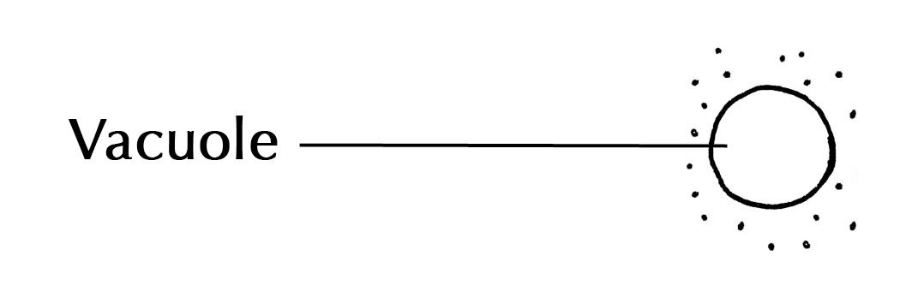
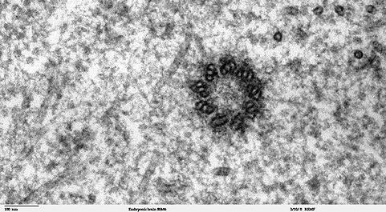
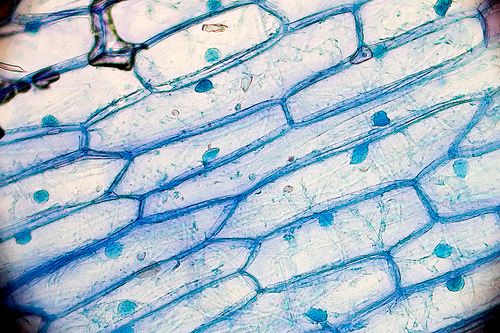
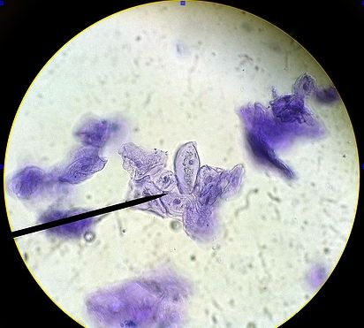

## 2.4 Cell organelles (ESG4Y)

We will now look at the key organelles that make up the cell. It is important to bear in mind that structure and function are closely related in all living systems. When studying each organelle, ensure that you observe the specific structures (from micrographs) that allow the organelle to perform its specific function.

### Cytoplasm (ESG4Z)

The cytoplasm is the jelly-like substance that fills the cell. It consists of up to \(\text{90}\%\) water. It also contains dissolved nutrients and waste products. Its main function is to hold together the organelles which make up the cytoplasm. It also nourishes the cell by supplying it with salts and sugars and provides a medium for metabolic reactions to occur.

<Callout type="note" title="Note">
**REVISION**You may have encountered the terms cytoplasm, nucleoplasm and protoplasm earlier in Grade 9. **Cytoplasm** is the part of the cell that is within the cell membrane and excludes the nucleus. **Nucleoplasm** is the substance of the cell nucleus, i.e. everything within the nucleus that is not part of the nucleolus. **Protoplasm** is the colourless material comprising the living part of a cell, including the cytoplasm, nucleus and other organelles.
</Callout>

All the contents of prokaryotic cells are contained within the cytoplasm. In eukaryotic cells, all the organelles are contained within the cytoplasm except the nucleolus which is contained within the nucleus.

**Functions of the cytoplasm**

- The cytoplasm provides mechanical support to the cell by exerting pressure against the cell's membrane which helps keep the shape of the cell. This pressure is known as **turgor**  pressure.
- It is the site of most cellular activities including metabolism, cell division and protein synthesis.
- The cytoplasm contains ribosomes which assist in the synthesis of protein.
- The cytoplasm acts a storage area for small carbohydrate, lipid and protein molecules.
- The cytoplasm suspends and can transport organelles around the cell.

### Nucleus (ESG52)

The nucleus is the largest organelle in the cell and contains all the cell's genetic information in the form of DNA. The presence of a nucleus is the primary factor that distinguishes eukaryotes from prokaryotes. The structure of the nucleus is described below:

**Nuclear envelope**: two lipid membranes that are studded with special proteins that separates the nucleus and its contents from the cytoplasm.

**Nuclear pores**: tiny holes called nuclear pores are found in the nuclear envelope and help to regulate the exchange of materials (such as RNA and proteins) between the nucleus and the cytoplasm.

**Chromatin**: thin long strands of DNA and protein.

**Nucleolus**: the nucleolus makes RNA another type of nucleic acid.

<Callout type="note" title="Note">
During cell division, DNA contracts and folds to form distinct structures called chromosomes. The chromosomes are formed at the start of cell division.
</Callout>

<Callout type="note" title="Note">
The genetic material of eukaryotic organisms is separated from the cytoplasm by a membrane whereas the genetic material of prokaryotic organisms (like bacteria) is in direct contact with the cytoplasm.
</Callout>

| Schematic Diagram | Micrograph |
| --- | --- |
| Figure 2.19: Diagram showing the basic structures of the animal cell nucleus. | Figure 2.20: An electron micrograph of a cell nucleus showing a densely staining nucleolus. |

<Callout type="note" title="Note">
Mitochondria also contain DNA, called mitochondrial DNA, (mtDNA) but it  makes up just a small percentage of the cell's overall DNA  content. All mitochondrial DNA in humans is derived from the mother's side.
</Callout>

**Functions of the nucleus**

- The main function of the cell nucleus is to control gene expression and facilitate the replication of DNA during the cell cycle (which you will learn about in the next chapter).
- The nucleus controls the *metabolic* functions of the cell by producing mRNA which encodes for enzymes e.g. insulin.
- The nucleus controls the *structure* of the cell by transcribing DNA which encodes for structural proteins such as actin and keratin.
- The nucleus is the site of ribosomal RNA (rRNA) synthesis, which is important for the construction of ribosomes. Ribosomes are the site of protein translation (synthesis of proteins from amino acids).
- Characteristics are transmitted from parent to offspring through genetic material contained in the nucleus.

### Mitochondria (ESG53)

A mitochondrion is a membrane bound organelle found in eukaryotic cells. This organelle generates the cell's supply of chemical energy by releasing energy stored in molecules from food and using it to produce ATP (adenosine triphosphate). ATP is a special type of "energy carrying" molecule.

**Structure and function of the mitochondrion**

Mitochondria contain two phospholipid bilayers: there is an outer membrane, and an inner membrane. The inner membrane contains many folds called cristae which contain specialised membrane proteins that enable the mitochondria to synthesise ATP. Inside the inner membrane is a jelly-like matrix. Listed from the outermost layer to the innermost compartment, the compartments of the mitochondrion, are:

- Outer mitochondrial membrane
- Intermembrane space
- Inner mitochondrial membrane
- Cristae (folds of the inner membrane)
- matrix (jelly-like substance within the inner membrane)

| Schematic Diagram | Micrograph |
| --- | --- |
| Figure 2.21: The major structures of the mitochondrion in three dimensions. | Figure 2.22: Electron micrograph of a mitochondrion. |

The table below relates each structure to its function.

| Structure | Function | Adaptation to function |
| --- | --- | --- |
| Outer mitochondrial membrane | Transfer of nutrients (e.g lipids) to mitochondrion. | Has large number of channels to facilitate transfer of molecules. |
| Intermembrane space | Stores large proteins allowing for cellular respiration. | Its position between two selectively permeable membranes allows it to have a unique composition compared to the cytoplasm and the matrix. |
| Inner membrane | Stores membrane proteins that allow for energy production. | Contains folds known as cristae which provide increased surface area, thus enabling production of ATP (chemical potential energy). |
| Matrix | Contains enzymes that allow for the production of ATP (energy). | The matrix is contains a high quantity of protein enzymes which allow for ATP production. |

<Callout type="note" title="Note">
In Life Sciences it is important to note that whenever a structure has an increased surface area, there is an increase in the functioning of that structure.
</Callout>

### Endoplasmic reticulum (ESG54)

The endoplasmic reticulum (ER) is an organelle found in eukaryotic cells only. The ER has a double membrane consisting of a network of hollow  tubes, flattened sheets, and round sacs. These flattened, hollow  folds and sacs are called cisternae. The ER is located in the cytoplasm and is connected to the nuclear envelope. There are two types of endoplasmic reticulum: smooth and rough ER.

**Smooth ER**: does not have any ribosomes attached. It is involved in the synthesis of lipids, including oils, phospholipids and steroids. It is also responsible for metabolism of carbohydrates, regulation of calcium concentration and detoxification of drugs.

**Rough ER**: is covered with ribosomes giving the endoplasmic reticulum its rough appearance. It is responsible for protein synthesis and plays a role in membrane production. The folds present in the membrane increase the surface area allowing more ribosomes to be present on the ER, thereby allowing greater protein production.

| Schematic Diagram | Micrograph |
| --- | --- |
| Smooth endoplasmic reticulum |
| Rough endoplasmic reticulum |

### Ribosomes (ESG55)

Ribosomes are composed of RNA and protein. They occur in the cytoplasm and are the sites where protein synthesis occurs. Ribosomes may occur singly in the cytoplasm or in groups or may be attached to the endoplasmic reticulum  thus forming the rough endoplasmic reticulum. Ribosomes are important for protein production. Together with a structure known as messenger RNA (a type of nucleic acid) ribosomes form a structure known as a polyribosome which is important in protein synthesis.

| Diagram : Free Ribosome | Diagram : Polyribosome |
| --- | --- |
| Figure 2.23: Free ribosomes found within cytoplasm. | Figure 2.24: Diagram of several ribosomes joined together on a strand of mRNA to form a polyribosome. |

### Golgi body (ESG56)

The Golgi body is found near the nucleus and endoplasmic reticulum. The Golgi body consists of a stack of flat membrane-bound sacs called cisternae. The cisternae within the Golgi body consist of enzymes which modify the packaged products of the Golgi body (proteins).

| Schematic Diagram | Micrograph |
| --- | --- |
| Figure 2.25: Diagram showing Golgi bodies found in animal cells. | Figure 2.26: TEM Micrograph of Golgi body, visible as a stack of semicircular black rings near the bottom. |

<Callout type="note" title="Note">
The Golgi body was discovered by the Italian physician Camillo Golgi. It was one of the first organelles to be discovered and described in detail because it's large size made it easier to observe.
</Callout>

**Functions of the Golgi body**

It is important for proteins to be transported from where they are synthesised to where they are required in the cell. The organelle responsible for this is the Golgi Body. The Golgi body is the sorting organelle of the cell.

Proteins are transported from the rough endoplasmic reticulum (RER) to the Golgi. In the Golgi, proteins are modified and packaged into vesicle. The Golgi body therefore receives proteins made in one location in the cell and transfers these to another location within the cell where they are required. For this reason the Golgi body can be considered to be the 'post office' of the cell.

### Vesicles and lysosomes (ESG57)

**Vesicles** are small, membrane-bound spherical sacs which facilitate the metabolism, transport and storage of molecules. Many vesicles are made in the Golgi body and the endoplasmic reticulum, or are made from parts of the cell membrane. Vesicles can be classified according to their contents and function. Transport vesicles transport molecules within the cell.

**Lysosomes**  are formed by the Golgi body and contain powerful digestive enzymes that can potentially digest the cell. Lysosomes are formed by the Golgi body or the endoplasmic reticulum. These powerful enzymes can digest cell structures and food molecules such as carbohydrates and proteins. Lysosomes are abundant in animal cells that ingest food through food vacuoles. When a cell dies, the lysosome releases its enzymes and digests the cell.

### Vacuoles (ESG58)

Vacuoles are membrane-bound, fluid-filled organelles that occur in the cytoplasm of most plant cells, but are very small or completely absent from animal cells. Plant cells generally have one large vacuole that takes up most of the cell's volume. A selectively permeable membrane called the **tonoplast**, surround the vacuole. The vacuole contains **cell sap** which is a liquid consisting of water, mineral salts, sugars and amino acids.

Figure 2.27: A vacuole.

**Functions of the vacuole**

- The vacuole plays an important role in digestion and excretion of cellular waste and storage of water and organic and inorganic substances.
- The vacuole takes in and releases water by osmosis in response to changes in the cytoplasm, as well as in the environment around the cell.
- The vacuole is also responsible for maintaining the shape of plant cells. When the cell is full of water, the vacuole exerts pressure outwards, pushing the cell membrane against the cell wall. This pressure is called turgor pressure.
- If there is not sufficient water, pressure exerted by the vacuole is reduced and the cells become flaccid causing the plant to wilt.

### Centrioles (ESG59)

Animal cells contain a special organelle called a centriole. The centriole is a cylindrical tube-like structure that is composed of 9 microtubules arranged in a very particular pattern. Two centrioles  arranged perpendicular to each other are referred to as a **centrosome**. The centrosome plays a very important role in cell division. The centrioles are responsible for organising the microtubules that position the chromosomes in the correct location during cell division. You will learn more about their function in the following chapter on Cell Division.

Figure 2.28: A TEM micrograph of a cross-section of a centriole in an animal (rat) cell.

### Plastids (ESG5B)

Plastids are organelles found only in plants. There are three different types:

1. **Leucoplasts**: White plastids found in roots.
3. **Chloroplasts**: Green-coloured plastids found in plants and algae.
5. **Chromoplasts**: Contain red, orange or yellow pigments and are common in ripening fruit, flowers or autumn leaves.

Figure 2.29: Plastids perform a variety of functions in plants, including storage and energy production.

<Callout type="note" title="Note">
The colour of plant flowers such as an orchid is controlled by a specialised organelle in a cell known as the chromoplast.

</Callout>

**Chloroplast**

The chloroplast is a double-membraned organelle. Within the double membrane is a gel-like substance called stroma. Stroma contains enzymes for photosynthesis. Suspended in the stroma are stack-like structures called grana (singular = granum). Each granum is a stack of thylakoid discs. The chlorophyll molecules (green pigments) are found on the surface of the thylakoid discs. Chlorophyll absorbs energy from the sun in order for photosynthesis to take place in the chloroplasts. The grana are connected by lamellae (intergrana). The lamellae keep the stacks apart from each other.

The structure of the chloroplast is neatly adapted to its function of trapping and storing energy in plants. For example, chloroplasts contain a high density of thylakoid discs and numerous grana to allow for increased surface area for the absorption of sunlight, thus producing a high quantity of food for the plant. Additionally, the lamellae keeping the thylakoids apart maximise chloroplast efficiency, thus allowing as much light as possible to be absorbed in the smallest surface area.

| Schematic Diagram | Micrograph |
| --- | --- |
| Figure 2.30: Structure of chloroplast. | Figure 2.31: Electron micrograph of chloroplast with grana and thylakoids. |

### The differences between plant and animal cells (ESG5C)

Now that we have looked at the basic structures and functions of the organelles in a cell, you would have noticed that there are key differences between plant and animal cells. The table below summarises these differences.

| Animal Cells | Plant Cells |
| --- | --- |
| Do not contain plastids. | Almost all plants cells contain plastids such chloroplasts, chromoplasts and leucoplasts. |
| No cell wall. | Have a rigid cellulose cell wall in addition to the cell membrane. |
| Contain centrioles. | Do not contain centrioles. |
| Animals do not have plasmodesmata or pits. | Contain plasmodesmata and pits. |
| Few vacuoles (if any). | Large central vacuole filled with cell sap in mature cells. |
| Nucleus is generally found at the centre of the cytoplasm. | Nucleus is found near the edge of the cell. |
| No intercellular spaces found between the cells. | Large intercellular air spaces found between some cells. |

## Examining plant cells under the microscope

### Aim

To study the microscopic structures of plant cells.

### Apparatus

- onion
- blade
- slides and coverslips
- brushes
- compound microscope
- tissue paper
- forceps
- dropper
- iodine solution
- watchglass
- petri dish containing water

### Method

1. Peel off the outer most layer of an onion carefully, using a pair of forceps.
3. Place the peeled layer in a watchglass containing water. Make certain that the onion peel does not roll or fold.
5. Using a scalpel or a thin blade, cut a square piece of the onion peel (about \(\text{1}\) \(\text{cm$^{2}$}\)).
7. Remove the thin transparent skin from the inside curve of a small piece of raw onion and place it on a drop of iodine solution on a clean slide.
9. Cover the peel with a coverslip ensuring that no bubbles are formed.
11. Using a piece of tissue paper wipe off any excess iodine solution remaining on the slide.
13. Observe the onion skin under low power of the microscope and then under high power.
15. Draw a neat diagram of 5-10 cells of the typical cells you can see.

Figure 2.32:  Onion cells stained with methylene blue.

**Activity 3.1. Preparation of a wet mount**

Before the learners do this practical it may be necessary to recap the parts and functions of the microscope and the preparation of a wet mount.

**Instructions**

1. It is necessary to stain the onion to clearly show the parts of the onion under the microscope.
3. Learners will see a number of closely arranged, brick shaped cells.
5. Learners to draw 5-10 cells.
7. Learners should draw label lines to indicate the cell wall, cytoplasm, nucleus and vacuole.
9. The cells have a regular shape and each cell has a cell wall.

**Note: As an extension activity learners can also do wet mount preparations of cheek cells. Methylene Blue can be used to stain the cheek cells.**

## Examining animal cells under the microscope

### Aim

To study the microscopic structures of human cheek cells under a compound microscope.

### Apparatus

- clean ear bud
- clean slide
- methylene blue
- dropper
- water
- tissue paper
- forceps
- microscope

### Method

1. Place a drop of water on a clean glass slide.
3. Using a clean ear bud, wipe the inside of your cheek. The ear bud will collect a moist film.
5. Spread the moist film on a drop of water on a clean glass slide, creating a small smear on the slide.
7. Use a coverslip to cover the slide gently.
9. Place one or two drops of stain on the side of the cover slip.
11. Use a piece of tissue to remove the excess dye.
13. Observe the cheek cells under low power magnification and then under high power magnification.

### Questions

1. What are the shapes of epidermal cells of the onion peel and the human cheek cells?
3. Why is iodine used to stain the onion peel?
5. What is the difference between the arrangement of cells in onion cells and in human cheek cells?
7. Why is a cell considered the structural and functional unit of living things?

Figure 2.33:  Cheek epithelial cells.

**Examining cells under a microscope**

**Questions**

1. What are the shapes of epidermal cells of the onion peel and the human cheek cells?
3. Why is iodine used to stain the onion peel?
5. What is the difference between the arrangement of cells in onion cells and in human cheek cells?
7. Why is a cell considered the structural and functional unit of living things?

**Answers**

1. The onion cells have a regular shape – roughly rectangular. The cheek epidermal cells have an irregular shape.
3. The onion peel stores glucose as starch, and starch turns brown iodine solution purple. Using iodine solution as a stain because it will stain the starch purple, which makes the cells more easily visible.
5. In the onion, the cells are packed regularly, like bricks in a wall. The epidermal cells are packed irregularly – the packing depends on the shape of the cells in the region, which are irregular.
7. The cell is the smallest unit of life. It contains the DNA necessary to create an entire organism, and is the basic building block from which all tissues and organisms are made. Every cell performs the seven life processes, and so each cell individual cell is living.

## Cell organelles

You are required to compile a report on one of the organelles you have studied in class, or any other organelle you choose. Your report must include the following information.

- **Past**
  - The discovery of the organelle
  - All past understanding of the organelles structure and/or function that has now changed
  - The importance of the discovery of the organelle to cell science
- **Present**
  - The presently understood structure and function of the organelle
  - A 2-dimensional picture of the organelle showing all the relevant structures of the organelle
  - An electron-microscope picture of the organelle showing the structure of the organelle
  - An understanding of the importance of the organelle to human survival
- **Future**
  - What remains to be discovered or fully understood?
  - Any important role of the organelle could potentially play with the development of future technology (i.e. in industry or medicine).
- **Any other additional information or interesting facts you wish to include.**

**Presentation**

- Students are required to present results of their research in a booklet format.
- It must be neatly yet creatively set out.
- It should include a thorough and correctly structured bibliography.

Students should be marked according to the attached rubric.

**Project: Cell Organelles**

Mark learners project according to the following guidelines.

| Assessing Knowledge |  |
| --- | --- |
| Discovery of the organelle identified | /5 |
| Story of the discovery of the organelle discussed and understood | /5 |
| Future discoveries regarding the organelle discussed and understood | /5 |
| Interpreting Knowledge |  |
| Information on the present structure and function of the organelle discussed and understood | /5 |
| 2D picture of organelle provided and sufficiently detailed | /5 |
| 3D picture of organelle provided and sufficiently detailed | /5 |
| Micrograph of organelle provided and sufficiently detailed | /5 |
| Additional information supplied | /5 |
| Understanding of content in everyday life |  |
| The importance of the discovery of the organelle to science provided and understood | /5 |
| The possible future role of the organelle provided, understood and relevant | /5 |
| Exploring science in the past |  |
| Past theories/understanding of the organelle that have changed discussed | /5 |
| Communicating information |  |
| Referencing technique correct | /5 |
| Presentation neat | /5 |
| Presentation creative | /5 |
| Total | /70 |

## Diagrams of cells

Diagrams of the cell are very well understood but they often give us the wrong impression about how complicated cells really are. This assignment will help you understand the complexity of cells.

1. Find and submit a hard copy of \(\text{5}\) micrographs showing different cell organelles.
3. Draw and label two organelles to demonstrate your drawing, labelling and interpretive skills.

Pay close attention to the following:

- The organelles should each comfortably occupy an A5 page.
- The organelles must each have a heading that includes the view, title and magnification.
- Drawings must follow the drawing skills you have learnt. One drawing must be the same size as the micrograph, the other must be exactly half the size.
- Your drawings must have a correct scale line.
- State the source of your micrographs according to the Harvard convention.
- Marks will be awarded for neatness: present your work as a uniform set.
- You must select hard copies well so that are of high quality and can be easily recognisable.
- Your images may be of the same organelle but only if the images show some significant variation.

**Project: Diagrams of cells**

Mark according to the following criteria:

1. Following instructions: size, quantity (5)
3. Images: choice, quality, headings, referenced (10)
5. Drawings: accuracy, realism, scale, labelling (10)
7. Effort: neatness, professionalism (5)

<Callout type="note" title="Note">
Revise everything you have learnt about cells by watching this video.

<VideoPlayer src="https://youtu.be/v2lHztS4sMU" title="Video: 2CPM" />
</Callout>
