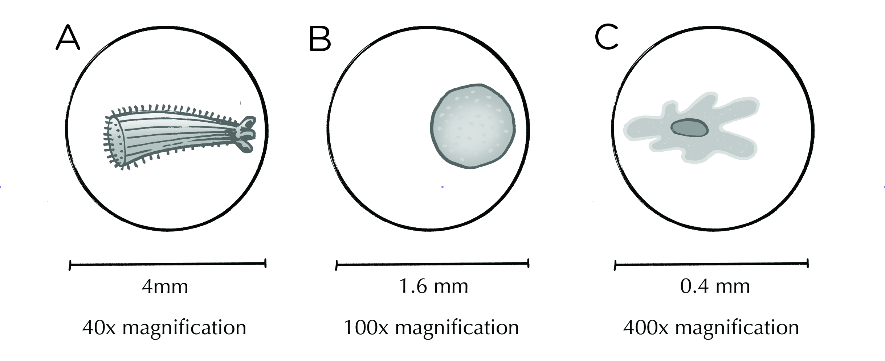
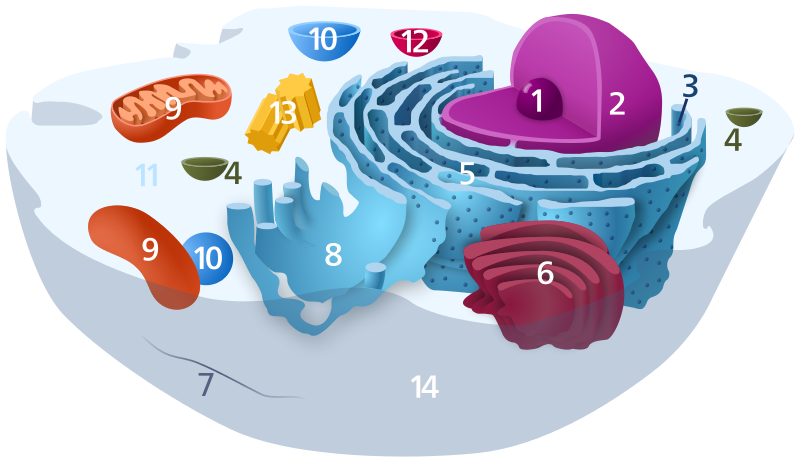

## 2.6 End of chapter exercises (ESG5F)

### Exercise 2.1

**Problem:**
Examine the three images below. Use calculations Explain which organism would be the smallest when viewed with the naked eye. Show all the calculations you used to arrive at your answer.

**Solution:**
\(\text{A} = \frac{4}{40} = \text{0,1}\text{ mm}\)

\(\text{B} = \frac{\text{1,6}}{100} = \text{0,016}\text{ mm}\)

\(\text{C} = \frac{\text{0,4}}{400} = \text{0,001}\text{ mm}\)

So item C would be the smallest

Below is a three-dimensional diagram of the cell. Provide the name and function of the following numbered structures:

The following difficult to distinguish structures have been done for you:

- **4-vesicle:** spherical sacs that facilitate storage, metabolism and transport of molecules.
- **7-cell membrane:** selectively permeable to control the passage of substances into and out of the cell.
- **10-vacuole:** storage of sugars, minerals and pigments and help maintain water balance in the cell.
- **12-lysosome:** contain powerful digestive enzymes that digest damaged cell structures and food molecules.

**Problem:**

**Solution:**
- **1-Nucleolus:** site of the transcription of RNA.
- **2-Nucleus:** controls metabolism of the cell and contains hereditary information.
- **3-Ribosome:** site of protein synthesis.
- **5-Rough endoplasmic reticulum:** many ribosomes therefore allowing for the production of many proteins.
- **6-Golgi body:** modify and package proteins and send them where they are needed int he cell.
- **8-Smooth endoplasmic reticulum:** the synthesis of lipids and the detoxification of drugs.
- **9-Mitochondrion:** the site of cellular respiration where energy is released from glucose molecules.
- **11-Cytoplasm:** jelly-like substance that contains all the organelles and which contains dissolved nutrients.
- **12-Centriole:** special structures that help cells to divide during mitosis.

Multiple answers are provided for each question. Write **only the letter** of the correct answer next to the corresponding number.

**Problem:**
Active transport is the movement of a substance from a:

1. high concentration to a low concentration.
3. high water potential to a low water potential.
5. isotonic solution.
7. low concentration to a high concentration.

**Solution:**
low concentration to a high concentration

**Problem:**
Protoplasm consists of:

1. nucleoplasm and nucleolus.
3. cytoplasm and nucleoplasm.
5. cytoplasm and organelles.
7. membranes and organelles.

**Solution:**
cytoplasm and nucleoplasm

**Problem:**
This organelle is responsible for transporting substances around the cell:

1. Ribosome
3. Golgi body
5. Nucleus
7. Endoplasmic reticulum

**Solution:**
Endoplasmic reticulum

**Problem:**
The nucleus does **not** control:

1. Hereditary transmission
3. Cellular respiration
5. Metabolism
7. Structure

**Solution:**
Cellular respiration

**Problem:**
The energy that a molecule possesses while moving:

1. Potential energy
3. Kinetic energy
5. Magnetic energy
7. Mechanical energy

**Solution:**
Kinetic energy

**Problem:**
Which of the following is **not** a product of cellular respiration?

1. \(\text{CO}_2\)
3. \(\text{H}_2 \text{O}\)
5. \(\text{O}_2\)
7. ATP

**Solution:**
\(\text{O}_2\)

Give the correct biological **term** for each of the following.
Write only the **term** next to the relevant question number.

**Problem:**
Part of the cell that consists of about \(\text{90}\%\) water.

**Solution:**
cytoplasm

**Problem:**
Often referred to as the powerhouse of the cell.

**Solution:**
mitochondrion

**Problem:**
Pigment found in green plants.

**Solution:**
chlorophyll

**Problem:**
The part of a plant cell that is composed of cellulose.

**Solution:**
cell wall

**Problem:**
The fluid inside the vacuole.

**Solution:**
cell sap

**Problem:**
The movement of a substance against a concentration gradient.

**Solution:**
active transport

**Problem:**
The structure that distributes substances made in the cell.

**Solution:**
Golgi body

Choose the correct **option** for each of the following questions.
Write only the **term** next to the relevant question number.

**Problem:**
What structure contains DNA and regulates most of the processes within the cell?

1. Mitochondria
3. Chloroplast
5. Nucleus
7. Nucleolus

**Solution:**
Nucleus

**Problem:**
What is a cell membrane?

1. thin flexible barrier around the cell that regulates transport
3. rigid cover that provides support for the cell
5. the place where light energy, water and carbon dioxide are used
7. special organelle that converts solar energy to chemical energy

**Solution:**
thin flexible barrier around the cell that regulates transport

**Problem:**
Which two organelles contain their own DNA genome, separate from the nuclear genome?

1. lysosomes and transport vesicles
3. endoplasmic reticulum and Golgi apparatus
5. cilia and flagella
7. mitochondria and chloroplast
9. ribosomes and vacuoles

**Solution:**
ribosomes and vacuoles

**Problem:**
Tabulate four differences between animal and plant cells.

**Solution:**
Any four of the following:

| Animal Cells | Plant Cells |
| --- | --- |
| Do not contain plastids. | Almost all plants cells contain plastids such chloroplasts, chromoplasts and leucoplasts. |
| No cell wall. | Have a rigid cellulose cell wall in addition to the cell membrane. |
| Contain centrioles. | Do not contain centrioles. |
| Animals do not have plasmodesmata or pits. | Contain plasmodesmata and pits. |
| Few vacuoles (if any). | Large central vacuole filled with cell sap in mature cells. |
| Nucleus is generally found at the centre of the cytoplasm. | Nucleus is found near the edge of the cell. |
| No intercellular spaces found between the cells. | Large intercellular air spaces found between some cells. |

**Problem:**
Name a structural adaptation of the mitochondria that makes it suited to its function:

**Solution:**
Mitochondria have many cristae (folds) that increase the surface area for reactions.

**Problem:**
Name one structural adaptation of chloroplasts.

**Solution:**
Chloroplasts have many thylakoid discs, which contain chlorophyll, thus maximising the surface area for the absorption of light energy.
