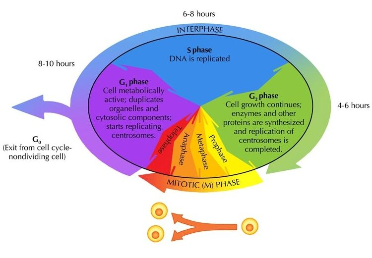
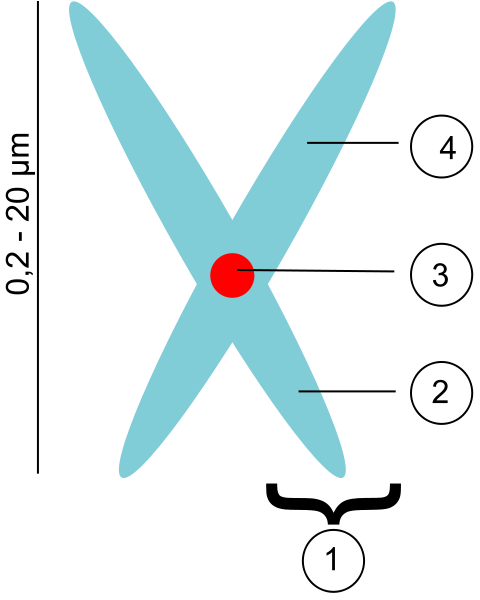

## 3.2 The cell cycle (ESG5J)

This section introduces the learner to the life cycle of a cell. Teachers should emphasise that mitosis and the cell cycle are not the same thing! Mitosis is simply one stage of the cell cycle. The process of mitosis (cell division) is explained. Learners need to know the names of the phases and they need to be able to draw simple descriptive diagrams showing the chromosome changes. A description of the differences in telophase between plant and animal cells is also required (plant cells lack centrioles). The difference between cytokinesis in animal and plant cells should also be addressed: plant cells invaginate and "pinch off" and plant cells grow a cell plate, which becomes the new cell wall.

The **cell cycle** is the series of events that takes place in a cell that results in DNA replication and cell division. There are two main stages in the cell cycle. The first stage is **interphase** during which the cell grows and replicates its DNA. The second phase is the **mitotic phase** (M-Phase) during which the cell divides and transfers one copy of its DNA to two identical daughter cells. Figure 3.1 provides a brief overview of what takes place during each of the key events of the cell cycle.

Figure 3.1: The sequence of events in the cell leading to division of a cell into two daughter cells is known as the cell cycle and is shown above.

### Interphase (ESG5K)

Interphase is the longest phase of the cell cycle. During this phase the cell grows to its maximum size, performs its normal cellular functions, replicates its DNA, and prepares for cell division. This stage is divided into three parts: **G1, G2** and **S phases**.

<Callout type="note" title="Note">
Some cells no longer need to divide and exit the cell cycle. These cells may exit the cell cycle permanently, such as neurons, or they may exit the cell cycle temporarily. These cells are said to be in G0. G0 is not a stage of the cell cycle.
</Callout>

<Callout type="note" title="Note">
In cells without a nucleus (prokaryotic cells e.g. bacteria), there are many copies of the DNA floating around the whole cell. The prokaryotic cell cycle occurs through a process termed  binary fission. In cells with a nucleus (eukaryotes) all the DNA is inside the nucleus and so a more complicated cell cycle is required for replication.
</Callout>

**G1 phase**: Occurs just after the two daughter cells have split and the cells have only one copy of their DNA. Cells in this stage synthesise proteins and increase in size. Cells can remain in this stage for a long time.

**S phase**: Is the stage during which DNA replication occurs. The cell makes an identical copy of each of its **chromosomes**. Chromosomes are found inside the nucleus of the cell and consist of long strands of DNA that contain the genetic information of the cell.

**G2 phase**: Occurs after the DNA had been duplicated in S phase. During this phase the cell may continue to grow and undergo normal cellular functions. Towards the end of this phase the cell will start to replicate its organelles in preparation for mitosis.

Interphase (G1, S and G2 phases) accounts for approximately \(\text{90}\%\) of the cell cycle, with the other \(\text{10}\%\) being taken up by mitosis.

### Mitotic Phase (ESG5M)

The mitotic phase (M phase) is composed of two tightly coupled processes: **mitosis** and **cytokinesis**. During mitosis the chromosomes in the cell nucleus separate into two identical sets in two nuclei. This is followed by **cytokinesis** in which the cytoplasm, organelles and cell membrane split into two cells containing roughly equal shares of these cellular components. We will now describe what takes place during the stages of M-phase, which includes the four broad phases of mitosis (prophase, metaphase, anaphase, telophase) and the fifth phase of cytokinesis:

1. prophase
3. metaphase
5. anaphase
7. telophase
9. cytokinesis

**1. Prophase**

During prophase, the **chromatin** material shortens and thickens into individual chromosomes which are visible under the light microscope. Each chromosome consist of two strands or **chromatids** joined by a  **centromere** (Figure 3.2 ).

<Callout type="note" title="Note">
Learn about chromosomes.

<VideoPlayer src="https://youtu.be/hx8_yNRUuX4" title="Video: 2CQD" />
</Callout>

Figure 3.2:  Chromosome structure showing (1) Chromatid, (3) Centromere, (2) Short and (4) Long arms of chromosome.

<Callout type="note" title="Note">
Human cells have 46 chromosomes. (23 from the mother and 23 from the father).
</Callout>

As prophase progresses, the nuclear membrane and nucleolus disintegrates. In animal cells the **centrioles** separate and move to opposite poles. The centrioles give rise to the spindle fibres which form between the poles. In plant cells there are no centrioles to move to the poles, so spindle fibres form in the cytoplasm.

| Schematic diagram : animal cell | Micrograph : plant cell |
| --- | --- |

**2. Metaphase**

During metaphase, chromosomes line up on the **equator** of the cell. The chromosomes appear in a straight line across the middle of the cell. Each chromosome is attached to the spindle fibres by its centromere.

<Callout type="tip" title="Note">
The stages of the cell cycle (**i**nterphase, **p**rophase, **m**etaphase, **a**naphase, **t**elophase) can be remembered by using the mnemonic **IPMAT**.
</Callout>

| Schematic diagram : animal cell | Micrograph : plant cell |
| --- | --- |

**3. Anaphase**

During anaphase the chromatids are pulled to opposite poles of the cell by the shortening of the spindle fibres. The chromatids are now called  **daughter chromosomes**.

| Schematic diagram : animal cell | Micrograph : plant cell |
| --- | --- |

<Callout type="note" title="Note">
In plant cells there are no centrioles to move to the poles, so spindle fibres form in the cytoplasm.
</Callout>

**4. Telophase**

During telophase, a nuclear membrane reforms around the daughter chromosomes that have gathered at each of the poles. The daughter chromosomes uncoil to form chromatin once again. The nuclear membrane reforms.

| Schematic diagram : animal cell | Micrograph : plant cell |
| --- | --- |

**5. Cytokinesis**

The cytoplasm then divides during a process called **cytokinesis**. Cytokinesis is not a stage of mitosis but the process of the cytoplasm splitting into two. In an animal cell the cell membrane constricts. This **invagination** or in-folding of the cytoplasm divides the cell in two. In a plant cell a  **cross wall**  is formed by the  **cell plate** dividing the cytoplasm in two.

| Schematic diagram : animal cell | Micrograph |
| --- | --- |

There are now two  **genetically identical**  daughter cells which are identical to the parent cell and to each other.

<Callout type="note" title="Note">
See mitosis in action.

<VideoPlayer src="https://youtu.be/eV6nbisahek" title="Video: 2CQF" />
</Callout>
