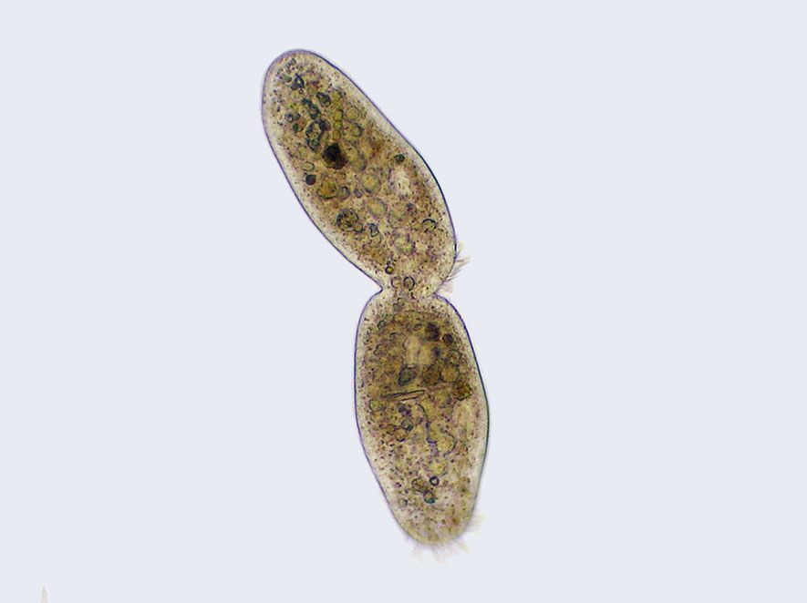

## 3.3 The role of mitosis (ESG5N)

Discuss the role of mitosis in growth, repair and reproduction in some simple organisms. Learners should be aware that there are two kinds of cell division, but only need to know mitosis in Grade 10. It is important that to remind learners that mitosis is the "copying" division, where the two daughter cells are exact copies of the mother cell. However, in meiosis, it is a reduction division where the daughter cells have half the number of chromosomes than the mother cell. No further detail is required.

The process of mitosis is essential for growth and repair processes of eukaryotic organisms: mitosis is how we are able to replace our fingernails and hair as well as how our skin is replaced. The table below summarises the role of mitosis in various processes in eukaryotic organisms.

| Living Process | Role of Mitosis |
| --- | --- |
| Development and growth | The number of cells increases by mitosis enabling organisms to grow from a single cell to a complex multicellular organism. |
| Cell replacement | Cells are constantly lost and replaced by new ones in the body, for example in the skin and in the gut. In addition, red blood cells live for only four months, and are replaced by mitosis. |
| Replacement of damaged plant or animal tissue (regeneration) | Some organisms use mitosis to replace body parts. For example starfish replace lost arms by mitosis. |
| Asexual reproduction | Some organisms such as the hydra use mitosis to produce genetically identical offspring. The process is known as budding. Mitosis is also the method by which yeast cells multiply. |

Table 3.1: The role of mitosis in eukaryotic organisms.

Figure 3.3 shows asexual reproduction in a ciliate organism. Asexual reproduction uses mitosis.

Figure 3.3: Asexual reproduction: ciliate undergoing cytokinesis.

<Callout type="note" title="Note">
Hair has the highest rate of mitosis. An average hair grows 0.3 mm every day and 1 cm every month.
</Callout>
