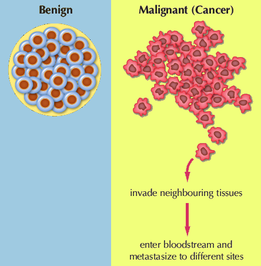
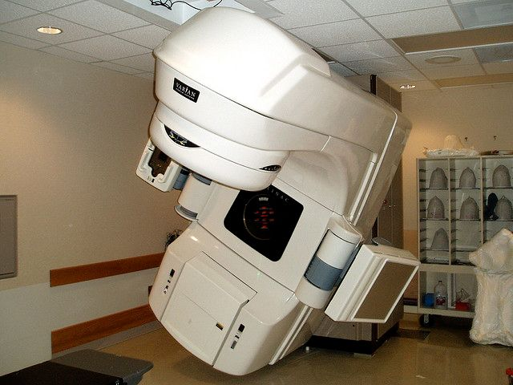
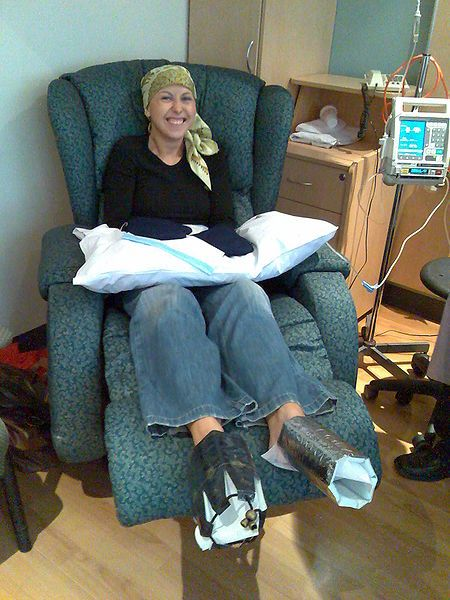
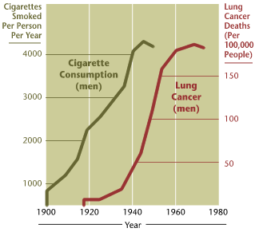

## 3.4 Cancer (ESG5P)

Cancers are caused by uncontrolled cell division and growth. Initially learners will need to be told what cancer is, and how cancer cells differ from normal cells. They will also need to understand how a tumour can be benign or malignant. The key characteristic of a malignant tumour is the ability to metastasise to other organs via the bloodstream or lymph.

A brief discussion of the causes of cancers with learners is necessary. Teachers should emphasise that learners can control some of the behaviours that cause cancer.  Finally teachers should address the beliefs and attitudes of various communities and groups about cancer. This is an excellent opportunity to hold a class discussion, and we encourage teachers to invite questions and stories from learners and not to focus on only some of the common misconceptions outlined in this book.

The various treatments of cancer including traditional, other non-conventional treatments also need to be discussed. The advancement of medical biotechnology e.g. radiotherapy, chemotherapy needs to be introduced to the learners, but no detail is required.

** Websites to visit **

Short video from the Khan Academy: "Cancer : An introduction to cancer and how it is the by-product of broken DNA replication"

Inside Cancer (very good summary of cancer and related issues)
 and

### Introduction (ESG5Q)

Cancer is a group of diseases characterised by uncontrolled cell division  which leads to growth of abnormal tissue. This means that a cancer is essentially a  **disease of mitosis**. Cancer begins when a single cell is  **transformed**, or converted from a normal cell to a cancer cell. Cancer cells grow and divide uncontrollably to form a mass of cancer cells called a **tumour**. As the tumours grow, they squash healthy cells, steal their nutrients and prevent them from working normally. Cancer cells differ from normal cells in a number of ways:

1. **Cancer cells don't listen to signals to stop growing**: Normal cells listen to signals from the body to stop growing and dividing. However cancer cells do not respond to signals from the body and  keep on dividing.
3. **Cancer cells grow new blood vessels**: As the tumour grows larger, it begins to release proteins from the cell to attract new blood vessels. Blood vessels draw nutrients away from healthy cells and therefore starve them while allowing the growth of the tumour. The new blood vessels also enable cancer cells to enter the bloodstream and spread to other parts of the body.
5. **Cancer cells spread around the body**: Another feature of cancer cells is that they can spread around the body (metastasise). Tumours that have the ability to spread to other parts of the body are called **malignant**. Cancer cells can spread to surrounding  tissues via the bloodstream or via the lymph system.

As previously mentioned, cancer cells are **malignant** which means they are able to invade tissues and spread to other parts of the body. Some tumours cannot spread to other tissues and are called **benign** tumours. Benign tumours are non-cancerous.

Figure 3.4: Benign tumours are unable to metastasise. Malignant tumours are able to metastasise away from the original tumour site.

<Callout type="note" title="Note">
Watch some videos to learn more about how normal cells turn cancerous.

<VideoPlayer src="https://insidecancer.org/" title="Video: 2CQH" />

<VideoPlayer src="https://www.khanacademy.org/video/cancer?playlist=Biology" title="Video: 2CQJ" />

<VideoPlayer src="https://www.khanacademy.org/video/cancer?playlist=Biology" title="Video: 2CQK" />
</Callout>

**Types of cancers**

Cancer can affect almost any tissue in the body. A list of some common cancers includes:

- Breast cancer
- Lung cancer
- Oesophageal cancer
- Leukaemia (blood cancer)
- Melanoma (skin cancer)

<Callout type="note" title="Note">
There are hundreds of different types of cancer. For a comprehensive list visit:
</Callout>

Cancers often spread to different organs, however it remains the same type of cancer as the original cancer, it is simply referred to as a metastasis. Therefore melanoma (skin cancer) that spreads to the liver is not liver cancer, but a melanoma metastasis to the liver.

### Causes of cancer (ESG5R)

Cancer is caused by agents called **carcinogens**. Carcinogens cause cancer by damaging DNA which can no longer code for the important regulatory functions of the cell cycle. Some viruses can also increase the likelihood of getting certain types of cancer. Human papillomavirus (HPV), the disease that causes genital warts, can increase a woman's risk of cervical cancer, and infection with hepatitis B or C increases the risk of liver cancer. In addition, some people are born with genetic mutations that they have inherited from their parents that increase their chances of getting cancer. However a genetic predisposition to cancer does not mean that you will get cancer. If you have a family history of cancer it simply means it is more important for you to limit your exposure to carcinogens. Examples of some carcinogens include:

- cigarette smoke
- radiation
- x-rays
- UV light
- food additives
- several dangerous chemicals

<Callout type="note" title="Note">
Carcinogens can cause a **DNA mutation** that occurs in one of several **genes** that normally function to control growth. E.g the *BRCA1*, or "Breast Cancer Gene". The *BRCA1* gene normally  functions to suppress tumour formation; but if a genetic mutation occurs it does not work properly, and tumour formation can begin. Mutations in this gene does not mean that a person will develop breast cancer, but they have an increased risk for breast cancer.
</Callout>

<Callout type="note" title="Note">
Watch this video to learn more about how gene mutations and cancer.

<VideoPlayer src="https://youtu.be/iHOspvc4yb0" title="Video: 2CQM" />
</Callout>

### Beliefs and attitudes concerning cancer (ESG5S)

There are some common misconceptions about cancer

- **It is people's fault if they get cancer**: Although there are ways to try and decrease your risk of getting cancer, it is not always possible. Cancer is caused by random mutations in DNA, and sometimes people get cancer purely by chance.
- **Cancer is a death sentence**: Sometimes when the cancer is very advanced there is not much to be done to save a person, but there are many cancers that respond well to treatment when detected early. Depending on the type and the stage of the cancer, people can survive cancer and go on to live healthy happy lives.
- **If someone in your family has cancer you might get it too**: Although there are some cancers that are more common in certain families due to an inherited genetic mutation, a family history of cancer does not mean than you will also get cancer. However, if a certain type of cancer runs in your family it is good to see a doctor for regular screenings.
- **Cancer is contagious and you can catch it from others**: Cancer cannot be spread from one person to another.
- **A positive attitude can cure cancer**: There is plenty of evidence that a positive attitude can help a person with cancer feel better and stay healthier for longer, however it is not the only factor that determines whether someone will recover or not.
- **Only old people get cancer**: Although cancer is more common in older people, children and babies can also get cancer. Leukaemia is a common childhood cancer.
- **Only females get breast cancer**: Although breast cancer is more common in females, males can also get breast cancer.
- **Only pale people get skin cancer**: Although skin cancer is more common in people with light skin (melanin, the pigment that makes your skin dark is also protective), people with dark skin can also get skin cancer.

### Cancer treatment (ESG5T)

Cancer is usually treated using conventional methods that are  based on Western evidence-based medicine. However, many people like to use a holistic approach to treat cancer, and therefore also use indigenous methods to manage symptoms. The following sections will introduce some conventional and indigenous methods for treating cancer.

### Conventional methods (ESG5V)

The conventional medical approaches to treating cancer include **radiation therapy, chemotherapy** and **surgery**.

**1. Radiation therapy**

Radiation therapy is the use of high energy electromagnetic radiation to kill cancer cells. The radiation damages the DNA inside the cancer cells, causing them to die. Radiation damages healthy cells too; therefore the treatment is targeted directly at the tumour.

Figure 3.5: Radiation therapy uses high energy electromagnetic radiation to kill cancer cells.

**2. Chemotherapy**

Chemotherapy is the use of special drugs to treat cancer. Most chemotherapy drugs are cytotoxic (toxic to cells) and work by  damaging the cell's DNA. Chemotherapy specifically tries to prevent cell division, and so it is very toxic to cancer cells which are characterised by uncontrolled cell division. However, unfortunately, these drugs also damage healthy cells that divide rapidly, such as blood cells and cells found in hair follicles, lining the mouth, stomach and intestine and the skin. Because of the damage to rapidly dividing healthy cells, the side-effects from chemotherapy include hair loss, mouth ulcers, nausea, sores, anaemia and infections due to a lowered immune system.

A combination of drugs which act in slightly different ways to halt cell division are often given together.  Patients often receive chemo according to a regime, where they receive doses of chemo for a time period, followed by a break that allows the healthy cells in their bodies to recover. Usually a chemo regime consists of a few cycles of chemotherapy doses and breaks for recovery.

Figure 3.6: Chemotherapy is the use of chemical treatments targeted at cancer cells.

<Callout type="note" title="Note">
Chemotherapy targets cells that are rapidly dividing so patients undergoing chemotherapy often lose their hair and feel nauseous (because the intestinal lining in the stomach is killed).
</Callout>

**3. Surgery**

Surgery involves removal of either the whole tumour, part of the tumour and sometimes even whole organs or body parts. When a small section of the tumour is removed this is called **biopsy**. Frequently surgery is followed by either radiation therapy or chemotherapy and sometimes both.

### Indigenous methods (ESG5W)

In addition to the conventional methods of treatment described, many people seek alternative forms of treatment. In South Africa, individuals commonly use traditional medicines like African Potato *(Hypoxis* *hemerocallidea)*  and "Cancer bush" *(Sutherlandia frutescens), * to boost the immune system while undergoing conventional treatments.

| Figure 3.7: African potato is used as a remedy against cancer in some forms of traditional medicine. | Figure 3.8: "Cancer bush" used in certain forms of indigenous treatments for cancer. |
| --- | --- |

The cancer bush (*Sutherlandia frutescent, uNwele)*  is an indigenous medicinal plant which the Khoi and Nama people used to wash wounds and to reduce high fevers. The early settlers also used this bush to treat chicken pox, eye problems and internal cancers. Cancer patients often lose weight and suffer muscle wastage and a tonic made from this bush may improve appetite, decrease anxiety and slow down the weight loss.

### Prevention of cancer (ESG5X)

<Callout type="note" title="Note">
Some people are born with mutations in genes involved in regulating the cell cycle. For example in colorectal cancer (cancer of the colon) some people have mutations in the mismatch repair genes. Mismatch repair genes fix damaged DNA. If they are not working properly it enhances a person's risk of getting cancer. People who have a close family member who got cancer when they were under 40 years of age need to be regularly tested for damaged genes.
</Callout>

The risk of developing any one of the many types of cancer can be reduced by eating a healthy diet, exercising regularly and avoiding smoking and alcohol. The sooner cancer is detected the easier it is to treat. Therefore it is also advisable for people to get regular screenings. Here are some guidelines to lower your risk of developing cancer:

- **Avoid smoking**: avoid smoking cigarettes and avoid enclosed areas where people smoke (this avoids passive smoking).
- **Avoid alcohol**: limit alcohol, as excessive alcohol consumption can lead to increased risk of oesophageal, liver and breast cancer.
- **Healthy diet**: avoid (or limit) very processed foods or burnt food, both of which contain carcinogens.
- **Regular physical activity**: partake in physical activity on a regular basis. Regular exercise improves general health and helps one to maintain an ideal body weight, thereby lowering the risk of many cancers.
- **Sun protection**: limit exposure to the sun and damage by ultraviolet radiation. Try to stay out of the sun between 10 am and 3 pm, wear high SPF sunscreen that protects against UVA and UVB, and wear a hat, sunglasses, and protective clothing.
- **Regular screenings**: cell or tissue abnormalities can sometimes be detected before they become cancerous. Regular pap smears can prevent cervical abnormalities developing into cervical cancer and getting moles and skin conditions checked can prevent dangerous skin cancer. Cancer can also be detected at the early treatable stages by going for regular mammograms (for breast cancer), or prostate exams (for prostate cancer) as adults. The frequency of these exams will be age and risk dependent.

| Ways to decrease cancer risk |
| --- |
| Avoid smoking | Avoid excessive alcohol consumption | Eat a healthy diet |
| Regular physical activity | Sun protection | Regular screenings |

<Callout type="note" title="Note">
Watch this video about how our bodies help protect us from cancer despite the constant bombardment of environmental carcinogens.

<VideoPlayer src="https://youtu.be/Qja4z1HGDQo" title="Video: 2CQN" />
</Callout>

## Cancer and smoking

### Aim

Investigating the relationship of smoking and cancer.

### Instructions

Look at the graph below and answer the questions that follow:

Figure 3.9: Graph showing correlation between smoking and lung cancer (courtesy NHI).

### Questions

1. In what year was the first incidence of lung cancer seen in male smokers?
3. How many years was this after the introduction of cigarettes?
5. In which year did the average number of cigarettes smoked per year reach a peak?
7. Approximate how many years it takes most male smokers to develop cancer? Clue: Compare the number of years seen between the two line graphs for 1000, 2000, 3000 and 4000 cigarettes per year. Add the years together and divide by 4 to get the average time (in years) taken for smokers to develop cancer.
9. What can you say about the shape of the two graphs? Do they look similar or different? What does this mean?
11. What was the death rate from lung cancer in 1950? Express your answer as a percentage and show your working.
13. Suggest a reason why the number of cigarettes smoked shows a decrease after 1945.

**Cancer and Smoking**

Approximately 1918-1919 (1)

Approximately 18 years - 19 years (1)

Around 1945 (accept one year either way) (1)

The average is about 20 years. (4)

They are very similar in shape (where the smoking graph shows an increase in the average number of cigarettes smoked per year, the incidence of lung cancer increased), but are approximately 20 years apart. The fact that the two lines converge (get closer together) near the top, indicates that the more cigarettes one smokes, the less time it takes for lung cancer to develop. (3)

125 deaths per \(\text{100 000}\) people \(= \frac{125}{\text{100 000}} \times 100 = \text{0,125}\%\) (3)

Fewer people were smoking after the Second World War – it became widely known that smoking damages one’s health, so they stopped / gave up. The ones who were still smoking may also have decided to cut down / reduce the number they smoke. (2)

## Research on cancer

**Aim**

To research and present information on one of the human cancers

**Resources required**

1. Science journals such as "New Scientist", "Scientific American" and any other journals you can find.
3. Use the Internet widely including the websites below:
   - Howard Hughes Medical Institute: contains links for educators and learners on a variety of approaches to determining causes and potential cures for cancer:
   - Whitehead Institute for cancer research. This is one of the world's leading cancer research labs where you can find interactive videos, links to other resources and information about a variety of cancers:

**Instructions**

Using the resources available, you are required to research ONE of the cancers affecting humans. In particular you are required to:

- Write a report under the following main headings:
  - **Discuss the major causes of the cancer**: Discuss cancer with respect to its genetic and/or environmental causes and how the cancer spreads within a particular individual.
  - **Describe the common beliefs and attitudes concerning the particular cancer you have chosen to research**: Present the popular (common) attitudes people have about cancer, its treatment and how cancer is caused in the first place.
  - **Describe the major forms of treatment available **: What are the major treatments available. Provide an analysis of these under the sub-headings "Modern biotechnological methods" and "Traditional methods".
  - **Describe the prevalence of the cancer type**: Prevalence refers to how common a cancer is in a particular location. Provide statistics in the form of histograms and pie charts of how prevalent the cancer is in different age groups, races and genders.
- At the end of your report, provide a complete list of references of websites, articles and other sources of information used in compiling the report.
- Include any pictures, diagrams and information that you think may be relevant to your report.

**Research on Cancer**

This can be an extremely complex research task, or one that is relatively easily managed, depending on how the teacher approaches the task. It is recommended that the following guidelines be used:

1. All staff members who teach classes in Grade 10 should get together and decide on how detailed they want the research tasks to be. All learners in the grade should get the same guidelines.
3. Decide on what the maximum mark will be and how much this task will contribute towards the term mark of learners. The guideline rubric for marking has a maximum of 25.
5. It is suggested that teachers do not require HUGE amounts of detail, since learners are in Grade 10 and the aim should be to have them expand their knowledge while also having fun with the subject matter. This should not take up all their free time for the term.
7. THE FOLLOWING BROAD GUIDELINES MAY BE USED IF TEACHERS PREFER
   1. **Major causes:** Describe two to four causes. It is recommended that learners list these in order of importance. Each cause should be approximately one short paragraph of about 4 lines. More marks will be allocated to four, rather than two causes.
   3. **Common beliefs / attitudes:** Find and briefly describe three commonly held beliefs about the causes, treatment, progression and origins of cancer. These do not have to be accurate, but they do have to be substantiated. Learners are required to indicate sources for where these beliefs / attitudes were found. It is also expected that learners indicate whether these are in fact accurate or incorrect.
   5. **Treatment:**Briefly describe two forms of treatment for the specific type of cancer that was researched. It is not expected that learners name specific drugs or give dosages of radiation or drugs.
   7. **Prevalence:** Sources must be acknowledged when quoting statistics. Teachers are to check that learners give stats for the SPECIFIC type of cancer they researched, not for cancers in general. Teachers should guard against plagiarism in copying pie charts and other graphs directly off the Internet – learners should be asked to give their sources if doing so is deemed acceptable by the staff, or they may be required to hand in only HAND DRAWN graphs and other charts. It is suggested that learners be told SPECIFICALLY what graphs to hand in, e.g. you MUST have at least one graph to support your research, but you may not submit more than three.
9. Teachers should draw up a rubric for marking the research task. The following table provided below is merely a suggestion – it may be used or altered as the staff at the school feel. They just need to print one rubric per task and put ticks in the relevant blocks:

| Section | 5 Excellent. Clear, detailed, neat | 4 Good. Well-researched, less detail | 3 Average. Tried, but made errors | 2 Not so good. Some gaps in knowledge | 1 Very weak. Very few facts | 0 Not done / no proof given |
| --- | --- | --- | --- | --- | --- | --- |
| Causes |  |  |  |  |  |  |
| Beliefs |  |  |  |  |  |  |
| Treatment |  |  |  |  |  |  |
| Prevalence |  |  |  |  |  |  |
| Pictures/ Graphs |  |  |  |  |  |  |
| Total |  |

Table 3.2: Marking rubric for Cancer Research Project
