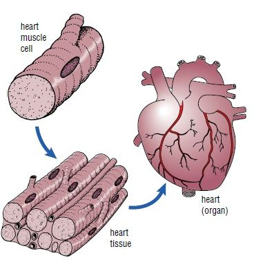

## 4.2 Tissues (ESG64)

**What is a tissue?**

Learners are introduced to the concept of a tissue as a group of similar cells adapted for a particular function. Encourage learners to try and list or identify some tissue types. Throughout the chapter, emphasise the relationship between basic structure of the tissue and its function.

Tissues are made up of a group of similar cells that are adapted for a particular function. Organs are then formed by the functional grouping together of multiple tissues.

Figure 4.1: The diagram above depicts how several cells adapted for the same function work in conjunction to form tissues, and together form an organ.

In this chapter we will be studying plant and animal tissues, starting with plant tissues.

[Simulation: 2CR2](http://www.s-cool.co.uk/a-level/biology/cells-and-organelles/revise-it/tissues)
