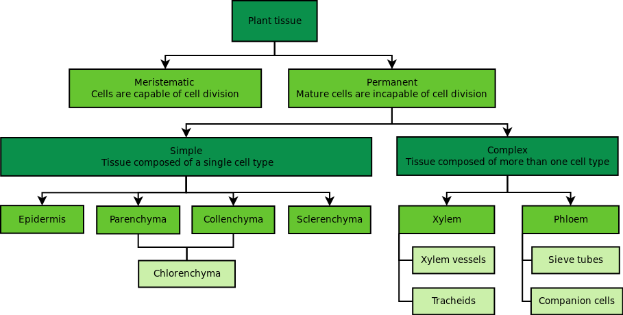
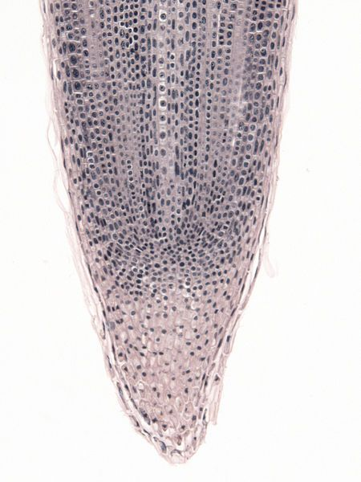
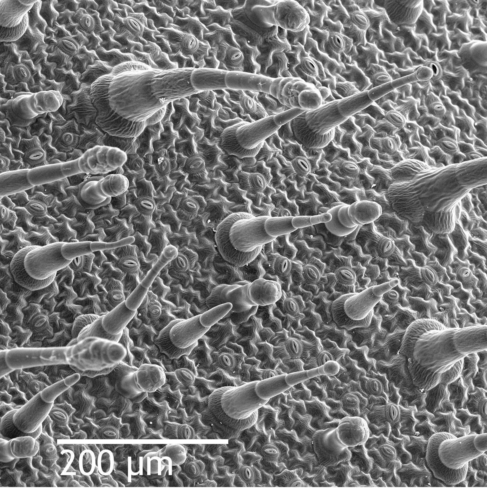
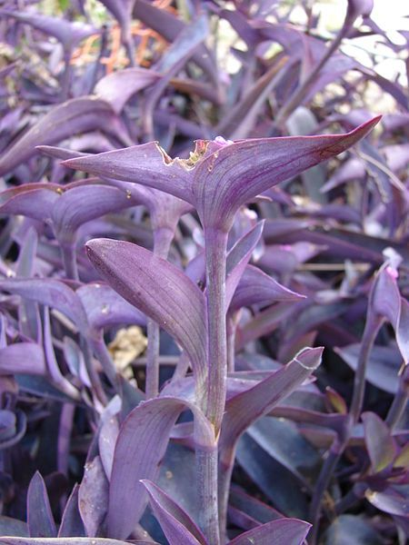
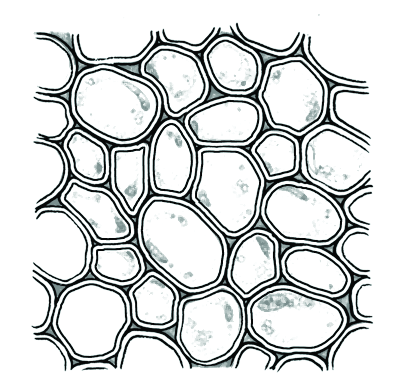
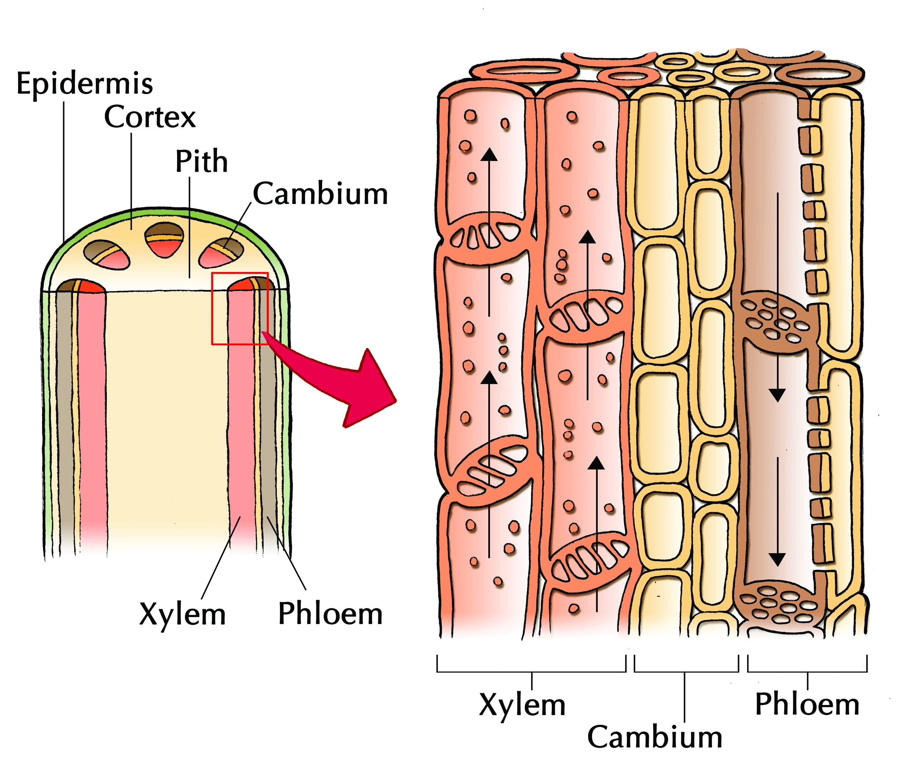

## 4.3 Plant tissues (ESG65)

Plant tissue is divided into four different types:

- Meristematic tissue which is responsible for the making of new cells by mitosis.
- Epidermal tissue which is the outer layer of cells that cover and protect the plant.
- Ground tissue which has air spaces, and manufactures and stores nutrients.
- Conducting tissue which is responsible for the transport of water and nutrients throughout the plant.

| Key Outcomes: Be able to identify the four different  groups of plant tissue Understand the structure and function of the different plant tissues and the importance of their location within the plant. Be able to draw and label plant tissues. Be able to prepare slides of the various plant tissues. Understand the importance of meristematic tissue in biotechnology and in our indigenous knowledge systems. |
| --- |

Learners need to be able to examine and identify some plant tissues using microscopes, bio viewers, photomicrographs and posters. Learners need to be able to draw the cells that make up the various plant tissues, showing the specialised structures.

**TEACHER RESOURCES:**

Types of plant tissues:

Plant tissues picture:

Plants are typically made up of roots, stems and leaves. Plant tissues can be broadly categorised into dividing, **meristematic** tissue or non-dividing, **permanent** tissue.  Permanent tissue is made up of **simple** and **complex** tissues.

<Callout type="note" title="Note">
There are over \(\text{200 000}\) types of plant species in the world. Green plants provide the Earth's oxygen, and also directly or indirectly provide food for all animals because of their ability to photosynthesise. Plants also provide the source of most of our drugs and medicines. The scientific study of plants is known as **botany.**
</Callout>

<Callout type="note" title="Note">
Learn more about plant tissues:

<VideoPlayer src="https://www.youtube.com/watch?v=4V0VcNCRKTo" title="Video: 2CR3" />
</Callout>

Figure 4.2 provides an overview of the types of plant tissues being studied in this chapter.

Figure 4.2: The diagram above depicts how several cells adapted for the same function work in conjunction to form tissues.

It is important that for each tissue type you understand:

- where it is located
- what its key structural features are and how these relate to function
- how each tissue type looks under the microscope
- how to draw biological diagrams of each structure

### Meristematic tissue (ESG66)

Meristematic tissue is **undifferentiated tissue**. Meristematic tissue contains actively dividing cells that result in formation of other tissue types (e.g. vascular, dermal or ground tissue). **Apical** meristematic tissue is found in buds and growing tips of plants. It generally makes plants grow taller or longer. **Lateral** meristematic tissue make the plant grow thicker. Lateral meristems occur in woody trees and plants. Examples of lateral meristematic tissue include the vascular cambium that results in the rings you see in trees, and  **cork cambium** or 'bark' found on the outside of trees.

| Diagram | Micrograph |
| --- | --- |
| Figure 4.3: Meristematic cells in the growing root-tip of the onion, from a longitudinal section. | Figure 4.4: Micrograph of meristematic tissue |

The following table highlights how the structure of the meristematic tissue is suited to its function.

| Structural adaptation | Function |
| --- | --- |
| Cells are small, spherical or polygonal in shape. | This allows for close packing of a large number of cells. |
| Vacuoles are very small or completely absent. | Vacuoles provide rigidity to cells thus preventing rapid division. |
| Large amount of cytoplasm and a large nucleus. | The lack of organelles is a feature of an undifferentiated cell. Large amount of nuclear material contains the DNA necessary for division and differentiation. |

Table 4.1: Structural adaption and function of meristematic tissue

Meristematic tissue is found in root tips as this is where roots are growing and where dividing cells are produced. Figure 4.5 shows a micrograph image of a root tip.

Figure 4.5: Image shows meristematic tissue in a root tip as observed under an electron microscope.

### Permanent tissues (ESG67)

The meristematic tissues give rise to cells that perform a specific function. Once cells develop to perform this particular function, they lose their ability to divide. The process of developing a particular structure suited to a specific function is known as *cellular differentiation*. We will examine two types of permanent tissue:

1. **Simple permanent tissues**
   - epidermis
   - parenchyma
   - collenchyma
   - sclerenchyma
3. **Complex permanent tissues**
   - xylem vessels (made up of tracheids and vessels)
   - phloem vessels (made up of sieve tubes and companion cells)

### Epidermis tissue (ESG68)

The epidermis is a single layer of cells that covers plants' leaves, flowers, roots and stems. It is the outermost cell layer of the plant body and plays a protective role in the plant. The function of key structural features are listed in table:epidermaltissue.

| Structure | Function |
| --- | --- |
| Layer of cells covering surface of entire plant. | Acts as a barrier to fungi and other microorganisms and pathogens. |
| Layer is thin and transparent. | Allow for light to pass through, thereby allowing for photosynthesis in the tissues below. |
| Epidermal tissues have abundant trichomes which are tiny hairs projecting from surface of epidermis. Trichomes are abundant in some plant leaves. | Leaf trichomes trap water in the area above the stomata and prevent water loss. |
| Root hairs are elongations of epidermal cells in the root. | Root hairs maximise the surface area over which absorption of water from the soil can occur. |
| Epidermal tissues in leaves are covered with a waxy cuticle . | The waxy outer layer on the epidermis prevents water loss from leaves. |
| Epidermal tissues contain guard cells containing chloroplasts. | Guard cells control the opening and closing of the pores known as stomata thus controlling water loss in plants. |
| Some plant epidermal cells can secrete poisonous or bad-tasting substances. | The bitter taste of the substances deter browsing and grazing by animals. |

Figure 4.6: Scanning electron microscope image of *Nicotiana alata* (tobacco plant)  upper leaf surface, showing trichomes (also known as `hairs') and a few stomata.

<Callout type="note" title="Note">
The chemicals in trichomes make plants less easily digested by hungry animals and can also slow down the growth of fungus on the plant. As such they act as a form of protection for the plant against predation.
</Callout>

### Guard cells and Stomata (ESG69)

A **stoma** is a pore found in the leaf and stem epidermis that allows for gaseous exchange. The stoma is bordered on either side by a pair of specialised cells known as  **guard cells**. Guard cells are bean shaped specialised epidermal cells, found mainly on the lower surface of leaves, which are responsible for regulating the size of the stoma  opening. Together, the stoma and the guard cells are referred to as  **stomata**.

The stomata in the epidermis allow oxygen, carbon dioxide and water vapour to enter and leave the leaf. The guard cells also contain chloroplasts for photosynthesis. Opening and closing of the guard cells is determined by the turgor pressure of the two guard cells. The turgor pressure is controlled by movements of large quantities of ions and sugar into the guard cells. When guard cells take up these solutes, the water potential decreases causing water to flow into the guard cells via osmosis. This leads to an increase in the swelling of the guard cells and the stomatal pores open.

| Structure |
| --- |
| Figure 4.7: Stomata in a tomato leaf as seen under a scanning electron microscope. | Figure 4.8: The above is a microscopic image of an Arabidopsis thaliana (commonly known as `Thale cress' or `mouse ear') stoma showing two guard cells exhibiting green fluorescence, with chloroplasts staining red. |

## Practical investigation of leaf epidermis

### Aim

To observe epidermal cells and stomata.

### Materials

- leaves of *Agapanthus*, Wandering Jew *(Tradescantia* ) or similar plants that have epidermis that strips off easily
- microscopes
- microscope slides and cover slips
- dissecting needles
- scissors

### Instructions

1. Rip a piece of leaf lengthwise and check for 'thinner bits' near the edges, which will be epidermal tissue (ensure that you have *lower* epidermis because this is where the guard cells are found).
3. Use the scissors to cut off a small section of epidermis and mount it in water on a microscope slide. Cover with a cover slip.
5. Focus the slide on low power and search for a section of the sample that does not have air bubbles over the stomata.
7. Enlarge the part of the specimen you chose and focus on high power.
9. Adjust lighting if necessary and draw one stoma and its guard cells. Label all parts.

### Questions

1. Describe the shape of the guard cells and normal epidermal cells.
3. Which epidermal cells have chloroplasts?
5. Describe the wall thickness around the guard cells and account for any visible differences.

**Activity: Practical investigation of leaf epidermis**

Learners to use microscope and slide preparation skills.

**NOTES TO TEACHERS**

- *Tradescantia*, a common SA plant with purple leaves, works particularly well for this practical since the epidermis rips off easily.
- Learners should be encouraged to rip the leaves quickly in order to get epidermal tissue.
- They must search the entire specimen on low power, in order to get the best part to magnify. There is little value in just enlarging the first part of the leaf they focus on – there will be many stomata that have air bubbles with thick black outlines over them. Learners must search carefully and enlarge the best stoma they can find.
- Learners must be encouraged to draw the guard cells as they see them, even if they are lying at an angle.

*Tradescantia*, a common SA plant with purple leaves.

**Questions**

1. Describe the shape of the guard cells and normal epidermal cells.
3. Which epidermal cells have chloroplasts?
5. Describe the wall thickness around the guard cells and account for any visible differences.

**Answers**

1. Guard cells are bean shaped and normal epidermal cells are irregular, square-shaped or elongated (depending on leaf used.
3. Only the guard cells.
5. Guard cells have thick inner walls and thinner outer walls, as this helps them to open the pores for gaseous exchange.

We will now look at parenchyma, collenchyma and sclerenchyma cells. Together these tissue types are referred to as **ground tissues.** Ground tissues are located in the region between epidermal and vascular tissue.

### Parenchyma tissue (ESG6B)

Parenchyma tissue forms the majority of stems and roots as well as soft fruit like tomatoes and grapes. It is the most common type of ground tissue. Parenchyma tissue is responsible for the storage of nutrients.

Figure 4.10:  Parenchyma tissue found in cells responsible for storage.

| Parenchyma |
| --- |
| Structure | Function |
| Thin-walled cells. | Thin walls allow for close packing and rapid diffusion between cells. |
| Intercellular spaces are present between cells. | Intercellular spaces allow diffusion of gases to occur. |
| Parenchyma cells have large central vacuoles. | This allows the cells to store and regulate ions, waste products and water. Also function in providing support. |
| Specialised parenchyma cells known as chlorenchyma found in plant leaves contain chloroplasts. | This allows them to perform a photosynthetic function and responsible for storage of starch. |
| Some parenchyma cells retain the ability to divide. | Allows replacement of damaged cells. |

Table 4.2: Structure and function of parenchyma

## Observing parenchyma cells.

### Aim

To observe the structure of fresh parenchyma cells.

### Materials

- banana
- petri dishes or watch glasses
- dissection needles
- iodine solution
- microscopes, microscope slides and cover slips

### Instructions

1. Use the dissecting needle to lift off a small piece of the soft banana tissue.
3. Put the sample onto a petri dish or watch glass and mash it slightly using the dissecting needle (and a pencil if you want).
5. Lift a small sample of the tissue onto a microscope slide on which you already have placed a drop of iodine solution. Put the cover slip on.
7. Observe the cells under low power and find a section where the cells are lying separate, not all over each other.
9. Enlarge this section and focus carefully to see if you can find nuclei in some of the cells (they will be bigger than the purple plastids and transparent).
11. Draw 2 or 3 cells and label.

### Questions

1. Describe the shape of the cells and their wall thickness.
3. What are the plastids called which appear purple and what is their function?

**Activity: Practical investigation to observe the structure of fresh parenchyma cells**

Learners to use microscope and slide preparation skills.

**NOTES TO TEACHERS**

1. The cells will be large and have very thin walls. Many cells have leucoplasts storing starch.
3. Encourage learners to use the diaphragm on the microscope to prevent their cells being over-exposed to light – this can make the cells difficult to see.

**Questions**

1. Describe the shape of the cells and their wall thickness.
3. What are the plastids called which appear purple and what is their function?

**Answers**

1. Cells are rounded or oval and have very thin walls.
3. The plastids are leukoplasts and they store starch.

### Collenchyma tissue (ESG6C)

Collenchyma is a simple, permanent tissue typically found in the shoots and leaves of plants. Collenchyma cells are thin-walled but the corners of the cell wall are thickened with cellulose. This tissue gives strength, particularly in growing shoots and leaves due to the thickened corners. The cells are tightly packed and have fewer inter-cellular spaces.

| Collenchyma |
| --- |
| Diagram | Micrograph |
| Figure 4.11: Collenchyma cells are thin walled with thickened corners. | Figure 4.12: Light microscope image of collenchyma cells. |

| Collenchyma |
| --- |
| Structure | Function |
| Cells are spherical, oval or polygonal in shape with no intercellular spaces. | This allows for close packing to provide structural support. |
| Corners of cell wall are thickened, with cellulose and pectin deposits. | Provides mechanical strength. |
| Cells are thin-walled on most sides. | Provides flexibility, allowing plant to bend in the wind. |

<Callout type="note" title="Note">
Collenchyma tissues make up the strong strands observed in stalks of celery.
</Callout>

<Callout type="note" title="Note">
The growth of collenchyma tissue is affected by mechanical stress on a plant. For instance if the plant is constantly shaken by the wind the walls of collenchyma may be \(\text{40}\)–\(\text{100}\%\) thicker than those that are not shaken.
</Callout>

<Callout type="note" title="Note">
Learn more about permanent simple tissues.

<VideoPlayer src="https://www.youtube.com/watch?v=szDQS7FNGUI" title="Video: 2CR4" />
</Callout>

### Sclerenchyma tissue (ESG6D)

Sclerenchyma is a simple, permanent tissue. It is the supporting tissue in plants, making the plants hard and stiff. Two types of sclerenchyma cells exist: **fibres** and **sclereids**.

**Sclerenchyma fibres** are long and narrow and have thick lignified cell walls. They provide mechanical strength to the plant and allow for the conduction of water.

**Sclereids** are specialised sclerenchyma cells with thickened, highly lignified walls with pits running through the walls. They support the soft tissues of pears and guavas and are found in the shells of some nuts.

| Sclerenchyma |
| --- |
| Diagram | Micrograph |
| Figure 4.13: Sclerenchyma tissue provides support in plants. | Figure 4.14: Cross-section of sclerenchyma fibres. | Figure 4.15: Sclereid. |

| Sclerenchyma |
| --- |
| Structure | Function |
| Cells are dead and have lignified secondary cell walls. | This provides mechanical strength and structural support. The lignin provides a 'wire-like' strength to prevent from tearing too easily. |
| Sclereids have strong walls which fill nearly the entire volume of the cell. | Provide the hardness of fruits like pears. These structures are used to protect other cells. |

Sclerenchyma tissues are important components in fabrics such as flax, jute and hemp. Fibres are important components of ropes and mattresses because of their ability to withstand high loads. Fibres found in jute are useful in processing textiles, given that their principal cell wall component is cellulose. Other important sources of fibres are grasses, sisal and agaves. Sclereid tissues are the important components of fruits such as cherries, plums or pears.

<Callout type="tip" title="Note">
A useful way to remember the difference between collenchyma and sclerenchyma is to remember the 3 Cs pertaining to collenchyma: thickened at **c**orners, contain  **c**ellulose, and named **c**ollenchyma.
</Callout>

## Observing sclerenchyma in pears

### Aim

To observe sclerenchyma stone cells (sclereids) in pears.

### Materials

- soft, ripe pear
- microscopes, microscope slides and cover slips
- iodine solution
- dissecting needles or forceps

### Instructions

1. Use the forceps or needle to lift a small piece of soft pear tissue onto your microscope slide.
3. Add a drop of iodine solution.
5. Mash the tissue slightly to separate the cells.
7. Cover with a cover slip and observe under low power. You should focus on the groups of dark "stones" that appear amongst the rounded parenchyma cells of the pear. Try to find one or two stone cells or sclereids that are separate from the rest.
9. Enlarge a good specimen (or focus on the edge of a group where one cells sticks out) and adjust the lighting.
11. Look carefully while you focus up and down to see the long, narrow PITS running through the extremely thick walls of these cells.
13. These "stone cells" are called sclereids. They are a modified form of sclerenchyma found in pears, guavas and the shells of nuts for extra support.
15. Also observe the large round cells around the sclereids.

### Questions

1. Do you see cytoplasm inside the stone cells? Are they living or dead cells?
3. What tissue type do the large round cells around the sclereids belong to?

**Activity: To observe sclerenchyma stone cells (sclereids) in pears.**

Learners to use microscope and slide preparation skills.

**NOTES TO TEACHERS**

1. Learners need a very small amount of pear tissue for this practical – the riper the pear, the better. This practical works best in pears that are actually over-ripe and extremely soft.
3. Once again, encourage learners to scan the entire slide for the best parts before enlarging. They need to find a very small group of sclereids (they will appear as “little groups of black stones” amongst the large, thin-walled parenchyma cells of the pear).
5. Learners must expect that it will be very difficult to focus them – the sclereids lie in a heap at slightly different levels, so it will not be possible to focus on all of them at the same time.
7. The cells and pits are best seen if one FOCUSES UP AND DOWN slightly on high magnification using the **fine focus adjustment** – warn them not to touch the coarse focus adjustment!
9. It will be necessary to adjust the diaphragm to prevent over-illumination of the material.

**Questions**

1. Do you see cytoplasm inside the stone cells? Are they living or dead cells?
3. What tissue type do the large round cells around the sclereids belong to?

**Answers**

1. No, they are dead cells.
3. Parenchyma.

## To investigate sclerenchyma fibres

### Aim

To see sclerenchyma fibres in tissue paper.

### Materials

- cheap toilet paper (single ply)
- iodine solution or water
- microscopes and slides

### Instructions

1. Tear a tiny piece of toilet paper off the sample and mount it in water or iodine solution.
3. Place on a cover slip and examine under the microscope on low power.
5. Focus on the torn edge of the paper and observe the long sclerenchyma fibres.
7. Observe on high power.

### Questions

1. Describe the shape of these cells.
3. Are they living or dead cells?
5. Suggest their function.

**To investigate sclerenchyma fibres**

**NOTES TO TEACHERS**

1. It’s important that learners focus on the torn EDGE of the paper, not the centre.

**Questions**

1. Describe the shape of these cells.
3. Are they living or dead cells?
5. Suggest their function.

**Answers**

1. Cells are very long and pointed.
3. Dead cells.
5. They provide strength and support and help transport water.

We will now examine the complex permanent tissues. Remember the difference between simple and complex permanent tissues is that simple permanent tissues are made up of cells of the same type whereas complex permanent tissues are made up of more than one cell type that combine to perform a particular function. We will examine the **vascular** tissues, xylem and phloem tissues next.

### Xylem tissue (ESG6F)

Xylem  has the dual function of supporting the plant and transporting water and dissolved mineral salts from the roots to the stems and leaves. It is made up of vessels,  tracheids, fibres and parenchyma cells. The vessels and tracheids are non-living at maturity and are hollow to allow the transport of water. Both vessels and tracheids have lignin in their secondary walls, which provides additional strength and support.

**Xylem vessels** are composed of a long chain of straight, elongated, tough, dead cells known as vessel elements. The vessel elements are long and hollow (lack protoplasm) and they make a long tube because the cells are arranged end to end, and the point of contact between two cells is dissolved away. The role of xylem vessels is to transport water from roots to leaves. Xylem vessels often have patterns of thickening in their secondary walls. Secondary wall thickening can be in the form of spirals, rings or pits.

**Tracheids** have thick secondary cell walls and are tapered at the ends. The thick walls of the tracheids provide support and tracheids do not have end openings like the vessels. The tracheids' ends overlap with one another, with pairs of pits present which allow water to pass through horizontally from cell to cell.

| Diagram | Micrograph |
| --- | --- |
| Figure 4.16: Longitudinal section through a xylem vessel to show hollow lumen to allow for transport of water and nutrients. | Figure 4.17: Xylem vessel fibres with rings of lignin thickening. |

<Callout type="note" title="Note">
In addition to transporting water and mineral salts from roots to leaves, xylem also provides support to plants and trees because of its tough lignified vessel elements.

</Callout>

| Structure | Function |
| --- | --- |
| Long cells | Form effective conducting tubes for water and minerals |
| Dead cells: no cytoplasm | No obstruction to water transport |
| Thick, lignified walls | Support the plant and are strong enough to resist the suction force of transpiration pull, so they don’t collapse |
| Pits in cell walls | Allow lateral water transport to neighbouring cells |
| Tracheids have tapered ends | Improved flexibility of the stem in wind |
| Vessels elements have open ends | Water is transported directly to the next cell |
| No intercellular spaces | Added support for the stem |
| Living parenchyma cells in between xylem | Form vascular rays for water transport to the cortex of the stem |
| Patterns of secondary wall thickening | Improve flexibility of the stem in wind and allow the stem to stretch as it lengthens |

## Observing the patterned secondary walls in the xylem of fresh plant tissue

### Aim

To observe the patterned secondary walls in the xylem of fresh plant tissue.

### Materials

- celery stalk, rhubarb stalks or pumpkin stems *(macerated - chop them across and boil them in water for 3 minutes, then add an equal amount of glycerine. Cool before using. It can be stored for a few months in the refrigerator.)*
- microscopes and slides
- dissecting needles
- petri dishes or watch glasses
- eosin solution

### Instructions

1. Lift a small piece of celery / any other tissue chosen from the dish and transfer it to a watch glass or petri dish.
3. Use the dissecting needle and a pencil to *tease* the tissue apart (separate the thread-like, thicker cells away from each other). Try to get the long cells away from each other, otherwise bundles will be too thick to allow you to see individual cells. Ignore the thin walled parenchyma cells around them.
5. Transfer the plant tissue to a microscope slide and add eosin solution. Separate a bit more if necessary.
7. Examine under low power, focusing on the bundles of xylem vessels. Look for long bundles of fairly wide cells with  *thickening in the form of rings or spirals.* Do not confuse xylem vessels with the more common and much narrower sclerenchyma fibres - fibres have walls all the same thickness, have no spirals or rings and they are pointed at the end. If necessary, make a second slide if you did not find xylem.
9. Move a good part to the centre and enlarge. Examine the secondary walls of these cells.

### Questions

1. Describe the shape of xylem vessels.
3. What secondary walls patterns do you see?
5. Suggest the function of such secondary walls.

**Activity: To observe the patterned secondary walls in the xylem of fresh plant tissue.**

Learners to use microscope and slide preparation skills.

**NOTES TO TEACHERS**

1. Learners must ensure that they transfer some of the “stringy tissue” that been prepared, not just the soft tissue (which is parenchyma).
3. They will need to spend a bit of time teasing the cells apart with dissecting needles; otherwise the cells are very clumped together and difficult to see properly. They need to separate the ‘stringy’ bits from the normal soft tissue and mount only the stingy stuff onto the microscope slide.
5. These cells can be successfully mounted in iodine solution if eosin is not available.
7. Remind learners to adjust the diaphragm and look specifically for spirals / rings in very long, tubular cells. There will be many long, pointed sclerenchyma cells with the xylem.
9. It is frustrating if no such cells can be found – it may be necessary to make a second slide and try again.

**Questions**

1. Describe the shape of xylem vessels.
3. What secondary walls patterns do you see?
5. Suggest the function of such secondary walls.

**Answers**

1. Long, tubular cells with open ends.
3. Hopefully spirals and rings, maybe a reticulate / netted vessel as well.
5. To provide flexibility, support and allow the stem to stretch as it grows. They also resist the suction of transpiration pull and prevent the vessels collapsing during water transport.

### Phloem tissue (ESG6G)

Phloem tissue is the living tissue responsible for transporting organic nutrients produced during photosynthesis (mainly as the carbohydrate  **sucrose**) to all parts of the plant where these are required. The phloem tissue is made up of the following major types of cells:

<Callout type="note" title="Note">
Do you remember that sucrose is made up of glucose and fructose monosaccharides? Plants transport sucrose rather than glucose because it is less reactive and has less of an effect on the water potential.
</Callout>

- **sieve elements**: these are conducting cells which transport sucrose.
- **parenchyma cells**: which store food for transport in phloem.
- **companion cells**: are associated with parenchyma cells and control the activities of sieve tube elements, since the latter have no nuclei. Companion cells are responsible for providing energy to the sieve elements to allow for the transport of sucrose. Companion cells play an important role in loading sieve tubes with sucrose produced during photosynthesis. Companion cells and sieve tube elements are connected via connecting strands of cytoplasm called plasmodesmata.
- **fibres**: unspecialised cells and supportive cells.

| Diagram | Micrograph |
| --- | --- |
| Figure 4.18: Longitudinal section: phloem tissue transports nutrients throughout the plant. | Figure 4.19: Cross-section: the arrow indicates the location of the phloem in the vascular bundle. |

In the table below, the key structural features of the phloem are related to their function.

| Structure | Function |
| --- | --- |
| Companion cells |
| Contain large number of ribosomes and mitochondria. | Due to absence of organelles or nuclei in sieve tubes, companion cells perform cellular functions of the sieve tube. |
| Has many plasmodesmata (intercellular connections) in the wall attached to the sieve tube. | Allows transfer of sucrose-containing sap over a large area. |
| Sieve tubes |
| Sieve tube elements are long conducting cells with cellulose cell walls. | Form good conducting tubes over long distances. Allows for transfer over a large area. |
| They are living cells with no nucleus or organelles such as vacuoles or ribosomes. | Allows for more space to transport sap. It is also why sieve elements need companion cells to carry out all cellular functions. |

Figure 4.20: Xylem and phloem are the main transport vessels in plants. The figure above shows how vascular tissues are arranged in a vascular bundle.
