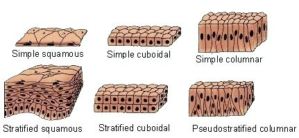
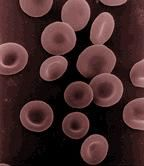
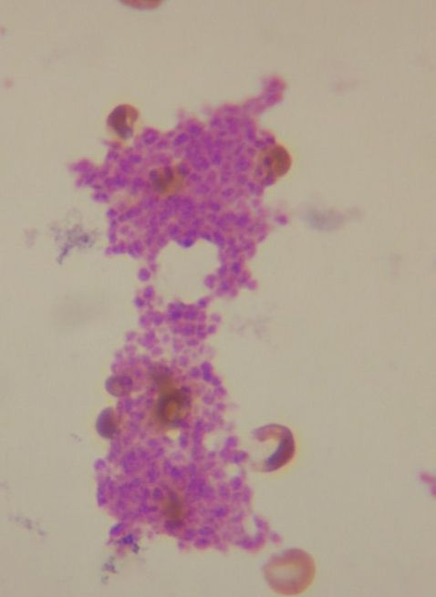
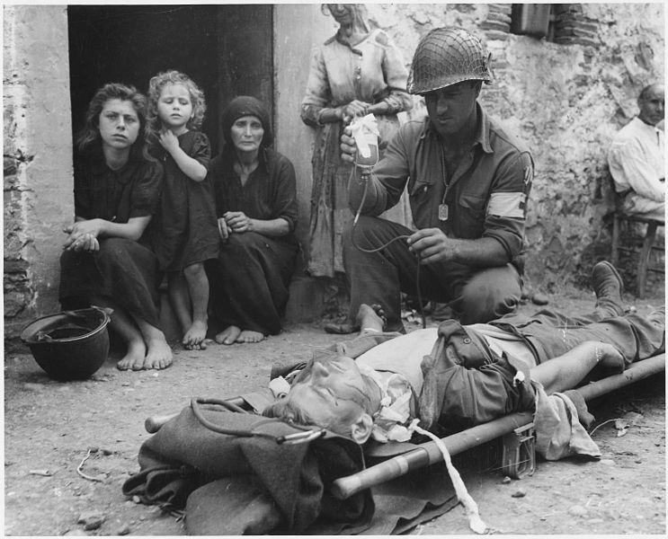

## 4.4 Animal tissues (ESG6H)

Animal cells with the same structure and function are grouped together to form tissues.  There are four types of animal tissues: epithelial tissue, connective tissue, muscle tissue and nervous tissue.

| Key Outcomes: Understand the differentiation of animal tissues and the relationship between structure and function of the various tissues. Know the location of the various tissues within the animal body. Learn the skill of drawing the various animal tissues. Be able to prepare slides of selected animal tissues. Know the importance of stem cell research in biotechnology and genetic engineering. |
| --- |

Learners need to be able to identify the four basic animal tissues and relate structure to function. Learners will be required to examine and identify some animal tissues using microscopes, bio viewers, micrographs or posters. They are required to be able to draw the various cells that make up these tissues in order to show their specialised structures.

**TEACHER RESOURCES:**

Tissues of human body:

Tissues are groups of similar cells that perform a particular function. We will be examining human tissues as an example of animal tissues.

Human bodies, like most animal bodies, are made up of four different types of tissue:

1. **Epithelial tissue** forms the outer layer of the body and also lines many of the bodies cavities where it has a protective function.
3. **Connective tissue** assists in support and protection of organs and limbs and depending on the location in the body it may join or separate organs or parts of the body.
5. **Muscle tissue** enables various forms of movement, both voluntary and involuntary.
7. **Nerve tissue** is responsible for the carrying of electrical and chemical signals and impulses from the brain and central nervous system to the periphery, and vice versa.

We will now look at each tissue type, examining its structure and function as well as its specific location in the body. You will be expected to recognise microscope images of each tissue type and produce biological drawings.

<Callout type="note" title="Note">
Watch a video about the different tissue types in animals

<VideoPlayer src="https://www.youtube.com/watch?v=I2bSWCyKOz0" title="Video: 2CR5" />
</Callout>

### Epithelial tissue (ESG6J)

Epithelial tissues are formed by cells that cover surfaces (e.g. skin) and line tubes and cavities (e.g. digestive organs, blood vessels, kidney tubules and airways). Epithelial tissue usually consists of a single layer of cells, however in certain cases there may be more than one layer.  All epithelial tissues are free surfaces attached to the underlying layers of a basement membrane.

There are different types of epithelial tissue which are named according to the number of layers they form and the shape of the individual cells that make up those layers. **Simple epithelium** refers to a **single** layer of cells. **Stratified epithelium** refers to **two or more** layers of cells. Squamous epithelium refers to  flattened cells, cuboidal epithelium  refers to cells that are cube-shaped and columnar epithelium refers to vertically elongated cells. Ciliated epithelium refers to epithelial cells that contain many tiny hair-like projections.

<Callout type="note" title="Note">
Pseudostratified epithelium refers to epithelium consisting of one layer but looking as though it consists of more than one layer.
</Callout>

Figure 4.21: The different types of epithelial tissue found in mammals.

** General functions of epithelial tissue**

- Provides a barrier between the external environment and the organ it covers.
- Specialised to function in secretion and absorption.
- Protects organisms from microorganisms, injury, and fluid loss.
- Excretes waste products such as sweat from the skin.

<Callout type="note" title="Note">
The skin is the largest human organ.
</Callout>

The different types of epithelial tissue are classified according to their shape. The major categories we are going to examine are **squamous, columnar** and **cuboidal** epithelium. The table presents each of them in detail.

| Epithelial tissue type | Location in body | Structure | Function |
| --- | --- | --- | --- |
| Simple squamous and stratified squamous | Simple: capillaries, alveoli (in lungs); stratified: skin | Thin and flat cells that are elliptically shaped and lie on basement membrane. Simple squamous epithelium is one-cell thick.  Stratified squamous epithelium consists of many layers. | Responsible for diffusion. Thin structure allows for movement of substances across the cells. |

| Epithelial tissue type | Diagram | Microscopic image |
| --- | --- | --- |
| Simple squamous and stratified squamous | Figure 4.22: Diagram of simple squamous epithelium |  |

| Epithelial tissue type | Location in body | Structure | Function |
| --- | --- | --- | --- |
| Cuboidal | Kidney tubules or glands (regions of the body responsible for excretion). | Cube-like in structure; may occasionally have structures called microvilli on surface to aid absorption. | Serve a protective function against bacteria and the wearing away of certain organs by lining various structures. Also prevent water loss. |

| Epithelial tissue type | Diagram | Microscopic image |
| --- | --- | --- |
| Cuboidal |  |  |

| Epithelial tissue type | Location in body | Structure | Function |
| --- | --- | --- | --- |
| Columnar | Digestive tract, reproductive organs | Elongated cells, nuclei located at the base of the cell. Cells connected by tight junctions and receive their nutrients from the basement membrane. | Main function is protective. Prevents against bacterial infection. Can also secrete mucus to protect surface from damage. |

| Epithelial tissue type | Diagram | Microscopic image |
| --- | --- | --- |
| Columnar |  |  |

A sub-type of columnar epithelium called ** ciliated columnar epithelium ** is found in some places in the body. Ciliated columnar epithelium contain little finger-like projections called **cilia**. These cilia beat in a wave-like motion to move particles, mucus or other substances around the body. Ciliated epithelium is found in the trachea and bronchi of the respiratory system and in the fallopian tubes of the female reproductive tract.

### Muscle tissue (ESG6K)

There are three types of muscle tissue:

1. skeletal
3. smooth
5. cardiac

Skeletal and cardiac muscle are striated. Striated muscle cells are striped, with regular patterns of proteins responsible for contraction. Striated muscle contracts and relaxes in short bursts, whereas smooth muscle contracts for longer.

**1. Skeletal muscle** is a voluntary muscle. It is striated in appearance. Skeletal muscle tissue has regularly arranged bundles. It is anchored by tendons and is used to effect skeletal muscle movement, such as **locomotion**, and maintain posture. The muscles have a reflex action but can also respond to conscious control.

**2. Smooth muscle** is an involuntary, non-striated muscle with tapered ends. It is found within the walls of blood vessels such as arteries and veins. Smooth muscle is also found in the digestive system, urinary tract and in the trachea. It is responsible for involuntary rhythmic contractions of peristalsis, required for moving food down the alimentary canal, and for the dilation and construction of blood vessels to control blood pressure.

**3. Cardiac muscle** is the major tissue making up the heart. It is an involuntary muscle that is striated in appearance. However, unlike skeletal muscle, cardiac muscle connects at branching, irregular angles. The connected branches help with coordinated contractions of the heart.

| Diagram | Micrograph |
| --- | --- |

### Nervous tissue (ESG6M)

Cells making up the central nervous system and peripheral nervous system are classified as nervous tissue. In the central nervous system, nervous tissue forms the brain and spinal cord. In the peripheral nervous system the nervous tissue forms the cranial nerves and spinal nerves, which include the sensory and motor neurons.

The function of nerve tissue is to transmit nerve impulses around the body. Nerves consist of a **cell body** (soma), **dendrites**, which receive impulses, and **axons** which send impulses. The axons of neurons are surrounded by a myelin sheath. The myelin sheath consists of layers of myelin, a white fatty substance. The myelin sheath's main function is to insulate nerve fibres and it also increases the speed of the impulses transmitted by the nerve cell. There are three types of nerve cells: sensory neurons, interneurons and motor neurons.

| Sensory neuron | Motor neuron | Interneuron |
| --- | --- | --- |
| Sensory neurons are responsible for sending information about the environment (called stimuli) to the central nervous system. They are activated by touch, light, temperature, pressure, hearing etc. Sensory nerve cells (or sensory neurons) carry impulses (electrical signals) from a receptor to the central nervous system (CNS). | These neurons are very short compared to the sensory and motor neurons. The connectors or interneurons connect a sensory neuron with a motor neuron. The impulse travels from the cell body at the head end along the short axon to the dendrites. | Motor neurons carry impulses from the CNS to  muscles or glands. In most cases the motor neuron causes muscle contraction (movement), but motor neurons can also cause secretion of substances by glands. The motor neuron causes a response via chemicals known as neurotransmitters. |

### Connective tissue (ESG6N)

Connective tissue is a biological tissue that is important in supporting, connecting or separating different types of tissues and organs in the body. All connective tissue is made up of cells, fibres (such as collagen) and extracellular matrix. The type of intercellular matrix differs in different connective tissues. There are different types of connective tissues with different functions. The following table lists some of the different types of connective tissue.

<Callout type="note" title="Note">
All connective tissues are characterised by cells separated from each other and found in some type of intercellular matrix.
</Callout>

| Connective tissue type | Structure | Function | Location | Diagram/Photo |
| --- | --- | --- | --- | --- |
| Areolar (loose connective) | jelly matrix; has network of elastic fibres which attach together | holds the organs in place, cushions and protects organs (acts as a packing material) | surrounds blood vessels and nerves found in the mesentry which surrounds the intestine | Figure 4.23: Loose connective tissue. |
| White fibrous | consists of non-elastic fibres | acts as a shock absorber, transfers or absorbs forces | in tendons, ligaments and many tough membrane sheaths that surround organs | Figure 4.24: White fibrous tissue. |
| Cartilage | rubbery matrix, can be flexible or rigid | gives structure, shape and strength; reduces friction; provides support | joints, nose, sternum, trachea | Figure 4.25: Cartilage. |
| Bone tissue | made up of collagen fibres; mineralised with calcium and phosphates to make it solid | provides strength and support; creates red blood cells and white blood cells | bones found all over the body | Figure 4.26: Osteoclast, a type of bone tissue. |

### Blood (ESG6P)

Blood is regarded as a specialised form of **connective** tissue because it originates in the bones and has some fibres. Blood is composed of red blood cells, white blood cells and platelets. These components are suspended in a yellow fluid known as plasma.

| Electron micrographs of blood cells |
| --- |
| Figure 4.27: Scanning electron microscope image of circulating blood showing several red and white blood cells. | Figure 4.28: Scanning electron microscope image of a white blood cell (right), a platelet (centre) and a red blood cell (left). |

**Red blood cells**: called erythrocytes are made in the red bone marrow. They do not have a nucleus and are biconcave in shape. Their biconcave shape makes them flexible so that they can  squeeze through narrow capillaries. It also gives them a bigger surface to volume ratio, so that they absorb and release gases faster. Red blood cells have a short life span of approximately 120 days. Red blood cells contain the protein known as haemoglobin. Haemoglobin contains the pigment known as heme that has an iron (Fe) at its centre that combines with oxygen. Haemoglobin releases oxygen as required and takes up carbon dioxide. Red blood cells transport oxygen from the lungs to the tissues and returns carbon dioxide from the tissues to the lungs.

Figure 4.29: Human red blood cells.

**White blood cells**: Are commonly known as leukocytes and are produced in the yellow bone marrow and lymph nodes. The cells have one or more nuclei. White blood cells are slightly larger than red blood cells and are more irregular in shape. Their main function is to protect the body from diseases. There are several types of white blood cells.

**Platelets**: Also known as thrombocytes are produced in the bone marrow and are fragments of bone marrow cells. They have no nuclei. Platelets assist in the clotting of blood and prevent excessive bleeding.

Figure 4.30: Platelets clumping together to form a blood smear. Platelets are largely responsible for wound repair and healing.

<Callout type="note" title="Note">
The number of leukocytes is often a measure of disease. They make up approximately \(\text{1}\%\) of blood in a healthy adult. A change in the amount of leukocytes can often be used to diagnose disease.
</Callout>

**Plasma**: Plasma is the pale-yellow component of blood that allows the rest of the components of blood to float in suspension. It makes up about \(\text{55}\%\) of total blood volume. It contains dissolved proteins, hormones, urea and carbon dioxide. Its main functions are to transport nutrients, cells and metabolic waste products and maintain blood volume.

<Callout type="note" title="Note">
Plasma donations are important in blood transfusion. During World War 2, the blood plasma transferred to wounded soldiers was important in saving thousands of lives.

Figure 4.31: American wounded soldier receiving blood plasma in August, 1943
</Callout>

## Knowing more about tissues: dissection of animal tissue

### Aim

The aim of this dissection is for you to revise the theory behind tissues and apply your knowledge to actual tissues.

### Instructions

You will be working in pairs. Instructions for this activity will be written in *italics*.

- At the end of the practical you should:
  1. Know and be able to use dissecting instruments correctly, especially insertion and removal of blades.
  3. Be able to recognise and use ether responsibly
  5. Be familiar with apparatus: petri dish, dissecting tray.
  7. Use a scale: zero (calibrate) and record mass.
  9. Perform simple mathematical calculations: percentage.
  11. Be able to read a vernier calliper.
  13. Clean and dry thoroughly and appropriately.

### Materials

- 1 piece filter paper
- scissors
- forceps
- threader
- pointer
- scalpel
- blade
- dissecting tray
- petri dish
- chicken wing
- 1 ml Ether
- cloths
- roller towel

### Method

**1. Skin**

- *Before you begin, look at the external appearance of the chicken wing.*
- *Weigh the entire wing and record its mass in the table on the last page.*
- *Insert the scalpel blade onto the handle. *
- *Lie the wing upside down on the dissecting board.*
- *Cut with scissors from the severed end towards the wingtip along the midline of the wing. *
- *Remove as much of the skin as you can by freeing it from the underlying tissue with a blunt instrument or pulling with your fingers. *
- *Carefully observe the tissue that you are breaking.*

1. Is skin a tissue or an organ?
3. Why is there a 'web' of skin between the joints?
5. What are the 'bumps' on the skin?
7. How easily does the skin come off between the joints?
9. Where is the skin most firmly attached?
11. Record the mass of the skin in a table as shown on the last page.

**2. Connective tissue**

The skin is held to the underlying pink tissue by a type of connective tissue.

1. Name this particular type of connective tissue.
3. Give two adjectives that accurately describe it.

**3. Fatty tissue**

- *Look at the underside of the skin you have removed. You should see clumps of yellow material. This is fat, or **adipose tissue**. It is also a type of connective tissue. *
- *Take a small amount of this fatty tissue and squash it gently in a small beaker with some ether.*
- *Pour some of this solution onto a piece of filter paper.*
- *Dry the filter paper by waving it in the air.*
- *This oily stain is known as a **translucent** stain.*
- *From now on collect all the fatty material you find — you will need it later (place in a separate beaker).*

1. What do you think the function of connective tissue is here?
3. What do you notice? There is an oily stain on the paper after the ether has evaporated.

**4. Muscle**

Muscle is the pinky-orange tissue you can see under the skin. The muscles were most likely severed when the chicken was dismembered in the butchery. Muscles are all arranged in 'antagonistic pairs' where the action one muscle does the opposite to its partner.

- *Hold the wing in your left hand.*
- *Grip the end of one of the muscles with forceps. Pull it.*
- *Describe what happens and name the type of action it caused.
       *
- * Let go and pull various other muscles. *
- *Can you get one to cause the opposite movement?*
- * Carefully dissect out a single muscle in FULL. Remove it from the wing completely.*

1. What type of tissue lies between the muscles?
3. Draw the wing muscle.
5. You need to follow the convention of drawing diagrams by:
   1. providing a heading or title
   3. adding labels (tendon, muscle, epimysium, fat tissue)
   5. labelling on the right hand side of the diagram
   7. providing a scale bar

**5. Blood vessels**

The smallest **vessels** you will be able to see are small  **arteries** (**arterioles**) and small  **veins** (**venules**).
           **Capillaries** are the very smallest blood vessels — so narrow in fact that erythrocytes can only fit through in single file. It is ONLY between these vessels and the surrounding tissues where  **diffusion**  of substances occurs. Capillaries will not be visible to the naked eye.

- *As you work, look out for blood vessels.*
- *The darker vessels are venules; the redder ones are arterioles.*
- *In the cut end of thicker vessels you may be able to see the  **lumen**  and vessel wall.*
- *If you find one, work the blunt end of the threader into it and down the vessel and see where it leads.*

1. Name two substances that will diffuse into the tissues and out of the tissues in this wing.

**6. Nerves**

Nerves are bundles of neurons enclosed in a membrane rather like a piece of electrical flex.  They tend to be deep in the tissues for protection.

- *Keep a look out for nerves.*
- *Nerves are hard to see but when soaked in ethanol they become white (If possible check with your teacher if he or she can do this for you).*

**7. Tendons**

Muscles are attached to bones by means of tendons. Tendons are made of a type of connective tissue that contains lots of white fibres made of collagen. It is this collagen that gives the connective tissue its properties.

- *Your task now is to remove all the muscles neatly from the bones. *
- *As you do so, try and pull one or two off the bone using your fingers or forceps; remove the rest using scissors or the scalpel. *
- * Look carefully at how the tendon joins the muscle.*
- *If necessary dissect into the muscle tissue. *
- *Collect ALL the muscles you remove.  *
- *You should now have a pile of fat and a pile of muscle. *
- *Weigh and record the mass of subcutaneous fat and muscle in the table where you recorded the mass of the wing.*

1. How firmly are the muscles attached to bones?
3. Approximately how many muscles did you remove?
5. Describe how the tendon and muscle join.
7. Write down four adjectives to describe collagen from what you can observe.

**8. Bone**

- *You should now be left with some bones joined together with skin, muscles and 'proper' connective tissue removed.*
- *Use the miniature hacksaw to cut a bone in half.*

1. Describe what you see after sawing the bone in half.
3. Use the vernier calliper to measure the thickness of the bone wall.
5. The bones of most birds are hollow. Why are hollow bones an advantage for a bird?

**9. Ligaments**

Ligaments look similar to tendons and have a very similar histology with lots of collagen fibres. Ligaments join bone to bone, and also form protective capsular ligaments around  synovial joints by for instance, keeping in the lubricating  synovial fluid.

- *Cut through and carefully remove the capsular ligament of a large joint using your scissors.*

1. Can you see internal ligaments?
3. Write down three observable characteristics of the ligament you cut.

**10. Cartilage**

- *Look at the end of a bone and find the cartilage (it is pearly white in colour). *
- *Try to remove it from the bone. Then try to scratch it first with your nail and, then with something very hard and sharp.*

1. Describe what you observe.
3. What type of cartilage is this?
5. What do you think the function of cartilage is?
7. What common, man-made material is closest in its properties to cartilage?

### Questions

Data (show all working)

| Tissue | Mass, correct to 1 decimal place (g) |
| --- | --- |
| Entire wing |  |
| Skin |  |
| Muscle |  |
| Subcutaneous Fat |

1. Muscle is eaten for its protein. Muscle is made of protein. What percentage of this wing is muscle?
3. What total percentage of this wing was made up of fat?
5. Calculate the total fat-to-muscle ratio as a percentage.
7. Look at the price per kilo for these wings. Assuming the wings have the same mass, and there are 6 per pack, how much does one wing cost?
9. You are paying the above price only to really eat the muscle (protein), what is the actual price per kilo you are paying for the meat (protein) in this case?

### Cleaning

Tidy and clean the work station thoroughly after each session. Wash instruments in hot soapy water with a sponge/scourer, rinse in the cold sink (NOT under running water) and dry with a cloth. Replace apparatus in the correct containers. Scalpel blades are to be removed, cleaned, dabbed dry with roller-towel and returned to their envelopes.

**Investigation: Dissection of animal tissue **

The purpose of this dissection is to revise the theory behind tissues and apply it to actual tissues.

**Information and Instructions:**

Dissection and other instructions are given in *italics.*

**Answers**

**1. Skin**

1. Skin is an organ.
3. To increase the surface area for the attachment of feathers and to help hold them together.
5. The bumps are feather follicles.
7. Easily – it is loosely attached on the muscle between the joints.
9. At the joints.
11. OPTIONAL – learners can record mass if scales are available.

**2. Connective tissue**

1. Areolar connective tissue.
3. Soft, flexible, thin, elastic, transparent.

**3. Fatty tissue**

1. To store reserve food in the form of lipids and to insulate the body against heat loss.
3. There is an oily stain on the paper after the either has evaporated, indicating that this substance is fat.

**4. Muscle**

**NOTE TO TEACHERS:** It is difficult to remove the entire muscle without damaging the tendons, where the muscle attaches to the bone. Very few learners will do this successfully. Most of them will cut through the muscle above the tendon.

1. When the upper muscle is pulled, the wing flexes / bends at the elbow. When the lower muscle is pulled, the wing straightens.
3. DIAGRAM: Adding a scale bar is optional. The epimysium is the membrane around the entire muscle – this is also an optional label, as this was not in the notes.

**5. Blood vessels**

**NOTE TO TEACHERS:** It is not always possible to see the difference between arteries and veins. Learners should look for any narrow dark red / blackish tubes.

1. Oxygen and food will diffuse from the blood to the wing tissues. CO2 and other wastes will diffuse from the tissues to the blood.

**6. Nerves**

**NOTE TO TEACHERS:** Learners sometimes find very narrow, whitish threads, which are the nerves. They are generally right against the bone and are often destroyed when learners remove the muscle.

**7. Tendons**

1. Muscles are VERY firmly attached to bone by tendons. It is not possible to just pull them off using fingers or forceps. They have to be cut off.
3. Learner dependent answer. Most groups manage to remove one or two at least.
5. Tendons are attached directly to the bone and gradually become muscle – the two are intermeshed at the start.
7. White, strong, inelastic, flexible, firm, fibrous, occurs in bundles.

**8. Bone**

1. If learners do not have miniature hacksaws available, the bone can be broken by hand. Learners should be able to see red bone marrow and a marrow cavity inside.
3. Use the vernier callipers if they are available for measurements.
5. Being hollow makes bones lighter, so it’s easier for the bird to fly. BUT chickens can’t fly, so their bones are not hollow, they contain bone marrow.

**9. Ligaments**

1. When they have cut through the ligament capsule around the elbow joint, learners may be able to see internal ligaments – they look like white ‘strings’ holding the bones of the elbow together.
3. Learners may use words like narrow, white, strong, etc to describe them, but many learners may not find them at all – they have destroyed them already.

**10. Cartilage**

1. It cannot be removed easily by just scratching it. The cartilage is very firmly joined to the end of the bones and forms a smooth, glassy surface on the bone.
3. Hyaline cartilage, but it can also be called articular cartilage.
5. The cartilage makes the end of the bone smooth, to reduce friction when the bones are moved by muscles.
7. It is similar to plastic.

**Questions**

DATA (SHOW ALL WORKING)

Learners may not have tables of mass measurements if scales were not available.

1. Teachers will have to check the percentage calculations if mass measurements were done. It is calculated as mass of muscle divided by mass of entire wing x 100.
3. Mass of fat divided by mass of wing x 100.
5. Fat mass divided by muscle mass x 100.
7. All learners can do these calculations, even if mass was not recorded. Price divided by 6 = cost per wing
9. The price would be 100/(percentage protein) x cost per kilogram = price per kg of protein

| Tissue | Mass, correct to 1 decimal place (g) |
| --- | --- |
| Entire wing |  |
| Skin |  |
| Muscle |  |
| Subcutaneous Fat | (4+1+1) |

Mark Scheme: Chicken wing

| Self-Assessment: Assess yourself after chatting through each point with your partner | Mostly no (0) | Mostly no | Yes | Very much so |
| --- | --- | --- | --- | --- |
| I followed the instructions carefully and read everything |  |  |  |  |
| We asked questions where we needed to |  |  |  |  |
| We did not ask irrelevant questions |  |  |  |  |
| I can now recognize all the tissues mentioned |  |  |  |  |
| I can confidently describe the tissues we saw |  |  |  |  |
| We worked well together |  |  |  |  |
| We stayed focused on the work |  |  |  |  |
| Our apparatus was clean and dry after our practical |  |  |  |  |
| I can confidently insert and remove scalpel blades |  |  |  |  |
| I used the apparatus well and successfully |  |  |  |  |
| Our wing was neatly dissected |  |  |  |  |
| Total   (out of 33, convert to 15) | /33        /15 |  |  |  |
