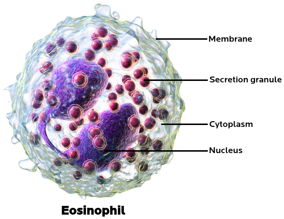
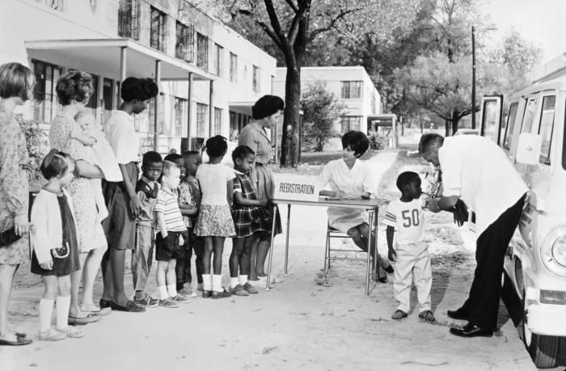
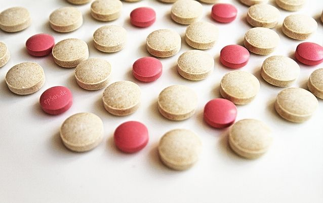
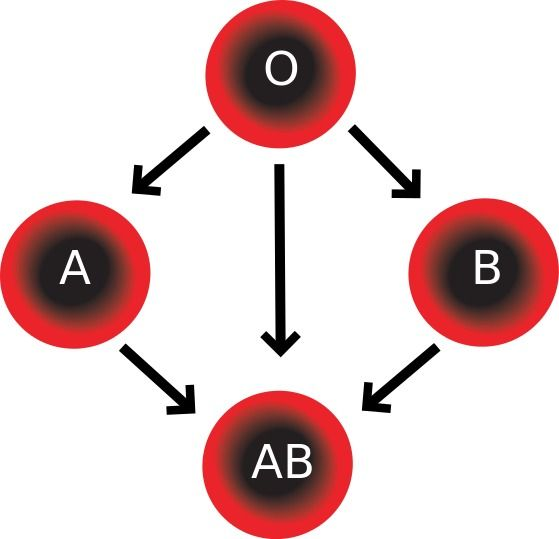
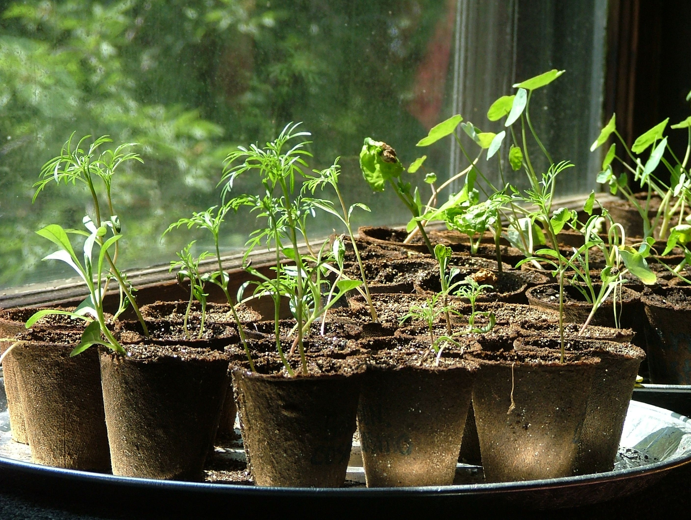
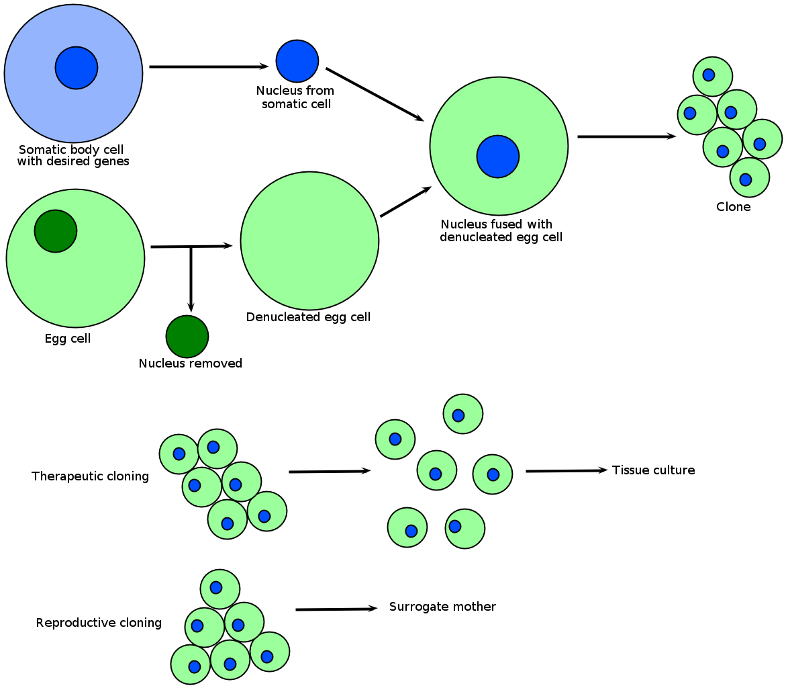
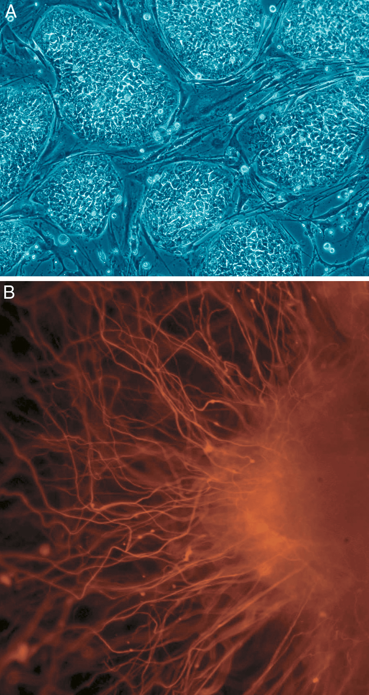

## 4.5 Applications of indigenous knowledge and biotechnology (ESG6Q)

In this section the following needs to be discussed with the learners to ensure an understanding of Life Science and the related technology.

- Traditional Technology which includes the role of traditional healers using herbal plants and traditions passed down to members in the community over generations.
- The advances in Medical Biotechnology and the importance of vaccines and antibiotics.  Technology advance in blood transfusion to prevent complications during transfusions.
- The cloning of plant and animal tissues and stem cell research.  The moral, ethical and legal issues around cloning needs to be discussed with learners.

### Traditional medicines (ESG6R)

In The World Health Organisation definition of traditional medicine, they incorporate a list of plant and animal product-based therapies as well as spiritual practices as part of traditional medicine. Up to \(\text{80}\%\) of people in African and Asian countries rely on traditional medicines for their basic health care needs. In South Africa, broadly, there are two types of practitioners: herbalists and diviners. Herbalists use plants to prescribe remedies to ailments. Diviners are said to communicate with ancestral spirits in order to diagnose problems and ailments. In Africa, traditional healers rely on up to \(\text{4 000}\) plants for remedies. *Pygneum*, a traditional medicine has been used in Africa and elsewhere to treat early forms of cancer for example.

<Callout type="note" title="Note">
In 2007, a research team from University of KwaZulu-Natal found that plant extracts from 16 plants used by local healers as 'muti' were highly effective in treating high blood pressure.
</Callout>

Due to the high cost of modern Western health care systems and technologies, there has been a recent focus on researching African traditional remedies and medicines. Traditional African medicine may well have healing properties that have been recognised through generations of use, and passed on in a cultural system. Because of the potential to reach greater masses at lower cost, there has been an attempt to combine traditional African medicine into the continent's health care systems. An example of this a 48-bed hospital that was opened in Kwa-Mhlanga, South Africa, in 2010. The hospital treats patients using a combination of traditional methods and Western healing methods.

### Modern biotechnology (ESG6S)

In this section we will examine some aspects of biotechnology that have been applied in modern medicine. Modern medicine is informed by medical research, and medical research is based on the scientific method.  Therefore, these therapies are based on investigations that have results that are reproducible. We will examine five achievements of modern medicine and discuss the underlying ethical issues these new treatments and technologies present:

1. Immunity and vaccines
3. Antibiotics
5. Blood transfusions
7. Cloning
9. Stem cell research

### 1. Immunity and vaccines (ESG6T)

Immunity is the body's resistance to infection by bacteria, viruses and other pathogens. The body defends itself against infection through a variety of means, such as physical, chemical and cellular barriers to infection.

- **Physical barriers** include the skin, saliva, tears and mucus. They also include hairs in the lining of the respiratory tract known as cilia.
- **Chemical barriers** include the various allergic responses that result in inflammation or swelling. These are caused by a chemical response system that results in the body releasing chemicals to attack any foreign objects entering the body. White blood cells known as eosinophils are normally responsible for the allergic response.
- **Cellular mechanisms** exist to fight bacterial infections. These include *neutrophils, macrophages and * which attack pathogens and "engulf" and eat them through a process of phagocytosis.

The above defence mechanisms described are part of the **innate** immune system. The body also has an **adaptive** immune system which `remembers' each pathogen that invades the body based on the specific markers on the pathogen. These markers are known as antigens. When a foreign organism invades, the adaptive immune system launches an antigen-specific response which destroys the infectious agent.

Figure 4.32: Eosinophils are important in controlling the allergic reaction.

<Callout type="note" title="Note">
A humorous video about the history of vaccination.

<VideoPlayer src="https://youtu.be/eMMwF3xiwik" title="Video: 2CR6" />
</Callout>

Vaccination is the most effective method of eradicating infectious diseases. It has resulted in the eradication of smallpox throughout the world and has greatly reduced diseases such as polio, measles and tetanus. Vaccination involves injecting components of the infectious agent in a non-toxic form in order to stimulate an individual's adaptive immune system. An immune response is produced against the vaccine, resulting in the production of T-lymphocyte memory cells. When a repeat infection occurs, the body is able to mount an effective and rapid immune response due to the presence of memory cells.

Figure 4.33: A vaccination campaign in the US.

### 2. Antibiotics (ESG6V)

Antibiotics are another example of a biotechnological advance in medicine. Antibiotics stop or inhibit the growth of certain disease-producing bacteria. These substances were originally found in organisms such as fungi and can now be chemically manufactured.  Antibiotics can be administered to patients intravenously as injections, or in the form of tablets, syrups or suspensions.

<Callout type="note" title="Note">
Learn about the discovery of penicillin and antibiotics.

<VideoPlayer src="https://youtu.be/tMPY-zf8X94" title="Video: 2CR7" />
</Callout>

Figure 4.34: Antibiotics.

### 3. Blood transfusions (ESG6W)

Blood transfusions often save the lives of people whom have lost large amounts of blood due to trauma caused by accidents and surgery. Before a person receives blood from a blood donor, the blood has to be typed to see if the donor is a match for the recipient. Blood is classified based on the presence of **antigens** in the red blood cells. An antigen is a molecule recognised by the immune system. There are four different types of blood groups. Recipients can only be given blood which is compatible to their own blood.

<Callout type="note" title="Note">
What are blood types? Watch this video to find out!

<VideoPlayer src="https://youtu.be/ttjn1jVACk8" title="Video: 2CR8" />
</Callout>

- Blood Group A has antigen A only
- Blood Group B has antigen B only
- Blood group AB has both antigen A and B
- Blood Group O has neither antigens A or B

The table below shows the different ABO Blood Groups and compatibility for blood transfusions.

| Blood group | Blood donor (person giving blood) | Blood recipient (person requiring blood) |
| --- | --- | --- |
| A | A and AB | A and O |
| B | B and AB | B and O |
| AB | AB only | All groups |
| O | All groups | O only |

Figure 4.35: Red blood cell compatibility chart. In addition to donating to the same blood group, type O blood donors can give to A, B and AB; blood donors of types A and B can give to AB.

Furthermore, the Rhesus factor of both the recipient and donor need to be determined. The Rhesus factor is another type of antigen found on the surface of red blood cells. Approximately \(\text{85}\%\) of the population has this protein and are know to be Rhesus positive. The remaining \(\text{15}\%\) of the population are Rhesus negative because this protein is not present in their red blood cells.

So, blood group A negative means the recipient has antigen A, but does not have the Rhesus factor, a recipient who is O positive means the recipient has neither antigen A or B but does have the Rhesus factor. It is important that a person receiving a blood transfusion receives blood from a donor that is compatible in both blood group and Rhesus factor.

### 4. Cloning (ESG6X)

Cloning is the process by which a genetically identical copy of an organism is produced. In nature, cloning occurs when organisms such as plants, insects or bacteria reproduce asexually. The copied material is referred to as a **clone**. There are three main types of cloning:

- Gene cloning: involves cloning of small sections or regions of DNA.
- Reproductive cloning: produces copies of whole animals or cells.
- Therapeutic cloning: produces stem cells for experiments to attempt to replace injured or diseased tissues.

Some plants have been producing identical clones of themselves through natural processes for millions of years. Through the production of a `runner' (stolon) for instance, strawberry crops produce genetically identical offspring. The new plant is referred to as a clone. Similar cloning occurs in grasses, potato crops and onions. Artificial cloning occurs through either **vegetative propagation** or through **tissue propagation**. Propagation is the process by which existing organisms produce more offspring.

**Vegetative propagation** is an ancient form of cloning plants. It involves taking a leaf cutting from a plant and growing it into a new plant. Vegetative propagation occurs because of the presence of a mass of unspecialised cells known as a **callus**. Callus cells grow, divide and form various specialised cells such as roots and stems, eventually producing a grown plant.

Figure 4.36: Growing new *Plumeria* plants from cuttings.

**Tissue culture propagation** is a more recent practice which involves taking pieces of specialised roots, isolating the cells and growing them in a nutrient-rich culture. In the culture, the specialised cells become transformed into undifferentiated cells. These are similar to the calluses formed above. The calluses then get treated with chemicals that trigger the growth of new plants that are identical to the original plant from which the root pieces were taken as shown in the diagram below. This method of cultivating new plants is known as **tissue culture**.

**Artificial cloning of organisms**

The technique used to clone whole animals, such as sheep is referred to as **reproductive cloning**. In reproductive cloning, scientists remove a mature **somatic cell** from the organism that is to be cloned. A somatic cell is any cell in the body that does not serve a reproductive purpose. In these cells, both sets of chromosomes (from the mother and father) are present. An example of a somatic cell is a skin cell. The nucleus is removed from the `donor' somatic cell and added to a `recipient' cell.

The recipient cell is usually an egg cell, from which the nucleus has been removed, so that only the cytoplasm remains (a denucleated cell). The clone produced can then be transferred into a **surrogate mother's** womb. A surrogate organism is one which acts as a substitute for another. In this case, the clone is transferred to a surrogate so the embryo can develop.

<Callout type="note" title="Note">
Learn how Dolly the Sheep was cloned.

<VideoPlayer src="https://youtu.be/YoEWYJHf0kU" title="Video: 2CR9" />
</Callout>

Figure 4.37: The cloning processes for reproductive and therapeutic cloning. Reproductive cloning is used for cloning of whole organisms e.g Dolly the Sheep.

### 5. Stem cell research (ESG6Y)

Stem cells are cells found in all multicellular organisms. Stem cells can differentiate into any type of cell such as a red blood cell, nerve cell, etc. The two types of stem cells are **embryonic stem cells** and **adult stem cells**. Embryonic stem cells can specialise into any cell type, while adult stem cells usually have some restrictions as to what type of cell they can become. Adult stem cells are produced in various tissues including the liver and the bone marrow. Embryonic stem cells are obtained from embryos and can be created *in vitro* (in the laboratory). Multiple embryos are generated through *in vitro* fertilisation methods, in which egg cells are harvested from the mother and fertilised by sperm cells from the father, outside of the body. The embryos that are not implanted into a patient are frozen or stored. Some of them are destroyed. The potential uses for stem cells include:

<Callout type="note" title="Note">
Are you confused about stem cells? Watch this entertaining video that explains what stem cells are and why they are so exciting.

<VideoPlayer src="https://youtu.be/jF2iXpoG5j8" title="Video: 2CRB" />
</Callout>

- **Spinal cord injury:** Repairing damaged nerve tissue after paralysis.
- **Brain damage:** Replacing or regenerating neurons in degenerative conditions like Parkinson's disease or after a stroke.
- **Cancer:** Creating new cells to replace cancerous cells e.g. bone marrow transplants for people with leukaemia.
- **Burn treatment:** New skin cells that match the donor may be grafted onto burn victims.

Figure 4.38 shows how embryonic cells differentiate to form nerve cells.

Figure 4.38: A) undifferentiated embryonic stem cells and B) nerve cells forming from embryonic cells.

<Callout type="note" title="Note">
Recall that in Chapter 4 you learnt that individuals with cancer can be treated through chemotherapy and radiation. However, these therapies often destroy healthy cells along with cancerous cells. The use of adult stem cells which derive from the bone marrow and liver tissue is important in replacing the healthy cells damaged by chemotherapy.
</Callout>

The use of stem cells and embryonic stem cells in particular, is controversial, with many people opposed to it for moral, religious or philosophical reasons. The objection is largely based on what happens to the unused embryos.

### Ethical issues (ESG6Z)

The use of science in cloning has created a lot of debate and controversy. Mainly, the debate is whether the methods used for cloning result in cells that have the potential to form full-grown organisms. The key ethical questions that arise are therefore:

- What to do about fused cells (known as embryos) that are not used for either therapeutic or reproductive purposes?
- By selecting certain genes for reproduction using cloning are we not favouring certain types of characteristics over others?
- Much of the cloning is conducted by private companies and this raises concerns that the public might not be able to benefit from the research being conducted.
- In the case of human cloning, if the embryos created are alive, do they have the rights of a normal human being?
- Are there better alternatives to stem cell research?

### Legislation around stem cell research (ESG72)

Due to the issue of stem cell research being so controversial, different countries have very different laws governing how it is to be conducted.

Some European countries such as Finland, Sweden, Belgium, Greece, Britain, Denmark and Netherlands allow stem cell research using human embryos while some such as Germany, Austria, Ireland, Italy and Portugal do not.The United States of America has divided opinions on stem cell research, with some of its States providing funding for stem cell research while others do not. India, Iran, South Korea, China and Australia are supportive of stem cell research. South Africa continues to support stem cell research.

<Callout type="note" title="Note">
In June 2012, the South African plastic surgeon, Dr Ridwan Mia, led a breakthrough surgery, saving the life of a three year old burn victim by transplanting skin cells cloned from the victim's cells. Pippie Kruger, the burn survivor, initially had a \(\text{10}\%\) chance of survival. However, the doctors obtained some of her skin cells, transported them to a laboratory in the USA, where they were cloned in order to produce millions of extra cells. These cells were transplanted into Pippie, resulting in the complete success of her skin grafting surgery.
</Callout>

### Potential applications of cloned animals (ESG73)

Reproductive cloning may allow copies of animals to be made for benefits in agriculture and medicine. Sheep such as Dolly have been cloned to overproduce a high quantity of a protein important for blood clotting in humans. It may soon be possible to clone extinct species of animals.

Drawbacks of cloning animals may include the fact that most cloned species are unable to develop into healthy animals. Dolly for example was only one of \(\text{277}\) cloned embryos. There have been significant health effects of cloning including increase in birth size and a variety of defects in vital organs such as the liver, brain and heart.

### Ethical biotechnology (ESG74)

- In medicine modern biotechnology finds promising applications in such areas as: drug production, pharmacogenomics (how a person's genes affects their response to drugs), and genetic testing (or genetic screening): techniques in molecular biology detect genetic diseases.
- To test the developing foetus for Down syndrome, amniocentesis and chorionic villus sampling can be used.

**TEACHER RESOURCES:**

Takes students on a step-by-step process showing them how to genetically engineer a plant and bacterium

-

Australian government resource for educators and learners on various aspects of biotechnology.

-

All the latest articles on developments in biotechnology written in accessible language.

-

Discusses latest issues in biotechnology and their political, economic and cultural implications.

-
