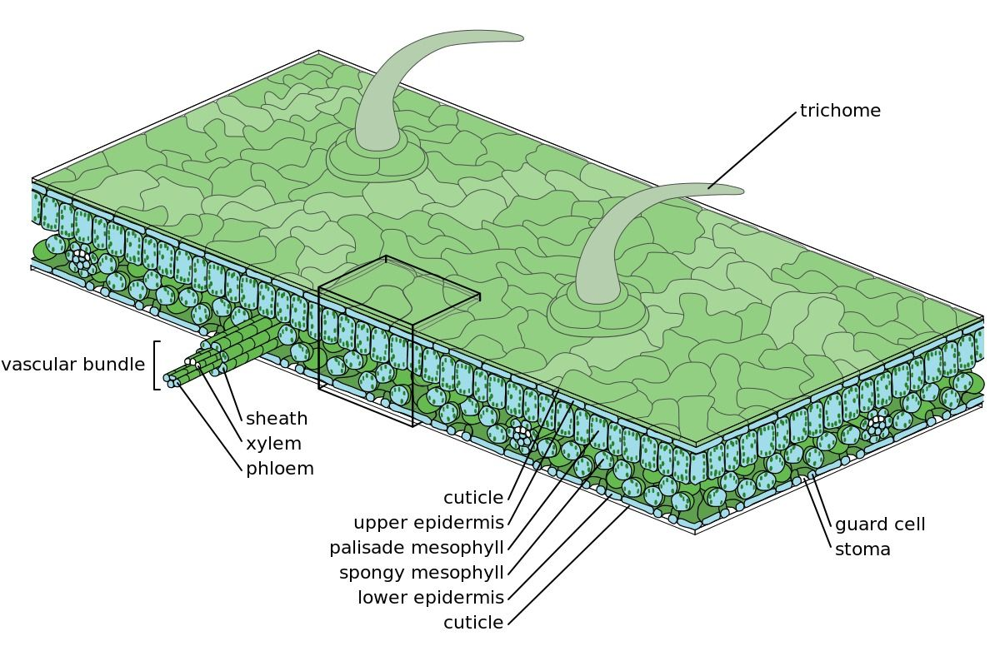
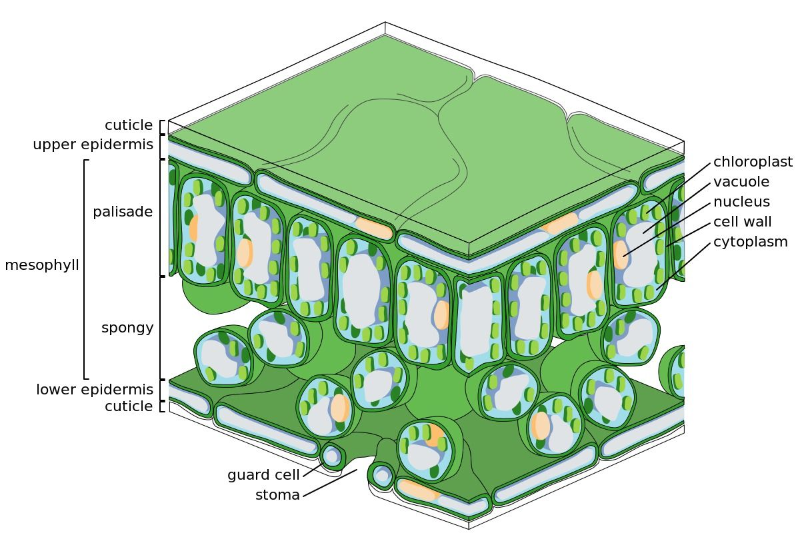
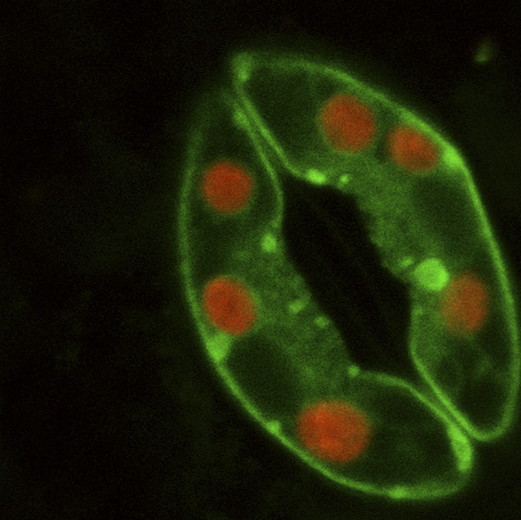

## 4.6 The leaf as an organ (ESG75)

Learners are reminded of the fact that an organ is a collection of tissues that are joined together to perform a common function. A group of organs work together to form an organ system. Organs exist in all higher biological organisms, they are not restricted to animals, but can also be identified in plants. For example, the leaf is an organ in a plant, as is the root, stem, flowers and fruits.  In this section the leaf is used as an example of an organ.

The leaf structure will be discussed using a cross-section of a dicotyledonous leaf.  Structure needs to be related to functions, such as transport, gaseous exchange and photosynthesis.  Link this section with the plant tissues already taught, the cell organelles and the movement of molecules across membranes into, through and out of the leaf.

You have learnt about individual tissues found in plants and animals. We will now look at how tissues join together to form organs. An organ is a collection of tissues joined together as a structural unit in order to perform a common function. In later chapters we will look at the various organs found in animals. In this section, we will discuss how a plant leaf is an example of an organ. We will present its structure with respect to its functions in photosynthesis, gaseous exchange and transport.

Leaves are typically found in vascular plants, which have lignified tissues (xylem) that enable them to conduct water. Leaves are usually flat and thin to allow for maximum gaseous exchange and capture of light. The organisation of the leaf has evolved to allow maximum exposure of chloroplasts to light, and to absorb carbon dioxide. Leaves have stomata, pores found in the leaf epidermis, which allow the plant to regulate the exchange of carbon dioxide, oxygen and water vapour with the atmosphere. The shape and structure of leaves varies considerably from one plant to another. This depends on the climate, available light intensity, presence of grazing animals, nutrients and competition from other plants. Leaves are either **dorsiventral** or **isobilateral**. Dorsiventral leaves have both surfaces differing from each other in appearance and structure. Isobilateral leaves have both surfaces looking the same. Leaves can also store food and water and are modified to
perform these
functions.

### Leaf structure (ESG76)

The leaf is a collection of tissues which include:

1. The **epidermis** which covers the upper and lower surfaces.
3. The **mesophyll** inside the leaf which is rich in chloroplasts.
5. The **veins** contains the vascular tissue (where xylem and phloem are present).

**Epidermis**

Epidermal cells form the outer layer covering a leaf, separating internal tissues from the external environment.

Epidermis tissue has several functions:

- protection against water loss via stomata and a waxy cuticle
- regulation of gaseous exchange
- secretion of metabolic compounds

**Mesophyll cells**

The mesophyll is located between the upper and lower layers of the leaf epidermis, and is mostly made up of **parenchyma** (ground tissue) or **chlorenchyma** tissue. The mesophyll is the primary location for photosynthesis and is divided into two layers, the upper palisade layer and the spongy mesophyll layer.

The *upper palisade layer*  lies beneath the upper epidermis and consists of vertically elongated cells that are tightly packed  together to maximise the number of cells exposed to sunlight. In addition, these cells contain many chloroplasts, thus maximising their photosynthetic ability. The palisade layer thickness depends on the extent of exposure to the sun. Leaves that are exposed to the sun have a thicker palisade layer. Those that are typically found in the shade have a thinner palisade layer. Beneath the upper palisade layer is the spongy mesophyll. The cells in the spongy mesophyll are slightly rounder and less densely packed and have air spaces to allow for gaseous exchange.

Figures below show the leaf and tissue structure of a dicot plant.

Figure 4.39: Leaf structure.

Figure 4.40: Leaf structure.

*Vascular tissue* is made up of the xylem and phloem vessels you learnt about earlier in this chapter. Xylem transports water and minerals to the leaf. Phloem transports dissolved sucrose made in the leaf out of its site of synthesis to the rest of the leaf. Most leaves have a bundle sheath around the xylem and phloem, consisting of sclerenchyma or collenchyma, for extra support.

### Transport of substances into and out of the leaf (ESG77)

The leaf is designed to transport water, sugars, carbon dioxide and oxygen across its surface. Each of these involves separate processes and cells which we will discuss below.

**Movement of oxygen and carbon dioxide**

Stomata are the site of gaseous exchange in the leaf. There are two major metabolic processes that take place in plants that involve the exchange of oxygen and carbon dioxide:

- **Photosynthesis:** takes place during the day when the chloroplasts can absorb radiant energy from the sun. Photosynthesis requires carbon dioxide and releases oxygen as a by-product. Therefore, during daylight hours, the concentration of carbon dioxide is low in the leaf and the concentration of oxygen is high. As a result, during the day, carbon dioxide enters the leaf and oxygen is released.
- **Cellular Respiration:**  occurs continuously throughout the day and night. Cellular respiration requires oxygen and releases carbon dioxide as a waste product. During the day, the plant can use some of the oxygen from photosynthesis for cellular respiration. During the night, when photosynthesis stops, the concentration of oxygen in the plant drops and the concentration gradient switches: the concentration of carbon dioxide is high and the concentration of oxygen is low. Therefore at night time, oxygen enters the leaves, and carbon dioxide is released.

**Movement of water into leaf**

Water is constantly being lost by the leaf through transpiration. This results in the cells in the mesophyll having a lower water concentration than the vascular bundles. Water thus moves down a concentration gradient from the xylem vessel into the living cells of the mesophyll layer and to the surface of the mesophyll cell walls. This causes water to move up from the stem by means of transpirational pull. The movement of water is maintained because water molecules constantly evaporate into leaf inter-cellular air space  out of the stomatal pore and into the atmosphere.

<Callout type="note" title="Note">
You will learn more about the transport processes in plants in: **Support and transport systems in plants**.
</Callout>

**Movement of sugars**

Chloroplasts found in the palisade layer capture radiant energy from the sun to make glucose via photosynthesis.  This glucose is used to make the simple sugar sucrose. Sucrose is transported to the rest of the plant through the phloem vessels present in the vascular tissue in the leaf. Plants convert sugars to starch for long-term storage.

**Opening and closing of stomata**: The opening and closing of the stomata is important for gaseous exchange, transpiration and the movement of sugars. Stomata open when it is bright and when there is high humidity. When water concentration in the soil is low, indicating that the plant is dry, chemical changes in the plant result in the closing of the stomata.

Figure 4.41: Confocal microscope image of guard cells and stoma. The red-staining region is chlorophyll.

## Examining leaf structure under a microscope

### Aim

To identify different tissues found in plant leaf.

### Questions:

Study the image shown and answer the questions given below.

| Figure A | Figure B |
| --- | --- |

1. Compare Figures A and B. Which of the numbered structures shown in B can you identify from Figure A?
3. Which of the numbered structures shown in B are absent in A?
5. The image given in Figure A is of a Spiderworts leaf. They grow in a part of Canada where the sun shines in the morning and it is cloudy in the afternoon. Describe what changes you would expect to see to the structures in the plant leaf during the day. How would these changes compare to a plant that grows during hot, sunny days and cold, dry nights?
