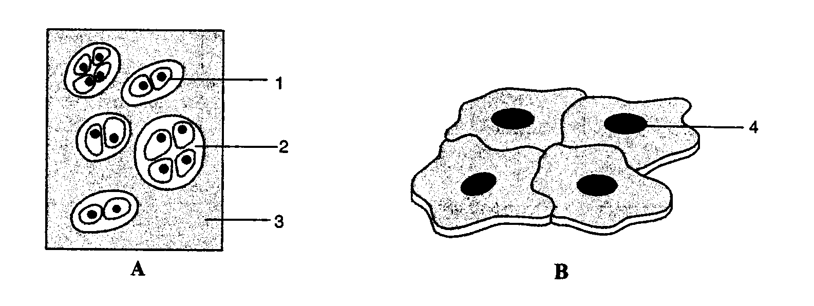

## End of chapter exercises

### Exercise 4.1

Answer the following questions based on the drawings below.

**Problem:**
Provide labels for 1, 2, 3 and 4.

**Solution:**
- 1-chondroblasts
- 2-lacuna
- 3-chondrin
- 4-nucleus of squamous epithelium cell

**Problem:**
Which tissue, A or B, is found in the rib cage?

**Solution:**
Tissue A

**Problem:**
Which tissue, A or B, is found in the lining of blood vessels?

**Solution:**
Tissue B

**Problem:**
Tissues come together to form a/an

1. organ
3. organ system
5. body system
7. organelle

**Solution:**
organ

**Problem:**
What kind of tissue can parenchyma tissue be described as being?

1. simple tissue
3. complex tissue
5. xylem
7. phloem

**Solution:**
simple tissue

**Problem:**
Which of the following is not a simple tissue?

1. xylem
3. parenchyma
5. collenchyma
7. sclerenchyma

**Solution:**
xylem

**Problem:**
What is the key difference between meristematic and permanent tissue?

1. the ability to conduct photosynthesis
3. the ability to divide
5. the ability to move
7. the complexity to perform a function

**Solution:**
the ability to divide

**Problem:**
Which type of tissue has lignified walls?

1. Parenchyma
3. Collenchyma
5. Sclerenchyma
7. Cambium

**Solution:**
Sclerenchyma

**Problem:**
Explain the statement `Tissues exhibit division of labour'. Give examples.

**Solution:**
Multicellular organisms are made up of millions of cells. Specialised cells that perform a specific task group together to form tissues. Thus different tissues perform different functions.

In humans, for example, muscle cells contract and relax to produce movement. Nerve cells are specialised to carry messages, blood flows to transport oxygen, food, hormones etc. In plants, vascular tissues conduct water from one part of the plant to the other. Thus multi-cellular organisms exhibit division of labour.

**Problem:**
Why do plants have more dead tissues compared to animals?

**Solution:**
Plants need the hard, dead cells to remain upright – they don’t have skeletons, and each cell must support itself or receive direct support from tissues around it, in order for the plant to remain upright. Most plant tissues are dead, since dead cells can provide mechanical strength as easily as live ones and therefore need less maintenance. Also, plants are stationary and hence require less energy. Animals require energy for movement. Animals are supported by hard (often bony) skeletons and do not need dead cells to support them.

**Problem:**
List the characteristics of meristematic tissues.

**Solution:**
They are actively dividing cells and divide throughout their life; cells are compactly arranged with no intercellular spaces; lack vacuoles; cells have dense cytoplasm and thin cell walls; have prominent nuclei.

**Problem:**
Which tissues are responsible for secondary growth in plants?

**Solution:**
Vascular cambium and cork cambium (also called secondary meristems) are responsible for secondary growth. They increase the thickness (girth) of the plant body.

**Problem:**
What are the key features which allow you to tell that a tissue type is collenchyma?

**Solution:**
Living cells that are elongated and generally contain chloroplasts; cell walls are irregularly thickened at corners due to deposition of cellulose or pectin; oval, circular or polygonal in shape; few intercellular spaces.

**Problem:**
Thando was shown two slides of plant tissues: parenchyma and sclerenchyma. Which of the features given below would be crucial in identifying sclerenchyma and why?

1. location of nucleus
3. size of cells
5. thickness of cell walls
7. position of vacuoles

**Solution:**
C, the thickness of the walls. The walls of the sclerenchyma are thickened due to lignin which thickens the walls. Sclerenchyma cells are dead and will not have vacuoles or nuclei.

**Problem:**
Why do meristematic cells lack vacuoles?

**Solution:**
Vacuoles are responsible for storing food and certain types of waste product. Meristematic cells being young and actively dividing do not participate in food manufacture and in storage functions. They do not generate waste. Therefore they do not require vacuoles. Meristematic cells are always young cells that have not had time to form vacuoles. They divide constantly so the cells are ‘embryonic’ – vacuoles are characteristic of mature plant cells.

**Problem:**
Considering the plant leaf as an organ, describe the main tissues that come together to form the organ. What is the role of each tissue type? Why are they all important in the functioning of the organ?

**Solution:**
- **Epidermis** forms the protective outer layer that has the waxy cuticle to prevent dehydration. It may form trichomes to reflect heat, repel herbivores and trap water vapour. The epidermis has stomata mainly in the lower epidermis to allow gaseous exchange without the leaf getting dehydrated. The cells are transparent to allow sunlight through to the photosynthesising cells.
- **Palisade mesophyll** consists of vertically elongated cells that all receive individual sunlight. These cells also have many chloroplasts, as they are below the upper epidermis and receive most sunlight. All mesophyll cells have large vacuoles to support the leaf by turgor pressure.
- **Spongy mesophyll** consists of loosely packed chlorenchyma cells with fewer chloroplasts, but large intercellular spaces to allow diffusion of gases throughout the leaf. All mesophyll cells have thin, moist walls to allow faster diffusion of gases and water. The air chambers in these mesophyll cells link directly to the stomata.
- **Veins** contain xylem to bring water into the photosynthesising tissues, as well as phloem to remove the sugars like glucose. Veins are well supported by a bundle sheath of sclerenchyma or collenchyma.
