## 5.2 Anatomy of dicotyledonous plants (ESG7C)

This section describes the structure of dicotyledonous roots and stems, followed by a description of the structure of the cells in the different tissues. Learners can use microscopes or photomicrographs to observe and draw cross sections of the root and stem. Slides can be made from celery or pumpkin stalks to view xylem tissue and secondary thickening patterns. This section can also be linked to mitotic cell division when describing the secondary growth. Link the annual rings in a tree trunk to environmental studies (climate change) which will be taught later. Annual rings are also used to assess the age of a tree.

### Differences between Monocotyledons and Dicotyledons (ESG7D)

All plants are classified as **producing seeds** or **not producing seeds**. Those that produce seeds are divided into flowering (angiosperms) and non-flowering (gymnosperms). Flowering plants are further divided into **monocotyledonous** and **dicotyledonous **(monocot and dicot) plants.

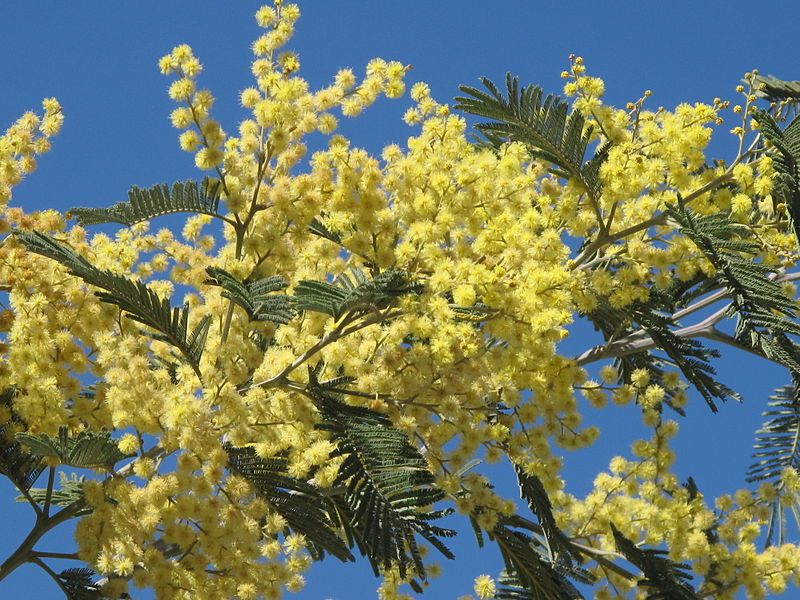

Figure 5.1: Flowering plants such as the acacia tree.

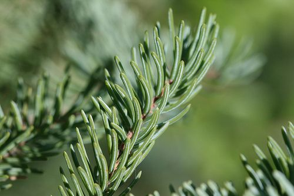

Figure 5.2: Gymnosperms are non-flowering plants such as pine trees or "black spruce" shown above.

In angiosperms, the **cotyledon** is part of the seed of the plant. The number of cotyledons (mono- or di-) is used to classify flowering plants. Monocotyledonous plants have one cotyledon, dicotyledonous plants have two. Plants belonging to each group have a number of features in common, such as the leaf and root structure, the strength of the stem, the flower structure and flower parts. Some differences between monocots and dicots are summarised in Figure 5.3.

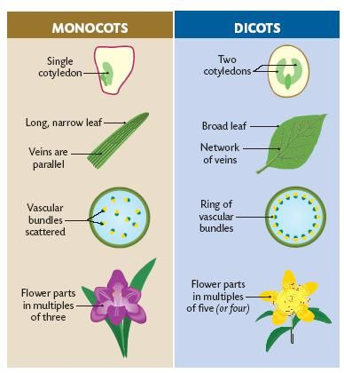

Figure 5.3: A comparison between monocots and dicots.

In addition to the differences listed above, monocots  and dicots have important differences in their roots. Monocots have a network of fibrous roots and dicots have tap roots.

In the previous chapter you learnt about the key plant tissues involved in support and transport functions, namely the xylem, phloem, collenchyma and sclerenchyma. Recall that these tissues are involved in both transport and supporting roles in plants. In different parts of the plant, tissues are arranged differently. In this section, we will study the overall structure (or anatomy) of dicotyledonous plants.

### Root anatomy (ESG7F)

Root systems are responsible for the following functions:

- **absorption** of water and organic compounds;
- **anchoring** of the plant body to the ground; and
- **storage** of food and nutrients.

When a seed germinates, the first structure to appear is the root or the **radicle**. This becomes the **primary root**. Other roots that branch out of the primary root are called **secondary roots** (Figure 5.4). The growing root tip is protected by the **root cap** as it moves through the coarse soil. The root cap is slimy in nature to facilitate easy movement. Above the root cap is the **apical meristem**. In this meristematic region, cells divide continuously by mitosis to produce new cells. In addition to mitosis, newly divided cells undergo elongation in the same direction of root lengthening.

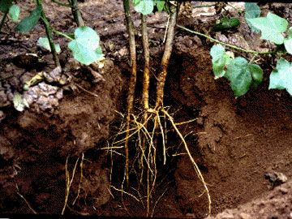

Figure 5.4: Primary and secondary root system of a cotton plant

Above the region of cell elongation, thousands of tiny **root hairs** are found in the root hair region. The function of the root hairs is to absorb water and dissolved mineral salts from the soil. As the root grows, it thickens and may produce **lateral roots** in the mature region as shown in Figure 5.5.

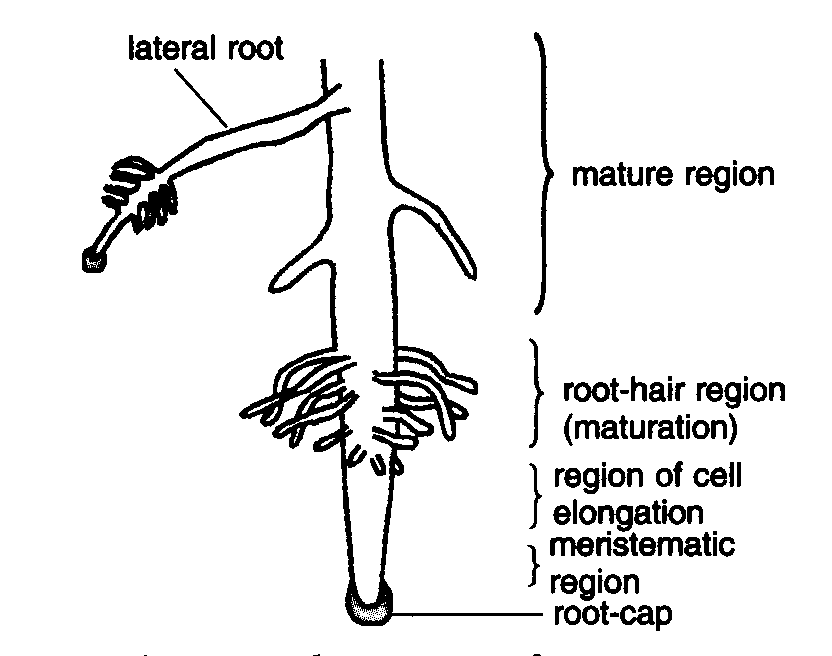

Figure 5.5: The dicotyledonous root

There are two major types of root system.

1. **Taproot system**: root system comprising one primary root and many secondary roots branching off the primary root. Examples of taproots include carrot and beetroots where the roots serve a storage function. Taproots are found in dicotyledonous plants.
3. **Fibrous root system**: system with no dominant primary root but many secondary roots of similar size. Fibrous (adventitious) root systems are common in monocotyledons. Examples include coconuts and grasses.

**Tissue distribution in root**

The different tissues in the root have a distribution which is common to all dicotyledonous plants and is shown in Figure 5.6.

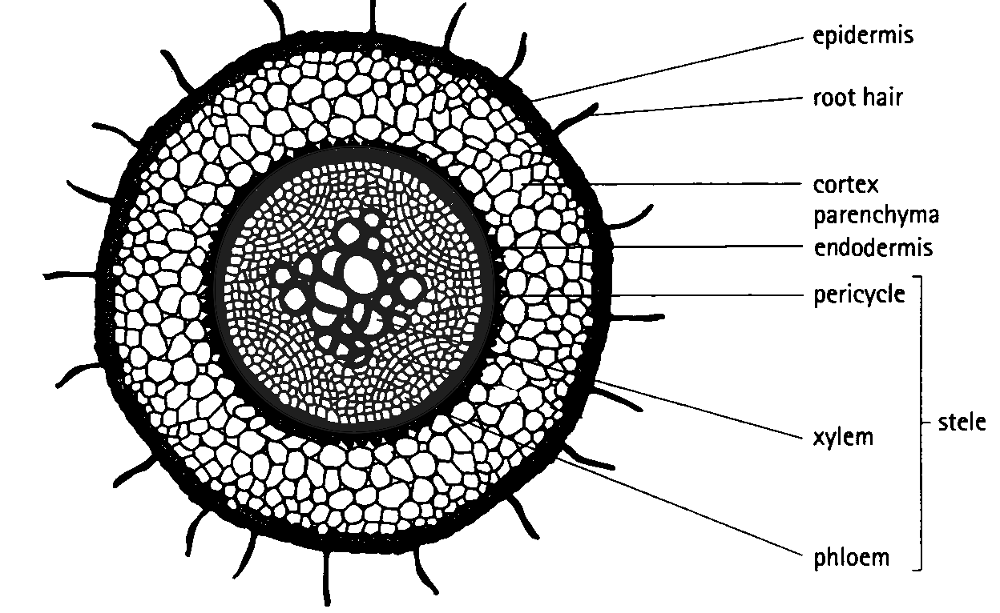

Figure 5.6: Dicotyledonous root profile showing the major tissues found in the root system which also aid in transport.

**The epidermis** is a single layer of cells on the outside that protects the inner tissues. The epidermal layer of the root has no waterproof cuticle as this would prevent the absorption of water. Structurally, the cells of the root hair (shown in Figure 5.7) have large central vacuoles and cover a large surface area which allows water to enter these cells readily via osmosis.

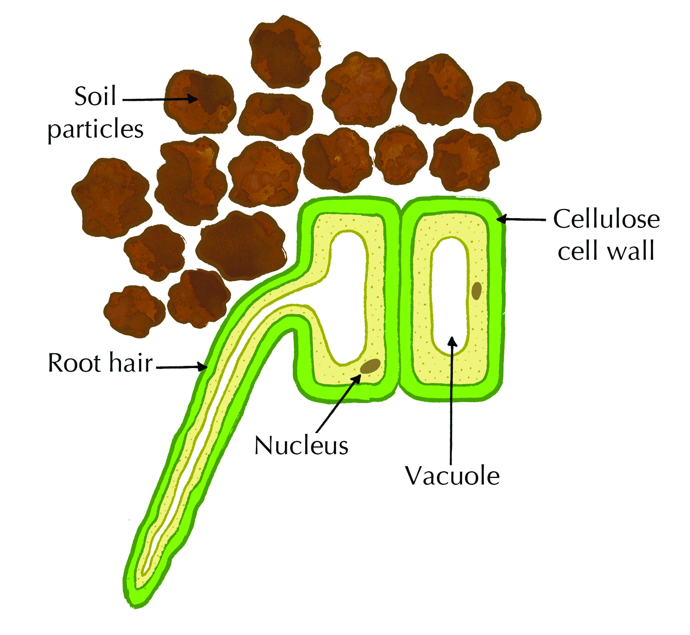

Figure 5.7: Diagram of a root hair cell

**The cortex** consists of *parenchyma* cells. These large, thin-walled cells have leucoplasts to store starch and large vacuoles to store water and dissolved sugars. Intercellular spaces between parenchyma cells facilitate the movement of water from the root hair cells on the outside of the plant to the xylem on the inside of the plant.

**The endodermis** forms the innermost layer of the cortex. It is a layer of tightly-packed, modified parenchyma cells. The radial and transverse cell walls are thickened with a water-impermeable, waxy suberin layer, known as the Casparian strip. This layer helps to regulate the flow of water from the cortex into the stele, rather than allowing the water to spread to all the root cells. To aid in directing water, there are also thin-walled passage cells in the endodermis, directly opposite the xylem, allowing water to move into the xylem rapidly.

**The stele**, or **vascular cylinder** (responsible for transporting water and minerals), consists of the pericycle, phloem, cambium and xylem. The **pericycle** is the outermost layer of the stele, and consists of one or more rows of thin-walled meristematic parenchyma cells. It is in close contact with the xylem and phloem tissues of the root. It functions in the formation of lateral roots.

**The phloem** tissue is responsible for transporting food from the leaves of the plant to the cells of the root. The **cambium** separates the xylem and phloem tissues from each other. This is the area where secondary growth of xylem and phloem tissues occur. **Xylem** tissue is responsible for transporting water and dissolved mineral salts to the xylem tissue of the stem and leaves. These cells are strengthened with lignin for support. The pits in the cell walls allow for the lateral movement of water. Figure 5.8 shows stained root tissues visualised by confocal microscopy. It shows the internal structure of root cells, including the epidermis, cortex, endodermis and pericycle.

<Callout type="note" title="Note">
Confocal microscopy is an advanced kind of microscopy which allows us to stain various cell types or structures with different colours, and visualise them in 3D, using special lasers and computer software.
</Callout>

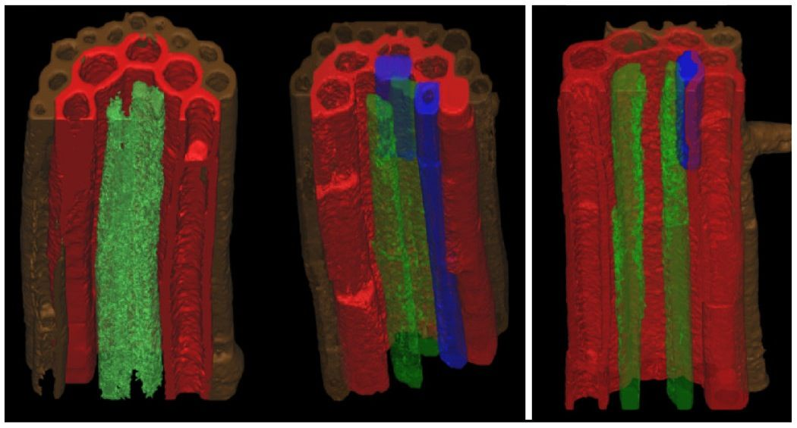

Figure 5.8: Stained root tissues as visualised by confocal microscopy. Colour key: brown, epidermis; red, cortex; blue, endodermis; green, pericycle.

### Stem anatomy (ESG7G)

Stems usually grow above the soil surface and towards the light from the sun. Depending on the hardness of the stem, we can distinguish between **herbaceous** stems, which are leafy non-woody structures, and **woody** stems. Woody stems are harder than herbaceous stems.

Stems have four main functions.

- **Support for the plant** as it holds leaves, flowers and fruits upright above the ground. Stems keep the leaves in the light and provide an attachment for flowers and fruits.
- **Transport** of water, mineral salts and sugars between roots and shoots in the xylem and phloem.
- **Storage** of nutrients.
- **Production of new living tissue**: stems contain meristematic tissue which generates new tissue.

The main stem develops from the **plumule of the embryo** and the lateral branches develop from the buds. Nodes and internodes are regions found on the stem. Nodes are the regions from which leaves and lateral branches develop, and the regions between nodes are known as internodes (shown in Figure 5.9). **Stomata**, or pores, can be found in stems of younger plants. We will subsequently discuss the tissues present in the dicot stem. The trunk of a tree (shown in Figure 5.10) is the stem.

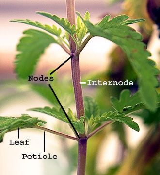

Figure 5.9: Stem showing internode and nodes plus leaf petioles.

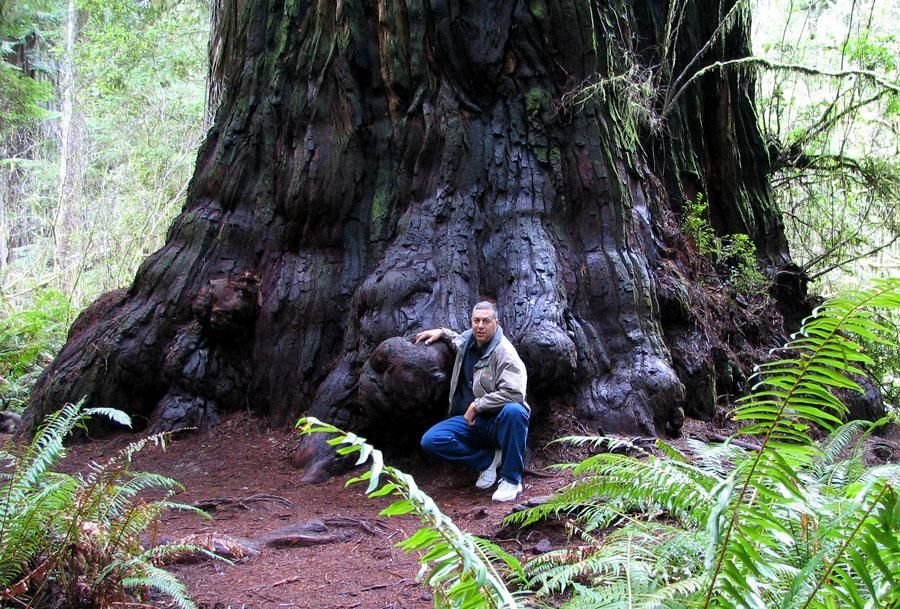

Figure 5.10: Photo of a redwood. The trunk of the tree is its stem.

**The internal structure of the dicotyledonous stem**

Figure 5.11 shows a schematic arrangement of tissues in a dicotyledonous stem. Details of each tissue type are described in this section.

**Epidermis**: A single layer of cells that covers the stem, and is in turn covered by a waxy cuticle. The waterproof cuticle helps prevent water loss and thus prevents the inner tissues drying out. Since the function of the epidermis is to protect underlying tissues, epidermal cells are tightly packed and have thickened walls. The epidermis may contain hair-like outgrowths known as trichomes, and stomata with guard cells. Stomata present in the epidermis allow for transpiration and gaseous exchange for respiration and photosynthesis.

**Cortex**: A region which comprises of **collenchyma**, **parenchyma** and the **endodermis**

- **Collenchyma**: A few layers of living cells that lie under the epidermis. These cells are not lignified but do have unevenly thickened cell walls. Collenchyma cells are thickened in the corners, but thin-walled elsewhere. The thickened corners strengthen the stem and provide support, while the thin-walled sections allow for flexibility in the wind. Collenchyma cells contain chloroplasts which produce food for the plant during photosynthesis.
- **Parenchyma**: Found beneath the collenchyma cells and makes up the bulk of the cortex. The cells are thin-walled, and there are intercellular spaces which are important in gaseous exchange. Parenchyma stores synthesised organic food (mostly starch) produced elsewhere in the plant.

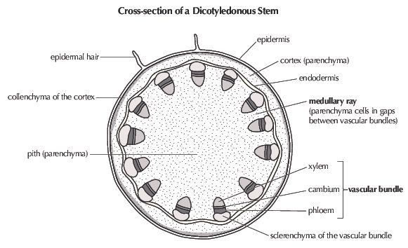

Figure 5.11: Cross-section of a dicotyledonous stem showing tissue distribution.

**Vascular cylinder** or **stele**: Comprised of the **pericycle**, **vascular bundles** and **pith**

- **Pericycle**: Commonly found in roots and, in lower vascular plants, also in stems. In higher vascular plants, however, a distinct layer of cells may not be present. The pericycle, if present, may be composed of either thin walled parenchyma cells or sclerenchyma cells with relatively thin or heavily thickened walls. In plants undergoing secondary growth, the pericycle contributes to the vascular cambium often diverging into a cork cambium.
- **Vascular bundles**: Characteristically organised in a ring inside the pericycle of the dicot plant. Mature vascular bundles are made up of water-conducting xylem, cambium, and food-conducting phloem. The phloem is located on the outside of the bundle and the xylem towards the centre (see Figure 5.11). The phloem and xylem is separated by meristematic tissue known as cambium, which is responsible for **secondary thickening**. Xylem has lignified cell walls which helps it fulfil its two important roles, namely; strengthening and supporting the stem, and transporting water and minerals from the root system to the leaves. The function of phloem is to transport synthesised food from the leaves to other parts of the plant.
- **Pith (or medulla)**: Occupies the large, central part of the stem. The pith is made up of thin-walled parenchyma cells containing intercellular spaces. Where the parenchyma extends between vascular bundles as thin bands it is known as medullary rays, and can be continuous with the pith and cortex of the parenchyma. The cells of the pith store water and starch, while the intercellular spaces allow for gaseous exchange. The medullary rays facilitate transport of substances from xylem and phloem to the inner and outer parts of the stem.

**Investigation: Examine the structure of the root and stem**

**NOTES FOR THE TEACHER:**

It is essential that teachers use a *very young* carrot for this – the smaller / narrower the carrot, the greater the chance that learners will be able to cut a very thin section completely across it. If the carrot is thick, it may be better to attempt to cut a thin section from HALF the carrot, rather than make it so thick that light will not shine through it. Thick sections will not allow one to see any detail at all. It is essential to use a very sharp blade / knife.

The age or size of the celery does not matter. These stems are fairly easy to cut thin, but they should still be as thin as the learner can make them. Note in particular the very obvious vascular bundles (darker, thick-walled ‘dots’ in the stem).

Alternatively, this practical can be conducted using various vegetables. Educators can get learners to discuss various vegetable which have roots, stems and leaves.

This practical requires the use of Iodine, therefore it is important to establish if any learners are allergic to iodine. If the learners are not sure, any learner that is allergic to shell fish should not be allowed to do the experiment as they may have an allergic reaction to the iodine.

Learners will be preparing slides in this practical. This should not be a new skill for the learners, but it is still important to conduct a demonstration for the students before they do the practical.

It is recommended that the drop of water or iodine solution be placed onto the slide BEFORE the specimen. Learners should be encouraged to remember the phrase “Always Fluid First” – this prevents dehydration of the specimen.

Since these are large specimens, learners may not need the 40x objective. Their specimens are also likely to be a bit thick and little detail may be observable, but the colour difference between the root cortex and vascular tissue should be visible, as well as the obvious vascular bundles of the stem compared to the background parenchyma tissue.

It is not necessary to formally assess the drawings learners make. It is good practise for them to make drawings off materials they have prepared themselves, and provides practise in doing biological diagrams correctly. They should have a heading that includes the magnification and should include a scale bar.

The following link gives information about making a wet mount microscope slide and shows an instructional video:

## Examining the structure of the root and stem

### Aim

To examine the structure of the root and stem.

### Apparatus

- light microscope
- scalpel or knife
- celery stalk (stem)
- carrot (root)
- glass slide
- iodine solution (Stain) or water
- cover slip
- dissecting needle or tweezers
- paper and pencil
- blotting paper or paper towel or tissue
- for variation you can also try using other vegetables

### Method

Prepare a temporary mount using the irrigation method:

1. Cut a very thin slice (cross section) from the middle of the celery stem and the carrot root. Although you will not be able to see microscopic details of the carrot tissue under a microscope, the differentiation by colour will be evident.
3. Place this section on a glass slide, in the centre.
5. Add a drop of iodine solution on top of the sample to stain it. This makes it more visible under the microscope. Water can be used if iodine is not available.
7. Place the coverslip next to the droplet, as shown in the diagram, then lower it slowly onto the glass slide. This will prevent bubbles forming under the coverslip. You can use a dissecting needle to lower the the coverslip into position. The drop will spread outward and suspend the sample between the slide and the coverslip.
   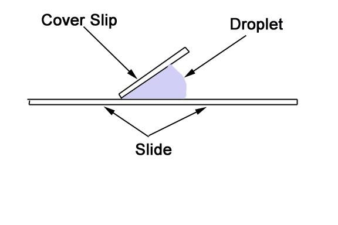
   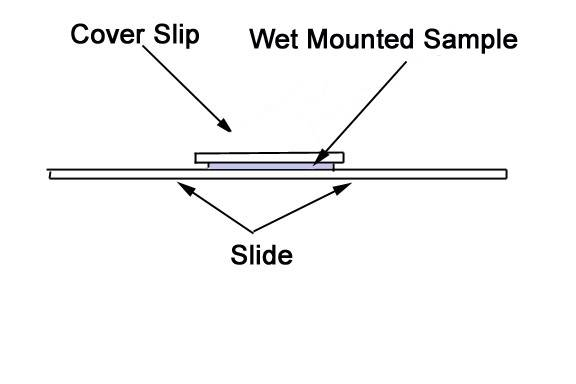
9. **Call your teacher.**
11. Switch on the microscope making sure the lowest objective is in position (the 4 X objective).
13. Place your slide on the stage.
15. Focus the image under the 4 X objective (lowest objective) and view the structure of the celery stem. Switch to the 10 X objective to look a little more closely. To see details of the structure of plant tissue, use the 40 X objective. Carefully observe all of the parts and different tissues.
17. Once you are able to see specific tissue types, call your teacher.
19. Make a biological drawing of your specimen as viewed under the microscope. Take note of the magnification and draw a scale bar. Label your diagram according to the tissues you have learnt about.

### Secondary growth (ESG7H)

Plants, like other living organisms need to grow, and they do this by mitosis. Cell growth is limited to the specialised cells that make up meristematic tissue. Meristematic tissue consists of small cells that are unspecialised. These cells divide by mitosis to form new cells that can **differentiate** i.e. undergo changes in their structure. When groups of cells differentiate they form specialised tissue (e.g. xylem, phloem, epidermal cells). There are different types of meristematic tissue:

- **Primary meristematic tissue** is found in the tips of roots, stems and buds. When the cells divide, new cells are produced which causes the plant to grow in length. This is referred to as  **primary growth.**
- **Secondary meristematic tissue** originates from permanent tissue, usually parenchyma tissue which divides by mitosis. **Cambium** is secondary meristematic tissue that is found in roots and stems. When these cells divide by mitosis it results in the plant becoming **wider.** This is called **secondary growth**.

Secondary growth is seen clearly if you examine the stump of a tree. During every growing season the stem of a plant increases in width. This is known as secondary thickening. Towards the end of the first year of growth, the parenchyma cells between the vascular bundles become meristematic. This means that they actively start dividing by mitosis, and link up with the cambium that occurs in the vascular bundles to form a cambium ring in the stem (see Figure 5.12). The cells in the cambium ring start dividing to form secondary phloem (on the outside of the cambium ring) and secondary xylem (on the inside of the cambium ring). Each year another ring of secondary phloem and secondary xylem is formed, making the stem grow wider.

<Callout type="note" title="Note">
Watch this video to learn about the oldest trees on Earth!

<VideoPlayer src="https://youtu.be/2Zf6LE0HcFo" title="Video: 2CRX" />
</Callout>

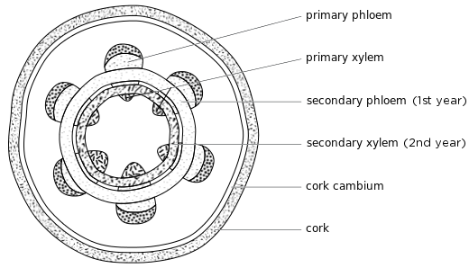

Figure 5.12: Process of secondary thickening in stems.

It is not possible to see the layers of secondary phloem but the secondary xylem layers are visible. These form rings called **annual rings** which can be used to work out the age of a plant.

As new rings are formed each year, the older rings are pushed inward and the xylem vessels collapse due to the pressure. The wood in the centre becomes denser and harder than the wood at the surface and is called  **heartwood**. The youngest annual rings found on the outside transport water. This wood is not as dense and is called **sapwood**. The light-coloured rings are called spring wood. They are formed during spring and summer when the growing conditions are favourable. These rings are therefore relatively broad and light in colour as the xylem cell walls are thin. The dark-coloured rings are called autumn wood. They are formed during autumn and winter when the growing conditions are unfavourable. The rings are therefore relatively narrow and dark in colour as the xylem cell walls are thick. Rings may be thicker in some years than in others, depending on the amount of rain and nutrients received.

There is another type of cambium in plants called **cork cambium**. Cork cambium forms when an outer layer of parenchyma in the cortex becomes meristematic and produces cortex cells to the inside and cork cells to the outside. This forms the dry outer cells of the bark on a stem.

<Callout type="tip" title="Note">
The vascular cambium and cork cambium are different and should not be confused!
</Callout>

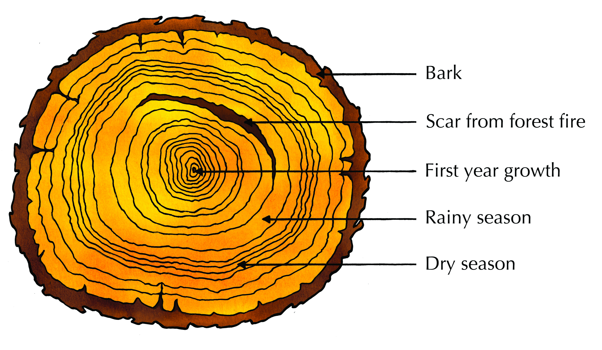

Figure 5.13: The annual rings in a tree trunk give a measure of the tree's age as well as the environmental conditions of the tree's growth.

**Investigation: To observe annual tree rings and to assess age and climatic conditions**

- In this investigation teachers are to source a tree trunk. It is recommended that teachers obtain a tree trunk with clear annual rings and then have it cut professionally / using an electric saw, so that several sections are obtained for use in the classroom. It may be interesting to find different species of trees or trees from different areas, so that the type of annual rings in different areas and species can be directly compared. However, if a tree trunk cannot be sourced, learners can be given a picture of a tree trunk showing the annual rings.
- Note that trees from eastern coastal areas may not form clear annual rings at all, since the climate is reasonably warm and wet all year, whereas trees from areas with very cold, dry winters like the Free State will have annual rings that are clearly visible.
- It is important that the learners read the introductory paragraph as this will assist them in answering the questions.
- The bar graph is merely a suggestion, not a requirement. Teachers can decide for themselves whether they have time for this
- The age and climatic history of the trees can be successfully done orally, if teachers prefer this. A class discussion can be very fruitful, without any written work being done.
- An alternative means of assessment is to divide the class into groups and provide each group with a different sample.

## Observing annual tree rings to assess age and climatic conditions

### Aim

**Background**

Every year a tree forms a new layer of xylem around the trunk. This forms tree rings, which are visible as circles in a cross section of a tree that has been cut down. Each tree ring, or wood layer, consists of two colours of wood; light wood that grows in spring and summer and dark wood that grows in autumn and winter. Tree rings can be counted to give you a rough estimate of the age of a tree. Occasionally a tree will form many rings in one year or miss forming rings in a year. The width of the tree rings is greater in years where good growing conditions occur. In years with droughts or low temperatures, the trees will produce narrower rings. Therefore, by looking at the tree rings you can get an idea of the weather affecting a tree in a particular year. Scientists can use this information to help determine the weather patterns of the past as well as events such as forest fires, earthquakes, and volcanic eruptions. The study of past events using the growth rings of trees is known as dendrochronology (
dendros = tree, chronos = time).

### Method

1. Examine a section of a tree trunk/stem provided by your teacher and count the tree rings, starting with the innermost ring. Measure the width of each ring using a ruler, or make a note of whether a ring is narrow or wide. Make a note of any scars caused by events such as fires or pests.
3. Draw a bar graph showing the width of your tree rings for every year of the tree's life.
5. How old is this tree? What can you say about the climatic conditions throughout the life of this tree?
