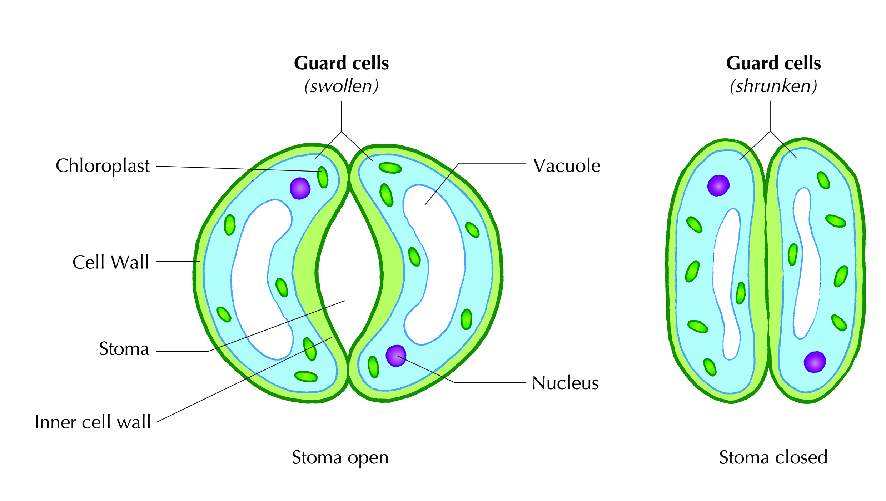
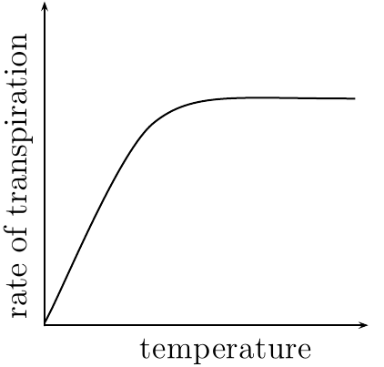
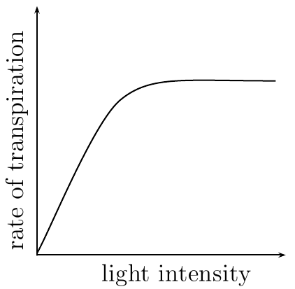
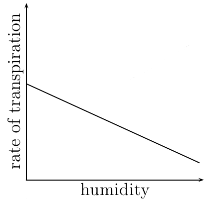
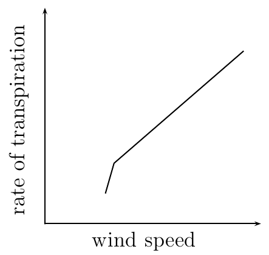
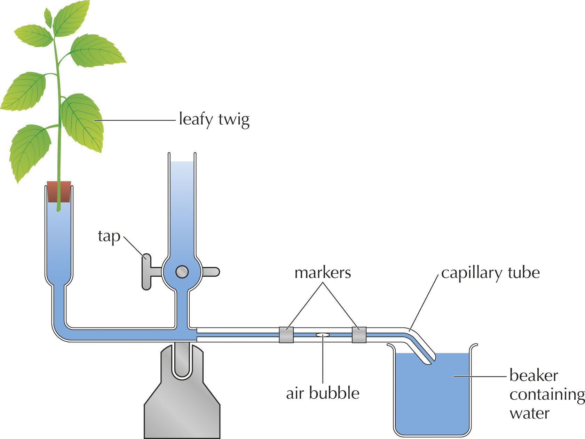
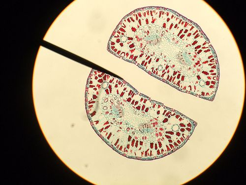
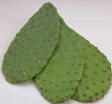
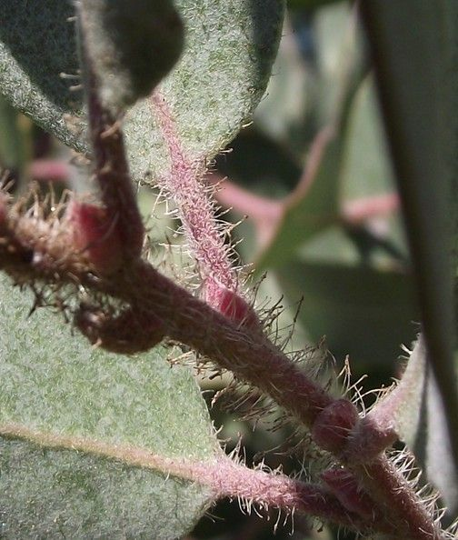
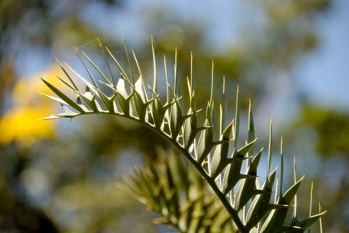

## 5.3 Transpiration (ESG7J)

This section explains how various environmental factors can change the rate of transpiration, and also examines how the structure of the leaves has adapted to minimise this water loss.

Learners will need to understand the factors that affect the transpiration rate such as temperature, light intensity, wind and humidity. Simple experiments can be conducted to demonstrate these factors.

Transpiration is a process that involves loss of water vapour through the stomata of plants. Transpiration is thought to be a 'necessary cost or evil' to allow the plant to absorb water from the soil. It is an inevitable process.

<Callout type="note" title="Note">
**Turgidity**, or turgor pressure, refers to the water content of cells and how this lends structural support to the plant. When cells absorb water, the vacuoles fill up and the cytoplasm increases, pushing against the cell membranes, which in turn push against the rigid cell walls. This makes the cells rigid, or turgid.
</Callout>

Transpiration is important in plants for three major reasons:

1. **Cooling of the plant**: the loss of water vapour from the plant cools down the plant when the weather is very hot.
3. **The transpirational pull**: when the plant loses water through transpiration from the leaves, water and mineral salts from the stem and roots moves, or is `pulled', upwards into the leaves. Water and is therefore taken up from the soil by osmosis and finally exits the plants through the stomata.
5. **Plant structure**: young plants or plants without woody stems require water for structural support. Transpiration helps maintain the turgidity in plants.

**Transpirational pull**: results from the evaporation of water from the surfaces of the mesophyll layer in the leaf to the atmosphere, through the stomata. Evaporation of water from the leaves surface causes a negative pressure (suction force) in the xylem that pulls water from the roots and soil. This results in water being drawn up the xylem vessel.

Transpirational pull draws water from the roots to the leaves because of the effects of **capillary action**. The primary forces that create the capillary action are *adhesion* and *cohesion*. Adhesion is the attraction that occurs between water and the surface of the xylem, and cohesion is the attraction between water molecules.

We will revisit transpirational pull and capillarity later in the chapter when we examine how water is transported in the plant.

<Callout type="note" title="Note">
**Capillary action** occurs when the adhesion of water molecules to the walls of the vessel is stronger than the cohesive forces between the water molecules. Have you ever seen fluid in a drinking straw move higher than the level of the fluid in the glass? This happens due to capillary action. The narrower the straw, the greater the capillary action, and therefore, the higher the fluid will rise in the straw.
</Callout>

<Callout type="note" title="Note">
**Cohesion** refers to the intermolecular, attractive forces that hold molecules in solids and liquids together. Imagine a drop of water on a waxy surface like wax paper. Even if the drop slides and rolls around, the water molecules will stay together due to the cohesive forces. **Adhesion** is the ability of a substance to stick to an unlike substance. If you were to take the same piece of wax paper and turn it upside down, some water droplets would still adhere to the paper. This indicates that there must be an attraction between the water and the wax paper. However, in this case the water-water cohesive force is stronger than the adhesive force between the molecules of the wax paper and the water.
</Callout>

### Factors affecting the rate of transpiration (ESG7K)

This interactive website explains transpiration pull.

Of particular use to learners is an interactive animation that lets them determine the effect of different environmental factors on transpiration rate.

There is a close inter-relationship between transpiration and leaf structure. The rate at which transpiration occurs refers to the amount of water lost by plants over a given time period. Plants regulate the rate of transpiration by opening and closing of stomata (Figure 5.14). There are, however, a number of external factors that affect the rate of transpiration, namely: temperature, light intensity, humidity, and wind.

Figure 5.14: The opening and closing of stomata. Different environmental conditions trigger both the opening and closing of stomata.

**Temperature**

Temperature affects the transpiration rate in two ways. Firstly, at warmer temperatures water molecules move faster, and the rate of evaporation from stomata is therefore much faster. Secondly, the water-holding capacity of warm air is greater than that of cold air. Assuming that cold air and warm air contain the same amount of water, the cold air may be saturated, and therefore have a shallow water concentration gradient, while the warm air may will be able to hold more water vapour, and will therefore have a steeper water concentration gradient.

Figure 5.15: Temperature vs transpiration rate.

**Light intensity**

At high light intensity, the rate of photosynthesis increases. As photosynthesis increases, the amount of stored glucose in the guard cells increases. This lowers the water potential of the leaf (i.e. the contents of the leaf are less dilute). As the water potential decreases, more water enters the guard cells making them more turgid. The turgor pressure of the guard cells leads to an opening up of stomata resulting in transpiration.

Figure 5.16: Transpiration vs light intensity.

**Relative humidity**

The amount of water vapour in the air is referred to as the humidity. Water always moves *down* a concentration gradient. Therefore when the humidity is high (lots of water vapour in the air) the water potential gradient between the inside of the leaf stomata and the atmosphere is shallow and the rate of transpiration will be low. However, if the atmosphere is dry, there will be a steep water concentration gradient between the humid inside of the stomata and the outside air and the rate of transpiration will therefore be fast.

Figure 5.17: Transpiration vs humidity.

**Wind**

When water is lost from the leaf it forms a thin layer outside the leaf. This reduces the water potential between the leaf and the atmosphere outside. When there is wind, this layer is blown away, thus maintaining the water potential gradient across the leaf.

Figure 5.18: Wind speed vs transpiration.

### Measuring the rate of transpiration (ESG7M)

To measure the rate of transpiration we use a piece of equipment called a  **potometer.**  A potometer measures how factors such as light, temperature, humidity, light intensity and wind will affect the rate of transpiration. The main type of potometer is the 'bubble' potometer shown in Figure 5.19. The potometer measures the amount of water lost from a leafy shoot by monitoring the rate at which an air bubble moves along the narrow tube as the leafy shoot sucks up water to replace the water lost by the transpiration of the plant.

<Callout type="note" title="Note">
A potometer provides an indirect measurement of the transpiration rate – it measures how fast water is absorbed, which is related to how fast water vapour is being lost. It cannot measure how fast water vapour is being given off directly.
</Callout>

As the leafy twig transpires, the air bubble moves to towards the plant. The quicker the air bubble moves, the faster the leafy twig is transpiring.

Figure 5.19: Potometer measures the rate of transpiration.

**Investigation: To determine the effect of environmental conditions on transpiration rate (using a simple photometer.**

The four groups should have leafy twigs of the same type of plant and about the same size, so that results in different environmental conditions can be reliably compared at the end. They should choose twigs with stems likely to fit tightly into a drinking straw and the stems should be strong enough not to be crushed when forced into the straws.

**ALTERNATIVE METHOD:**

Alternatively, if available, learners can use narrow clear plastic tubing filled with water that can be cut open / slit at one end to insert the twig. Plastic tubing is easier to seal with tape than drinking straws and it can be taped in place horizontally along a desk or table once an air bubble has been introduced at the open end. One learner will have to hold the plant off the desk. The tube is then placed into water and a ruler is taped in place next to it to track the movement of the bubble over time. They won’t be able to reset it, but that’s fine – take 3 or 4 measurements of how far the bubble moves in 2 minutes and get an average for each environmental condition. This is faster than doing it for an hour in each condition.

Learners can create the various environmental conditions in the laboratory.

- The conditions in the laboratory can serve as the "control" environment.
- Learners can use a fan to mimic 'windy' conditions.
- Learners can use an electric heater to mimic 'hot' conditions.
- Learners can place the apparatus under a bell jar or under a plastic bag to mimic 'humid' conditions.

Precautionary Measures:

- The stem must be cut under water as this will prevent air obstructions in the xylem tissue
- The system must be airtight (use Vaseline to ensure this)
- Use the same stem during the whole experiment to get the same readings
- If using a potometer, and the bubble gets too close to the plant, one can open the stopcock (tap), to allow extra water into the tube and push the bubble back to the start. This resets the potometer for further readings. Be careful not to push the bubble too far, otherwise it may escape completely and one has to wait with the tube out of the beaker, until a new air bubble has been sucked into the tube.
- It is important that learners WAIT TEN MINUTES after setting it up for the plant’s transpiration rate to stabilise before taking measurements.

**Observations and Results:**

Teachers should be able to guide the class in drawing up tables to compare the transpiration rate in the four conditions, but the following table is suggested as a guideline:

| Conditions | Cumulative distance water has moved (mm): |
| --- | --- |
|  | 0 | 1 | 2 | 3 | 4 | 5 | 6 |
| Sunny, no wind |  |  |  |  |  |  |  |
| Sunny, with wind |  |  |  |  |  |  |  |
| Sunny, plastic bag around plant |  |  |  |  |  |  |  |
| Shade, no wind |  |  |  |  |  |  |  |

Table 5.1: The effect of different environmental conditions on the rate of transpiration

Learners should find the following transpiration rates:

- Fastest transpiration rate in the sun with wind.
- Second fastest in the sun, but no wind.
- Third fastest in the shade with no wind.
- Slowest transpiration rate in the plant that had the bag around it.

Bar graphs should have headings similar to the table heading. Environmental conditions will go onto the horizontal axis and rate of transpiration on the vertical axis. Since measurements were taken every 10 minutes for an hour, the total cumulative transpiration at the end of the 60 minute period will be the transpiration rate per hour.

**Conclusions:**

- Different environmental conditions have an effect on transpiration rate in plants.
- Warm conditions, wind and bright sunlight speed up transpiration rate.
- Cool conditions, no wind and humidity slow down transpiration rate.

**Improving the accuracy of findings:  **Accept any 2 of the following:

- Do not take measurements directly after changing the conditions.
- Use the same plant and take it to different places to keep the leaf surface area constant.
- If using different plants, they must be of the same species and the same size.
- Do not get water on the leaves, as this will block stomata and reduce transpiration rate.
- Use a woody stem, to stop the xylem being crushed when it is inserted into the tube / straw.
- Cut the stem under water to stop air bubbles entering the xylem.
- Take several readings in each condition and average the findings.

**Questions:**

1. Why is it important to cut the stem at an angle under the water?
3. Which part of the stem does the straw represent?
5. Which three factors are you investigating?
7. Under which condition is the highest rate of transpiration?
9. Name one possible error that could have occurred in your investigation.
11. What are the potential limitations of this investigation?

**Answers:**

1. To prevent air from getting into the xylem. Cut at an angle so there is a large surface area through which the water can enter the plant. It is important to remember that cutting straight across the stem may crush and block the xylem.
3. The xylem of the stem.
5. Humidity, wind, light and moisture.
7. Learners should find the sunny area with wind to have the highest rate of transpiration. However, learners are to assess their own experiments and base answer on results.
9. Accept any error:
   - We didn’t measure for exactly the same amount of time every time
   - The plants were not exactly the same size
   - The tube was too wide and the bubble hardly moved
   - The tube wasn’t sealed, so the bubble didn’t move at all and the water ran out
   - Wind speed varied in our area
   - We had wind on our plant and couldn’t stop it – supposed to be no wind there
   - ANY other error that may have occurred during this investigation.
11. The following are some examples of answers that learners may provide:
   - We can’t be sure that we were accurate, because we couldn’t keep the wind speed the same.
   - We had wind when we didn’t want any.
   - We were comparing the transpiration rates of completely different plants so different numbers of leaves on the twigs could have caused differences in their transpiration rates
   - Since we were using different plants it was not only the environmental conditions that differed, but the plants themselves.

## Determining the effect of environmental conditions on transpiration rate using a potometer

### Aim

To determine the effect of environmental conditions on transpiration rate using a simple potometer.

### Apparatus

- drinking straw or clear plastic tubing
- soft green leafy shoot
- Vaseline
- marking pen
- play dough / putti/ Prestick
- plastic bag
- elastic band
- ruler

### Method

A potometer measures the rate of transpiration by measuring the movement of water into a plant. The following experiment uses a simple hand made potometer.

Learners will be divided into four groups as each group will investigate a different factor and then all the results can be shared at the end of the investigation.

Perform the following steps under water:

1. Cut the stem of the leafy shoot (at an angle to increase the surface area)    **under water** . The reason we cut it under water is to prevent air bubbles entering the xylem vessel. You must use a very sharp knife or new scalpel and cut at an angle in order to increase surface area for water uptake in the xylem. Florists who cut plants before immersing them in water follow the same procedure for this reason.
3. Test to make sure the stem of the leafy twig will fit snugly into the top of the straw.
5. Remove the leafy shoot from the straw and set aside, keeping the stem submerged, and the leaves above water.
7. Fill the straw with water. Place your finger over one end of the straw to stop the water from running out.
9. Put the leafy shoot into the open end and seal it with play dough/ putti/ Prestick while removing it from water KEEPING YOUR FINGER ON THE STRAW! Perform the following steps above water.
11. Seal with Vaseline. Make sure it is air tight and water tight. If not, all the water will run out when you take your finger off the straw.
13. Mark the water level on the straw.
15. Place your potometer under one of the following conditions for one hour:
   - as is, in a warm, sunny place (no wind)
   - as is, in a warm, windy place
   - with a plastic bag tied around the leaf, in a warm, sunny place
   - a shady place.
17. Every 10 minutes use a marking pen to mark the change in water level on the straw. Continue taking measurements for 1 hour.
19. Measure the distance the water moves during each time interval.

### Results

Each of the four groups that investigated different environmental conditions should contribute their results for the final analysis.

- Draw a table and record the class' results.
- Plot a bar graph to compare the total distances the water moved in the different straws in 1 hour under the four different environmental conditions.
- At the end of the experiments, all students must  plot the following line graphs:
  - the effect of temperature on the rate of transpiration
  - the effect of light intensity on the rate of transpiration
  - the effect of relative humidity on the rate of transpiration
  - the effect of wind on the rate of transpiration

### Observations

Record your observation from the table, bar graph and line graphs.

### Conclusions

- What can you conclude from this investigation?
- Give two ways in which you can improve your experimental results.

### Questions

1. Why is it important to cut the stem at an angle under the water?
3. Which part of the stem does the straw represent?
5. Which four factors are you investigating?
7. Under which condition is the highest rate of transpiration?
9. Name one possible error that could have occurred in your investigation.
11. What are the potential limitations of this investigation?

More information about potometer experiments can be found on the following websites:

In addition, the following website has a 'virtual laboratory' that allows you to perform the above experiment online:

Perform the experiment and complete the laboratory exercise given on the website.

## Determining the effect of light intensity on transpiration

### Aim

To determine the effect of light intensity on transpiration.

### Apparatus

- plants
- plastic bag
- piece of string
- graduated measuring cylinder

### Method

1. Use at least three plants of the same species and as close to the same size as possible (think of why this might be important).
3. Ensure that all three plants are exposed to the same amount of light.
5. Use clear plastic bags to completely cover all the leaves of each plant.
7. Tie the bottom of the plastic around the main stem of the plant, allowing the water lost from the plant to collect inside the bag. Try not to crush the leaves of the plant with the bag.
9. Place the bags on the plants early in the morning. Leave the bags on all day and check for signs of water drops inside. If there are water drops, shake the bag so that the water drops to the bottom of the bag.
11. At the end of the day, carefully remove the bags to ensure that you do not lose any water. It will help if you tilt the plant slightly while removing the bags.
13. Collect the water inside a measuring cylinder and measure how much water the plant has lost.
15. Tie a new plastic bag around the plant and leaver overnight.
17. The following morning, collect and measure the water that was released by the plant overnight.

### Results

Record the amount of water lost during the day and during the night.

Using the three plants, figure out the average water loss for each time period.

Plot a bar graph comparing the average amount of water loss in the day and night.

### Observations

Write down anything you observed about the plants, the plastic bags and the rate of water loss from the plant.

### Conclusions

What can you conclude regarding the rate of transpiration at different light intensities? Was there higher or lower water loss when you left the plant overnight compared to when you monitored it throughout the day?

### Questions

How can you improve this experiment to determine the effects of different light intensities on transpiration?

In this experiment what are the key variables we are controlling for? Have we properly controlled for these?

**Investigation: Determining the effect of light intensity on transpiration**

The following activity can be done as a DEMONSTRATION and is optional.  It is not easy to collect water in bags and then remove the bag without losing the water.

**Conclusions:**

The plant loses more water during the day, because it’s hotter and the light intensity is higher than at night.

| Advantages of transpiration | Disadvantages of transpiration |
| --- | --- |
| Cools the plant down | Excessive water loss causes the plant to wilt |
| Assists in the transport of water from the soil |  |
| Important for transport of water through the xylem |  |
| Regulates the concentration of cell sap |  |
| Distribution of salts and minerals in the plant |  |

Table 5.2: Table comparing the advantages and disadvantages of transpiration

### Structural adaptations of plants to reduce rate of transpiration (ESG7N)

When the rate of transpiration is too high, it can have detrimental effects on the plant, as you will see in the next section on wilting and guttation. For this reason, plants have developed structural adaptations to minimise the amount of water loss.

- **Position of stomata:**
   Stomata are found on both surfaces of the leaf but there are usually more on the ventral (lower) surface of the leaf. This means that less water vapour is lost because the ventral side of the leaf is in the shade and therefore does not get as hot.
- **Sunken stomata:**
   some plants such as xerophytes have sunken stomata as a way of preventing water loss. Xerophytes (pronounced "zero-phytes") are plants that are normally found in hot, dry areas such as deserts. The sunken stomata creates a small pocket of moist air. The high humidity in the air pocket reduces the water potential gradient between the leaf air spaces and the exterior, and therefore decreases the rate of transpiration.
  
  Figure 5.20: Sunken stomata.
- **Thickened cuticle:**
   Some plants that occur in dry places have a thick cuticle that reduces transpiration.
  
  Figure 5.21: Desert plants like cactus have thick cuticles to avoid water loss.
- **Hairs on leaves:**
  Hairs trap a small layer of water vapour that works in three ways to reduce transpiration:
  - Creates a pocket of moist air to reduce the water potential gradient.
  - Increases the sheen on leaves to make them more reflective.
  - The combination of the above effects result in a cooling effect that also decreases transpiration.
  
  Figure 5.22: Hairy leaves to trap water.
- **Reduction of leaf size:**
  Small leaves have a smaller surface area for transpiration to occur.
- **Leaf spines:** Some plants have spines instead of leaves. Spines usually have thicker cuticles and a very small surface area, which decreases transpiration.
  
  Figure 5.23: Spiny leaves have a small surface area to decrease transpiration.
- **Leaf arrangement:**
   vertical leaf arrangement (like proteas) decrease the surface area exposed to the sun in the heat of the day, In rosette arrangements the upper leaves shield the lower leaves from the Sun.
- **Rolling of leaves:**
  When leaves roll up, water vapour gets trapped in the tunnel made by the leaf, therefore reducing the water potential gradient, and therefore reducing the rate of transpiration.
