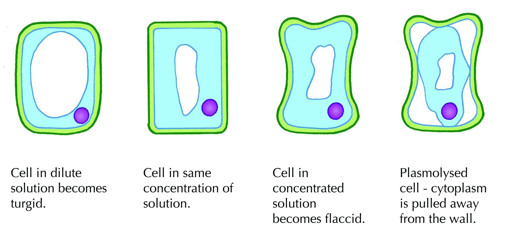
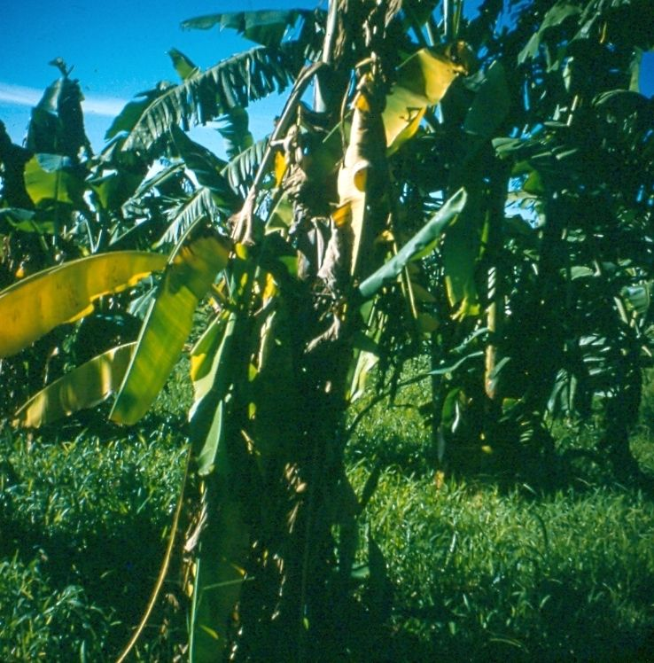
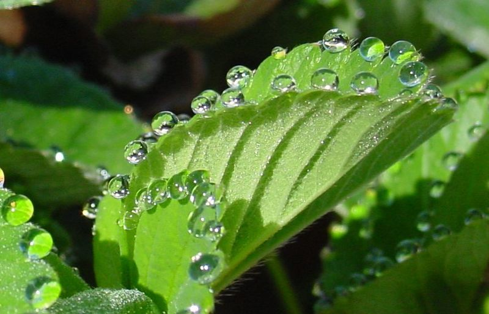

## 5.4 Wilting and guttation (ESG7P)

**Wilting and Guttation**

This section explains to the learners how excessive loss of water can cause plants to wilt and lose some of their structural support.

During transpiration the learners learnt  how the leaves are constantly losing water vapour to the environment. However, what happens when there is not enough water in the soil to replace the water that was lost? Similarly, what happens when there is too much water? In this unit we discuss wilting, and why plants wilt and get floppy in hot weather or after a long drought. We will also look at ways that plants can rid themselves of extra water when there is too much water in the environment and the plant has to cope with high root pressure and a low transpiration rate.

We just discussed transpiration, and how leaves are constantly losing water vapour to the environment. However, what happens when there is not enough water in the soil to replace the water that was lost? Similarly, what happens when there is too much water? In the next section we discuss wilting, and why plants wilt and get `floppy' in hot weather or after a long drought. We will also look at ways that plants can rid themselves of extra water when there is too much water in the environment and the plant has to cope with high root pressure and a low transpiration rate.

### Wilting (ESG7Q)

Plants need water to maintain turgor pressure. Turgor pressure is what provides the plant with much of its structural support. Have a look at Figure 5.24 which shows the effect of osmosis on the turgidity of cells.

Figure 5.24: Cells in solutions with different concentrations

Wilting refers to the loss of rigidity or structure of non-woody parts of plants (Figure 5.25). It occurs when turgidity of plant cells is lost. When a cell absorbs water, the cell membrane pushes against the cell wall. The rigid cell wall pushes back on the cell making the cell turgid. If there is not enough water in the plant, the large central vacuole of the cell shrinks and the cytoplasm decreases, resulting in decreased pressure being exerted on the cell membrane, and in turn, on the cell wall. This results in the cell becoming flaccid (floppy). When the cells of a plant are flaccid, the entire plant begins to wilt.

Figure 5.25: Crops wilt due to a lack of water.

Wilting occurs due to lower availability of water which may be due to:

- **Drought conditions**: where the soil moisture drops below conditions that allow plants to grow.
- **Low temperatures**: which prevent the plants vascular transport system from functioning;
- **High salinity** (salt concentration): which causes water to diffuse from plant cells to the soil, thus inducing shrinking of cells.
- **Bacterial or fungal infections**: that block the plant's vascular system.

### Guttation (ESG7R)

Guttation is the "oozing out" or exuding of drops of water on the tips or edges of leaves of some vascular plants. An example of guttation is visible in Figure 5.26.

Figure 5.26: Guttation in plant leaves

Below is an explanation of how guttation occurs:

- At night, when it is dark, less transpiration occurs since the stomata are closed.
- When soil moisture is very high, water will enter the plant roots because the water potential of the roots is lower than that of the surrounding soil.
- Thus, water accumulates in the plant, resulting in *root pressure.*
- The root pressure forces some water to exit the leaf tip or edge structures called *hydathodes*
   or water glands, forming drops.
- Root pressure is what drives the flow of water out of the plant leaves, rather than transpirational pull.

For guttation to occur there must be a high water content in the soil to create the root pressure. The transpiration rate must be slow in order for the root pressure to be higher than the transpirational pull. Guttation must not be confused with transpiration. Table 5.3 highlights the differences between guttation and transpiration.

| Guttation | Transpiration |
| --- | --- |
| Occurs early morning and at night | Occurs during the day when it is hot |
| Takes place through hydathodes | Takes place through the stomata |
| Water is lost in liquid form through the hydathodes | Water is lost as vapour via the stomata |
| Caused by root pressure | Caused by high water potential |
| Water droplets are found on the margin of the leaf | Water vapour transpiration takes place mostly in the lower surface of the leaf |

Table 5.3: Table comparing guttation and transpiration.
