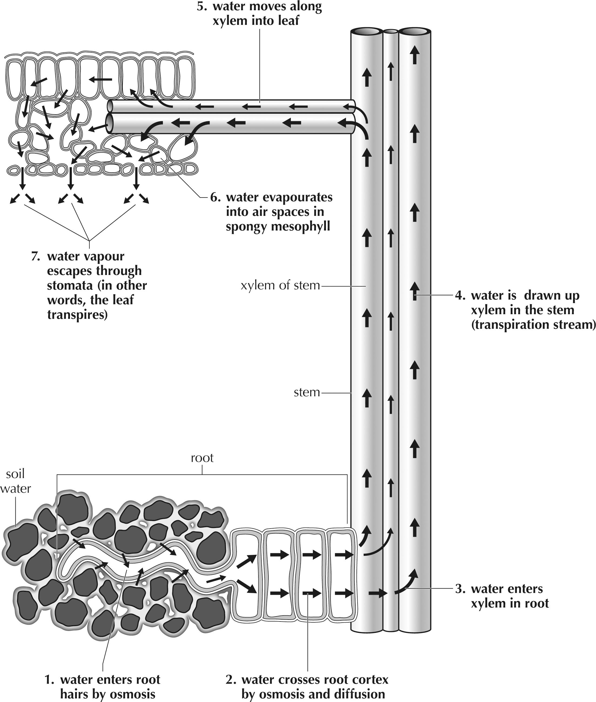
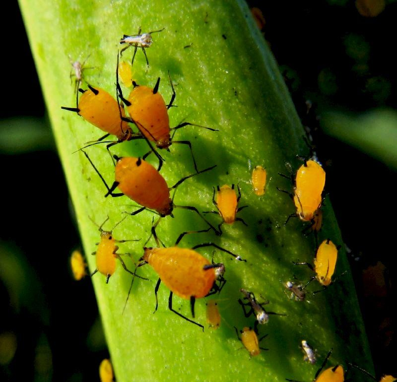
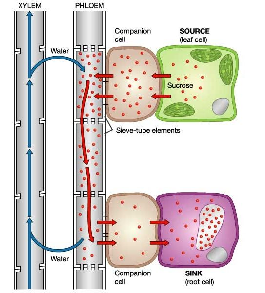

## 5.5 Uptake of water and minerals in the roots (ESG7S)

In the first section of this chapter, we looked at the structure of the dicotyledonous root and stem and compared the different cells in the specialised tissues of the plant root and stem. Now we will look at how these specialised cells help the plant to absorb water from the soil and transport it to the stem, where it can then be transported to the rest of the plant.

### Movement of water through the dicotyledonous root (ESG7T)

**Uptake of Water and Minerals in the Roots**

In this section learners need to know how water enters from the soil into the specialised cells of the root.

Learners need to relate this section to:

- the movement of water down a water potential gradient (osmosis and diffusion)
- the structure of the dicotyledonous root and stem
- the different cells in the specialised tissues of the plant root and stem

Water is found in the spaces between the soil particles. Water and mineral salts first enter through the cell wall and cell membrane of the root hair cell by osmosis. Root hair cells are outgrowths at the tips of plants' roots (Figure 5.27). They function solely to take up water and mineral salts. Root hair cells do not perform photosynthesis, and do not contain chloroplasts as they are underground and not exposed to sunlight. These cells have large vacuoles which allow storage of water and mineral salts. Their small diameter (5-17 micrometres) and greater length (1500 micrometres) ensure they have a large surface area over which to absorb water and mineral salts. Water fills the vacuole of the root hair cell.

The following list summarises how the root hair is adapted to absorb water from the soil:

- There are many, elongated root hairs to increase the total root surface area for water absorption.
- They have thin walls to speed up the intake of water by osmosis.
- They have large vacuoles to absorb water quickly and transport it to the next cells.
- The vacuoles have salts, which speed up water absorption from soil water.
- Root hairs do not have cuticles, as this would prevent water absorption.

Water can now move from the root hair cells and across the parenchyma cells of the cortex in two major ways. Some water passes through the cells by *osmosis*.  Most water travels either in, or between the cell walls (of the parenchyma cells) by simple *diffusion*. The water must pass through the endodermis to enter the xylem. Once water is in the xylem of the root, it will pass up the xylem of the stem.

Figure 5.27: Step-by-step transport of water in plants, from the roots to the xylem.

Transpiration and movement of water:

This website shows a diagram of how water moves up through the plant.

This video shows plant transport and provides some interactive quiz games.

### Transport of water and minerals to leaves (ESG7V)

**Transport of Water and Minerals to Leaves**

In this section the transport of water and minerals to the leaves is discussed.

Plants must transport water from the roots to the leaves where it is needed for the process of photosynthesis. Nutrients produced in the leaves by photosynthesis are transported to all the parts of the plant. The phloem carries nutrients up and down the plant. The xylem only carries water up the plant.

To understand this section you need to remind learners need to link this to previous units learnt in the Chapter.

- the internal structure of a dicotyledonous leaf and stem and the structure of the cells that make up the specialised tissues.
- the movement of water from the soil into the root
- transpiration and the loss of water vapour from the stomata

<Callout type="note" title="Note">
Learn how water is transported from the soil to the leaves of a plant.

<VideoPlayer src="https://youtu.be/g7HbmUnqGlM" title="Video: 2CRY" />
</Callout>

<Callout type="note" title="Note">
Learn how transpiration helps with the transport of water to the leaves.

<VideoPlayer src="https://youtu.be/rMCpFLr_q58" title="Video: 2CRZ" />
</Callout>

We have dealt with the transport of water in plants from the soil into the root xylem. Now we need to discuss how the water is transported against gravity from the roots to the leaves where it is needed for the process of photosynthesis.

Water travels to the leaves via the stem. Recall, that three processes are necessary for the transport of water in plants, namely; transpiration, capillarity and root pressure. All three of these processes are passive and do not require an input of energy.

**Transpiration**: constant water loss via transpiration from the leaves causes a negative water pressure in the leaves. The negative pressure in the leaves works like a 'suction' force, pulling the water up the stem.

**Capillary Action**: water moves up the stem in response to the 'suction' caused by transpiration because of two forces: adhesion and cohesion. Cohesion is the tendency for water molecules to stick together and adhesion is the tendency for water molecules to stick to other surfaces, such as the inside of the xylem vessels. Stem xylem is structurally adapted to take advantage of capillarity, because they are very long with a narrow diameter.

**Root Pressure**: water can also be moved up the stem via a 'push' force from the roots. Water is constantly being absorbed by the roots due to the negative water potential in the root cells. This movement of water into the roots can cause the water pressure inside the roots to become high, resulting in a force that 'pushes' water up the stem xylem.

<Callout type="note" title="Note">
**Capillarity**: refers to the ability of a liquid to flow through narrow spaces (capillary pressure).
</Callout>

## Examining water uptake by the stem

### Aim

To examine water uptake by the stem.

### Apparatus

- water
- food colouring dye (available at supermarket)
- white flower on a stem, e.g. Impatiens, carnation or chrysanthemum
- scissors
- two jars, cups or measuring cylinders
- plastic tray
- sticky tape

### Method

1. Fill one jar with plain water, and one with water containing several drops of food colouring dye.
3. Take the flower and carefully cut the stem lengthwise, either part way up the stem or right up to the base of the flower (try both, the results will be different!)
5. Put one half of the stem into the jar containing plain water and one half of the stem into the jar containing food colouring dye. To make it easier to insert the stalks without breaking them, it helps to wedge paper underneath the jars so that you can tilt them towards each other. Tape the jars or cylinders down onto a tray so that they do not fall over.
7. Observe the flowers after a few hours and the next day, and note where the dye ends up in the flower head. You can leave the flowers up to a week but be sure to make sure that they have enough water.

**Variation:**  Instead of using one cylinder with water and one with food dye, use two different colour food dyes (e.g. blue and red). At first the flower will show two separate colours, but as time goes by the whole flower will show both dyes. This is because water can move sideways between xylem vessels through openings along their length. The ability of water to move laterally between vessels is useful for when air becomes trapped in a vessel, causing a blockage. If you cut the stem right up to the base of the flower, this will limit movement between the xylem vessels.

**Variation:** Try using celery stalks with leaves. Cut open the celery stalk (cross-section) and you will see darker-coloured little holes/ spots. These are the vessels.

### Results

Record your observations and results

### Conclusions

What did you conclude from this experiment?

An example of this experiment with photographs can be found at:

**Investigation: To examine water uptake by the stem**

**RESULTS **

In this investigation learners are to write down their observations. The learners should observe that the flowers show the red or blue colour of the food colouring in their petals, especially in the veins. The celery stalk should have dark red / blue spots, where the xylem in the vascular bundles has been stained by the dye in the food colouring.

**CONCLUSIONS **

The class  can then discuss their observations and conclusions, particularly if learners used different plants. Learners should conclude that the water in plants is transported by xylem in the veins. Xylem vessels branch throughout the flower petals, starting off as fairly large bundles of xylem vessels at the base of the petal and becoming finer bundles as it gets to the edges of the petals.

### Movement of manufactured food (ESG7W)

**Movement of manufactured food**

This section deals with how sugars are transported from the leaves to the rest of the plant via specialised phloem cells.

Revise the concept of photosynthesis and that plants use carbon dioxide and water to manufacture glucose and oxygen is the waste product. Sunlight and enzymes are necessary for photosynthesis to occur. Once the food is manufactured in the leaves it needs to be distributed to the entire plant so that the glucose can be used by each cell for respiration (manufacture energy).

Learners to understand that the glucose is manufactured mainly in the palisade cells and then passes into the phloem. Transport of food material from leaves to other parts of the plant is called translocation. This food may be stored in roots, stems or fruit.

Plants use sunlight, carbon dioxide and water to manufacture glucose, yielding oxygen as a by-product. Sunlight or radiant light is captured by the green pigment chlorophyll inside of chloroplasts to provide the energy for photosynthesis to occur. Once the food is manufactured in the leaves it needs to be distributed to the entire plant so that the glucose can be used by each cell for respiration and some of the photosynthetic products are then stored for later use.

The glucose is manufactured mainly in the palisade cells where there are more chloroplasts, and then passes into the phloem. Plants usually transport food in the form of the sugar sucrose because it is less reactive than glucose. Sucrose is transported to where it is needed in the the plant via phloem sap, and may be stored in roots, stems or fruit. Transport of food material from leaves to other parts of the plant is called **translocation**. Understanding the phloem structure is important to understanding how it transports food.

Read more: [Anatomy of Plants - Biology Encyclopedia - cells, body, function, system, different, organs, hormone, structure, types, membrane](http://www.biologyreference.com/A-Ar/Anatomy-of-Plants.html#ixzz1an9JO8yK)

Figure 5.28: Aphids feeding on phloem sap which is rich in glucose.

**How the phloem functions**

While the transport of water is usually unidirectional in xylem (upward or lateral), the movement of sugars in the phloem is multi-directional, and occurs by **active transport**, an energy-dependent process. Sucrose is actively transported *against* a concentration gradient into sieve-tube elements. The sieve-tube elements have no nuclei but the adjacent companion cells do. Companion cells are closely associated with sieve tubes and carry out all the cellular functions of the sieve tubes.

The cytoplasm of sieve tubes and companion cells is connected through numerous channels called **plasmodesmata**. These cytoplasmic connections allow the companion cells to regulate the content and activity of the sieve tube cytoplasm. The companion cells also help load the sieve tube with sugar and the other metabolic products that they transport throughout the plant. This lowers the water potential of the sieve-tube element, causing water to
move in by osmosis, creating a pressure that pushes the sap down the tube. The metabolising cells of the plant actively transport sugars out of sieve-tube elements, producing exactly the opposite effect. The diagram below illustrates how the overall process works.

Figure 5.29: Diagram showing movement in the xylem and phloem vessels. Water movement is upwards in the xylem and lateral into and out of the phloem. Lateral movement also occurs into and out of the companion cells accompanying the phloem vessel.
