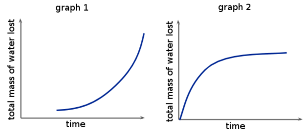

## End of chapter exercises

### Exercise 5.1

The water loss in two plants was recorded over a 12 hour period. Study the information below and then answer the questions that follow. The results for the two plants were recorded in the following table.

| Time of Day | 06:00 | 08:00 | 10:00 | 12:00 | 14:00 | 16:00 | 18:00 |
| --- | --- | --- | --- | --- | --- | --- | --- |
| Water loss in Plant A  (\(\text{cm$^{3}$}\)) | \(\text{0,0}\) | \(\text{0,4}\) | \(\text{1,6}\) | \(\text{6,0}\) | \(\text{9,0}\) | \(\text{8,0}\) | \(\text{7,6}\) |
| Water loss in Plant B  (\(\text{cm$^{3}$}\)) | \(\text{0,2}\) | \(\text{0,7}\) | \(\text{4,0}\) | \(\text{14,0}\) | \(\text{19,0}\) | \(\text{18,2}\) | \(\text{17,7}\) |

**Problem:**
What is the correct biological term for water loss in a plant?

**Solution:**
Transpiration

**Problem:**
From which plant was the greatest amount of water loss recorded?

**Solution:**
Plant B

**Problem:**
Assuming the plants were kept in identical conditions; suggest two possible ways that the plant that lost less water may have differed structurally from the plant that most more water.

**Solution:**
Any two of the following: It could have smaller or fewer leaves / trichomes or hairs on the leaves / leaves in a rosette arrangement / sunken stomata / fewer stomata per leaf / thicker cuticle / curled up leaves.

**Problem:**
Which time of day was the greatest water loss recorded for both Plants A and B. Why do you think this is so?

**Solution:**
14h00 (2pm). It is the hottest part of the day. The sun shines brightly, causing stomata to open wider and the high air temperature causes water vapour to diffuse rapidly out of stomata.

**Problem:**
At 18h00 the rate of water loss was lower. Why did this occur?

**Solution:**
The sun went down, so light intensity became lower, closing the stomata. The air temperature was also lower, reducing the diffusion rate of water vapour, so both plants lost less water.

**Problem:**
What is the apparatus that was used in the laboratory to measure the rate of water loss in plants A and B.

**Solution:**
Potometer

**Problem:**
What do you understand by guttation and how does the process of guttation occur?

**Solution:**
Guttation is the loss of liquid water from the hydathodes on the leaves of some plants. It occurs early in the morning when air is cool, soil is wet and humidity is high, so transpiration rate is low. Guttation is independent of transpiration and results from root pressure.

**Problem:**
Tabulate the differences between guttation and transpiration.

**Solution:**
| Guttation | Transpiration |
| --- | --- |
| occurs early morning and at night | occurs during the day when it is hot and light |
| takes place through hydathodes | takes place through the stomata |
| Water is lost in liquid form | Water is lost as vapour |
| caused by root pressure | caused by high water potential |
| Water droplets are found on the margin of the leaf | Water vapour transpiration takes place mostly in the lower surface of the leaf where stomata are located |

**Problem:**
Briefly discuss the movement of water through the dicotyledonous root.

**Solution:**
Water enters the root hair cells from soil water. It passes through the thin cell walls of root hair cells into the vacuoles and then passes by osmosis through parenchyma cells of the cortex or via intercellular spaces towards the endodermis. Casparian strips in endodermal cells force water into the xylem but passage cells allow water to pass right through them. Water passes through the pericycle and into the xylem, from where it is transported upwards due to transpiration pull, capillarity and root pressure.

**Problem:**
Give a short explanation for the following:

- Capilliarity
- Dicotyledon
- Transpiration
- Water potential gradient

**Solution:**
- **Capillarity** is the tendency of water molecules to cling to each other (cohesion) and cling to the sides of xylem vessels (adhesion). These two forces together cause capillarity – the make a water column in xylem continuous, so it ‘creeps up’ the xylem and is easily moved up by transpiration pull.
- **Dicotyledons** are plants in one class of the Angiosperms / flowering plants. They have seeds with 2 cotyledon or seed lobes, net veins, petioles, flower parts in multiples of 4 or 5, tap root systems and vascular bundles in a ring in the stem.
- **Transpiration** is the loss of water vapour from the aerial parts of plants. It occurs mainly through stomata on the leaves. It is fastest during the hottest times of the day and is increased in low humidity and when the wind blows.
- **Water potential gradient**  is the difference in the water potential of two liquids. Water potential is the potential of water to move from one area to another due to differences in pressure, solutes dissolved in the water and other factors. The water potential gradient between two solutions has a direct effect on the rate of osmosis – the bigger the gradient, the faster osmosis occurs in the direction of the gradient, i.e. always from a high to low water potential.

**Problem:**
On a hot day in the middle of a drought, what can you expect the leaves of a plant to look like? Draw a diagram to describe your answer.

**Solution:**
Learners should draw wilted leaves.

**Problem:**
List the environmental conditions that would result in the highest rate of transpiration.

**Solution:**
- Dry air / low humidity
- high air temperature
- high wind speed
- bright light

**Problem:**
Name four defining characteristics of a monocotyledonous plant.

**Solution:**
Any four of the following:

- Leaves with parallel veins
- Leaves with leaf sheaths, not petioles
- Fibrous root system
- Flower parts in multiples of 3
- Seeds with one cotyledon
- Vascular bundles scattered in the stem, not in a circle

**Problem:**
In a short paragraph, explain how secondary thickening in a stem comes about.

**Solution:**
The parenchyma cells in medullary rays become meristematic and form cambium between the vascular bundles, which joins up with vascular cambium to form a complete cambium ring. This divides by mitosis to form secondary xylem to the inside and secondary phloem to the outside of the stem. Secondary xylem is formed faster than secondary phloem and its rate of formation is affected by temperature and rainfall. In spring and summer, large xylem cells with thinner walls are formed in a broad band – this is called spring wood. In autumn and winter, a narrow band of smaller, thick-walled xylem cells are formed – this is called autumn wood. One layer of spring wood and the layer of autumn wood next to it are called an annual ring – it indicates the growth in thickness of the stem in one year. Just under the hypodermis, a parenchyma layer also becomes meristematic and forms the cork cambium, which forms cork cells to the outside and parenchyma / cortex cells to the inside. Lenticels usually develop in the cork layer to assist gaseous exchange in older stems.

**Problem:**
Name and briefly discuss the adaptation of leaves to minimise transpiration.

**Solution:**
Leaves can have the following adaptations to reduce transpiration rate:

- Small or narrow leaves to reduce the surface area over which water vapour is lost
- Leaves in a rosette arrangement to shade lower leaves and trap water vapour
- Curled up leaves to trap water vapour inside the leaf cavity
- Thick cuticles to prevent evaporation of water
- Sunken stomata to trap water vapour in pits near the leaf
- Very few stomata or stomata only on the lower surface to reduce water loss
- Trichomes to make leaves reflective and trap water vapour

**Problem:**
Name the two main ways that water can travel through the parenchyma of the root.

**Solution:**
Along the cell walls or in the intercellular spaces or from vacuole to vacuole.

**Problem:**
Explain the difference between cohesion and adhesion.

**Solution:**
Cohesion is the force that holds water molecules together whereas adhesion is the force that allows water molecules to cling to other substances, e.g. to the walls of xylem vessels.

**Problem:**
During transpiration, the movement of water through the xylem is largely due to:

1. mitosis
3. capillary action
5. osmosis
7. all of the above

**Solution:**
capillary action

**Problem:**
Stomata:

1. are found in plant roots
3. permit the intake of carbon dioxide
5. prevent the intake of oxygen
7. all of the above

**Solution:**
permit the intake of carbon dioxide

**Problem:**
Water can be lost by a plant through which process(es)?

1. guttation
3. transpiration
5. condensation
7. a and b

**Solution:**
a and b: guttation and transpiration

**Problem:**
What environmental condition(s) always lead to an increase in transpiration rate in each plant tested?

1. heat
3. wind
5. light
7. all of the above

**Solution:**
all of the above

**Problem:**
Wind appears to increase the rate of transpiration in a plant. This is most likely due to the fact that:

1. humidity increased
3. evaporation increased
5. stomata were forced to close
7. all of the above

**Solution:**
evaporation increased

**Problem:**
Describe how light intensity is responsible for an increase or decrease in the transpiration rate.

**Solution:**
Light intensity increases rate of photosynthesis. This increases the rate of glucose production and storage in guard cells. This leads to movement of water into the guard cells as a result of a lower water potential with respect to outside the guard cells. The increase in turgor pressure of the guard cells results in the opening up of the stomata which results in increased transpiration.

**Problem:**
Study the two graphs below which show water loss from a plant over a period of time, and answer the following question:

Which graph could show water loss under increasing external humidity? Give reasons for your answer.

**Solution:**
Graph 2. As the humidity increases over time, the transpiration rate slows down. When the humidity is low water is lost more rapidly because there is a steep water potential gradient between water vapour inside the stomata and the outside atmosphere. As humidity increases, the water potential gradient across the inside and outside the leaf become more equal, and so the rate of transpiration decreases. At high humidity, the water loss is reduced to zero.

Describe how each of the following adaptations results in a decrease in the transpiration rate:

**Problem:**
Spiny leaves

**Solution:**
Lower surface area over which water is lost.

**Problem:**
Rolled leaves

**Solution:**
Have sunken stomata which creates an artificial 'humidity' layer outside the plant thereby preventing water loss.

**Problem:**
Waxy cuticle

**Solution:**
The thick waxy cuticle layer is hydrophobic, thus making it more difficult for water to pass through, therefore decreasing water loss by transpiration.

Complete the following sentences:

**Problem:**
Translocation refers to the ...

**Solution:**
Translocation refers to the movement of manufactured sugars from the leaves to the rest of the plant through the phloem.

**Problem:**
Xylem tissue in plants is responsible for the transport of ...

**Solution:**
Xylem tissue in plants is responsible for the transport of water and mineral salts.

**Problem:**
The roots absorb water through the ...

**Solution:**
The roots absorb water through the root hairs.

**Problem:**
Draw a table showing how the structure of root hairs is adapted for their function.

**Solution:**
| Structure | Function |
| --- | --- |
| Thin and long root hairs | Increase surface area over which absorption of water and mineral salts can occur |
| Thin cell wall | Makes osmosis faster |
| No cuticle | Cuticle would hinder water absorption |
| Large vacuole | Allows for storage of water and mineral salts |
| Mineral salts in vacuole | Creates a concentration gradient to encourage osmosis |
| Several root hairs | Increased surface area |

Table 5.4: Table showing relationship between structural adaptations of root hairs and their function
