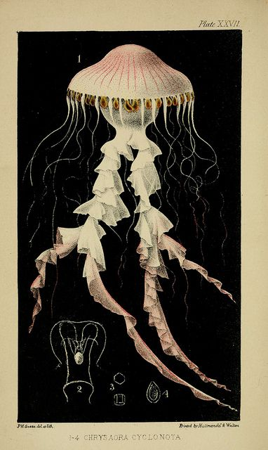
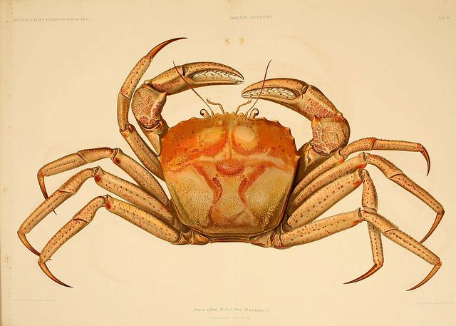
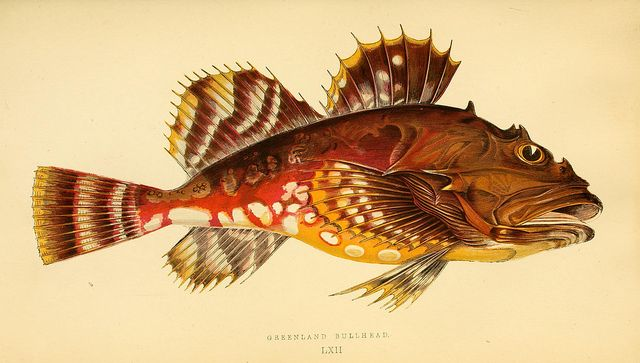
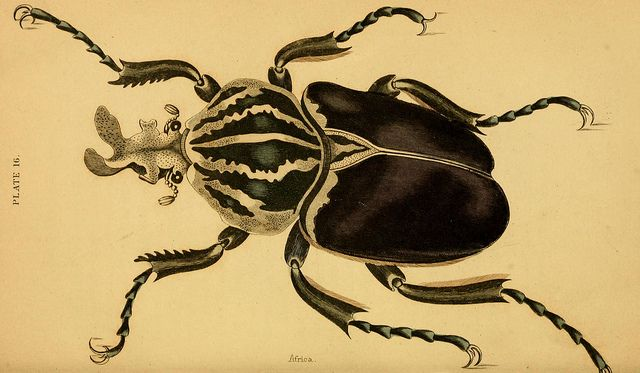
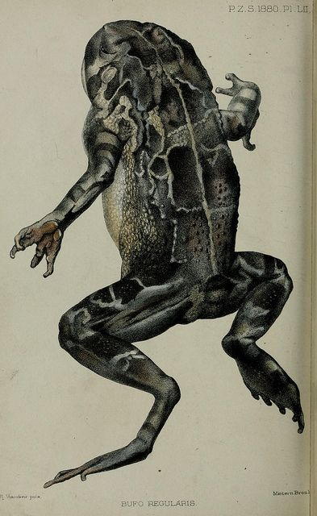
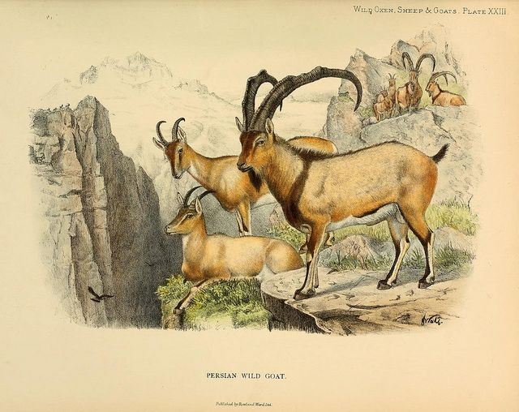
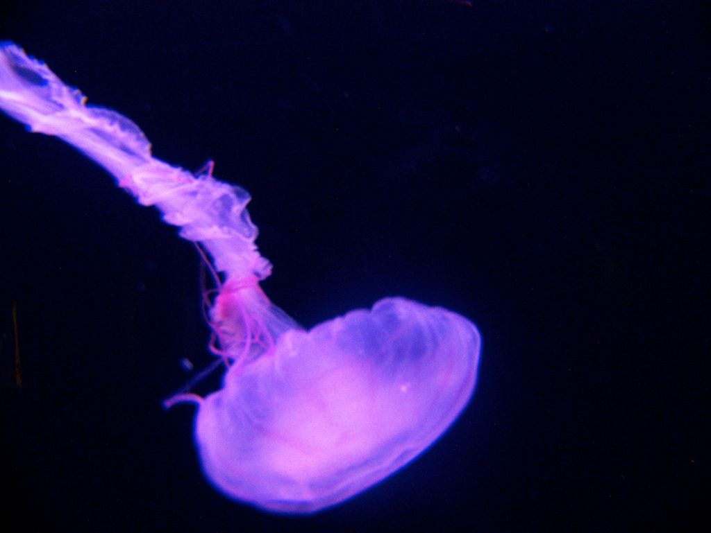
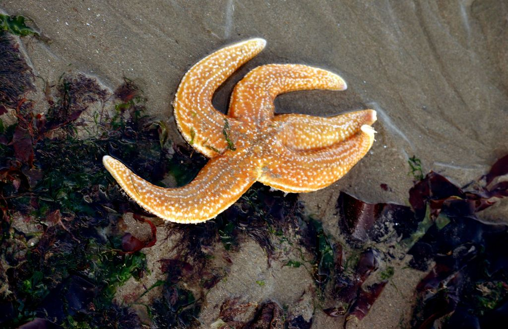
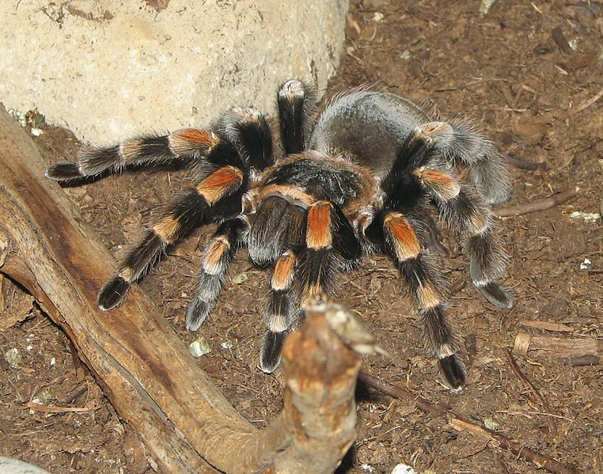

## 6.2 Skeletons (ESG82)

The skeleton is the supporting structure of an organism. There are three different types of skeletons: hydrostatic skeletons, endoskeletons and exoskeletons.

- **Hydrostatic skeleton**: Water exerts pressure on muscular walls, for example, in jellyfish.
- **Exoskeleton**: The stable chitinous or mineralised outer shell of an organism, for example, the shell of a grasshopper or prawn.
- **Endoskeleton**: A cartilaginous or mineralized support structure inside the body, for example, in humans and other vertebrates.

In this chapter we will be looking at support systems in animals and investigating the human skeletal system in some depth.

<Callout type="note" title="Note">
As you will learn in the chapter **History of Life on Earth**, many of these structural adaptations allowed animals to move from water onto land.
</Callout>

### The evolutionary development of the skeleton (ESG83)

Learners do need to know detail from this section on the evolution of skeletons. Rather, it is important that they grasp how form has adapted to function over time. This section should be used to reinforce the learner's previous understanding of evolution, covered in earlier grades, and should lay a foundation for the later chapter on the 'History of Life on Earth'.

**Body support provided by water**

The earliest forms of life evolved in the oceans. The fact that this is an aquatic environment is key. Water is about \(\text{1 000}\) times denser than air. The high density of water allows organisms to float, due to a physical, upward force inherent in liquids known as buoyancy. Buoyancy allowed organisms to grow and reach large sizes because the buoyancy force supported the body weight of these animals. However, the density of water also provides resistance to movement, and animals had to adapt to ensure that they were able to move efficiently through water.

An early adaptation by organisms was the ability to change the hydrostatic pressure within different chambers of their bodies to enable quick movement. This resulted in the development of **hydrostatic skeletons**. Animals with this type of skeleton include jellyfish, octopus and sea anemones. The changing shape of the animal reduces both friction and drag.

Figure 6.1: The animal above is a jellyfish. It uses its muscles to contract against the hydrostatic skeleton to bring about movement.

Over time, in order to refine movement and improve protection from predators, some organisms developed a hard chitinous **exoskeleton**. Exoskeletons first developed in the aquatic environment in ancient arthropods. Animals with this type of skeleton include crustaceans like crabs and lobsters.

Figure 6.2: Crustaceans, such as this crab, developed a protective exoskeleton.

Eventually, there were some animals that developed a skeletal structure internal to the body, which would become the vertebrate group of animals. These animals have an **endoskeleton**. Initially, all endoskeletons were made of cartilage, which is a dense rubbery type of tissue. Later, endoskeletons of bone evolved.

Figure 6.3: The first vertebrates evolved in the oceans. This fish has an internal endoskeleton that makes it streamlined and allows it to move rapidly through water.

**The adaptation of the skeleton to a terrestrial environment**

The two major requirements for survival on land are the development of a suitable support system and an air breathing mechanism. One of the biggest problems encountered by animals moving from water to land was the loss of the effect of buoyancy. In order to counter this, animals needed to develop strong limbs and had to adapt the skeleton to support their body weight on land. Moving effectively on land is essential, particularly if one needs to avoid predators, catch prey, or adapt to a particular habitat. Different skeleton types have solved these problems in different ways.

Animals with exoskeletons like arthropods (a class of animals including insects, crustaceans and arachnids) transitioned from sea to land long before the vertebrates (organisms with endoskeletons). A major factor in their success was the **exoskeleton** which provides attachment for muscles controlling **locomotion** (movement of appendages). Exoskeletons also provided some protection from dessication (water loss).

Figure 6.4: This beetle is an example of a insect. Insects have a protective exoskeleton that made it possible for them to colonise land millions of years ago.

Amphibians with **endoskeletons **, like frogs and newts, live both on the land and in the water. Their skeletons have adapted to give advantages in both conditions. They have calcified bones to support their body weight under the force of gravity. Their skull is light and flattened, for both motility on land and a streamlined shape for moving easily in water. Their pectoral girdle is adapted to give support for the forelimbs, which absorb the body weight when landing after a jump.

Figure 6.5: Amphibians were the first vertebrates to colonise land. They begin their life-cycle in water, and emerge onto land as adults.

Depending on their means of locomotion, terrestrial animals needed to adapt their shapes and skeletons to overcome the effects of gravity. Limbless animals, such as snakes, had to overcome drag and friction. Flying animals such as birds and bats need light skeletons and very strong sternums for wing muscle attachment. Animals that support their bodies clear of the ground needed an energy efficient way of maintaining balance. For this reason, the leg bones of most animals are held directly underneath the body. In this position they act as props or struts and it is the bones rather than the muscles that take most of the strain of the body's weight.

Figure 6.6: Land vertebrates often have legs placed directly beneath the body. The legs acts as struts, and are the most energy-efficient way to keep the body suspended above the ground.

### Hydrostatic skeleton (ESG84)

A hydrostatic skeleton is a structure found in many cold-blooded and soft-bodied organisms. It consists of a fluid-filled cavity, which is surrounded by muscles. The cavity is called a **coelom** and in some animals this cavity is filled with a blood-like substance called **haemocoel**. The fluid presses against the muscles, which in turn contract against the pressure of the fluid. The fluid is incompressible and thus maintains a constant volume against which the muscles can contract. The hydrostatic skeleton prevents the collapse of the body. The muscles in the body act against the fluid and in doing so bring about movement. If the body is segmented, the pressure of the fluid is localised in a few segments at a time. Hydrostatic skeletons occur in flatworms, round worms, earthworms, starfish and slugs.

Note that starfish and other Echinoderms have an outer skeleton of calcareous (chalky) ossicles (little bones) or spicules which are like little spines for protection. This outer skeleton encloses a water vascular system with tube feet that are moved by fluid pressure changes (it serves as a hydrostatic skeleton which controls movement).

Figure 6.7: The animal above is a jellyfish. It uses its muscles to contract against the hydrostatic skeleton to bring about movement.

Figure 6.8: The animal depicted above is an Echinoderm - a starfish - which uses its tube feet for movement.

**Advantages of a hydrostatic skeleton**

- **Fluid shape:** This allows organisms with hydrostatic skeletons to fit through oddly shaped passages, which is useful for burrowing or swimming.
- **Strength:** Creatures with hydrostatic skeletons can squeeze between spaces and expand, making a 'prying open' movement which allows them to force their way into various regions of rock and soil surfaces.
- **Healing:** Healing takes place faster in organisms with hydrostatic skeletons than in organisms with bone structures. This is because the haemocoel contained within the hydrostatic skeleton is made up mostly of water, and thus, can be refilled quickly. This allows many organisms with hydrostatic skeletons such as earthworms to grow back their body mass after damage.
- **Lightweight:** The hydrostatic skeleton allows the animal to move in a more flexible manner as it requires very little muscle mass for movement.
- **Circulation:** The fluid cavity allows circulation of nutrients and waste.
- **Protection:** The hydrostatic skeletons cushions the internal organs of the animal from shock.
- **Suited to environment:** Hydrostatic skeletons are suited for life in moist or aquatic environments, depending on the animal's adaptations.

**Disadvantages of a hydrostatic skeleton**

- ** Structure and surface for attachment:** The hydrostatic skeleton lacks a structure and does not have surfaces for the attachment of muscles or limbs.
- ** Lack of protection:** There is very little protection for the internal organs.
- ** Dessication:** A moist or water habitat is essential for survival of these animals in order to prevent dessication (drying out).
- ** Limited strength:** Terrestrial animals with hydrostatic skeletons cannot increase their body size as they would collapse under their own body weight.

### Exoskeleton (ESG85)

An exoskeleton is an external skeleton that supports and protects an animal's body. The skeleton is non-living and consists of a cuticle strengthened by chitin, a substance secreted by the epidermis (skin). Crustaceans such as crabs have their exoskeleton further strengthened by calcium carbonate. There are muscles attached to the inside of the exoskeleton which provides the resistance needed for muscle action.

The exoskeleton is confined to animals such as insects, spiders, scorpions, crabs etc., all of which belong to the Phylum Arthropoda (jointed-legged and jointed-bodied animals). The exoskeleton acts as a hard outer covering, and is made up of a series of plates or tubes. We often call large exoskeletons `shells'. Exoskeletons first appeared in the fossil record during the time of the **Cambrian explosion** and comprises a substantial portion of our fossil record (as you will learn in chapter 10).

Figure 6.9: Picture of a spider, a type of arthropod.

**Advantages of the exoskeleton**

- **Muscle attachment:** The exoskeleton forms the point of attachment of internal muscles needed for locomotion thereby providing better leverage for muscle action.
- **Protection:** The exoskeleton protects the soft internal tissues and organs.
- **Support:** The exoskeleton provides structural support and shape.
- **Prevents Dessication:** The exoskeleton prevents desiccation (drying out) on land.
- **Light-weight:** The exoskeleton of insects has a low density and is therefore lightweight, to allow for flight.
- **Diversity:** The mouth-parts can be modified for biting, sucking, piercing  grasping thus providing for a diversified diet for organisms possessing an exoskeleton compared to those that do not.

**Disadvantages of the exoskeleton**

- **Size restriction:** The final body size is limited because as the body size increases, the surface area to volume ratio decreases. The larger the animal, the heavier the exoskeleton, making movement more difficult.
- **Non-living skeleton does not grow with animal:** The overall growth of the animal is restricted due to periodic moulting. Since the exoskeleton restricts growth, moulting is required to accommodate for increases in the size of the animal.
- **Vulnerability during moulting:** The animal is vulnerable when it is in the moulting process, because the new skeleton is very soft until the new exoskeleton has dried and hardened.
- **Sites of structural weakness:** Exoskeletons are weaker at the joints.

### Endoskeleton (ESG86)

**Endoskeleton**

This skeleton is found inside the body and can consist of bone (all vertebrates except sharks) or cartilage (sharks) and some endoskeletons consist of both.

**Advantages of the endoskeleton**

- **Living:** Endoskeletons consist of living tissue, so it is able to grow steadily within the animal enabling some to reach a large size.
- **Structure and support:** The endoskeleton provides shape and structural support.
- **Structural diversity and adaptation:** The bones can vary in size and shape to support the animal's mass.
- **Flexible:** The endoskeleton is jointed which allows for flexible movement and support.
- **Muscle attachment:** The muscles attach directly to the skeletal bones to allow for movement and support.
- **Protection:** The endoskeleton protects the vital organs such as the heart and lungs which are protected by the ribcage.
- **Diversified locomotion:** The development of an endoskeleton has allowed for animals to become successfully adapted to locomotion in the environment in which they live. Vertebrates (organisms with a vertebral column and an endoskeleton) have become adapted to move in a number of different modes of locomotion, e.g. running, jumping, swimming, and flying.

**Disadvantages of the endoskeleton**

- **Vulnerable to external environment:** The endoskeleton does not offer the animal any protection from the exterior, be it a physical attack or changes in environmental conditions. The animal is therefore very vulnerable.
- **Susceptible to disease:** The skeleton consists of living tissue so is susceptible to infections and disease.
