## 6.3 Human skeleton (ESG87)

Humans have a living **endoskeleton** (internal skeleton) made of bone, cartilage and connective tissue. At birth, the human skeleton consists of over \(\text{270}\) bones. However, in adults this number has reduced to \(\text{206}\) bones due the fusion of smaller bones into larger structures. The adult skeleton (Figure 6.10) is made up of the **axial skeleton** and the **appendicular skeleton** (Figure 6.11).

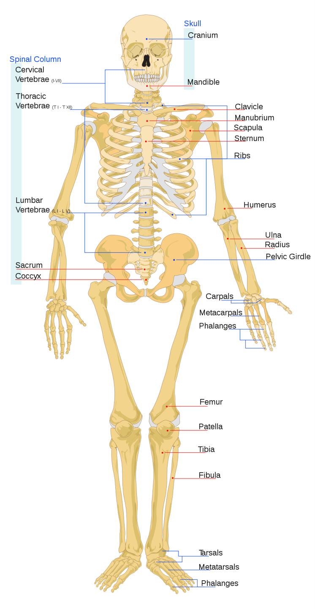

Figure 6.10: Diagram showing an overview of the main skeletal features of the human skeleton.

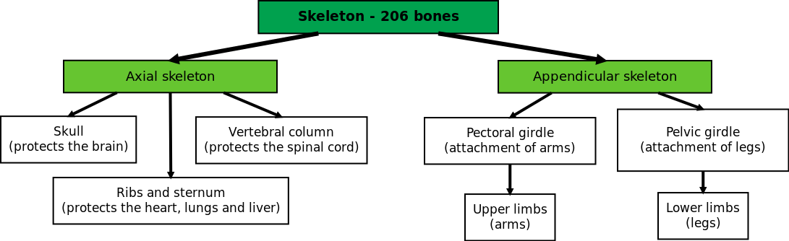

Figure 6.11: There are 206 bones in the adult human skeleton, which can be 'grouped' into different categories.

### Axial skeleton (ESG88)

**TEACHER RESOURCES:**

Axial skeleton animation

The axial skeleton forms the central axis of the body and consists of the skull, vertebral column and rib cage and sternum.

**The Skull**

The skull consists of the **cranium** and **facial bones**.

The **cranium** consists of eight flat bones joined together by immovable joints called sutures. The cranium surrounds and protects the brain. There is a large opening at the base of the skull called the **foramen magnum** through which the spinal cord passes. On either side of the foramen magnum is a projection which articulates with the first vertebra (called the **atlas**) to allow for the nodding movement of the head.

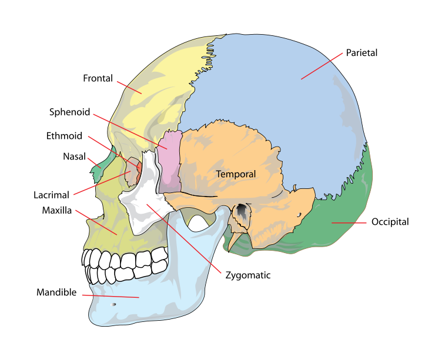

Figure 6.12: The cranium.

There are \(\text{15}\) **facial bones**. These are irregular bones that include the cheek bones, nasal bones, temples, upper jaw bone (maxilla)) and lower jaw bones (mandible). The only movable bone is the lower jaw. The upper and lower jaws bear the sockets for the \(\text{32}\) permanent teeth.

The number, type and arrangement of the teeth in an animal is indicated by a **dental formula**. The human dental formula is: 2.1.2.3/2.1.2.3. This formula represents the numbers of each type of teeth in half of the upper jaw and half of the lower jaw. This formula tells us that in both the upper and lower halves there are 2 incisors, 1 canine, 2 premolars and 3 molars.

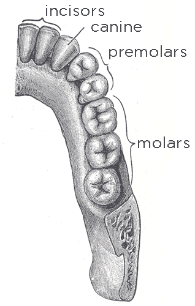

Figure 6.13: Dental formula in a human adult.

**The human vertebral column**

The vertebral column typically consists of 24 articulating vertebrae and 9 fused vertebrae in the sacrum and the coccyx. Between the vertebrae are **discs of fibrocartilage**, which prevent friction between vertebrae, and act as shock absorbers during walking, running and jumping. **Spinal nerves** are able to enter and leave the spinal cord through gaps between adjacent vertebrae. **Strong ligaments and muscles** around the spine stabilise the vertebrae and help to control movement. The vertebrae join up to each other in such a way that there is a continuous **spinal canal** which runs from the  base of the skull to the pelvic girdle. This canal contains the **spinal cord**. The entire vertebral canal can be divided into five regions.

- Cervical region
- Thoracic region
- Lumbar region
- Sacral region
- Coccyx

<Callout type="note" title="Note">
A few interesting facts about the human skeleton:

- Humans have seven neck bones - the same as giraffes.
- The strongest and longest bone is the thigh bone (the femur).
- One out of 20 people have an extra rib.
</Callout>

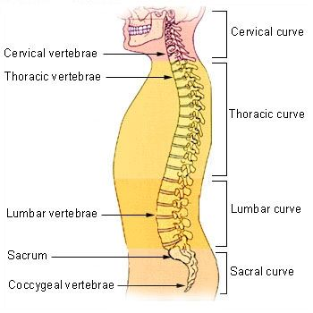

Figure 6.14: Human vertebral column.

The **cervical** (neck) region consists of seven vertebrae. The first cervical vertebra, called the **atlas**, supports the skull and allows for the  nodding movement of the head. The second vertebra, called the **axis**, has a projection on which the atlas pivots to give the side to side movement of the head.

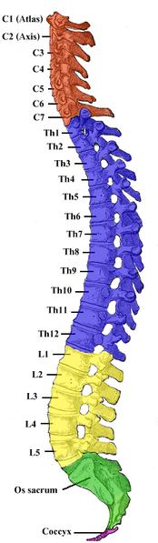

Figure 6.15: Cervical region of the skeleton is highlighted in red.

The **thoracic region** (chest) consists of 12 vertebrae, which each bear a pair of ribs.

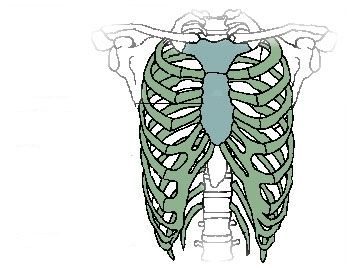

Figure 6.16: The thoracic vertebrae give rise to 12 pairs of ribs.

The **lumbar region** (lower back) consists of five vertebrae. This region has the largest vertebrae as it carries the weight of the body.

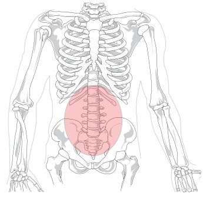

Figure 6.17: The lumbar region is highlighted by the red circle.

The **sacral region** consists of five fused vertebrae, forming a bone called the **sacrum**. the sacrum forms part of the pelvic girdle which provides surfaces for the attachment of muscles and the legs.

The **coccyx** is made up of four fused bones. These bones form the tail in those mammals that have tails.

<Callout type="note" title="Note">
In a newborn baby the entire vertebral column curves backwards probably because of the confines of the uterus. Initially a baby cannot support the weight of its head. When after about 3 months it is able to support its head, the **cervical forward curve is complete**. The **lumbar forward curve** is complete when the baby is able to stand on its own and ready to learn to walk.
</Callout>

**Functions of the vertebral column**

- Supports the skull
- Surrounds and protects the spinal cord
- Provides attachment for ribs, girdles, and back muscles
- Separate vertebrae and S-shaped curvature provide flexibility allowing humans to bend backwards, forwards and sideways
- Fibrocartilage discs between the vertebrae act as shock absorbers

**The rib cage and sternum **

The rib cage is a bony and cartilaginous structure. A typical rib cage consists of 24 ribs (12 pairs), the sternum (an inverted T-shaped structure connecting the rib bones), costal cartilages and the 12 thoracic vertebrae shown in the diagram below. The first seven pairs of ribs connect directly to the sternum and are referred to as *true ribs*. The remaining five pairs of ribs do not connect directly to the sternum and are referred to as *false ribs*. The rib cage aids in the protection of the heart and lungs. With the help of the diaphragm and the intercostal muscles, they increase and decrease the volume of the thoracic cavity thereby allowing inhalation and exhalation to take place.

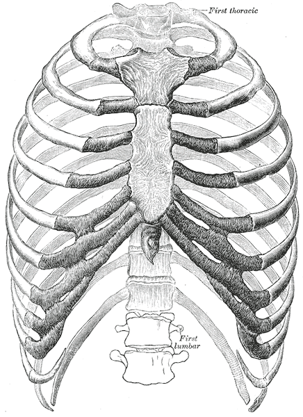

Figure 6.18: The human rib cage.

### Appendicular skeleton (ESG89)

The appendicular skeleton consists of the **pectoral girdle** with the **arms** and the **pelvic girdle** with the **legs**. The pectoral girdle and arms and pelvic girdle and legs will be explored in greater detail in the following section.

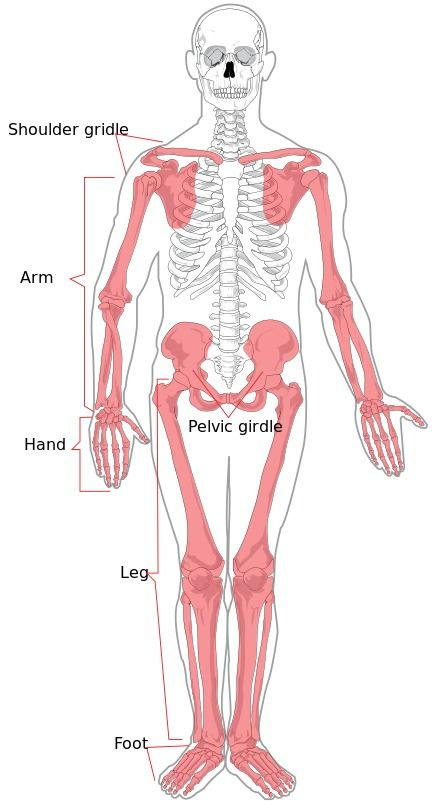

Figure 6.19: The appendicular skeleton is shaded.

**The pectoral girdle and arms **

The pectoral girdle consists of two **clavicles** (collar bones) and two **scapulae** (shoulder blades). Each clavicle is attached to the sternum in the front and the scapulae at the sides and they help to support the shoulders. The clavicle is the most frequently broken bone in the body as it often takes the full impact of falls on outstretched arms or of blows to the shoulder. The pectoral girdle is connected by muscles to the back of the thorax to enable it to have a supporting structure as well as giving the shoulders greater freedom of movement which in turn allows greater mobility of the arms. Any limit to movement is provided by the clavicle.

Each upper **arm** has a single bone called the **humerus** which fits into the **Glenoid cavity** on the **scapula** to form a ball and socket joint. This cavity is very shallow which allows the arms to move in almost any direction. The forearm consists of two bones namely the **ulna** in line with the little finger and the **radius** **in line with** the thumb. The joint at the elbow is a hinge joint. The wrist consists of eight small **carpal bones** arranged in two rows of four. The palm of the hand consists of five **metacarpal** bones. There are 14 digits (short bones) or **phalanges** in each hand, two in each thumb and three in each of the fingers.

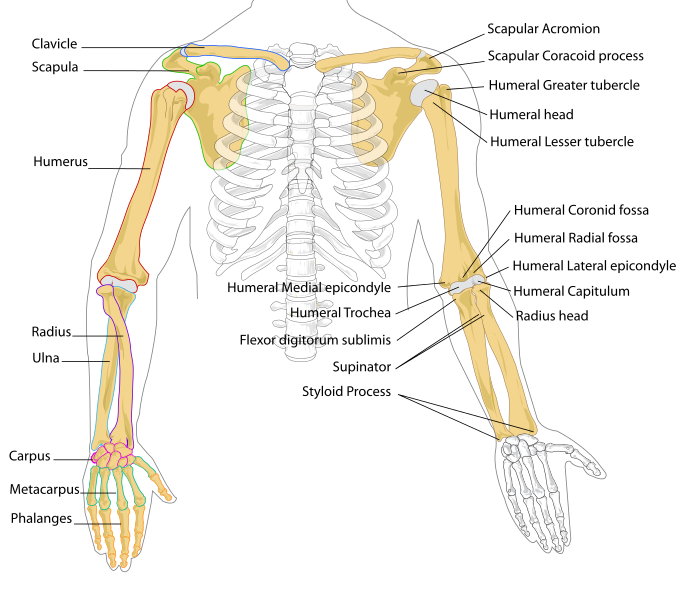

Figure 6.20: Skeletal framework of the arm and shoulder region.

**Functions of pectoral girdle**

- Forms a strong  support structure for the attachments of the arms.
- Provides large area of bone for the attachment of muscles.
- Forms ball-and-socket joints with the arms which allows the arms to move freely.

**Pelvic girdle and the legs**

The pelvic girdle consists of hip bones joined at the front by cartilage called the **pubic symphysis** and they are attached to the **sacrum** at the back. Each hip bone consists of three fused bones (ilium, ischium and pubis). Portions of all three bones contribute to the formation of the **acetabulum,** a deep socket into which the head of the femur (thigh bone) joins to form the hip joint.

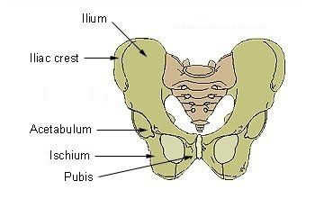

Figure 6.21: Skeletal framework of pelvic girdle.

<Callout type="note" title="Note">
The female pelvic girdle is wider and lighter than the male. This is an adaptation to allow for  pregnancy and childbirth.
</Callout>

The **femur** in the **leg** is the largest and strongest bone in the body. The upper end forms a ball and socket joint with the hip bone while the lower end articulates with the **tibia** to form the hinge joint of the knee. The **patella** or kneecap is a flat triangular bone which is embedded in the tendon of the thigh muscle and attached by a ligament to the tibia.

There are two bones in the lower leg: the **tibia** (shin bone) which is the larger of the two and supports most of the mass. The upper end articulates with the femur while the lower end articulates with one of the tarsal bones to form the ankle joint. The **fibula **(calf bone) is thinner than the tibia and serves mainly for the attachment of muscles. It is attached to the femur and is articulated to the top and bottom of the tibia.

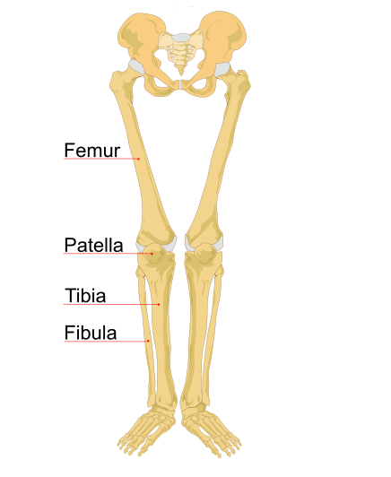

Figure 6.22: Skeletal framework of pelvic girdle and legs.

The structure of the foot is similar to that of the hand. However, the foot supports the weight of the body, so it is stronger and less mobile than the hand. There are seven **tarsals** or ankle bones, only one of which, the talus, articulates with the tibia. The talus us also know as the ** ankle bone**. The  **heel bone** (calcaneum) is the largest of the tarsal bones and is the bone to which the calf muscle is attached. The heel bone presses firmly on the ground when one stands, walks or runs.

There are 5 **metatarsal bones** which form the ball and arch of the foot. The 14 **phalanges** of the toes are the counterparts of those in the fingers, with the big toe having two phalanges and the other 4 having 3 phalanges each. Together these structures consist of the bones form the **lower limb** shown in Figure 6.23.

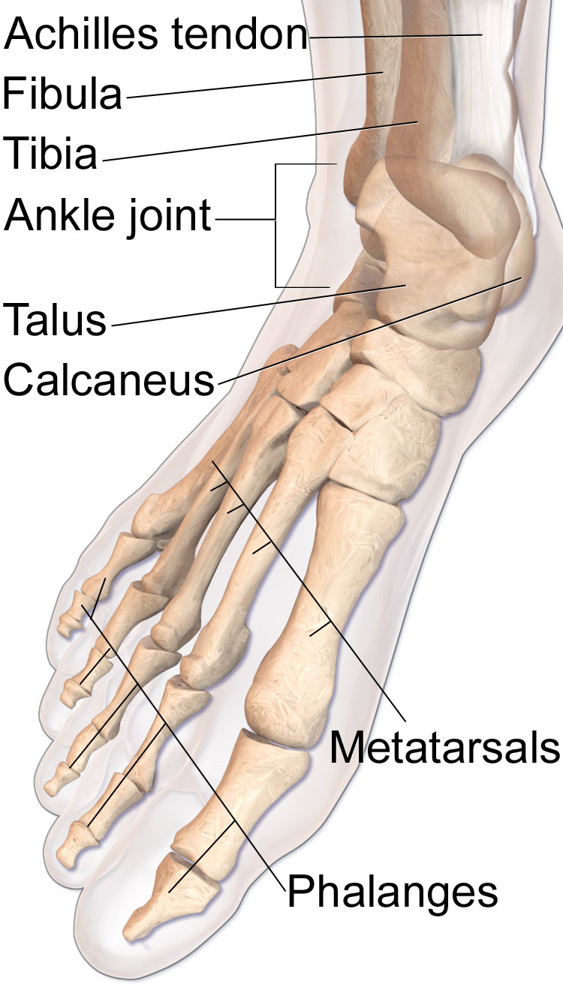

Figure 6.23: Bones of lower extremity.

### Functions of skeleton (ESG8B)

The human skeleton is living and performs many functions in the body. Some important functions are summarised below:

1. **Movement:** muscles attach to the bones of the skeleton, enabling movement.
3. **Protection:** the skull protects the brain, the ribcage protects the heart and lungs, and the pelvic bones protect the digestive tract and reproductive organs.
5. **Support:** provides shape and support to the body.
7. **Storage of minerals:** bones store minerals such as calcium and phosphate ions.
9. **Hearing:** bones in the middle ear, called the hammer, anvil and stirrup, amplify sound waves and assist in the hearing process.
11. **Red blood cell production:** long bones and flat bones contain red bone marrow to produce red blood cells.

### Structure of long bone (ESG8C)

Although there are many different types of bones in the skeleton, we will discuss the different parts of a specific type of bone: the **long bone**. The femur, tibia and fibula in the leg, and the humerus, radius and ulna in the arm are all examples of long bones.

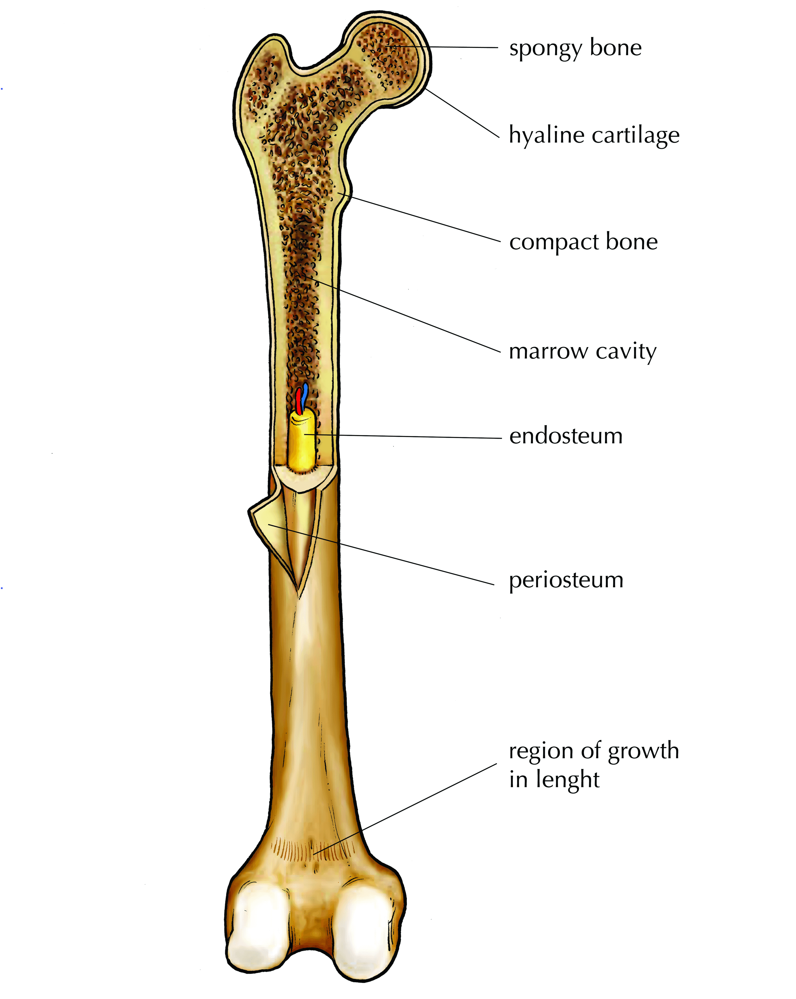

Figure 6.24: Parts of a long bone.

**Epiphysis:** The head of each end of a long bone consists largely of spongy bone and is covered with hyaline cartilage.

**Spongy bone**: Found in the epiphysis of long bones and contains red marrow.

**Red bone marrow:** Found in the spaces between the trabeculae in spongy bone. This is where the red blood cells are made at the rate of 2 -3 million per second. White blood cell types are also produced here.

**Trabeculae:** The struts in the network of irregular bony plates in the epiphysis of bones which transfer stresses from the epiphysis to the diaphysis which has a much thicker layer of compact bone and resists stress better.

**Diaphysis:** Cylindrical shaft of a long bone composed of hard compact bone on the outside.

**Periosteum:** The membrane of dense fibrous connective tissue which surrounds the outside surface of the shaft of a long bone. It has blood vessels which enables it to nourish the bone and repair injuries. It also provides a surface for the attachment of muscles by means of tendons and ligaments.

**Endosteum:** The delicate connective tissue layer lining the inside surface of compact bone.

**Marrow cavity:** This is filled with yellow marrow which consists largely of fat.

## Draw and label a longitudinal section of a long bone

In this activity you need to draw and label the parts of a long bone.

### Instructions

Make sure that you follow all the guidelines for biological drawings:

1. Give your diagram a caption or heading
3. Your diagram must take up at least half a page
5. Your drawing should be in pencil
7. Label lines should be drawn with a ruler
9. Label lines should not cross

**Draw and label a longitudinal section of a long bone**

Learners should accurately draw a long bone, resembling that in Figure 6.24

Make sure learners follow all the criteria for a biological drawing. Marks should be deducted for shading or colouring.

## Optional Investigation: Investigating organic and inorganic components of bones

### Aim

**Experiment A**: Remove the inorganic component of bone in order to investigate the organic component

**Experiment B**: Remove the organic component of bone in order to observe the properties of the inorganic component

<Callout type="warning" title="Note">
Bunsen burner and methylated spirits: Wear safety goggles and no loose fitting clothes. Do not wear synthetic clothes that easily catch fire (cotton and wool clothes are preferable).

Hydrochloric acid: Wear closed shoes, safety goggles, a lab coat and gloves.
</Callout>

### Apparatus

**Experiment A**

- two small chicken bones
- two test tubes
- dilute hydrochloric acid/white vinegar

**Experiment B**

- towel
- one small chicken bone
- pipe clay triangle or wire gauze on a tripod stand
- bunsen burner or Methylated spirits burner

### Method

**Experiment A **

1. Label two test tubes with your initials and A and B. Put a bone in each test tube.
3. Cover Bone A with water and Bone B with dilute hydrochloric acid. Leave for a few days. The acid will dissolve out the mineral component of the bone leaving behind the organic part.
5. Take out Bone A and dry it.
7. Use tweezers to take Bone B out of the acid. Rinse it under the tap and dry it.
9. Compare the two bones and write down how they appear and whether they are soft or hard, flexible or brittle.

**Experiment A: observations **

The bone that was in the hydrochloric was much softer and more flexible than the bone in water.
          This is because the acid reacts with the calcium phosphate in the bone and removes the calcium from the bone tissue.  It is the calcium salts in the bone tissue make the bones strong and hard.  Calcium salts precipitate out of the bone and this precipitate can be seen in the bottom of the test tube.

**NOTE:**    If you leave the chicken bone in the hydrochloric acid too long you will also remove the collagen.

**Experiment B **

1. Place the chicken bone (Bone C) on a pipe triangle or wire gauze on a tripod stand.
3. Roast the bone strongly for 10 minutes. Roasting will burn off the organic component of bone (mainly the protein collagen) leaving behind the mineral part.
5. Allow the bone to cool down completely before you touch it.
7. Describe the appearance of Bone C stating whether it is soft or hard, flexible or brittle.

**Experiment B: observations **

The chicken bone has now become bone ash. It is extremely brittle.

**NOTE:** This bone ash can contain calcium oxide which is an alkali so it is important to avoid inhaling any dust or powder from the bone.

### Observations

Note down your observations in your lab notebook.

### Conclusions

What can you conclude about the different organic and inorganic components of bones?

**Conclusions **

The inorganic component of bone (calcium) helps make bone hard and rigid. The organic component of bone (collagen) helps give bone its flexibility and strength, so that it is not too brittle and does not snap, crumble or break.

### Questions

1. What are the main inorganic components of bone?
3. What changes have occurred in Bone A?
5. What properties have been removed from Bone B with the loss of its inorganic components?
7. Which deficiency disease can have similar effects on bones in children?
9. What is the role of Bone B in this experiment?
11. What protein makes up the main organic component of bone?
13. What changes took place in Bone C during the roasting process?
15. What properties have been removed from Bone C with the loss of its organic component?

**Questions**

1. What are the main inorganic components of bone?
3. What changes have occurred in Bone A?
5. What properties have been removed from Bone B with the loss of its inorganic components?
7. Which deficiency disease can have similar effects on bones in children?
9. What is the role of Bone B in this experiment?
11. What protein makes up the main organic component of bone?
13. What changes took place in Bone C during the roasting process?
15. What properties have been removed from Bone C with the loss of its organic component?

**Answers**

1. Calcium and phosphate (calcium phosphate).
3. None. Bone A was kept in water.
5. Calcium has been removed from the bone tissue, and the bone has become flexible and soft.
7. Rickets.
9. Bone B was the experiment as it was covered with the hydrochloric acid and an observation needed to be made.
11. Collagen, which is an elastic protein which improves fracture resistance.
13. The organic components were burnt away and the bone turned to ash.
15. The bone ash contains calcium oxide and the collagen has been destroyed, therefore the bone is no longer flexible and becomes brittle.
