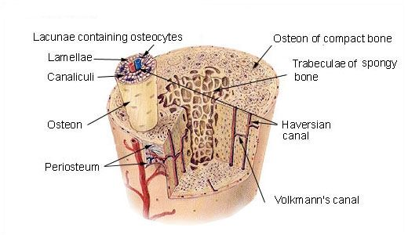
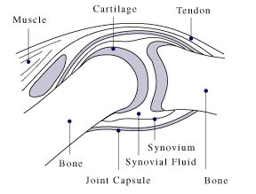
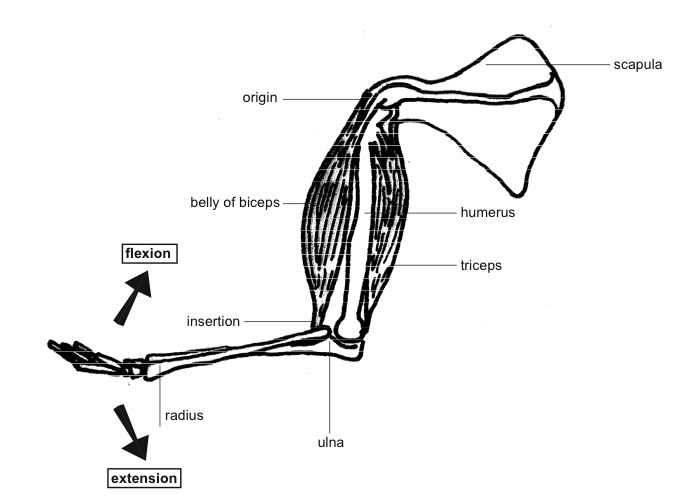

## 6.4 Musculoskeletal tissues (ESG8D)

The tissues which provide structure to the body and enable movement are part of the **musculoskeletal** system. The tissues in the this system include the bones, cartilage, joint, tendons, ligaments and muscles. In this section we will examine each of these types of tissues, so that in the next section on locomotion, we can understand how these structures work together to bring about movement.

- **Bone**: hard mineralized tissue that determines the structure of the body and provides attachments for muscles.
- **Cartilage**: flexible connective tissue that is usually found in many areas of the body including the joints between bones.
- **Joints**: region where bones meet, a variety of joint types allow for a range of movements in a number of different planes.
- **Ligament**: tissue that connects bones to other bones.
- **Tendons**: fibrous connective tissue that connects muscle to bone and transfers the force generated by the muscles into skeletal movement.
- **Muscles**: made up of fibres that are capable of contraction and therefore capable of bringing about movement.

### Bones (ESG8F)

Bones provide the framework and internal core structure for the attachment of muscles. Bone is a living rigid tissue which forms the support structures for the rest of the body. The process of bone formation is called  ossification. The matrix of bone contains a dense arrangement of collagen fibres together with mineral salts of calcium, magnesium and phosphates. The calcium salts give bone its hardness and rigidity while collagen fibres give bones its flexibility and strength.

**Microscopic structure of a long bone**

Bones are made up of numerous hollow tunnels called **Haversian canals**. Haversian canals occur within the matrix of bone tissue and run **parallel** to the length of the bone.  Each Haversian canal consists of a ** nerve** to carry impulses, **blood vessels** to transport gases, food and wastes and a **lymph duct** to drain tissue fluid. Under the microscope they appear as black circles against a lighter background.

Figure 6.25: A diagram of a section of compact bone showing Haversian canals.

Each Haversian canal is surrounded by concentric rings of compact bone called **lamellae**. Each of these layers contains a ring of fluid-filled cavities called  **lacunae**. Each of these lacuna will contain a number of bone cells called **osteocytes**. The lacunae are linked to each other and to the Haversian canal by a system of very tiny interconnecting canals called **canaliculi**. Strands of cytoplasm extend through these canals which supply the osteocytes with oxygen and nutrients and remove waste products. The Haversian canals, lacunae, osteocytes and canaliculi together form a unit called an Haversian System and a number of these systems make up compact bones.

<Callout type="note" title="Note">
Apart from osteocytes which are embedded in the lacunae of bone there are two other types of bone cells.

**Osteoblasts**: Bone forming cells. These cells allow the bone to  change and remodel its shape as the organism grows and responds to  stresses. If a bone is broken or if strengthening is needed, bone cells lay down new tissue and repair damaged tissue

**Osteoclasts**: Special bone cells for destroying and reabsorbing bone tissue.
</Callout>

**Functions of bone**

- To serve as a firm support framework for the whole body.
- To protect such delicate structures as the brain and spinal cord.
- To serve as levers, working with attached muscles to produce movement.
- To serve as a storehouse for calcium salts, which may be reabsorbed into the blood if there is not enough calcium in the diet.
- To produce blood cells in the red marrow.

### Cartilage (ESG8G)

Cartilage is a tough semi-transparent flexible tissue that consists of a tough matrix or jelly-like substance. The matrix is made up of collagen (a protein) and proteins with special carbohydrate chains called proteoglycans. Cartilage is enclosed by a fibrous capsule called the perichondrium. It consists of living cells called chondrocytes which secrete a rubbery protein matrix called chondrin. Chondrocytes occur in small fluid-filled spaces called lacunae which are scattered throughout the matrix. There are no blood vessels or nerves in the matrix.

**Cartilage and bone**

Infant and young children do not have bones like those of adults. Their bones are made mostly of  cartilage - a firm, elastic, fibrous material. As the individual grows and matures, the cartilage is gradually replaced by bone cells which deposit crystals of calcium carbonate and calcium phosphate. This process called **ossification** greatly increases the strength of the bone.

| Cartilage | Appearance | Location | Function |
| --- | --- | --- | --- |
| Hyaline cartilage | glass-like, bluish-white, few fibres | at ends of bones, forms c-shaped structures in Trachea, joins ribs to sternum, larynx and tip of nose, temporary cartilage in bones | reduces friction at joints, allows movement of ribs during breathing, forms permanent structures, allows bones to increase in length |
| Fibrocartilage | many white collagen fibres | discs between the vertebrae,  in the rim of ball and socket joints,  between pubic bones | acts as shock absorbers, makes the socket deeper while still allowing movement |
| Elastic | many yellow fibres in matrix | in the pinna of the ear, in the epiglottis | maintains the shape of the ear, strengthens the epiglottis |

### Joints (ESG8H)

A joint is a point at which two bones make contact. It allows movement in many planes.

1. **Fibrous joints**: Joins bones where no movement is allowed. An example of this includes the bones of your cranium (the skull).
3. **Cartilaginous joints**: These allow slight, restricted movement. An example is the discs between the vertebrae of the spine.
5. **Synovial joints**: These allow free movement in one or more directions. Examples include the joints of the pelvic and pectoral girdles. They also facilitate movements like standing, sitting, walking and running.

Another way of categorising joints is **movable** and **immovable** joints. Most joints in the skeleton are movable joints. Movable joints are also known as **synovial joints**. Synovial joints are characterised by the existence of capsules, which contain synovial fluid. The synovial fluid helps to prevent friction during movement.

Figure 6.26: Example of a synovial joint.

There are a number of different types of synovial joints. The four main types of synovial joints include:

1. **Ball and socket joint**: Found in structures such as the shoulder. It allows forwards/backwards, up/down and roundabout movement.
3. **Hinge joint**: Found in structures such as the elbow. It allows the forearm to move up and down and acts like the hinge of a door.
5. **Pivot joint**: Allows turning of the head in a rotational movement from side to side.
7. **Gliding joint**: Found in the wrist and foot. It allows bones to slide over one another.

## Movement at joints

Joints occur where two bones meet. Different types of joints allow for different types of movements. In this activity you will need to identify the different joint types, identify where they are located in the body and describe their motion.

### Instructions

For each of the following joints, you need to:

- give an example of their location in the body
- describe their motion

1. Fibrous joints
3. Ball and socket joints
5. Gliding joints
7. Hinge joints
9. Pivot joints

**Activity: Movement at joints **

**Answers**

1. Fibrous joints:
   - sutures of the skull
   - no movement
3. Ball and socket joints:
   - hip and leg, shoulder and arm
   - Allows movement in all directions, such as swinging and rotation.
5. Gliding joints:
   - wrist and ankle, metacarpals, metatarsals
   - Small movement in one direction as bones slide past each other- e.g. sideways or up and down.
7. Hinge joints:
   - elbow, knees, fingers, toes
   - Allows movement in one direction only: e.g. up and down. Work like the hinge of a door.
9. Pivot joints:
   - atlas and axis of vertebral column, radius and ulna of arm
   - Allows a rotating movement as one bone pivots around another.

### Tendons and ligaments (ESG8J)

Tendon and ligaments are dense bands of dense connective tissue. **Ligaments** join bone to bone, and **tendons** join muscles to bone. An example of a ligament is the anterior cruciate ligament (ACL) of the knee, and an example of a tendon is the Achilles tendon, which attaches your calf muscle to your heel. Tendons and ligaments are similar structures, but they have some important differences, which are summarised in Table 6.1.

**Comparison of ligaments and tendons**

| Ligaments | Tendons |
| --- | --- |
| join bone to bone | attach muscles to bones |
| consist of white collagen fibres and a network of yellow elastic fibres | consist of non elastic collagen fibres which give tendons a white shiny appearance |
| strong collagen fibres prevent dislocation at joints, and yellow elastic fibres allow flexibility at the joint | parallel arrangement of strong collagen fibres in order to efficiently convert muscle contraction into movement of the skeleton |

Table 6.1: Table comparing ligaments and tendons

### Antagonistic muscles (ESG8K)

Voluntary muscles are normally connected to at least two bones. The point of attachment to the movable bone is called the  point of **insertion** and the point of attachment of a muscle to the immovable bone is called the **origin**. Most muscles work in pairs and when a muscle works it needs to have an **agonist** and an **antagonist**.

An agonist is a muscle that acts to move a limb out of a particular position (contraction). An antagonist is a muscle that acts in opposition to the specific movement generated by the agonist and is responsible for returning the limb back to its original position (relaxation). Antagonistic pairs of muscles are necessary because each muscle can only exert a pulling force. A muscle cannot push itself back to its starting position. Therefore another muscle is required to pull in the opposite direction in order to return the agonist muscle back to its starting position. An example of this can
be found in the contraction and relaxation of the biceps and triceps muscles when moving your forearm.

**Example: Biceps and triceps**

In the case of the biceps the two bones involved are the scapula (origin) and the humerus (insertion). The biceps muscle gets its name from having two tendons attached to the scapula. The tendons join to form a single muscle body, and then splits again into two tendons, one of which inserts at the radius, and the other of which inserts at the ulna. When the biceps muscle contracts, the forearm is lifted or bent, decreasing the angle between the forearm and humerus and flexing your arm. This ability of the biceps to decrease the angle between the joints results in it being called a **flexor** muscle.

Figure 6.27: Illustration of the triceps (extensor) and biceps (flexor) muscles

<Callout type="note" title="Note">
The *biceps brachii* muscle gets its name from being a two-headed muscle, attaching to the scapula at two points. Although it is commonly referred to as a `bicep', biceps is the correct form even in the singular. Similarly, the *triceps brachii* muscle joins at three points, and should be referred to as the triceps, whether you are talking about one or both arms.
</Callout>

**Straightening of the forearm**

When the arm is bent the biceps cannot contract since it is already in a contracted state. Muscles can only cause movement by **pulling as they contract**, not by pushing when they relax. Therefore, the straightening of the arm is brought about by the contraction of the **triceps muscle** (an **extensor** muscle) as it increases the angle between forearm and humerus. The triceps has three points of origin, two on the humerus and one on the scapula, and a single point of insertion on the ulna.

<Callout type="note" title="Note">
The mechanics of the antagonism within the biceps and triceps.

<VideoPlayer src="https://www.youtube.com/watch?v=T-ozRNVhGVg" title="Video: 2CT5" />
</Callout>

<Callout type="note" title="Note">
Learn more about antagonistic muscles:
</Callout>

## Knowing more about tissues: dissection of animal tissue

### Aim

The aim of this dissection is for you to revise the theory behind tissues and apply your knowledge to actual tissues.

### Instructions

You will be working in pairs. Instructions for this activity will be written in *italics*.

- At the end of the practical you should:
  1. Know and be able to use dissecting instruments correctly, especially insertion and removal of blades.
  3. Be able to recognise and use ether responsibly
  5. Be familiar with apparatus: petri dish, dissecting tray.
  7. Use a scale: zero (calibrate) and record mass
  9. Perform simple mathematical calculations: percentage
  11. Be able to read a vernier calliper.
  13. Clean and dry thoroughly and appropriately.

### Materials

- 1 piece filter paper
- scissors
- forceps
- threader
- pointer
- scalpel
- blade
- dissecting tray
- petri dish
- chicken wing
- 1 ml Ether
- cloths
- roller towel

### Method

**1. Skin**

- *Before you begin, look at the external appearance of the chicken wing.*
- *Weigh the entire wing and record its mass in the table on the last page.*
- *Insert the scalpel blade onto the handle. *
- *Lie the wing upside down on the dissecting board.*
- *Cut with scissors from the severed end towards the wingtip along the midline of the wing. *
- *Remove as much of the skin as you can by freeing it from the underlying tissue with a blunt instrument or pulling with your fingers. *
- *Carefully observe the tissue that you are breaking.*

1. Is skin a tissue or an organ?
3. Why is there a 'web' of skin between the joints?
5. What are the 'bumps' on the skin?
7. How easily does the skin come off between the joints?
9. Where is the skin most firmly attached?
11. Record the mass of the skin in a table as shown on the last page.

**2. Connective tissue**

The skin is held to the underlying pink tissue by a type of connective tissue.

1. Name this particular type of connective tissue.
3. Give two adjectives that accurately describe it.

**3. Fatty tissue**

- *Look at the underside of the skin you have removed. You should see clumps of yellow material. This is fat, or **adipose tissue**. It is also a type of connective tissue. *
- *Take a small amount of this fatty tissue and squash it gently in a small beaker with some ether.*
- *Pour some of this solution onto a piece of filter paper.*
- *Dry the filter paper by waving it in the air.*
- *This oily stain is known as a **translucent** stain.*
- *From now on collect all the fatty material you find — you will need it later (place in a separate beaker).*

1. What do you think the function of connective tissue is here?
3. What do you notice? There is an oily stain on the paper after the ether has evaporated.

**4. Muscle**

Muscle is the pinky-orange tissue you can see under the skin. The muscles were most likely severed when the chicken was dismembered in the butchery. Muscles are all arranged in 'antagonistic pairs'. In an antagonistic pair, the action of one muscle (e.g. contraction) causes the opposite action to occur in the paired muscle (flexion).

- *Hold the wing in your left hand.*
- *Grip the end of one of the muscles with forceps. Pull it.*
- *Describe what happens and name the type of action it caused.
       *
- * Let go and pull various other muscles. *
- *Can you get one to cause the opposite movement?*
- * Carefully dissect out a single muscle in FULL. Remove it from the wing completely.*

1. What type of tissue lies between the muscles?
3. Draw the wing muscle.
5. You need to follow the convention of drawing diagrams by:
   1. providing a heading or title.
   3. adding labels (tendon, muscle, epimysium, fat tissue).
   5. labelling on the right hand side of the diagram.
   7. providing a scale bar.

**5. Blood vessels**

The smallest **vessels** you will be able to see are small  **arteries** (**arterioles**) and small  **veins** (**venules**).
           **Capillaries** are the very smallest blood vessels — so narrow in fact that erythrocytes can only fit through in single file. It is ONLY between these vessels and the surrounding tissues where  **diffusion**  of substances occurs. Capillaries will not be visible to the naked eye.

- *As you work, look out for blood vessels.*
- *The darker vessels are venules; the redder ones are arterioles.*
- *In the cut end of thicker vessels you may be able to see the  **lumen**  and vessel wall.*
- *If you find one, work the blunt end of the threader into it and down the vessel and see where it leads.*

1. Name two substances that will diffuse into the tissues and out of the tissues in this wing.

**6. Nerves**

Nerves are bundles of neurons enclosed in a membrane rather like a piece of electrical flex.  They tend to be deep in the tissues for protection.

- *Keep a look out for nerves.*
- *Nerves are hard to see but when soaked in ethanol they become white (If possible check with your teacher if he or she can do this for you).*

**7. Tendons**

Muscles are attached to bones by means of tendons. Tendons are made of a type of connective tissue that contains lots of white fibres made of collagen. It is this collagen that gives the connective tissue its properties.

- *Your task now is to remove all the muscles neatly from the bones. *
- *As you do so, try and pull one or two off the bone using your fingers or forceps; remove the rest using scissors or the scalpel. *
- * Look carefully at how the tendon joins the muscle.*
- *If necessary dissect into the muscle tissue. *
- *Collect ALL the muscles you remove.  *
- *You should now have a pile of fat and a pile of muscle. *
- *Weigh and record the mass of subcutaneous fat and muscle in the table where you recorded the mass of the wing.*

1. How firmly are the muscles attached to bones?
3. Approximately how many muscles did you remove?
5. Describe how the tendon and muscle join.
7. Write down four adjectives to describe collagen from what you can observe.

**8. Bone**

- *You should now be left with some bones joined together with skin, muscles and 'proper' connective tissue removed.*
- *Use the miniature hacksaw to cut a bone in half.*

1. Describe what you see after sawing the bone in half.
3. Use the vernier calliper to measure the thickness of the bone wall.
5. The bones of most birds are hollow. Why are hollow bones an advantage for a bird?

**9. Ligaments**

Ligaments look similar to tendons and have a very similar histology with lots of collagen fibres. Ligaments join bone to bone, and also form protective capsular ligaments around  synovial joints by for instance, keeping in the lubricating  synovial fluid.

- *Cut through and carefully remove the capsular ligament of a large joint using your scissors.*

1. Can you see internal ligaments?
3. Write down three observable characteristics of the ligament you cut.

**10. Cartilage**

- *Look at the end of a bone and find the cartilage (it is pearly white in colour). *
- *Try to remove it from the bone. Then try to scratch it first with your nail and, then with something very hard and sharp.*

1. Describe what you observe.
3. What type of cartilage is this?
5. What do you think the function of cartilage is?
7. What common, man-made material is closest in its properties to cartilage?

### Questions

Data (show all working)

| Tissue | Mass, correct to 1 decimal place (g) |
| --- | --- |
| Entire wing |  |
| Skin |  |
| Muscle |  |
| Subcutaneous Fat |

1. Muscle is eaten for its protein. Muscle is made of protein. What percentage of this wing is muscle?
3. What total percentage of this wing was made up of fat?
5. Calculate the total fat-to-muscle ratio as a percentage.
7. Look at the price per kilo for these wings. Assuming the wings have the same mass, and there are six per pack, how much does one wing cost?
9. You are paying the above price only to really eat the muscle (protein), what is the actual price per kilo you are paying for the meat (protein) in this case?

### Cleaning

Tidy and clean the work station thoroughly after each session. Wash instruments in hot soapy water with a sponge/scourer, rinse in the cold sink (NOT under running water) and dry with a cloth. Replace apparatus in the correct containers. Scalpel blades are to be removed, cleaned, dabbed dry with roller-towel and returned to their envelopes.

**Investigation: Dissection of animal tissue **

The purpose of this dissection is to revise the theory behind tissues and apply it to actual tissues.

**Information and Instructions:**

Dissection and other instructions are given in *italics.*

**Answers**

**1. Skin**

1. Skin is an organ.
3. To increase the surface area for the attachment of feathers and to help hold them together.
5. The bumps are feather follicles.
7. Easily – it is loosely attached on the muscle between the joints.
9. At the joints.
11. OPTIONAL – learners can record mass if scales are available.

**2. Connective tissue**

1. Areolar connective tissue.
3. Soft, flexible, thin, elastic, transparent.

**3. Fatty tissue**

1. To store reserve food in the form of lipids and to insulate the body against heat loss.
3. There is an oily stain on the paper after the either has evaporated, indicating that this substance is fat.

**4. Muscle**

**NOTE TO TEACHERS:** It is difficult to remove the entire muscle without damaging the tendons, where the muscle attaches to the bone. Very few learners will do this successfully. Most of them will cut through the muscle above the tendon.

1. When the upper muscle is pulled, the wing flexes / bends at the elbow. When the lower muscle is pulled, the wing straightens.
3. DIAGRAM: Adding a scale bar is optional. The epimysium is the membrane around the entire muscle – this is also an optional label, as this was not in the notes.

**5. Blood vessels**

**NOTE TO TEACHERS:** It is not always possible to see the difference between arteries and veins. Learners should look for any narrow dark red / blackish tubes.

1. Oxygen and food will diffuse from the blood to the wing tissues. Carbon dioxide and other wastes will diffuse from the tissues to the blood.

**6. Nerves**

**NOTE TO TEACHERS:** Learners sometimes find very narrow, whitish threads, which are the nerves. They are generally right against the bone and are often destroyed when learners remove the muscle.

**7. Tendons**

1. Muscles are VERY firmly attached to bone by tendons. It is not possible to just pull them off using fingers or forceps. They have to be cut off.
3. Learner dependent answer. Most groups manage to remove one or two at least.
5. Tendons are attached directly to the bone and gradually become muscle – the two are intermeshed at the start.
7. White, strong, inelastic, flexible, firm, fibrous, occurs in bundles.

**8. Bone**

1. If learners do not have miniature hacksaws available, the bone can be broken by hand. Learners should be able to see red bone marrow and a marrow cavity inside.
3. Use the vernier callipers if they are available for measurements.
5. Being hollow makes bones lighter, so it’s easier for the bird to fly. BUT chickens can’t fly, so their bones are not hollow, they contain bone marrow.

**9. Ligaments**

1. When they have cut through the ligament capsule around the elbow joint, learners may be able to see internal ligaments – they look like white ‘strings’ holding the bones of the elbow together.
3. Learners may use words like narrow, white, strong, etc to describe them, but many learners may not find them at all – they have destroyed them already.

**10. Cartilage**

1. It cannot be removed easily by just scratching it. The cartilage is very firmly joined to the end of the bones and forms a smooth, glassy surface on the bone.
3. Hyaline cartilage, but it can also be called articular cartilage.
5. The cartilage makes the end of the bone smooth, to reduce friction when the bones are moved by muscles.
7. It is similar to plastic.

**Questions**

DATA (SHOW ALL WORKING)

Learners may not have tables of mass measurements if scales were not available.

1. Teachers will have to check the percentage calculations if mass measurements were done. It is calculated as mass of muscle divided by mass of entire wing x 100.
3. Mass of fat divided by mass of wing x 100.
5. Fat mass divided by muscle mass x 100.
7. All learners can do these calculations, even if mass was not recorded. Price divided by 6 = cost per wing
9. The price would be 100/(percentage protein) x cost per kilogram = price per kg of protein

| Tissue | Mass, correct to 1 decimal place (g) |
| --- | --- |
| Entire wing |  |
| Skin |  |
| Muscle |  |
| Subcutaneous Fat | (4+1+1) |

Mark Scheme: Chicken wing

| Self-Assessment: Assess yourself after chatting through each point with your partner | Mostly no (0) | Mostly no | Yes | Very much so |
| --- | --- | --- | --- | --- |
| I followed the instructions carefully and read everything |  |  |  |  |
| We asked questions where we needed to |  |  |  |  |
| We did not ask irrelevant questions |  |  |  |  |
| I can now recognize all the tissues mentioned |  |  |  |  |
| I can confidently describe the tissues we saw |  |  |  |  |
| We worked well together |  |  |  |  |
| We stayed focused on the work |  |  |  |  |
| Our apparatus was clean and dry after our practical |  |  |  |  |
| I can confidently insert and remove scalpel blades |  |  |  |  |
| I used the apparatus well and successfully |  |  |  |  |
| Our wing was neatly dissected |  |  |  |  |
| Total   (out of 33, convert to 15) | /33        /15 |  |  |  |
