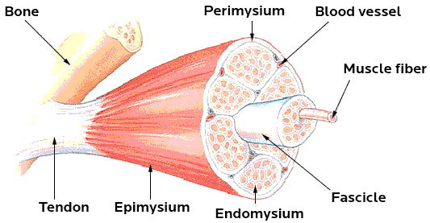
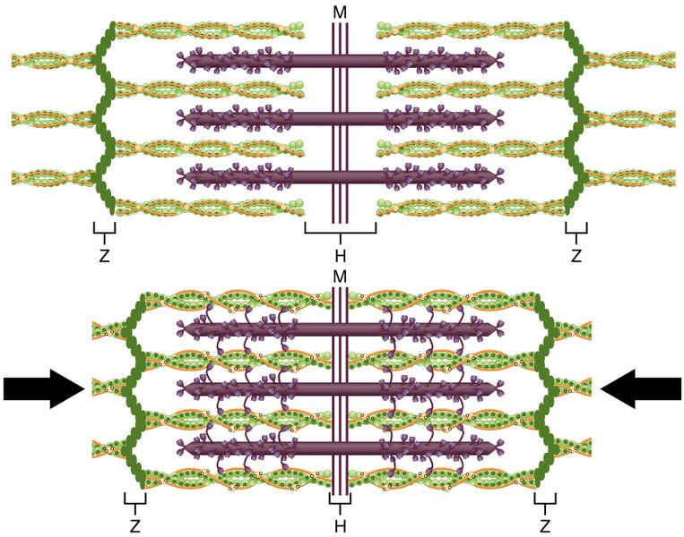

## 6.6 Muscle structure and function (ESG8N)

You learnt about three types of muscle tissue (skeletal, smooth and cardiac) in Chapter 4. In this chapter, we will look at **striated** or **skeletal muscle**. Skeletal muscle is voluntary muscle which means it can be controlled by will.They are the muscles that you use to enable you to run, skip, walk etc.

<Callout type="note" title="Note">
How muscles work: the sliding filament model

<VideoPlayer src="https://youtu.be/jqy0i1KXUO4" title="Video: 2CT7" />
</Callout>

The basic units of a muscle are called myofibrils. Myofibrils make up the muscle fibre (muscle cell). Numerous muscle fibres are found in  bundles. These bundles are surrounded by perimysium. Several of these together make up the fasciculus. Numerous fasciculi are surrounded by epimysium. These structures combine to form a muscle.

Figure 6.29: Different structural components of the voluntary muscle.

<Callout type="note" title="Note">
Watch a video about the anatomy of a muscle cell:

<VideoPlayer src="http://www.khanacademy.org/video/anatomy-of-a-muscle-cell?playlist=Biology" title="Video: 2CT8" />

Learn more about myosin and actin:

<VideoPlayer src="http://www.khanacademy.org/video/myosin-and-actin?playlist=Biology" title="Video: 2CT9" />

Learn about the role of sarcoplasmic reticulum in muscle cell:

<VideoPlayer src="http://www.khanacademy.org/video/role-of-the-sarcoplasmic-reticulum-in-muscle-cells?playlist=Biology" title="Video: 2CTB" />
</Callout>

**Muscle contraction**

Each muscle cell (muscle fibre) is made up of many **myofibrils**. Myofibrils are responsible for the muscle contraction. Each myofibril consists of units called **sarcomeres**. There are many sarcomeres joined end to end in each myofibril. Sarcomeres consist of **thin actin** filaments and **thick myosin** filaments.

When muscle fibres contract these filaments slide across each other. The actin filaments shorten, but the length of the myosin filaments do not change. This causes the sarcomeres to shorten, resulting in the shortening of the whole muscle. The contraction of the muscle fibres requires energy in the form of ATP. The energy is supplied by the process of cellular respiration.

<Callout type="note" title="Note">
ATP stands for adenosine triphosphate. It is the energy reserve of the body.
</Callout>

Figure 6.30: Diagram showing a sarcomere made up up thick and thin filament that slide past each other to enable muscle contraction.

<Callout type="note" title="Note">
Summary of the workings of the muscle:

<VideoPlayer src="https://www.youtube.com/watch?v=zQocsLRm7_A" title="Video: 2CTC" />

<VideoPlayer src="http://www.khanacademy.org/video/anatomy-of-a-muscle-cell?playlist=Biology" title="Video: 2CTD" />
</Callout>
