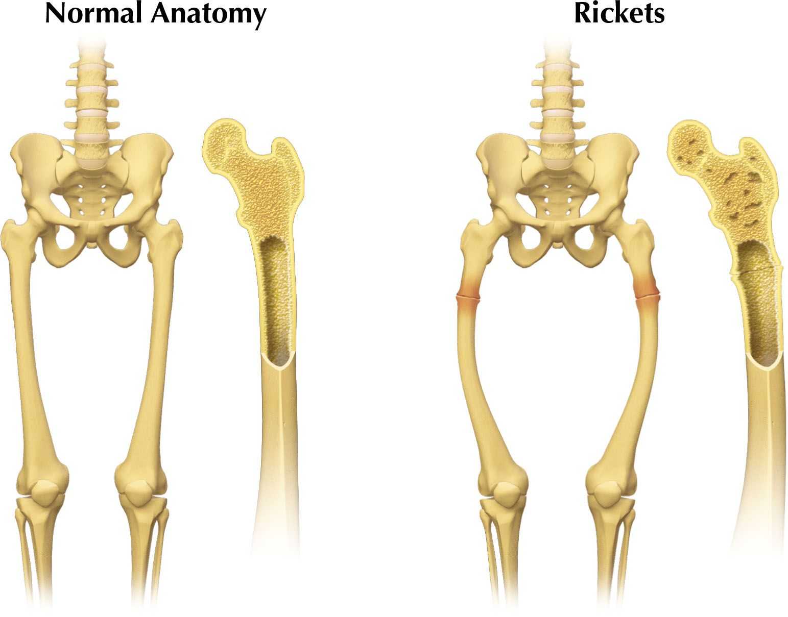
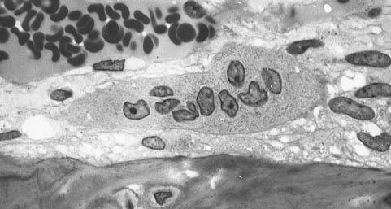
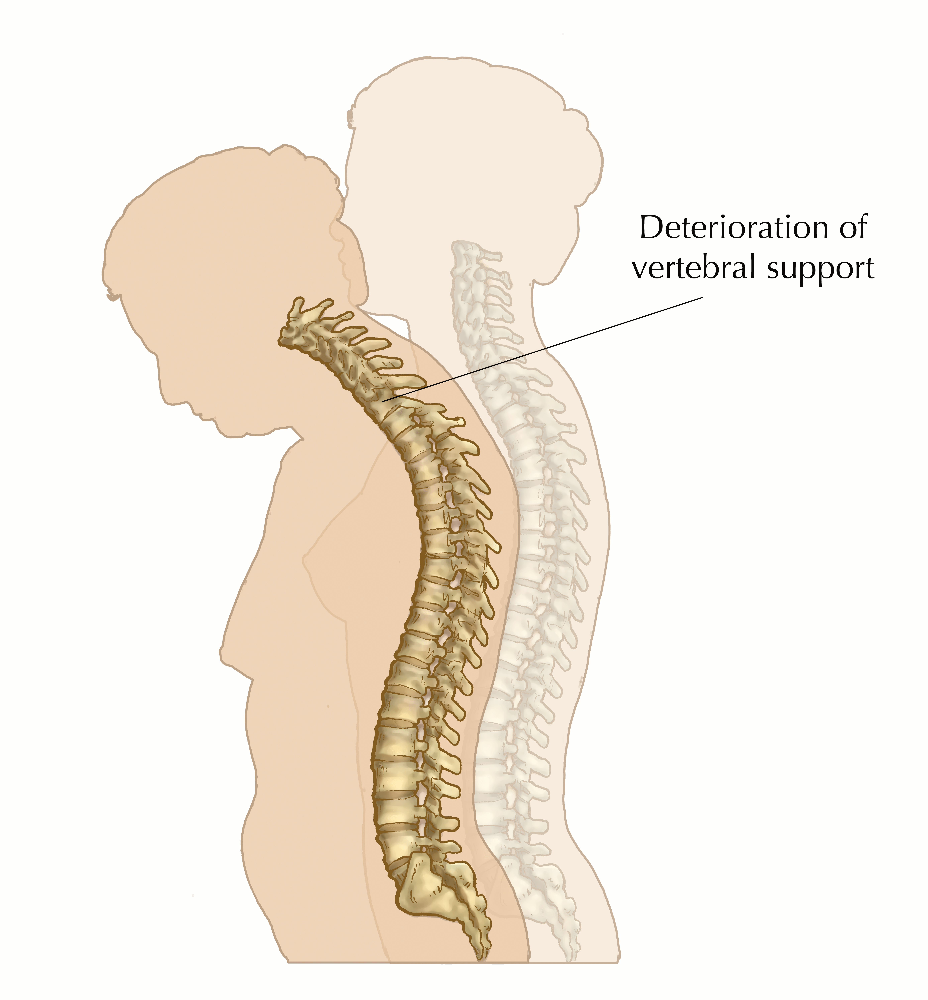
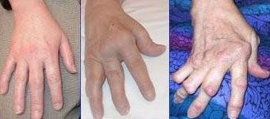

## 6.7 Diseases (ESG8P)

As a result of wear-and-tear over time and due to lack of proper nutrition, individuals can develop bone problems. Common bone problems include rickets, osteoporosis and arthritis.

### Rickets (ESG8Q)

Rickets is a disease that is most commonly caused by a lack of vitamin D, however it can also be caused by deficiencies in phosphorous or calcium. Deficiencies in these key nutrients results in a softening of the bone tissue, leading to fractures and bone deformities in children. Rickets is a widespread childhood disease in many developing countries.

Figure 6.31: The diagram shows the difference between a normal patient and a rickets patient.

### Osteoporosis (ESG8R)

<Callout type="note" title="Note">
Osteoporosis is derived from the Greek words for bone (*ostoun*), and pore (*poros*). It is common in older people, especially women.
</Callout>

Bones are constantly being broken down by osteoclasts and built up by osteoblasts. When the process of breakdown and deposition are evenly matched bone mass is maintained. However, when there is a shortage of calcium in the body or when a bone is inactive (e.g leg in plaster or immobilised), calcium is withdrawn from the bone for use in other parts of the body. This results in an increased breakdown of bone tissue without an increase in deposit of new bone by **osteoblasts**. Excessive breakdown without new bone deposition results in the development of holes/pores in the bone (hence the name of the disease). A decrease in bone density makes the bone weak and prone to fractures. The most typical fractures are of the spine, wrist and hip.

<Callout type="note" title="Note">
Osteoporosis is common in older women whose oestrogen levels drop after menopause. Oestrogen usually suppresses osteoclast activity (bone resorption). When oestogen levels drop, the activity of osteoclasts is no longer inhibited and bone breakdown exceeds bone formation. This results in an overall loss of bone mass.
</Callout>

Figure 6.32: Bone marrow derived cells with bone below it showing the typical distinguishing characteristics of the osteoporosis cells: large cells with multiple nuclei and a `foamy' cytosol.

Figure 6.33: Pictures illustrating the onset of osteoporosis.

### Arthritis (ESG8S)

Arthritis is a diseases caused by disorders of joints or inflammation of them. There are several types of arthritis. The hand of an individual affected by a particular form of arthritis called rheumatoid arthritis can be seen in Figure 6.34. It is caused by an individual's cells being attacked by their own immune system and is known as an **auto-immune disorder**. The immune system attacks the body tissues and most damage occurs in the cartilage found between joints.

Figure 6.34: The hands shown have been affected by arthritis.

Arthritis can also be caused by the daily wear-and-tear of a joint, when bones constantly rub against each other. It can affect the hands, the knee, feet, hip and back. It usually affects the elderly but can also result from an injury. The disease can also result from a lifestyle characterised by lack of exercise.

Arthritis cannot be cured. However, in rare cases joint replacement is available.

<Callout type="note" title="Note">
Visualise osteoarthritis

<VideoPlayer src="https://www.youtube.com/watch?v=a1d8qK4BEx0" title="Video: 2CTF" />
</Callout>

**TEACHER RESOURCES:**

Further reading on the web:

Types of arthritis:
