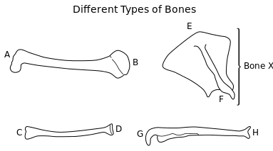
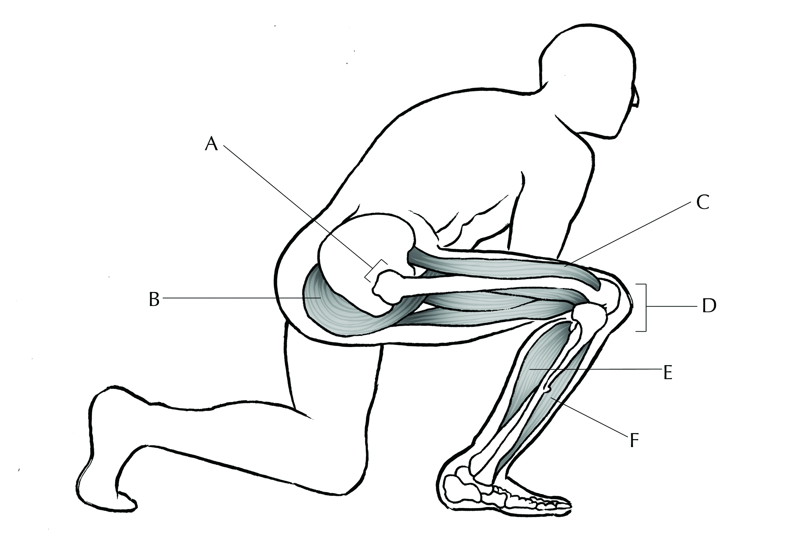

## End of chapter exercises

### Exercise 6.1

**Problem:**
Draw a table showing the three types of skeletons and provide one advantage and one disadvantage of each.

**Solution:**
Learners need only provide one example of an advantage and one example of a disadvantage for each skeleton type.

| Skeleton | Advantage | Disadvantage |
| --- | --- | --- |
| Hydrostatic | - Allows animal to be very flexible  moves easily; not restricted in terms of possible movements. - Give support without adding much weight. - Allows rapid diffusion of gases through the body wall, so a transport system is often unnecessary, e.g. jellyfish. - Cushions the internal organs of the animal from shock. - These organisms are suited for life in moist aquatic environments. | -There is very little protection for the internal organs. - Lacks a structure and does not have surfaces for the attachment of muscles or limbs. - Not very strong  easily damaged or lost if the enclosed cavity around it is pierced. - Generally not suitable to terrestrial animals and offers no protection against dehydration. - Limits the size of the animal – large animals would not be feasible, as they would collapse under their own body weight. |
| Exoskeleton | - Very strong and provides good protection against physical damage. - Can be present in great variety of colours to provide protection via camouflage. - Offer good protection against dehydration. - The exoskeleton forms the point of attachment of internal muscles needed for movement. - The exoskeleton provides structural shape and support for the organism. - Exoskeletons of insects have a low density and are therefore lightweight, allowing for flight. | - Heavy, so it prevents the animal getting very large. (small animals are easy prey) - Necessitates moulting, making the animal very vulnerable. - Movement is only possible at thinner joints, but these are more vulnerable than thick areas. - The final body size is limited because as the body increases the surface area to volume ration decreases. |
| Endoskeleton | - Provides shape and structural support. - Bone is very hard, so provides excellent protection of vital organs e.g. brain, heart, lungs. - Bones vary in size to support the animal’s mass. - Allows animal to become bigger – large animals have fewer predators. - Consist of living tissue, so it is able to grow within the animal. - Endoskeleton is jointed which allows for flexible movement and support. - Animals have successfully adapted to locomotion in their living environments. | - Broken bones take a long time to heal and are painful. - Bones inside the body offer no protection to some soft tissues, e.g. intestine. - The skeleton consists of living tissue so it is susceptible to infections and diseases. |

**Problem:**
State where the Haversian canal is located and state its function.

**Solution:**
Haversian canal is in the centre of an Haversian system in compact bone. It contains a nerve to carry impulses, blood vessels to transport gases, food and wastes and a lymph duct to drain tissue fluid.

**Problem:**
State four functions of bone tissue.

**Solution:**
*Any four of the following:*

- To serve as a firm support framework for the whole body.
- To protect such delicate structures as the brain and spinal cord.
- To serve as levers, working with attached muscles to produce movement.
- To serve as a storehouse for calcium salts, which may be reabsorbed into the blood if there is not enough calcium in the diet.
- To produce blood cells in the red marrow.

**Problem:**
Tabulate two differences between tendons and ligaments.

**Solution:**
Any two of the following differences:

| Tendons | Ligaments |
| --- | --- |
| Attach muscles to bones | Attach bones to other bones |
| Contain more white collagen fibres and very few yellow elastic fibres | Contain white collagen fibres and a network of yellow elastic fibres |
| Very inelastic in order to efficiently convert muscle contraction into movement of the skeleton | Have some elasticity to enable bending at joints |
| Fibre in tendons are all along the long axis for strength | The fibres in ligaments are woven together, not arranged longitudinally |

**Problem:**
Supply the biological term for each of these bones:

1. thigh bone
3. knee cap
5. shin bone
7. ankle bone
9. heel bone
11. upper arm bone
13. wrist bones
15. breast bone

**Solution:**
1. femur
3. patella
5. tibia
7. talus
9. calcaneum
11. humerus
13. carpals
15. sternum

**Problem:**
State **four** functions of the human skeleton.

**Solution:**
*Any four of the following*:

- Protection- protects vital organs, e.g. brain, heart, lungs
- Movement- provides point of attachment for muscles, and resistance for muscle contraction (levers for locomotion)
- Support and structure - gives shape to the body, e.g. facial features; supports body parts and keeps us upright
- Storage of minerals - bones store minerals such as calcium and phosphate ions
- Red blood cells production - long bones and flat bones contain red bone marrow to produce red blood cells
- Hearing - bones in the middle ear, called the hammer, anvil and stirrup, amplify sound waves and assist in the hearing process

**Problem:**
State the number of:

1. bones in the human vertebral column
3. pairs of true ribs
5. lumbar vertebrae

**Solution:**
1. \(\text{33}\)
3. \(\text{7}\)
5. \(\text{5}\)

**Problem:**
Study the following diagrams showing the main bones of the pectoral girdle and the human arm (forelimb) and answer the questions that follow:

1. Identify bone X.
3. Parts of some of these bones meet at certain joints. By using the letters (A–H) only, state which parts of the bones form the shoulder joint.
5. Name the type of synovial joint that is located at the following parts of the body:
   1. At the elbow
   3. Where the lower limb joins the pelvis
   5. In the wrist

**Solution:**
1. Scapula
3. Bone end B joins to part F
5. 1. hinge joint
   3. ball and socket joint
   5. gliding joint

**Problem:**
The diagram below shows the legs of an athlete while he is waiting for a race to start. The letters A to F show some of the muscles as well as joints that will be used during the race.

1. When the Starter's gun is fired, the athlete's right leg will straighten, pushing the athlete upwards and forwards. Which of the letters (A to F) indicate muscles that will:
   1. Relax
   3. Contract
3. The leg shown in the diagram has different types of joints. Which of the following letters (A to F) indicates:
   1. A hinge joint
   3. A ball and socket joint

**Solution:**
1. 1. B
   3. B, C and E
3. 1. D
   3. A

**Problem:**
During the race, the above athlete suffered an injury to his right knee that resulted in torn ligaments. As a consequence, he was not allowed to participate in competitions for six weeks, and was only paid one third of his monthly income during this time.

- What are ligaments?
- Do you think that athletes who are unable to take part in competitions due to injury should be entitled to their full income? Give a reason for your answer.
- After six weeks the athlete found out that the knee injury was permanent.  He had surgery to fit in an artificial knee, which could perform better than his original knee. Suggest why he should NOT be allowed to participate in the competitions he took part in previously.

**Solution:**
- Ligaments are made of connective tissue, and join bone to bone.
- **Yes**
  The injury may not be the athlete’s fault- it is unintentional. An athlete not being able to compete due to injury is just like being paid sick leave.
  **No**
  Not taking part in the competition may make their team lose.
  Reducing pay prevents athletes from willingly pulling out of the competitions under the pretext of injury.
  Any other logical answer.
- He will have an unfair advantage over other competitors with normal knees.

**Problem:**
Skeleton and Movement – True or False? If it is false provide a reason for why you think the statement is false.

1. The skeleton's role is to provide support, protection and capacity for movement.
3. The skeleton is divided into the axial and appendicular skeleton.
5. The axial skeleton consists of the pectoral and pelvic girdles and their attached limbs.
7. Carpals are found in the ankles and tarsals in the wrists.
9. The biceps muscle raises the arm while the triceps lowers it in an antagonistic pair.
11. Synovial liquid lubricates joints and keeps them friction free.
13. Bone joints in the cranium are examples of fibrous joints.
15. The neck contains \(\text{7}\) lumbar vertebrae.
17. Tendons join muscles to bone and are elastic while ligaments join bone to bone and are non-elastic.
19. Bone is composed of flexible minerals such as Calcium and Phosphate with rigid fibres of Collagen.
21. Osteocyte is another word for bone cell.

**Solution:**
1. True
3. True
5. False (should be appendicular skeleton)
7. False (other way round  carpals are in the wrist, tarsals in the ankle)
9. False (the biceps and triceps respectively raise and lower the LOWER arm or forearm, not whole arm)
11. True (not entirely 'friction-free', but close)
13. True
15. False (neck has cervical vertebrae)
17. False (joining functions are correct, but tendons are inelastic and ligaments are more elastic)
19. False (Ca and P are inflexible minerals and collagen is a flexible protein)
21. True (but bone cells can also be called osteoblasts)

**Problem:**
Compare the biceps and triceps muscles with respect to:

1. Point of origin
3. Point of insertion
5. Function

**Solution:**
1. Biceps and triceps **both** originate at the shoulder. Biceps has two tendons attached to the shoulder (two at origin), triceps has three attached to the shoulder (three at origin)
3. Biceps muscle inserts on the radius and ulna, while the triceps inserts on the ulna only.
5. The biceps contract to bend the arm at the elbow, the triceps contracts to straighten the arm at the elbow.
