## 7.2 Circulatory systems in animals (ESG8X)

Transport systems are crucial to survival. Unicellular organisms rely on simple **diffusion** for transport of nutrients and removal of waste. Multicellular organisms have developed more complex **circulatory** systems.

### Open and closed circulation systems (ESG8Y)

There are two types of circulatory systems found in animals: **open** and **closed** circulatory systems.

**Open circulatory systems**

In an open circulatory system, blood vessels transport all fluids into a cavity. When the animal moves, the blood inside the cavity moves freely around the body in all directions. The blood bathes the organs directly, thus supplying oxygen and removing waste from the organs. Blood flows at a very slow speed due to the absence of smooth muscles, which, as you learnt previously, are responsible for contraction of blood vessels. Most invertebrates (crabs, insects, snails etc.) have an open circulatory system. Figure 7.1 shows a schematic of an open circulatory system delivering blood directly to tissues.

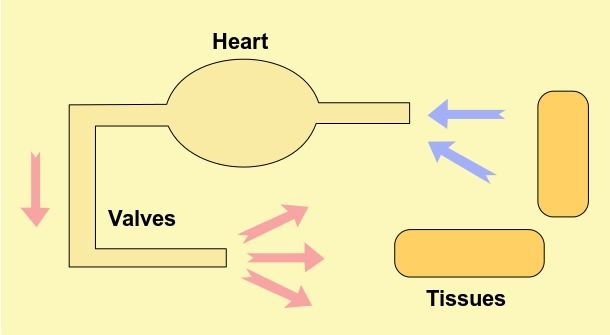

Figure 7.1: Open circulatory system.

**Closed circulatory systems**

Closed circulatory systems are different to open circulatory systems because blood never leaves the blood vessels. Instead, it is transferred from
  one blood vessel to another continuously without entering a cavity. Blood is transported in a single direction, delivering oxygen and nutrients to cells and removing waste products. Closed circulatory systems can be further divided into **single** circulatory systems and **double** circulatory systems.

### Single and double circulation systems (ESG8Z)

The circulatory system is a broad term that encompasses the **cardiovascular** and **lymphatic** systems. The lymphatic system will be discussed later in this chapter. The cardiovascular system consists of the heart (cardio) and the vessels required for transport of blood (vascular). The vascular system consists of arteries, veins and capillaries. Vertebrates (animals with
backbones like fish, birds, reptiles, etc.), including most mammals, have closed cardiovascular systems. The two main circulation pathways in invertebrates are the **single** and **double** circulation pathways.

**Single circulatory pathways**

Single circulatory pathways as shown in the diagram below consist of a double chambered heart with an atrium and ventricle (the heart structure will be described in detail later in this chapter). Fish possess single circulation pathways. The heart pumps deoxygenated blood to the gills where it gets oxygenated. Oxygenated blood is then supplied to the entire fish body, with deoxygenated blood returned to the heart.

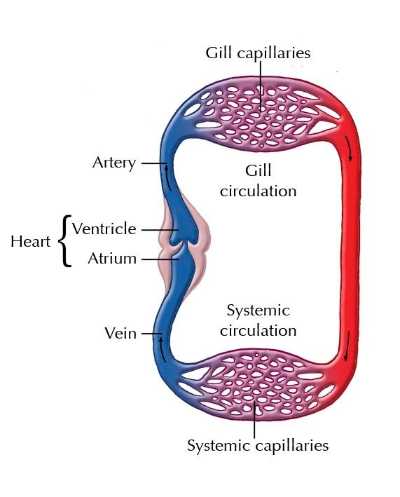

Figure 7.2: Single circulation system as found in a typical fish species. The red represents oxygen-rich or oxygenated blood, the blue represents oxygen-deficient or deoxygenated blood.

**Double circulatory systems**

Double circulation pathways are found in birds and mammals. Animals with this type of circulatory system have a four-chambered heart.

The right atrium receives deoxygenated from the body and the right ventricle sends it to the lungs to be oxygenated. The left atrium receives oxygenated blood from the lungs and the left ventricle sends it to the rest of the body. Most mammals, including humans, have this type of circulatory system. These circulatory systems are called 'double' circulatory systems because they are made up of two circuits, referred to as the **pulmonary** and **systemic** circulatory systems.

<Callout type="note" title="Note">
Humans, birds, and mammals have a four-chambered heart. Fish have a two-chambered heart, one atrium and one ventricle. Amphibians have a  three-chambered heart with two atria and one ventricle. The advantage of a four chambered heart is that there is no mixture of the oxygenated and deoxygenated blood.
</Callout>

### Human circulatory systems (ESG92)

The human circulatory system involves the **pulmonary** and **systemic** circulatory systems. The **pulmonary circulatory system** consists of blood vessels that transport deoxygenated blood from the heart to the lungs and return oxygenated blood from the lungs to the heart. In the **systemic circulatory system**, blood vessels transport oxygenated blood from the heart to various organs in the body and return deoxygenated blood to the heart.

**Pulmonary circulation system**

In the pulmonary circulation system, deoxygenated blood leaves the heart through the right ventricle and is transported to the lungs via the **pulmonary artery**. The pulmonary artery is the only artery that carries deoxygenated blood. It carries blood to the capillaries where carbon dioxide diffuses out of the blood into the **alveoli** (lung cells) and then into the lungs, where it is exhaled. At the same time, oxygen diffuses into the alveoli, and then enters the blood and is returned to the left atrium of the heart via the **pulmonary vein**.

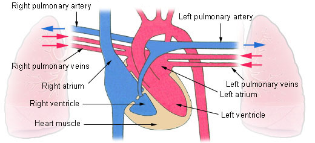

Figure 7.3: Pulmonary circulation system. Oxygen rich blood is shown in red; oxygen-depleted blood is shown in blue.

<Callout type="note" title="Note">
A simulation that shows how the human circulatory system is divided into two circuits: the systemic and the pulmonary circulatory systems: http://www.biologyinmotion.com/cardio/index.html
</Callout>

**Systemic circulation**

Systemic circulation refers to the part of the circulation system that leaves the heart, carrying oxygenated blood to the body's cells, and returning deoxygenated blood to the heart. Blood leaves through the left ventricle into the **aorta**, the body's largest artery. The aorta leads to smaller arteries that supply all organs of the body. These arteries finally branch into capillaries. In the capillaries, oxygen diffuses from the blood into the cells, and waste and carbon dioxide diffuse out of cells and into blood. Deoxygenated blood in capillaries then moves into venules that merge into veins, and the blood is transported back to the heart. These veins merge into two major veins, namely the **superior vena cava** and the **inferior vena cava** (figure:doublecirculation). The movement of blood is indicated by arrows on the diagram. The deoxygenated blood enters the right atrium via the the superior vena cava. Major arteries
 supply blood to the brain, small intestine, liver and kidneys. However, systemic circulation also reaches the other organs, including the muscles and skin. The following diagram (Figure 7.4) shows the circulatory system in humans.

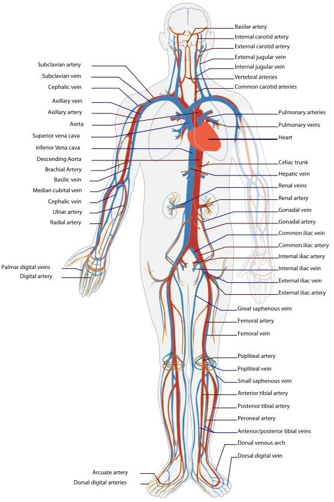

Figure 7.4: The systemic circulatory system supplies blood to the entire body.

**TEACHERS RESOURCE: **

Circulation animation:

### The heart and associated blood vessels (ESG93)

**External structure of the heart**

The heart is a large muscle, about the size of your clenched fist, that pumps blood through repeated rhythmic contractions. The heart is situated in your thorax, just behind your breastbone, in a space called the **pericardial cavity**. The heart is enclosed by a double protective membrane, called the **pericardium**. The region between the two pericardium layers is filled with **pericardial fluid** which protects the heart from shock and enables the heart to contract without friction.

The heart is a muscle (**myocardium**) and consists of four chambers. The upper two chambers of the heart are called **atria** (singular= atrium). The two atria are separated by the inter-atrial septum. The lower two chambers of the heart are known as **ventricles** and are separated from each other by the interventricular septum. The ventricles have more muscular walls than the atria, and the walls of the right ventricle, which supplies blood to the lungs is less muscular than the walls of the left ventricle, which must pump blood to the whole body.

<Callout type="note" title="Note">
Clench your fist - the size of your fist is more or less the size of your heart.
</Callout>

In addition, there are a number of large blood vessels that carry blood towards and away from the heart. The terms `artery' and `vein' are not determined by what the vessel transports (oxygenated blood or deoxygenated) but by whether the vessel flows to or from the heart. **Arteries** take blood away from the heart and generally carry oxygenated blood, with the exception of the pulmonary artery. **Veins** transport blood towards the heart and generally carry deoxygenated blood, except the pulmonary vein. On the right side of the heart, the **superior vena cava** transports deoxygenated blood from the head and arms and the inferior vena cava transports deoxygenated blood from the lower part of the body back to the heart, where it enters the right atrium. The **pulmonary artery** carries deoxygenated blood away from the right ventricle of the heart towards the lungs to be oxygenated. On the left side of the heart, the
**pulmonary vein** brings oxygenated blood from the lungs towards the left atrium of the heart and the oxygenated blood exits the left ventricle via the **aorta** and is transported to all parts of the body.

Since the heart is a muscle, and therefore requires oxygen and nutrients itself to keep beating, it receives blood from the **coronary arteries**, and returns deoxygenated blood via the **coronary veins**.

<Callout type="note" title="Note">
In humans, the left lung is smaller than the right lung to make room in the chest cavity for the heart.
</Callout>

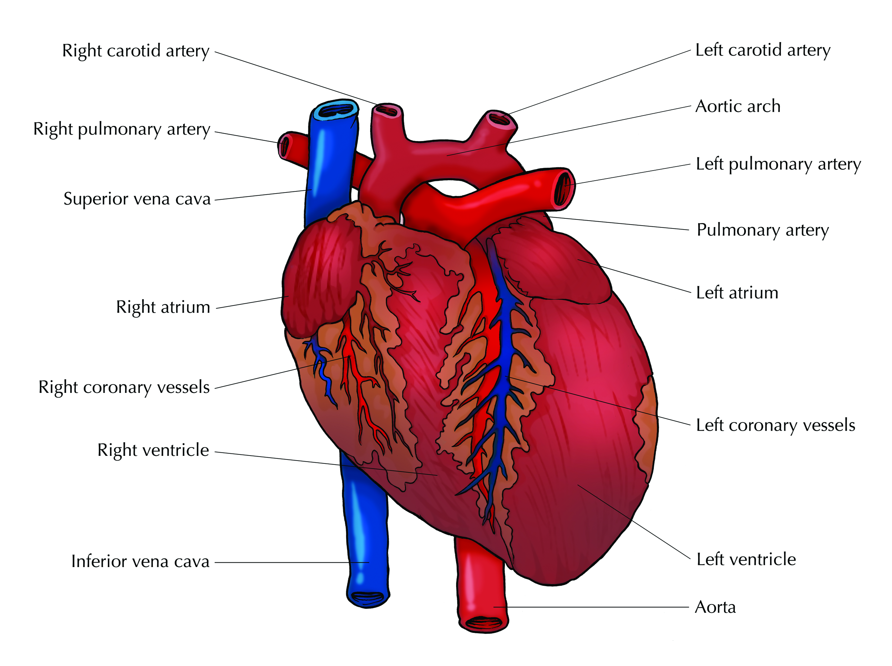

Figure 7.5: The external structure of the heart: the major part of the heart consists of muscles and is known as the myocardium. The region in which the heart is found is known as the pericardial cavity, which is enclosed by the pericardium.

**Internal structure of the heart**

As previously mentioned, the heart is made up of **four chambers**. There are **two atria** at the top of the heart which receive blood and **two ventricles** at the bottom of the heart which pump blood out of the heart. The **septum** divides the left and right sides of the heart. In order to make sure that blood flows in only one direction (forward), and to prevent backflow of blood, there are valves between the atria and ventricles (atrioventricular valves). These valves only open in one direction, to let blood into the ventricles, and are flapped shut by the pressure of the blood when the ventricles contract.

The **tricuspid valve** is situated between the right atrium and the right ventricle while the **bicuspid**/ **mitral valve** is found between the left atrium and the left ventricle. Strong tendinous cords (*chordae tendineae*) attached to valves prevent them from turning inside out when they close. The **semi-lunar valves** are located at the bottom of the aorta and pulmonary artery, and prevent blood from re-entering the ventricles after it has been pumped out of the heart.

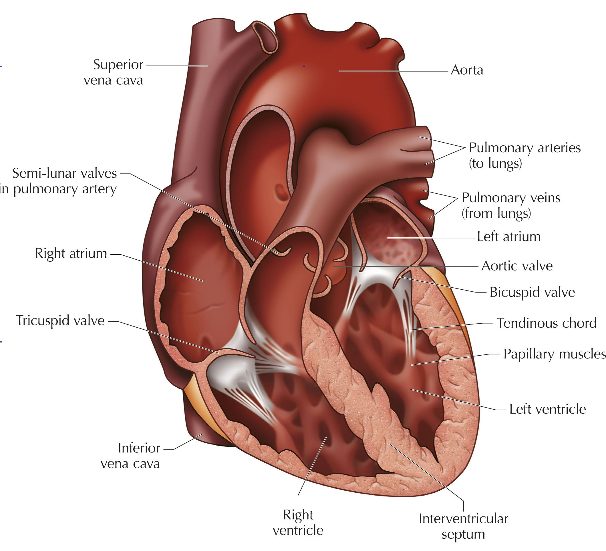

Figure 7.6: The internal structure of the mammalian heart.

<Callout type="note" title="Note">
This video shows the passage of blood through the heart and around the body.

<VideoPlayer src="https://youtu.be/o6Ct2LK0jVQ" title="Video: 2CTW" />
</Callout>

In the previous sections we have discussed pulmonary and systemic circulation, and we have described the four chamber structure of the heart as well as some of the major arteries and veins that transport blood towards and away from the heart. In order to summarise all this information, study the flow diagram below which describes the passage of deoxygenated blood through one full cycle.

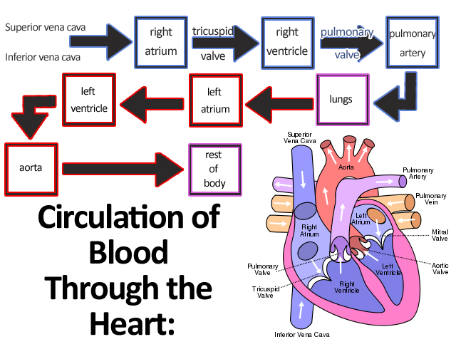

Figure 7.7: Flow diagram depicting movement of blood from the heart through the circulatory system. The blue boxes represent deoxygenated blood, the purple boxes represent capillary networks where gaseous exchange occurs and the red boxes represent stages at which the blood is oxygenated.

<Callout type="tip" title="Note">
**Memory trick**: the t**RI** cuspid valve is found on the **RI**ght side of the heart.
</Callout>

### Major organs and systemic circulation (ESG94)

All the organs of the body are supplied with blood. This is necessary so that the cells can obtain oxygen, which is required for cellular respiration, as well as essential nutrients. Each organ has an artery that supplies it with blood from the heart. Metabolic wastes, including carbon dioxide, need to be removed from cells and returned to the heart. These move into the capillaries which enter into veins that eventually enters either the superior or inferior vena cava which then enters the right atrium.

Arteries and veins have been named according to the organ to which they supply blood. The **liver** receives oxygenated blood from the heart via the hepatic artery. This artery runs alongside the **hepatic portal vein**. The hepatic portal vein contains nutrients that have been absorbed by the digestive system. This nutrient-rich blood must first pass through the liver, so that the nutrient composition of the blood can be controlled. Blood passes from the liver to the heart through the **hepatic** vein. Metabolic waste is circulated in the blood, and if allowed to accumulate, would eventually reach toxic levels. The **kidneys** are supplied with blood (which contain waste) via the **renal** arteries. The kidneys filter metabolic waste from the blood, passing it to urine to be excreted safely. Blood leaves the kidney via the renal vein.

The **brain** is supplied with blood via the **carotid** arteries and the vertebral arteries. The blood from the brain is drained via the **jugular** veins. The brain is supplied with \(\text{15}\%\) of the total amount of blood pumped by the heart. The heart is also a muscle (myocardium) that requires blood flow to work. Blood is supplied to the heart via two **coronary arteries**, and leaves the heart via four **cardiac veins**.

## Dissecting a mammalian heart

### Aim

To dissect a mammalian heart (sheep or ox heart).

### Apparatus

- your teacher will give each group a heart to dissect
- a scalpel handle with a blade or a sharp non-serrated knife
- a sharp pair of scissors
- a pair of forceps
- gloves
- paper towel
- pictures of the external and internal views of the heart

### Method

1. Work in groups of four.
3. Place the heart on the dissecting board with the atria at the top and the ventricles facing downwards.
5. Carefully examine the external view of the heart. Try identify the vertical and horizontal groves on the heart. This is the position of the internal walls between the chambers of the heart.
7. Examine and note the difference in the walls of the ventricles and atria. Also note the difference in appearance between the walls of the ventricles and atria.
9. With the scalpel or sharp knife carefully cut the heart open across the left atrium.
11. Compare the thickness and the size of the right ventricle and atrium.
13. Identify the valves and examine the tendinous cords which are attached to the valves.
15. Identify the semi-lunar valves at the bottom of the pulmonary artery.
17. Now cut through the left side of the heart in the same way as you did the right side of the heart.
19. Carefully cut through the septum of the heart so that you have two halves.

### Questions

1. What is the smooth outer layer of the heart called?
3. Did you notice any fat around the heart?
5. Did you notice a difference between the atria and ventricles externally?
7. Name the blood vessels visible on the outside of the heart.
9. Compare the thickness of the walls of the atria and ventricles. Explain why they are different.
11. Explain the difference between the left and right ventricular walls.

**Questions**

1. What is the smooth outer layer of the heart called?
3. Did you notice any fat around the heart?
5. Did you notice a difference between the atria and ventricles externally?
7. Name the blood vessels visible on the outside of the heart.
9. Compare the thickness of the walls of the atria and ventricles. Explain why they are different.
11. Explain the difference between the left and right ventricular walls.

**Answers**

1. Pericardium
3. Yes - fat should be present in some places, especially in the grooves.
5. Yes – the atria are much smaller than the ventricles, they have thinner muscle walls and are at the top of the heart, whereas ventricles are at the bottom.
7. Coronary arteries and veins
9. Atria have thin, flexible walls and ventricles have much thicker, stronger walls. This is because atria only have to pump blood down to the ventricles (short distance), so they do not have to be as strong as ventricles, that pump blood much further (to the lungs or the entire body).
11. The wall of the left ventricle is much thicker than that of the right ventricle, since it needs to exert greater force / be stronger. The left ventricle pumps blood to the entire body, which requires much more force than simply pumping blood from the right ventricle to the lungs, which are also in the thoracic cavity.

### The cardiac cycle (ESG95)

A cardiac cycle refers to the sequence of events that happens in the heart from the start of one heartbeat to the start of the subsequent heartbeat. During a cardiac cycle the atria and the ventricles work separately. The sinoatrial node (pacemaker) is located in the right atrium and regulates the contraction and relaxing of the atria.

- At rest, each heartbeat takes approximately \(\text{0,8}\) seconds.
- The normal heart rate at rest is approximately \(\text{72}\) beats per minute.
- During **systole** the heart muscle contracts.
- During **diastole** the heart muscle relaxes.

The phases of the cardiac cycle will be broken down and explained in the following section:

**Phase 1: Atrial systole (Atrium contracts)**

- Blood from the superior and inferior vena cava flows into the right atrium.
- Blood from the pulmonary veins flows into the left atrium.
- The atria contract at the same time.
- This contraction lasts for about \(\text{0,1}\) seconds.
- Blood is forced through the tricuspid and bicuspid valves into the ventricles.

**Phase 2: Ventricular systole (Ventricle contracts)**

- Ventricles relax and fill with blood.
- The ventricles contract for \(\text{0,3}\) seconds.
- Blood is forced upwards, closing the bicuspid and tricuspid valves (lubb sound).
- The blood travels up into the pulmonary artery (on the right) and the aorta (on the left).
- The atria are relaxed during ventricular systole.

**Phase 3: General diastole: (General relaxation of the heart)**

- The ventricles relax, thus decreasing the flow from the ventricles.
- Once there is no pressure the blood flow closes the semi-lunar valves in the aorta and the pulmonary artery (dubb sound).
- General diastole lasts for about \(\text{0,4}\) seconds.

**TEACHERS RESOURCE: **

View Cardiac Magnetic Resonance imaging of a beating heart. Large magnets are used to create images of the heart inside the body, without the need for surgery.

- View from the front (upside down):
- View from the top:
- View from the side:

**The sound the heart makes**

The heart makes two beating sounds. One is loud and one is soft. We call this the **lubb dubb** sound. The **lubb** sound is caused by the pressure of the ventricles contracting, forcing the atrioventricular valves shut. The **dubb** sound is caused by the lack of pressure in the ventricles which causes the blood to flow back and close the semi-lunar valves in the pulmonary artery and aorta. A doctor uses a **stethoscope** to listen to the heartbeats. Alternatively, a person's pulse can be measured by pressing a finger (other than the thumb which already has a pulse) against the brachial artery in the wrist or the carotid artery next to the trachea. The pulse of the heart allows us to measure the heart rate which is the number of heartbeats per unit time.

**Mechanisms for controlling cardiac cycle and heart rate (pulse)**

The cardiac cycle is controlled by nerve fibres extending from nodes of nerve bundles through the heart muscle. There are two nodes, namely the **sinoatrial node (SA node)** and the **atrioventricular node (AV node)**. The SA node is located within the wall of the right atrium while the AV node is located between the atria and the ventricles. Electrical impulses generated in the SA node cause the right and left atria to contract first, initiating the cardiac cycle. The electrical signal reaches the AV node, where the signal pauses, before spreading through conductive tissues called the bundles of His and Purkinje fibres. These fibres branch into pathways which supply the right and left ventricles, causing the ventricles to contract. The SA node is the pacemaker of the heart since electrical signals are normally generated there - without any stimulation from the nervous system **(automaticity)**. However, although the heart rate is automatic, it
changes during exercise or when experiencing intense emotions like fear, anger and excitement. This is as a result of added stimulation from the nervous system and hormones, such as adrenaline.

<Callout type="note" title="Note">
Simple simulation of how electrical activity spreads over the heart. http://en.wikipedia.org/wiki/File:ECG_Principle_fast.gif
</Callout>

**TEACHERS RESOURCE: **

Simple simulation of how electrical activity spreads over the heart.

[Simulation: 2CTX](http://en.wikipedia.org/wiki/File:ECG_Principle_fast.gif)

**Electrical activity**

The electrical activity in the heart is so strong that it can be measured from the surface of the body as an **electrocardiogram** (ECG). A normal heart has a very regular rhythm. **Arrhythmia** is a condition where the heart has an abnormal rhythm, as shown in the figures. **Tachycardia** is when the *resting* heart rate is too fast (more than \(\text{100}\) beats per minute), and **bradycardia** is when the heart rate is too slow (less than \(\text{60}\) beats per minute).

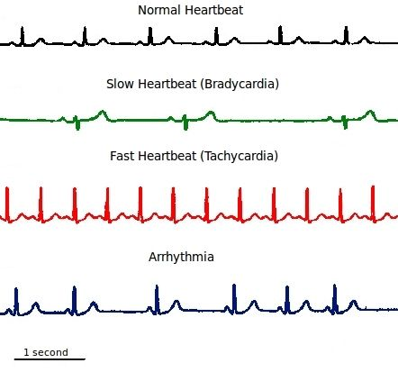

Figure 7.8: Electrocardiogram depicting different heart rhythms.

**TEACHERS RESOURCE: **

Before conducting the following activity, it may be useful to read the following resource on measuring pulse rate:

## Investigating heart rates before, during and after strenuous exercise

### Aim

To investigate your heart rate before, during and after strenuous exercise

### Apparatus

- stopwatch
- pen and paper for recording

### Method

1. Work in pairs on the field and ensure you have a stop watch.
3. One partner performs the experiment and the other records the results. Partners then swap roles.
5. Take the resting pulse rate before exercising.
7. One partner runs quickly around the field twice.
9. Immediately after the run take his/her pulse.
11. Continue to take his pulse every minute for 5 minutes.
13. Record the results and plot a graph using the data pertaining to you.

### Results

Record your results here:

| Time | Heart rate (beats/minute) |
| --- | --- |
| Before exercise (resting) |  |
| \(\text{0}\) \(\text{min}\)(immediately after exercise) |  |
| \(\text{1}\) \(\text{min}\) (after exercise) |  |
| \(\text{2}\) \(\text{min}\) |  |
| \(\text{3}\) \(\text{min}\) |  |
| \(\text{4}\) \(\text{min}\) |  |
| \(\text{5}\) \(\text{min}\) |  |

Draw a line graph to illustrate your results. Show the resting pulse rate as a separate dotted line on the axis.

### Conclusions

Write your conclusion.

### Questions

1. Write a hypothesis for this investigation.
3. Write down the independent variable.
5. Write down the dependent variable.
7. Name ONE factor that must be kept constant during this investigation.
9. Write down TWO ways in which the accuracy of this investigation can be improved.
11. What conclusions can be made about your cardiovascular fitness?
13. Explain why the heart rate increases during exercise.

**Results:**

Learners should have a resting pulse that is significantly lower than the pulse rate after running around. Check that if they have taken their pulse for 30 seconds x 2, all readings should be EVEN numbers. In the minutes after running, pulse should gradually return to resting pulse rate. Most teenagers should have a resting pulse around 60 – 84 beats per minute.

Graph to show changes in pulse rate before, during and after exercise

- Graph should have Time (minutes) on horizontal axis and Pulse rate (beats per min) on the vertical axis.
- Both axes must go up in equal intervals along the entire length.
- Resting pulse is shown as a dotted line parallel to the horizontal axis.
- Graph should start ON resting pulse and go up, then gradually back down to resting pulse rate.

**Conclusion:**

Pulse rate increases when exercise is done, then gradually returns to resting pulse after the exercise. (Learners may notice that individuals who are fit return to resting pulse FASTER than unfit individuals.)

**Questions**

1. Write a hypothesis for this investigation.
3. Write down the independent variable.
5. Write down the dependent variable.
7. Name ONE factor that must be kept constant during this investigation.
9. Write down TWO ways in which the accuracy of this investigation can be improved.
11. What conclusions can be made about your cardiovascular fitness?
13. Explain why the heart rate increases during exercise.

**Answers**

1. Pulse rate during exercise will be higher than resting pulse rate.
   Accept ANY hypothesis, as long as it is:
   - geared towards the aim of the investigation
   - written as a statement, not a question
   - written in the FUTURE tense
   - a clear expectation of what will be found – it does not have to be correct
3. There are TWO independent variables. The main one is Resting, Doing Exercise and Recovering (or Type of Activity), but time can also be seen as a secondary independent variable.
5. The dependent variable is Pulse Rate.
7. There are several variables that need to be controlled:
   - The same learner needs to be used when taking the pulse before and after exercise.
   - Both learners in a group must do the same exercise (run around field twice).
   - Pulse must be taken before and immediately after exercise.
   - Pulse must be taken exactly at one minute intervals during recovery.
   - Always take pulse as 30 seconds x 2 or over a full minute.
9. Several things may be done:
   - Repeat the investigation again two or more times with one learner and obtain an average. Use large groups of individuals in a certain age group and average their results.
   - Keep measuring pulse rate until it returns to resting rate – this may take longer than 5 min in some learners.
   - Use a heart rate monitor for greater accuracy with pulse rates.
   - Control more variables in order to get similar groups of people – all the same age, same gender, same fitness level, same mass approximately etc.
11. The conclusions MUST be based on the results obtained and will probably also indicate relative fitness levels – fit individuals tend to recover faster after exercise. It must also be linked to the original hypothesis and state whether this hypothesis is accepted or rejected. Learners must be encouraged to evaluate the hypothesis and should be told that it is perfectly acceptable for the hypothesis to have been incorrect – they must NOT go back to it and change it.
13. Heart rate increases due to the higher rate of cell respiration that is required to provide the necessary energy during running. The cells demand MORE oxygen and release MORE carbon dioxide than normal, so breathing and heart rate both speed up to deliver the greater amount of \(\text{O}_{2}\) and remove the greater amount of \(\text{CO}_{2}\)  formed.

**Stroke Volume**

The stroke volume is the amount of blood pumped through the heart during each cardiac cycle. The stroke volume can change depending on the needs of the body. During exercise, muscles need more oxygen and glucose in order to produce energy in the form of ATP. Therefore the heart increases its stroke volume and stroke rate to meet this demand. This is a temporary change to maintain homeostasis, and after exercise the heart rate and stroke volume return to normal.

When a person exercises regularly, and is fit, the heart undergoes certain long-term adaptations. The heart muscle gets stronger, and expels more blood with each contraction. There is therefore a greater stroke volume with each heartbeat. Since the heart expels more blood with each stroke, the heart has to beat less often in order to maintain the same volume of blood flow. Therefore, fit people often have lower resting heart rates.

<Callout type="note" title="Note">
**Cardiac output** is the volume of blood that is pumped by the heart in one-minute. Cardiac output is equal to the stroke volume (SV) multiplied by the heart rate (HR).
</Callout>

**Blood Pressure**

Blood pressure refers to the force that the blood exerts on the blood vessel walls. Blood pressure is determined by the size of the blood vessels and ensures that blood flows to all the parts of the body. Normal blood pressure is 120/80 (120 over 80) measured in units of mercury (mm Hg). The 120 represents the systolic pressure, which is when the ventricles contract. The 80 represents the diastolic pressure, which is when general diastole occurs.

Blood pressure can be increased by smoking, stress, adrenalin surges, water retention, high cholesterol, obesity and lack of exercise. High blood pressure **(hypertension)** is dangerous and increases the risk of an aneurysm, stroke or heart attack. Low blood pressure **(hypotension)** can lead to light-headedness and fainting because of insufficient blood supply to the brain.

### Blood vessels (ESG96)

We will now examine the structure and function of arteries, capillaries, veins and valves.

**Arteries**

**A**rteries carry blood **A**way from the heart. The pressure created by the pumping heart forces blood through the arteries. Arteries have three layers. They have an outside layer made up of connective tissue; a middle layer made up of smooth muscle, to allow contraction of the arteries in order to regulate the pressure of blood flow, and an inside layer of tightly connected simple squamous endothelial cells. The large arteries close to the heart branch into smaller arterioles (smaller arteries) and eventually branch into capillaries.

<Callout type="note" title="Note">
Laughing is good exercise for your heart. Whenever you laugh, the blood vessels dilate (open up), causing the blood flow to increase, thus keeping your heart healthy.
</Callout>

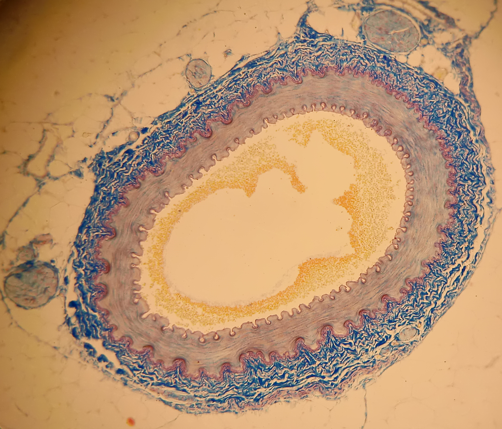

Figure 7.9: Micrograph of artery.

**Capillaries**

Capillaries are little more than a single layer of endothelial cells. Capillaries form intricate networks throughout the tissues. They allow water, nutrients and gases to diffuse out of the blood and waste materials to diffuse into the blood. This exchange occurs between the blood and the tissue fluid. The tissue fluid is the fluid surrounding the cells. The blood cells never come into contact with the cells. The blood and tissue fluid exchange material, and the tissue fluid then exchanges material with the cells.

**Veins**

The intricate networks formed by the capillaries eventually converge to form venules, (small veins). The venules then converge to form veins which return the blood to the heart. Vein walls only consist of two layers. The outer layer is made up of connective tissue whereas the inner layer is made up of endothelial cells.

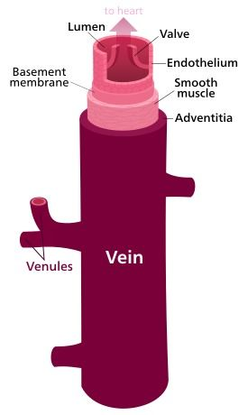

Figure 7.10: Schematic diagram of a vein.

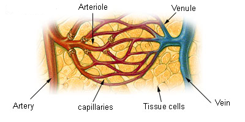

Figure 7.11: Diagram representing the branching of an artery into arterioles. These subsequently form the capillary bed which empties into several venules, leading to the vein.

**Valves**

Once the blood has passed through the capillaries very little blood pressure remains to return blood to the heart.Instead of pressure from the heart veins use a series of valves to force blood to return to the heart. Contraction of the muscles squeezes the veins, pushing the blood through them. The valves cause the blood to flow in only one direction, back to the heart.

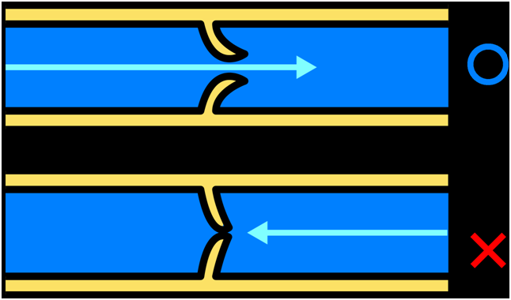

Figure 7.12: Valves ensure that blood flows one only way though veins.

**TEACHERS RESOURCE: **

Interactive diagram illustrating arterial and venous structure:

### Comparison between arteries, veins and capillaries (ESG97)

The figure and table below summarise the differences between arteries, capillaries and veins.

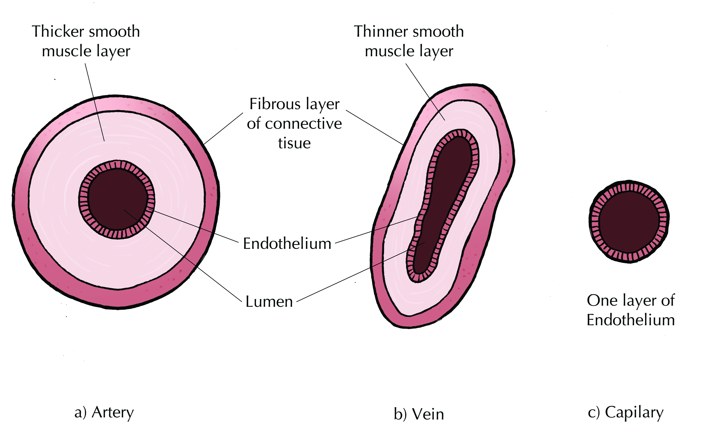

Figure 7.13: Cross-section showing the differences between a) arteries, b) veins and c) capillaries.

| Arteries | Capillaries | Veins |
| --- | --- | --- |
| blood moves away from the heart | blood supply at tissue level | blood returned to the heart |
| thick middle layer of involuntary muscle to increase or decrease diameter | one layer of endothelium with very small diameter | thin middle layer as pressure is reduced |
| inner layer of endothelium which reduces friction | only endothelium layer present | larger diameter of inner cavity, lined with endothelium to reduce friction |
| situated deeper in the tissue to maintain body temperature | situated at tissue level only | situated near the surface of the skin to release heat |
| no valves except in the base of the aorta and the pulmonary arteries | no valves present | semi-lunar valves are present at intervals, to prevent back flow of blood |
| blood always under high pressure | blood is under high pressure where red blood cells are forced to flow through in single file | blood is under low pressure |
| a pulse can be felt as blood flows | no pulse | no pulse can be detected |

Table 7.1: Table comparing arteries, capillaries, and veins

<Callout type="note" title="Note">
The average adult heart beats:

- \(\text{72}\) times a minute
- \(\text{100 000}\) times a day
- \(\text{3 600 000}\) times a year
- A billion times during a lifetime.
</Callout>
