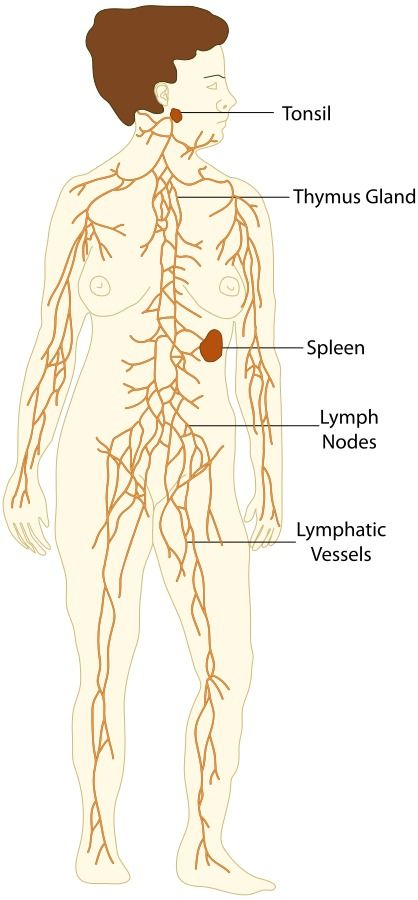
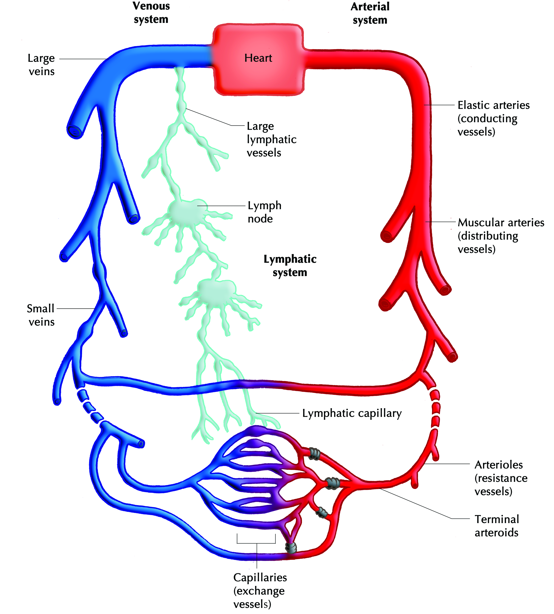
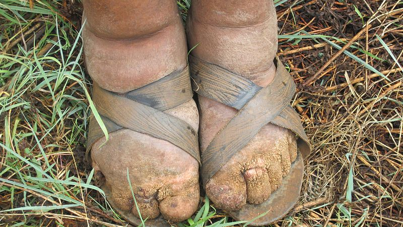

## 7.3 Lymphatic circulatory system (ESG98)

The lymphatic system is part of the circulatory system, comprising a network of inter-connected tubes known as **lymphatic vessels** that carry a clear fluid called **lymph** towards the heart.

The lymphatic organs play an important part in the immune system. The lymphatic system transports the white blood cells which are important in the immune response against pathogens.

**TEACHERS RESOURCE: **

Use this resource to learn more about the lymph system and to select short informative videos to show to the class.

Short videos on lymph:

### Composition of the lymphatic system (ESG99)

The lymphatic system is composed of lymph vessels, lymph ducts, lymph nodes and organs. The organs associated with the lymphatic system are the **spleen** and **thymus**. The spleen is the boundary between the blood and the lymphatic system. Knots of lymphatic tissue in the spleen add lymphocytes to the blood. The spleen also acts as a filter for the blood, and helps to destroy worn out red-blood cells. In the event of damage to the spleen, it can be removed and its functions will be carried out by the liver, the bone marrow and the lymph nodes.

Figure 7.14: Diagram of human lymphatic system.

**Lymph vessels** are located as a network throughout all tissues in the body. Lymph vessels assist the circulatory system and all the cells of the body by removing wastes, germs and excess water from the tissue fluid. Lymph vessels carry lymph fluid from the bottom of the body up towards the heart and also drains from the head and shoulders as well as the arms.

**Muscle contractions** help push the lymph fluid upwards, and **valves** prevent the lymph fluid from flowing backwards. Many lymph vessels eventually merge into two large lymphatic vessels, called **lymphatic ducts** which empty into veins in the neck. The **thoracic duct** collects from the left side of the body and the lower right side of the body and empties into the left subclavian vein. The right thoracic duct collects from the right arm, thorax, neck and head, and drains into the right subclavian vein.

Most of the disease-fighting function of the adult mammal is carried out by the **lymph nodes** which occur along the lymph ducts. Lymph nodes are small, irregularly-shaped masses through which lymph vessels flow. Clusters of nodes occur in the armpits, groin, and neck. Cells of the immune system line channels through the nodes and attack bacteria and viruses travelling in the lymph, so they basically act as tiny filters.

Figure 7.15: Interaction between lymphatic and cardiovascular circulatory systems.

### Functions of lymphatic system (ESG9B)

The main functions of the lymphatic system are as follows:

- The main function of the lymphatic system is to **collect and transport tissue fluids** from the intercellular spaces in all the tissues of the body, back to the veins in the blood system.
- Lymph plays an important role in **returning plasma proteins to the bloodstream**.
- **Digested fats are absorbed** and then transported from the villi in the small intestine to the bloodstream via the lymph vessels.
- **Lymphocytes are manufactured in the lymph nodes**
- Antibodies manufactured in the lymph nodes assist the body to build up an effective **immunity** to infectious diseases.
- Lymph nodes ** play an important role in the defence mechanism of the body**. They filter out micro-organisms (such as bacteria) and foreign substances such as toxins.
- Lymph transports large molecular compounds (such as enzymes and hormones) from their manufactured sites to the bloodstream.

<VideoPlayer src="http://www.youtube.com/embed/Kh-XdNnTZUo" title="Video: 2CTY" />

<Callout type="note" title="Note">
Elephantiasis is a disease characterised by thickening of the skin and underlying tissues, especially in the legs and genitals. It occurs when the body becomes infected by parasitic infections, which target the lymphatic system.

Figure 7.16: An Ethiopian farmer affected by elephantiasis after being infected by a worm that settled in the lymphatic system thereby causing the disease.
</Callout>

**A comparison of the cardiovascular and lymphatic systems **

Table 7.2 provides a comparison of the cardiovascular and lymphatic systems.

| Cardiovascular System | Lymphatic System |
| --- | --- |
| Blood is responsible for collecting and distributing oxygen, nutrients and hormones to the tissues of entire body. | Lymph is responsible for collecting and removing waste products left behind in the tissues. |
| Blood flows in the arteries, capillaries, and veins. | Lymph flows in an open circuit from the tissues into lymphatic vessels. |
| Blood flows towards the heart and away from the heart. | Lymph flows in one direction only (towards the heart). |
| Blood is pumped by the heart to all parts of the body. | Lymph is not pumped . It passively flows from the tissues into the lymph capillaries. |
| Blood consists of the liquid plasma that transports the red and white blood cells and platelets. | Lymph that has been filtered and is ready to return to the cardiovascular system is a   clear or milky white fluid. |
| Blood is visible and damage to blood vessels causes obvious signs such as bleeding or bruising. | Lymph is colourless or translucent and damage to the lymphatic system is difficult to detect until swelling occurs. |
| Blood is filtered by the kidneys. | Lymph is filtered by lymph nodes located throughout the body. |

Table 7.2: Comparison between the cardiovascular system and the lymphatic system
