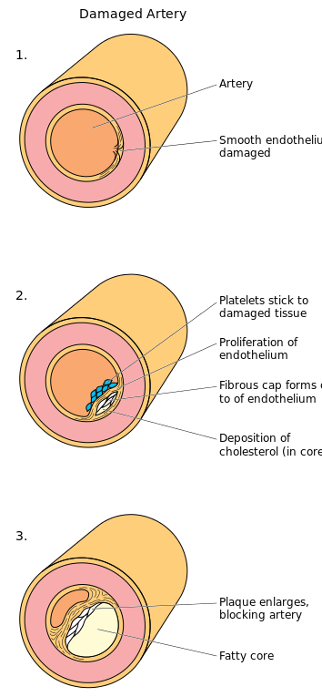
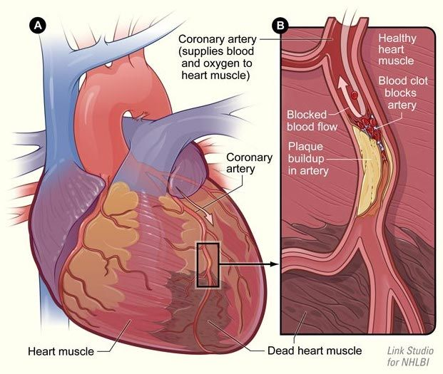
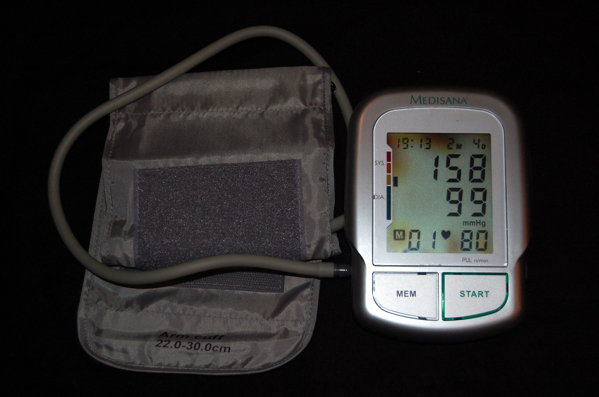
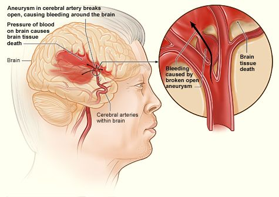

## 7.4 Cardiovascular diseases (ESG9C)

Cardiovascular diseases affect the heart or blood vessels (arteries, veins and capillaries). Cardiovascular diseases are the biggest cause of deaths worldwide, and the incidence of these diseases is rising rapidly in countries like South Africa. Cardiovascular diseases can be avoided through improvements in eating habits and through regular exercise. In this section we will study the causes of heart attacks and strokes as well as how these may be treated. We will also study the causes of high and low blood pressure and how these have an effect on our well-being. We will finally discuss the types of treatments that are available such as stents, valve replacements, bypass surgery, pacemakers and heart transplants.

### Heart attack (ESG9D)

This is also referred to as a **myocardial infarction**. Heart muscles are provided with oxygenated blood by a system of coronary arteries. Blocked flow of blood can cause the death of cardiac muscle due to lack of oxygen. Arteries get blocked as a result of the gradual build-up of lipids and cholesterol, which form a **plaque**. This condition of plaque build up in the arteries is referred to as **atherosclerosis**. When a plaque bursts, it causes blood to clot at the site of the rupture and obstructs the artery (see diagram in figure:damagedarteryblocked). Often there are no symptoms of atherosclerosis. However, some people who have narrowed coronary arteries experience chest pain, (**angina**), when blood flow to the heart is insufficient.

Figure 7.17: 1. Normal arteries have a wide diameter through which blood can easily flow. 2. Plaque forms on the walls of the artery, narrowing the lumen. 3. When the plaques bursts, platelets form a blood clot at the site of rupture, which can obstruct the artery.

Figure 7.18: Heart attack: the blood clot blocks the coronary arteries and cardiac muscle dies from lack of oxygen.

<VideoPlayer src="http://www.khanacademy.org/video/heart-disease-and-heart-attacks?playlist=Biology" title="Video: 2CTZ" />

<VideoPlayer src="http://www.khanacademy.org/video/thrombo-emboli-and-thromboembolisms?playlist=Biology" title="Video: 2CV2" />

<VideoPlayer src="http://www.khanacademy.org/video/stenosis-ischemia-and-heart-failure?playlist=Biology" title="Video: 2CV3" />

### Hypertension (ESG9F)

As previously mentioned blood pressure is the pressure exerted by the blood against the walls of the blood vessels, especially the arteries. Normal blood pressure at rest is within the range of \(\text{100}\)–\(\text{140}\) \(\text{mm Hg}\) systolic (top reading) and \(\text{60}\)–\(\text{90}\) \(\text{mm Hg}\) (bottom reading). High blood pressure (hypertension) is said to be present if it is persistently at or above \(\text{140}\)/\(\text{90}\) \(\text{mm Hg}\). Hypertension is a major risk factor for strokes, heart attacks and bursting of blood vessels (aneurysms). Hypertension is essentially caused by a resistance to blood flow in blood vessels.

Figure 7.19: The instrument used to measure blood pressure is a **sphygmomanometer**. This figure shows an automated arm blood pressure meter showing arterial hypertension. From the top reading systolic pressure is \(\text{158}\) \(\text{mm Hg}\) and diastolic reading is \(\text{99}\) \(\text{mm Hg}\) and the heart rate is \(\text{80}\) beats per minute.

### Hypotension (ESG9G)

Hypotension refers to abnormally **low** blood pressure, especially in the arteries of the systemic circulation. A patient is considered hypotensive if he/she has a systolic blood pressure less than \(\text{90}\) millimetres of mercury (\(\text{mm Hg}\)) or diastolic pressure being less than \(\text{60}\) \(\text{mm Hg}\). However, in practice, blood pressure is considered too low only if noticeable symptoms are present, such as feeling light-headed. If the blood pressure is sufficiently low, fainting and often seizures will occur. Severely low blood pressure can deprive the brain and other vital  organs of oxygen and nutrients, leading to a life-threatening condition called **shock**.

### Stroke (ESG9H)

A stroke results when a clot, burst artery or blood vessel interrupts flow of blood to the brain, resulting in glucose and oxygen not reaching the brain. This causes impairment in speech, movement and memory. Larger strokes can result in paralysis or death.

<VideoPlayer src="https://www.khanacademy.org/science/healthcare-and-medicine/heart-disease-and-stroke/v/strokes" title="Video: 2CV4" />

### Aneurysm (ESG9J)

An aneurysm is a localised blood-filled bubble in an artery wall. These bubbles form due to a weakness in the blood vessel wall and can grow quite large. Aneurysms can occur in many places in the body, including the brain, abdomen or aorta. When aneurysms burst, they result in massive internal blood loss and death.

Figure 7.20: A hemorrhagic stroke caused by a burst aneurysm in the brain.
