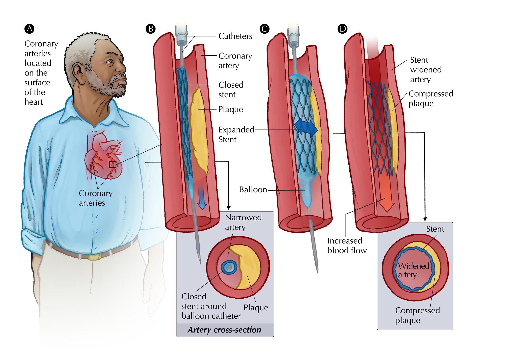
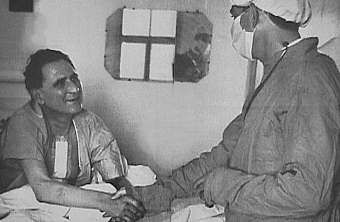

## 7.5 Treatment of heart diseases (ESG9K)

We will now examine some of the treatment of cardiovascular diseases.

for treatments of heart disease

### Stents (ESG9M)

In some cases, a small wire mesh tube is inserted into a blocked or narrowed artery to keep it open. This is called a percutaneous coronary intervention. To perform this procedure, doctors insert a needle into the femoral artery, and then thread a very thin wire through the arteries until it reaches the heart and the area of blockage. A thin catheter with a small wire coil (stent) and in inflatable balloon is then threaded over the thin wire and inserted into the coronary artery at the site of the blockage. Once in position, the balloon is gently inflated to open the artery and remove the blockage. The stent is left in the artery so that the artery does not block again, and the catheter is removed.

Figure 7.21: Stent replacement in heart patients.

<VideoPlayer src="https://youtu.be/N7nghr9TpSU" title="Video: 2CV5" />

### Pacemaker (ESG9N)

Pacemakers are small electrical devices that get implanted into the chest or abdomen of patients in order to help control arrhythmias (abnormal heart rhythms). Modern devices are quite advanced and can learn a patient's normal heart-beat patterns and detect when the heart enters an abnormal rhythm ( e.g. skips a beat). The device will then send out a little electrical pulse to stimulate the heart to beat and restore a normal heart beat.

### Valve replacement (ESG9P)

Valve replacement surgery is the replacement of one or more of the heart valves with an artificial valve. There are two types of valves presently being used: **Biological valves** are manufactured from animal or human tissue. These valves have a life span of approximately 12 to 15 years. If biological valves are used the patient generally does not require additional blood thinning medication. **Mechanical valves** are manufactured from synthetic materials. These valves, because they are made of synthetic materials last longer, but the patient needs to take anti-coagulant medication for the rest of their lives.

### Coronary Bypass Surgery (ESG9Q)

This is the most common type of surgery used for the treatment of coronary heart disease. The surgeon removes a section of a vein from the patient's leg and then carefully grafts the removed vein (attaches) onto the aorta to bypass the blocked part of the artery.

<VideoPlayer src="http://www.youtube.com/watch?v=dee8CMamoQ0" title="Video: 2CV6" />

### Heart Transplant (ESG9R)

A heart transplant is the surgical removal of a person's diseased heart and  replacement with a healthy heart from a donor. Heart  failure is a condition in which the heart is damaged or weak. As a  result, it cannot pump enough blood to meet the body's needs. Heart transplants are done as a life-saving measure for end-stage heart failure. Donor hearts are in short supply, therefore patients who need heart transplants go through a very careful selection process. They must be sick enough to need  a new heart, yet healthy enough to receive it. Survival rates for people receiving heart transplants have improved, especially in the first year after the transplant.

<Callout type="note" title="Note">
The survival after heart transplant surgery is about \(\text{88}\%\) after the first year, \(\text{75}\%\) after \(\text{5}\) years and \(\text{56}\%\) after 10 years.
</Callout>

<Callout type="note" title="Note">
The first human heart transplant was performed on the 3rd December 1967 by Professor Christiaan Barnard, a **South African** heart surgeon. The patient, Mr Louis Washkansky, unfortunately only survived for 18 days after the surgery. However the cause of death was pneumonia, and not his new heart, which beat strongly till his death.
</Callout>

Figure 7.22: Heart transplant by Dr Christiaan Barnard.
