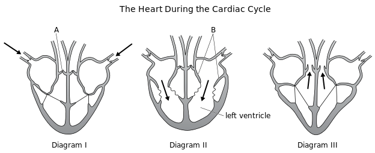
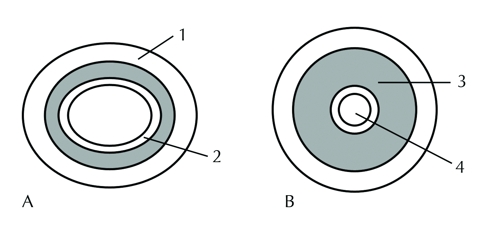
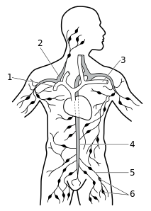
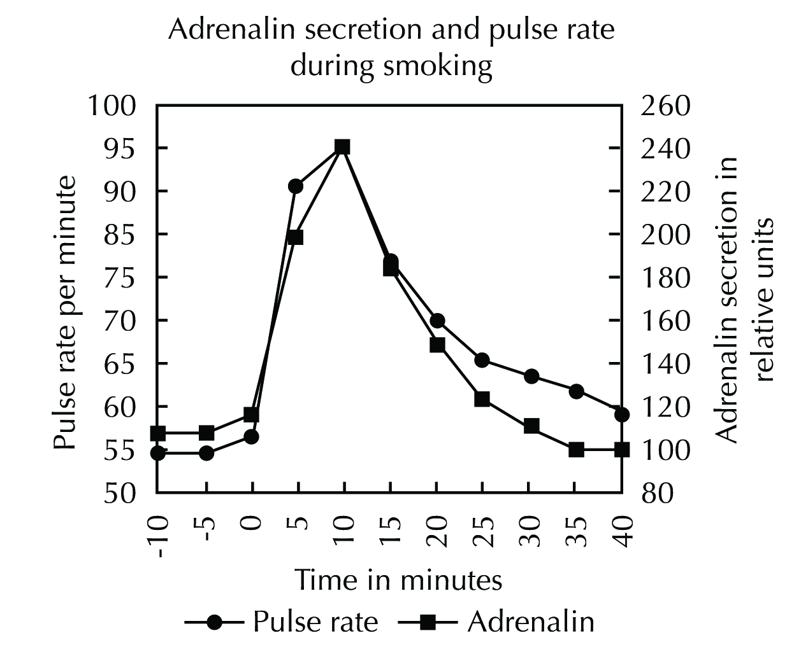
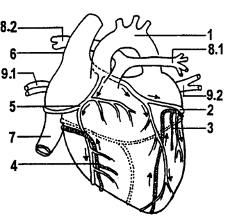
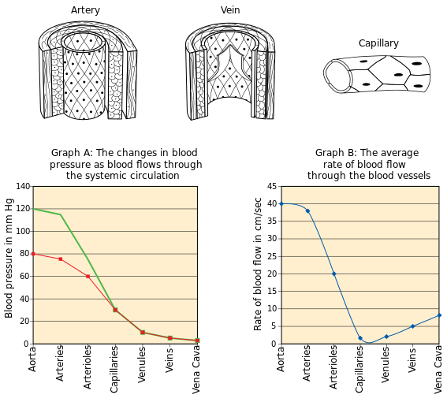
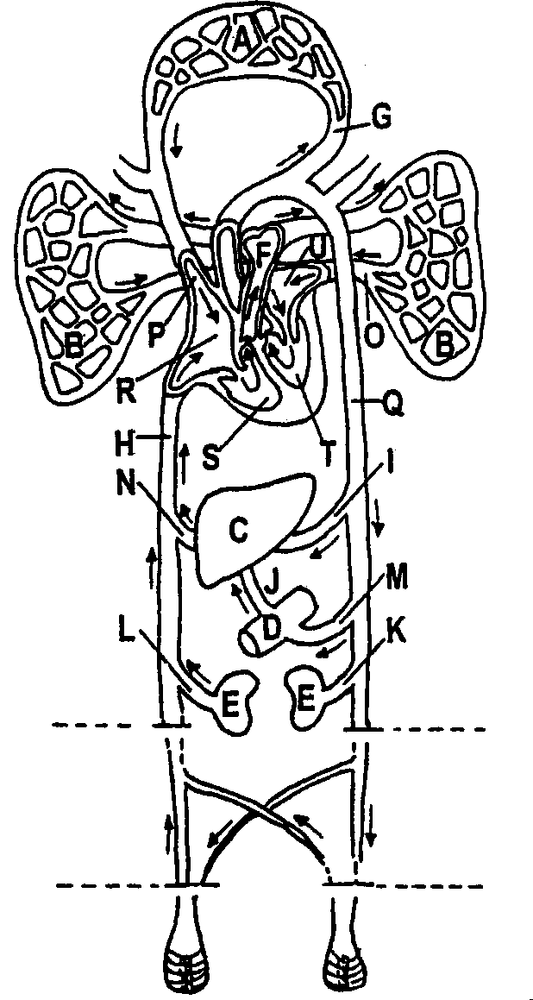

## End of chapter exercises

### Exercise 7.1

**Problem:**
The following diagrams show the heart during the cardiac cycle. The arrows represent the flow of blood. Study the diagrams and answer the questions that follow:

1. Identify the structures labelled A and B respectively.
3. Name and explain what happens in each of the phases of the cardiac cycle represented in:
   1. Diagram I
   3. Diagram II
   5. Diagram III

**Solution:**
1. A: semi-lunar valve; B: Bicuspid or mitral valve
3. 1. Diagram I: **General diastole:** Blood enters the atria from the venae cava (right atrium) and from the pulmonary veins (left atrium). The entire heart is relaxed.
   3. Diagram II: **Atrial systole:** Both atria contract and blood is pumped from the atria through the bi-/tricuspid valves to the ventricles. The bi - /tricuspid valves open easily downward to allow blood through.
   5. Diagram III: **Ventricular systole:**Both ventricles contract and pump blood upwards into the pulmonary artery (right ventricle) and aorta (left ventricle). The bi - / tricuspid valves close (because of chordae tendinae preventing them from opening backwards, so blood does not return to the atria. The semi-lunar vales open at the base of the major arteries to allow blood into them.

**Problem:**
Loss of a lot of blood, vomiting and diarrhoea often causes a decrease in blood volume. As a result, blood cannot move normally around the body, as blood vessels are not completely full. The tissues do not get enough blood, leading to possible death of cells and hence damage to organs.

1. Explain why severe vomiting and diarrhoea would cause a decrease in the blood volume.
3. What is the relationship between blood volume and blood pressure?

**Solution:**
1. Both vomiting and diarrhoea involve loss of large amounts of water from the body. The water lost from the digestive system cannot be absorbed into the blood, and as a result, blood plasma volume drops.
3. As blood volume increases, blood pressure increases. They are thus positively correlated. If blood volume decreases, blood pressure decreases. This is because the lower volume in the vessels exerts less pressure on the vessel walls.

**Problem:**
Read the passage below and then answer the questions based on it.

| When the ventricles of the heart pump blood into the arteries, the pressure of the blood in the arteries is high. This is called systolic pressure (average \(\text{120}\) \(\text{mm Hg}\)). When the heart muscle relaxes, the pressure in the arteries is much less. This is called diastolic pressure (average \(\text{80}\) \(\text{mm Hg}\)). The average blood pressure of a healthy person is \(\text{120}\) over \(\text{80}\). It is normal for a person's blood pressure to differ slightly from the average. If blood pressure is too high or too low there is medication that can be used to control this. High blood pressure is called 'hypertension' and low blood pressure is called 'hypotension'. There are several contributing factors to heart disease, namely hypertension, strokes, lack of exercise, smoking, rich fatty diets, obesity and diabetes. Research has shown that \(\text{25}\%\) of the South African population suffer from hypertension and that this is on the increase. The treatment for hypertension is expensive and has a great impact on the health system and on the economy. |
| --- |

1. Explain what causes the pressure in the arteries to rise and fall.
3. Why is it essential that blood pressure in the capillary vessels be much lower than that in the artery?
5. List THREE reasons why heart disease is on the increase in South Africa.
7. Suggest ONE way in which the government could reduce the number of people with heart disease.

**Solution:**
1. Blood pressure rises and falls because of the contraction and relaxation of the heart. In particular, it is ventricular systole and ventricular diastole that changes arterial blood pressure.
3. Low blood pressure in the capillaries slows blood down, so it gives enough time for diffusion of substances between the blood and cells. The walls of capillaries are also much thinner than those of arteries (squamous epithelium only), so they could rupture / break if the blood pressure is too high in them.
5. Any three of the following:
   - Increasing obesity
   - High rates of diabetes associated with obesity
   - Diets rich in fats and red meat – having a braai often
   - Greater intake of fast food, e.g. fried chicken and burgers with chips
   - Lack of enough exercise amongst most people even after hours
   - A more sedentary lifestyle behind computers / desks all day
   - Smoking
7. Any one of the following:
   - Education programs to inform people of the link between diet, obesity and heart disease.
   - Make gym membership cheap [or free at government owned gyms].
   - Encourage sport at school or make it compulsory.
   - Clinics can hand out free or very cheap medication to treat heart disease, so it won’t get worse.
   - Remove all taxes on fresh fruit and vegetables.
   - Add extra taxes on fast food.
   - Etc – there are several others. Accept anything relevant.

**Problem:**
Study the diagrams which show two cross-sections of mammalian blood vessels and answer the questions that follow:

1. Which vessel, A or B is the artery?
3. Provide TWO reasons for your answer to the previous question.
5. Which vessel carries blood at low pressure?
7. Provide an explanation for your answer to the previous question.
9. Identify the parts numbered 1 to 4.
11. How do capillaries differ from larger blood vessels?
13. In which vessel, A or B would you expect to find valves?
15. What is the function of the valves in the previous question?
17. Name the blood vessel that:
   1. carries deoxygenated blood from the heart to the lungs
   3. carries oxygenated blood from the heart for systemic circulation
   5. carries blood from the digestive system to the liver

**Solution:**
1. B
3. - It stays round when drained of blood (doesn’t collapse).
   - It has a thicker muscle wall than the vein.
5. The vein / A
7. Blood has just left the capillaries when it enters veins, so it had been travelling slowly and at much lower pressure than in arteries. When blood enters the veins (wider than capillaries), the pressure drops even further. Blood in the veins is also not under direct pressure from the beating of the heart, so the pressure is lower than in arteries.
9. - 1 = fibrous layers / connective tissue
   - 2 = squamous epithelium / endothelium layer
   - 3 = smooth involuntary muscle layer
   - 4 = lumen
11. Capillaries:
   - Are much narrower than large blood vessels
   - Have no muscle or connective tissue in their walls (have extremely thin walls made only of squamous epithelium)
   - Are highly branched and have a very large surface area
   - Never have semi-lunar valves.
13. A
15. They prevent backflow of blood, as most of the transport of blood in veins occurs against gravity – e.g. from the legs and lower torso towards the heart.
17. 1. Pulmonary artery
   3. Aorta
   5. Hepatic portal vein

**Problem:**
Study the diagram of the lymphatic system and answer the questions that follow:

1. Name the components of the lymphatic system.
3. Identify the:
   1. blood vessel numbered 3
   3. duct numbered 4
   5. structure numbered 6
5. Name TWO factors that assist movement of the lymph fluid.
7. State FOUR functions of lymph in the human body.

**Solution:**
1. Lymph capillaries, lymph ducts with semi-lunar valves and lymph nodes.
3. Identify the:
   1. 3 - Left sub-clavian vein
   3. 4 - Thoracic duct
   5. 6 - Lymph nodes
5. Any two of the following:
   - Movement of voluntary muscles / skeletal muscles (any body movement) – this creates pressure on the lymph ducts that run in between the muscle fibres.
   - Semi-lunar valves prevent lymph backflow, and since liquids are incompressible, if it is constantly absorbed from between the cells into lymph ducts, any new lymph moving into the ducts will cause existing lymph to keep moving towards the heart.
   - Breathing causes the development of a low pressure in the chest cavity, which creates a slight suction on lymph ducts to carry lymph towards the thorax.
7. Any four of the following:
   - Transports blood plasma with plasma proteins back to the blood stream.
   - Transports absorbed lipids from the villi to the blood stream.
   - Lymph nodes manufacture white blood cells / lymphocytes as part of immunity or defense against pathogens or disease.
   - Lymph transports these white blood cells to the blood stream.
   - It drains tissue fluid from between cells, containing dissolved wastes that need to get to the blood stream.

Multiple-choice questions

**Problem:**
The left side of the heart:

1. transports deoxygenated blood to the lungs
3. is more muscular than the right-hand side
5. has a built in pacemaker
7. is a mixture of oxygenated and deoxygenated blood

**Solution:**
is more muscular than the right-hand side

**Problem:**
Angina is:

1. a panic attack caused by the release of too much adrenalin
3. a fatal heart attack
5. a serious heart cramp caused by a lack of oxygen in the cardiac muscles
7. the result of a clot in the blood vessels going to the brain

**Solution:**
a serious heart cramp caused by a lack of oxygen in the cardiac muscles

**Problem:**
The stage in the cardiac cycle when the blood is pumped into the aorta and the pulmonary artery is:

1. atrial systole
3. ventricular diastole
5. general diastole
7. ventricular systole

**Solution:**
ventricular systole

**Problem:**
The valve between the left ventricle and the left atrium of the heart is called the:

1. mitral valve
3. tricuspid valve
5. aortic semi-lunar valve
7. pulmonary semi-lunar valve

**Solution:**
mitral valve

**Problem:**
The accompanying graph indicates that changes in adrenalin secretion and the pulse rate, before, during (0 to 10 minutes) and after a cigarette was smoked. Use the given graph to indicate which one of the following deduction is a valid interpretation of the graph.

1. Smoking directly causes an increase in the basal metabolic rate.
3. The cardiac muscles relax during smoking.
5. Smoking directly stimulates the pulse rate.
7. There is a no relationship between adrenalin secretion and pulse rate.

**Solution:**
Smoking directly stimulates the pulse rate.

**Problem:**
Explain why there is a relationships between smoking and adrenalin secretion.

**Solution:**
Smoking reduces the amount of oxygen available for diffusion at the lungs, so less oxygen gets absorbed and blood is oxygenated to a lesser degree. This causes the delivery of less oxygen to the cells, and this stimulates the heart rate via adrenalin, so that pulse rate increases in an effort to deliver enough oxygen to cells.

**Problem:**
Study the accompanying diagram of the ventral view of the external structure of the heart and answer the questions that follow.

1. Label parts numbered 1, 2, 7, 8.2 and 9.2
3. What type of blood (oxygenated or deoxygenated) is transported  by blood vessels 1, 3 and 6?
5. What possible danger to human health exists if the lumen of structure 4 is obstructed with a thick layer of cholesterol?
7. Discuss what happens during  ventricular systole in the cardiac cycle.

**Solution:**
1. - 1 -  aorta
   - 2 -  coronary artery
   - 7 -  inferior vena cava
   - 8.2 - (right) pulmonary artery
   - 9.2 - pulmonary veins
3. - 1 - oxygenated blood
   - 3 - deoxygenated blood
   - 6 - deoxygenated blood
5. Blood cannot flow freely as it leaves the heart muscle, so blood backs up at the obstruction and flows away in front of it. This causes a fairly large section of heart muscle to be without adequate blood supply and the heart cells may die from lack of oxygen and accumulation of carbon dioxide.
7. Both ventricles contract simultaneously. Blood is pumped from the left ventricle into the aorta and to the entire body, and from the right ventricle into the pulmonary artery to the lungs. The mitral and tricuspid valves close to prevent backflow into the atria, being prevented from opening backward by chordae tendinae. The semi-lunar valves at the base of the aorta and pulmonary artery open and allow blood into these major arteries.

**Problem:**
Study the diagrams below illustrating the structure of different types of blood vessels. Graph A shows the average blood pressure in different blood vessels in the human body, while graph B indicates the rate of blood flow in the different blood vessels.

1. Tabulate three **structural** differences between an artery and a vein.
3. Study graph B and give a reason why the rate of blood flow in the capillaries is very low.
5. What is the systolic and diastolic pressure in the aorta? (graph A)

**Solution:**
1. | Artery | Vein |
   | --- | --- |
   | thick muscle wall round in cross section no valves, except bases of pulmonary artery and aorta | thin muscle wall flatter in cross section semi-lunar valves present at regular intervals |
   NB: Do not accept the type of blood they carry, or direction of blood, i.e. to/from the heart as these are not **structural** differences.
3. The diameter of capillaries is very narrow, and has high resistance. Therefore blood flows more slowly through them.
5. Systolic - 120 mm Hg; Diastolic - 80 mm Hg

**Problem:**
The accompanying diagram represents the basic human blood circulation. Study the diagram and answer the questions.

1. Name the chambers of the heart illustrated as R and T.
3. Name the arteries indicated as I and K. (organ C is the liver and organ E is the kidney)
5. Name the vein indicated as J.

**Solution:**
1. R = right atrium; T = left ventricle
3. I = hepatic artery; K = renal artery
5. J = hepatic portal vein

**Problem:**
Answer the following questions with a word or phrase that corresponds to the description given.

1. The membrane surrounding the heart.
3. The valve situated between the left atrium and left ventricle.
5. The phase in the cardiac cycle when the atria contract.
7. The name of the artery taking deoxygenated blood to the lungs.
9. The blood circulatory system that supplies the heart muscle with oxygenated blood.
11. The disorder / condition that results from a blockage in a blood vessel in the brain.
13. The instrument used to measure blood pressure.
15. The blood system that supplies oxygen to body cells
17. The structure that separates the left and right sides of the heart.
19. The ability of the heart to contract at its own inherent rhythm.
21. The layer found on the inside of veins.
23. The blood vessel connecting the stomach and intestine to the liver.
25. Veins that have lost their elasticity and form small sacs of blood.
27. The smallest blood vessels in the body.
29. The pacemaker of the heart

**Solution:**
1. pericardium
3. mitral valve / bicuspid valve
5. atrial systole
7. pulmonary artery
9. coronary circulation
11. stroke
13. sphygmomanometer
15. systemic circulation
17. septum
19. automatism
21. endothelium / squamous epithelium
23. hepatic portal vein
25. varicose veins
27. capillaries
29. SA node / sinoatrial node
