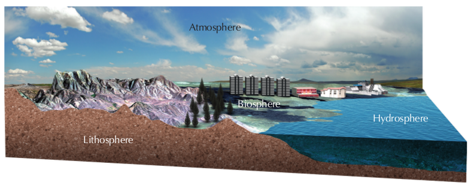

## 8.2 Biosphere (ESG9W)

The biosphere refers to all living organisms on Earth and is often called the global ecosystem. The biosphere interacts with other spheres, such as the lithosphere, atmosphere and hydrosphere. Each of these spheres is discussed briefly below:

- **Biosphere**: is the sphere that includes all living organisms, from plants to bacteria to multicellular organisms.
- **Hydrosphere**: is the combined mass of water found on, under and above the surface of the earth. The hydrosphere is made up of oceans, seas, lakes, rivers and springs. The water in these bodies can be freshwater or salt water. The hydrosphere is home to a wide diversity of aquatic plant and animal life.
- **Lithosphere**: refers to the outermost surface of the Earth, the Earth's crust. The *oceanic lithosphere* is associated with the oceanic crust and exists in oceanic basins. *Continental lithosphere* is associated with continental crust which covers the Earth's landmass. The lithosphere shields living organisms from the heat of the Earth's core and contains ionic compounds which allow plant and animal life to exist.
- **Atmosphere**: is the layer of gases surrounding the earth. The gases in the atmosphere allow organisms to respire and regulates the temperature of the planet. The atmosphere's ability to absorb the ultraviolet rays of the sun is what allows life on earth to survive.

| Spheres on Earth |
| --- |
| Biosphere | Hydrosphere |
| Lithosphere | Atmosphere |

The connections between spheres imply that disturbances in one sphere affect the other spheres. For example, excessive deforestation (biosphere) results in increased erosion of soil (the upper layer of the lithosphere- *pedosphere*) into rivers (hydrosphere). Deforestation also results in an increase in atmospheric carbon dioxide (atmosphere). Deforestation therefore is an example of how disturbances in one sphere produces effects in the hydrosphere, upper-lithosphere and atmosphere.

Figure 8.1: The various spheres within the biosphere are connected.
