## 8.3 Biomes (ESG9X)

In this section learners will focus on summarising the importance of terrestrial and aquatic biomes of Southern Africa. They will study how climate, soil and vegetation influence the organisms found in each. The location of the different biomes in South Africa will also be introduced.

The biosphere is divided up into a number of **biomes**. Biomes are regions with similar climate and geography. The key factors determining climate are average annual precipitation (rainfall) and temperature. These factors, in turn, depend on the geography of the region, such as the latitude and altitude of the region, and mountainous barriers. The specific conditions of biomes determine the plant and animal life found within them. The communities of plants, animals and soil organisms in a particular biome are collectively referred to as an **ecosystem**. Biomes can be **aquatic** or** terrestrial**.

### Aquatic biomes (ESG9Y)

Water covers a major portion of the Earth's surface, so aquatic biomes contain a rich diversity of plants and animals. Aquatic biomes are divided into two main groups depending on the amount of salt present in the water: freshwater and marine biomes.

**1. Freshwater**

Freshwater biomes are defined by their low salt concentration, which is usually less than \(\text{1}\%\).  Examples include: ponds, lakes, streams, rivers and wetlands.

**2. Marine biomes**

Marine bodies are salty, having approximately 35 grams of dissolved salt per litre of water (\(\text{3,5}\%\)). Marine biomes are divided into oceans, coral reefs and estuaries. The vegetation of the marine biomes consists of the different types of algae, which is one of the major sources of oxygen in the world. Green algae also play a role in the removal of carbon dioxide from the atmosphere.

- **Oceans**: are very large marine bodies that dominate the Earth's surface and hold the largest ecosystems. The open ocean or sea covers nearly three-quarters of the earth's surface and contains a rich diversity of living organisms. Examples of animals in the ocean biome include whales, sharks, octopuses, perlemoen, crabs and crayfish. Figure 8.2 shows a typical ocean ecosystem.

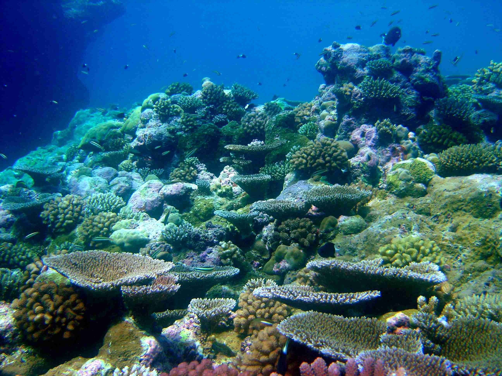

Figure 8.2: Ocean ecosystem.

- **Coral reefs**: are found in the warm, clear, shallow waters of tropical oceans around islands or along continental coastlines. Coral reefs are mostly formed underwater from calcium carbonate produced by living coral. Reefs provide food and shelter for other organisms and protect shorelines from erosion. South Africa has only one coral reef in the subtropical ocean waters north of Lake St. Lucia in northern KwaZulu Natal. Figure 8.3 shows a typical coral reef system.

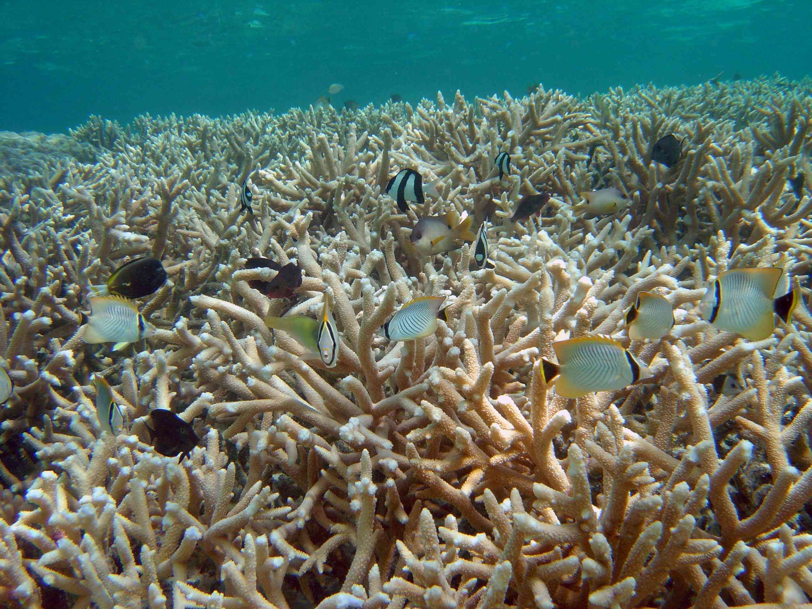

Figure 8.3: Coral reef.

- **Estuaries**: are partially enclosed areas of  fresh water and silt from streams or rivers, which mix with salty ocean water. Estuaries represent a transition from land to sea and from freshwater to saltwater. Estuaries are biologically very productive areas and provide homes for a wide variety of plants, birds and animals. Figure 8.4 shows an example of an estuary system.

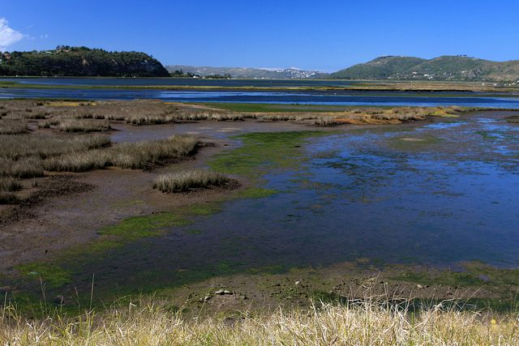

Figure 8.4: Knysna Estuary.

**Marine biomes of South Africa**

South Africa's long coastline stretches for over 3000 kilometres, from Namibia in the West to Mozambique in the East. There are a few key features to note about South Africa's coastline and marine biomes. South Africa's coastline is rugged, as rocky shores are exposed to high wave energy and the coastline generally experiences high wind for most of the year. There are up to 343 estuaries found along the coast, two thirds of which are found on East Coast between Cape Padrone in the Eastern Cape Province and Mtunzini in KwaZulu-Natal. The Eastern coastline receives the highest rainfall, mostly during summer.

South Africa's East Coast has relatively warm waters (20-25 degrees C), the West Coast receives colder Atlantic waters (9-14 degrees C), and the South Coast experiences intermediate water temperatures (16-21 degrees C). The cold Benguela Upwelling System on the South-West coast supports large numbers of marine animals. The warm Agulhas current off the East Coast has a smaller quantity of fish but a greater diversity of species. Abundant opportunities exist for tourism, recreation, food, export and associated economic development.

### Terrestrial biomes (ESG9Z)

Terrestrial biomes occur on land and can be of many types. Examples include: thicket, tundra, forest, grassland and desert. Terrestrial biomes are usually classified based on the dominant vegetation, climate or geographic location. The location and characteristics of the various biomes is mostly influenced by climatic conditions such as rainfall and temperature.

### South African Biomes (ESGB2)

The most recent classification of the terrestrial biomes in South Africa divides the region into the following eight biomes:

1. Grassland
3. Savannah
5. Succulent Karoo
7. Nama Karoo
9. Forest
11. Fynbos
13. Desert
15. Thicket

The biome regions in South Africa are mapped in Figure 8.5.

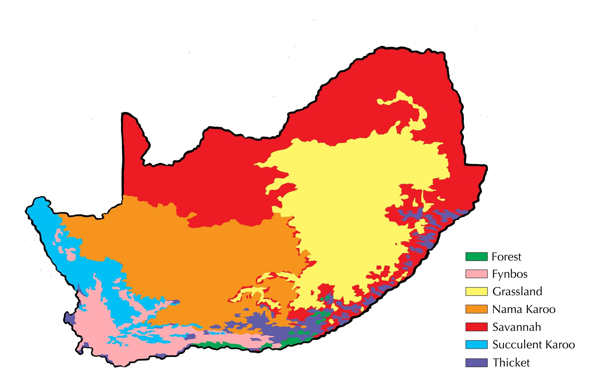

Figure 8.5: Biomes of South Africa.

**1. Grassland Biome**

- **Location**: grasslands are found on the Highveld.
- **Climate**: they typically have summer rainfall of 400 mm to 2000 mm. Winters are cold, and frost can occur.
- **Soil and geography**: in grasslands, the soil is red/yellow/grey or red/black clay. Grassland soil has rich fertile upper layers.
- **Flora**: vegetation is mainly grass, but trees can grow on the hills and along river beds.
- **Fauna**: many types of grass-eating herbivores can be found in this habitat, such as black wildebeest, blesbok and eland. Rodents are also common in grasslands which makes this biome an ideal hunting ground for birds of prey. The diverse plant species also support many plant-eating insects such as butterflies, grasshoppers, crickets and ants.

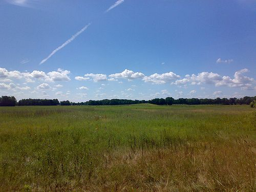

Figure 8.6: Grasslands are regions where the vegetation is dominated by grasses.

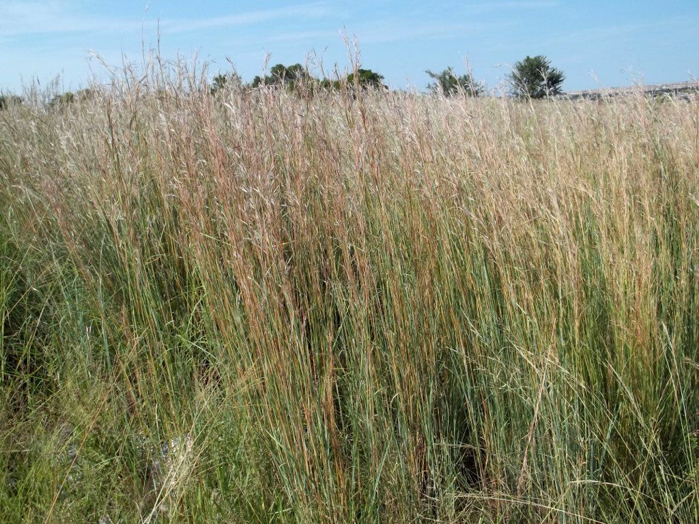

Figure 8.7: Grasslands are regions where the vegetation is dominated by grasses.

## Burning of grassland

### Aim

Compare and analyse the advantages and disadvantages of burning grassland.

### Materials

- Internet
- articles
- books

### Instructions

1. Using these resources, tabulate the advantages and disadvantages of burning grassland.
3. Remember to cite your references correctly.

**Activity: Burning of grassland**

**Answers**

Below are a couple of advantages and disadvantages related to the burning of grassland. However, learners may also come up with different examples, and as long as they can cite their source, their answers should be accepted.

| Advantages | Disadvantages |
| --- | --- |
| Some types of seeds actually germinate better after a fire, as their hard seed pods crack open. | Valuable seeds may be destroyed and then they cannot germinate. |
| Species that were being crowded or overwhelmed by other species have a chance to recolonise. | Animals and plants are injured, damaged or killed. Fire kills indiscriminately and may kill endangered plant / animal species. |
| Plants that grow aggressively (weeds) are restricted. | Organisms in the soil are destroyed, humus is reduced. Loss of nitrogen and sulphur from the soil. |
| Younger plants provide better nutrition (green grass after a severe winter). Fire destroys unpalatable grass  types and allows new palatable (better tasting) grass to grow out. | Grasses are weakened if burning is practised  or occurs at the wrong time. |
| Blackened soil heats up quickly in the sun and speeds up the growth of new plants. | Destroys the soil cover and can lead to erosion. |
| Destroys insect pests, ticks and parasitic worms. | Fires may get out of control and burn useful farmland or endanger lives and property. |
| Phosphate in the ash acts as soil fertiliser and improves plant growth. | Air pollution and smoke may irritate the lungs of people and animals. |

**2. Savannah biome**

- **Location**: the Savannah biome is the largest biome in Southern Africa. It is found mainly in the western parts of Limpopo, the northern parts of the Northern Cape and Free State, the North West Province and KwaZulu Natal.
- **Climate**: summers are hot and wet and the winters are cool with little or no rain. Frost occurs in winter.
- **Soil and geography**: the soil consists of red/black clay or red/ yellow/ grey soil and is often sandy.
- **Flora**: this biome is also known as the bushveld, where grasses are mainly found and regular fires prevent the trees from dominating. Herbaceous plants and woody plants can be found in different areas. Plants are able to withstand fire.
- **Fauna**: big game species such as kudu and Springbok, lion, buffalo and elephant are found in the Savannah Biome. This is also a malaria-prone area.

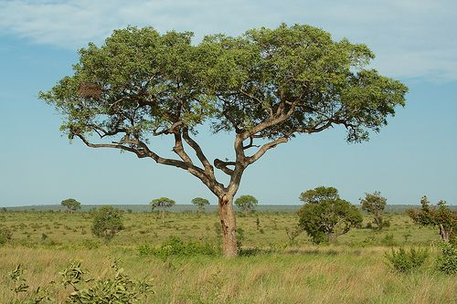

Figure 8.8: Savannah biome.

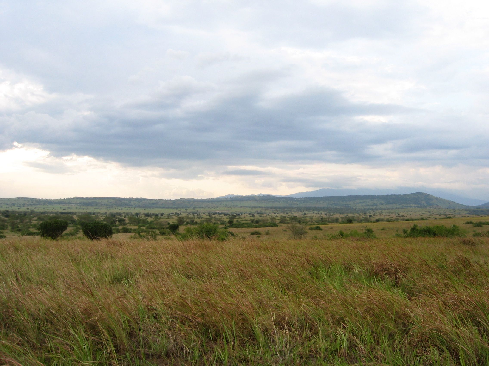

Figure 8.9: Savannah biome.

**3. Succulent Karoo biome**

- **Location**: the Succulent Karoo biome can be found along the west coast of the Northern Cape Province and the northern parts of the Western Cape Province.
- **Climate**: this biome is hot in summer and cold in winter and the rainfall in this area is very low. Fog is common, and frost is seldom severe enough to cause damage.
- **Soil and geography**: lime-rich, weakly developed soils, rocks and sand that is easily eroded.
- **Flora**: forty percent of plant species found here are endemic to this biome. The Namaqualand region of this biome is famous for its colourful wild flowers. Succulent plants are able to live through dry seasons by using water stored in their leaves or stems.
- **Fauna**: insects are common and the plants provide grazing for sheep and goats.

<Callout type="note" title="Note">
The word 'Karoo' comes from the Khoi word *Karusa*, which means dry, barren, thirstland. Karoo is an apt description for this arid region.
</Callout>

**4. Nama Karoo**

- **Location**: the Nama Karoo  is the second largest biome in South Africa. It forms the major part of the Northern Cape Province and the Free State.
- **Climate**: it is regarded as a semi-desert area receiving very little rain. The summers are very hot and the winters are very cold and frost often occurs.
- **Soil and geography**: soil occurring on rocks is weakly developed. The area is also characterised by sands and rocky and red clay, making erosion occur easily.
- **Flora**: it is characterised by grassy dwarf shrub land.
- **Fauna**: the flora provides good grazing for sheep and goats.

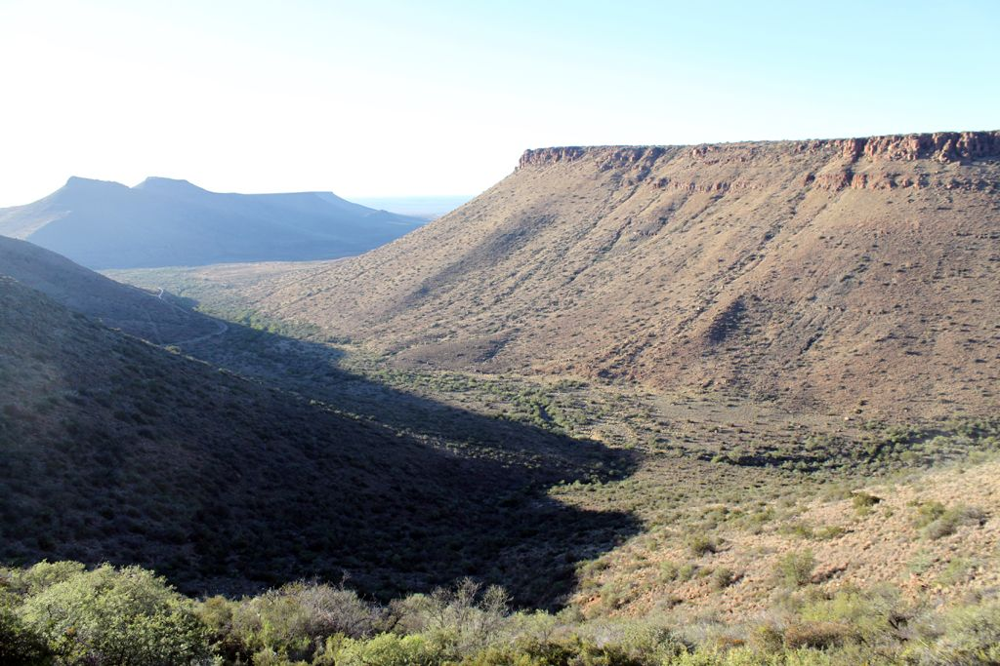

Figure 8.10: Nama Karoo found in the Northern Cape province.

**5. Forest Biome **

<Callout type="note" title="Note">
Trees are not only producers, but as a result of their size they also create a **habitat** for other species. The leaf cover of trees provides **shelter** for animals, while the bark and fissures in the trees also provide a habitat for insects. The leaf cover also creates a shady environment in which shade-loving, low-growing plants can flourish.
</Callout>

- **Location**: the forest biome in South Africa occurs in patches, in areas such as Knysna of the Western Cape as well as KwaZulu Natal, the Eastern Cape, Limpopo and Mpumalanga.
- **Climate**: some of these forests experience rain only in winter, while others get rainfall throughout the year.
- **Soil and geography**: forests range in altitude from sea level to above 2000 metres, soil is drained and virtually all soil types are present.
- **Flora**: forests are dominated by trees of which the Yellowwood is the largest. There are many herbaceous and bulbous plants that also occur.
- **Fauna**: numerous insect species, birds ans small mammals such as bushpig, bushbuck and monkeys. The canopy is a perfect habitat for birds such as the Knysna Loeries, pigeons and eagle.

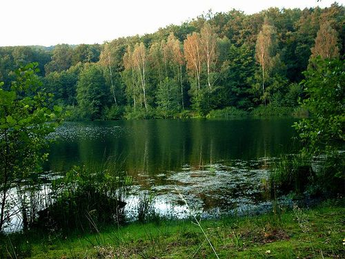

Figure 8.11: Forest biome.

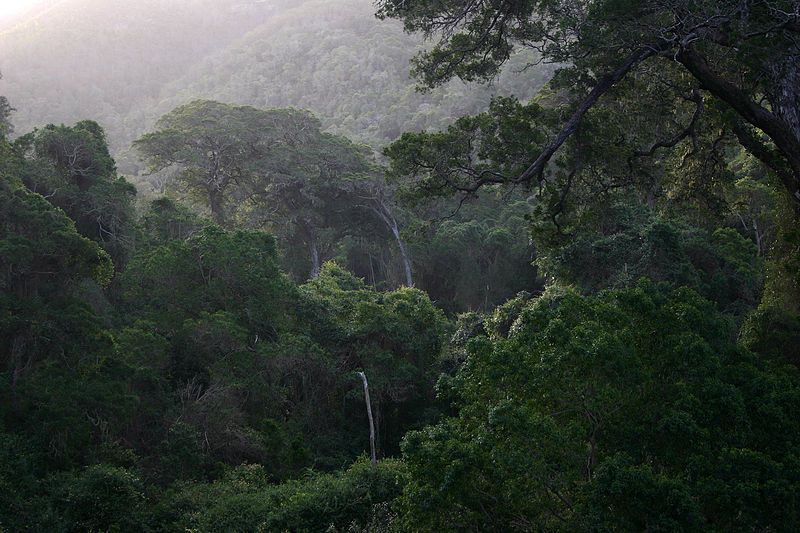

Figure 8.12: Knysna Forest.

<Callout type="note" title="Note">
When leaves or fruit fall from the trees and collect at the feet of the trees, another series of organisms can appear. By breaking down organic material, decomposers such as microorganisms return the organic nutrients to the soil. Humus is formed in this way. Humus is dead organic material. Other creatures that live off decayed organic material, namely the detritivores, also promote this process of decomposition by breaking up dead plant matter into its component nutrients.
</Callout>

## Poster project to illustrate the role players in a forest ecosystem

### Instructions

1. Bring pictures of animals, trees and other plants to class.
3. The teacher will divide the class into groups.
5. Each group will prepare a poster to illustrate the mutual dependence of the trees, other plants and animals.
7. Each group must present their poster to the rest of the class.
9. Answer the following questions / follow the instructions arising from the class discussion:

### Questions

1. Supposing the tree on your poster was to fall over.
   - Which organisms would die?
   - Which organisms would move away?
   - Which organisms would increase in number?
3. Describe the role played by trees in an ecosystem.
5. Ecologically speaking, why is it bad practice to rake up leaves under trees?
7. Name three more examples where humans harm ecosystems.
9. Identify components of the ecosystem, including each trophic level. Represent this in the form of a diagram.

**Project: Create a poster to illustrate the key role-players in a Forest Ecosystem**

The answers to the questions will depend on the poster the learners have done. Each poster should have different answers to the questions.

**Questions**

1. Supposing the tree on your poster was to fall over.
   - Which organisms would die?
   - Which organisms would move away?
   - Which organisms would increase in number?
3. Describe the role played by trees in an ecosystem.
5. Ecologically speaking, why is it bad practice to rake up leaves under trees?
7. Name three more examples where humans harm ecosystems.
9. Identify components of the ecosystem, including each trophic level. Represent this in the form of a diagram.

**Answers**

1. If the tree falls:
   - The following organisms would die:
     - Probably the tree itself, if it was still alive.
     - Also young birds in nests in the tree.
     - Anything on which the tree falls.
   - The following organisms would move away:
     - Adult birds that were nesting or sleeping in the tree.
     - Any animals that used the tree as a food source or habitat.
     - Animals in the immediate vicinity of the tree (for a short while, anyway).
   - The following organisms would increase in number:
     - Fungi and bacteria that would decompose the fallen tree.
     - Ants and termites, that may use the dead tree as food source.
     - Probably mosses and lichens that may grow on the surface of the tree.
     - Smaller green plants in the area, as they would now get more sunlight.
3. The role played by trees in an ecosystem:
   - Play a role in the gas balance of the atmosphere (remove \(\text{CO}_{2}\) and produce \(\text{O}_{2}\)).
   - Form a habitat for many animals, e.g. squirrels, insects and birds.
   - Many trees form fruits that act as a food source for animals, while leaves are eaten by herbivores. Nectar is eaten by bats, birds and insects.
   - Provide shade and shelter against hail, sleet, snow and rain.
   - Prevent soil erosion by holding back soil when it rains
   - Thick stands of mangrove trees prevent much of the damage caused by tsunamis.
   - They provide a screen against harsh winds
   - Fallen leaves decompose to form compost, enriching the soil.
   - Trees absorb much water and reduce surface runoff, allowing soil water sources to replenish slowly.
   - There are several other learner-dependent answers.
5. Leaves should be left to decompose slowly, releasing nutrients into the soil. This provides fertiliser to enrich the soil with humus and recycles nutrients in nature.
7. Examples where humans harm ecosystems:
   - Uncontrolled burning / accidental damage to ecosystems.
   - Deliberate burning as a form of deforestation.
   - Pollution in all its forms, including litter.
   - Noise due to people, machines and vehicles unsettles animals.
   - Planting invasive alien plants / not removing them from ecosystems destroys the natural species balance of an area.
   - Monoculture removes biodiversity, e.g. on farms / golf estates
   - There are several other learner-dependent answers.
9. Learner dependent answer. This may be shown as a food pyramid.

<Callout type="note" title="Note">
The Fynbos contains approximately \(\text{75}\%\) of South Africa's rare and threatened plants.
</Callout>

**6. Fynbos**

- **Location**: fynbos is the natural shrub found in the Western Cape of South Africa.
- **Climate**: characterised by cold, wet winters and hot, dry summers (Mediterranean climate conditions).
- **Soil and geography**: poor, acid and coarse-grained soil.
- **Flora**: fynbos is widely known for its widespread biodiversity. Important plant types found in the fynbos include proteas, 'silver trees' and 'pincushions'. Plants growing here do not lose their leaves. Proteas have striking flowers. It has the highest fynbos variety in the world, with over 9000 species of fynbos found here.
- **Fauna**: fynbos is home to many bird species, insects and small mammals.

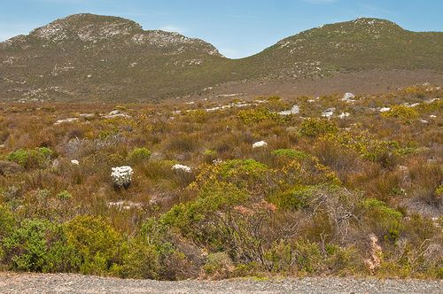

Figure 8.13: Mountain Fynbos found in Western Cape.

The flora of the fynbos has a high degree of **endemism**. This is the ecological state of being specific to a geographic location such as an island, country or in this case, a defined biome such as the fynbos.

Fire is a necessary stage in the life-cycle of nearly all fynbos plants, and is common during the dry summer months. Many of the seeds germinate only after the intense heat of a fire. As proteas 'prepare' for the fire, they retain their seeds on the bush for at least a year, a habit known as **serotiny**.

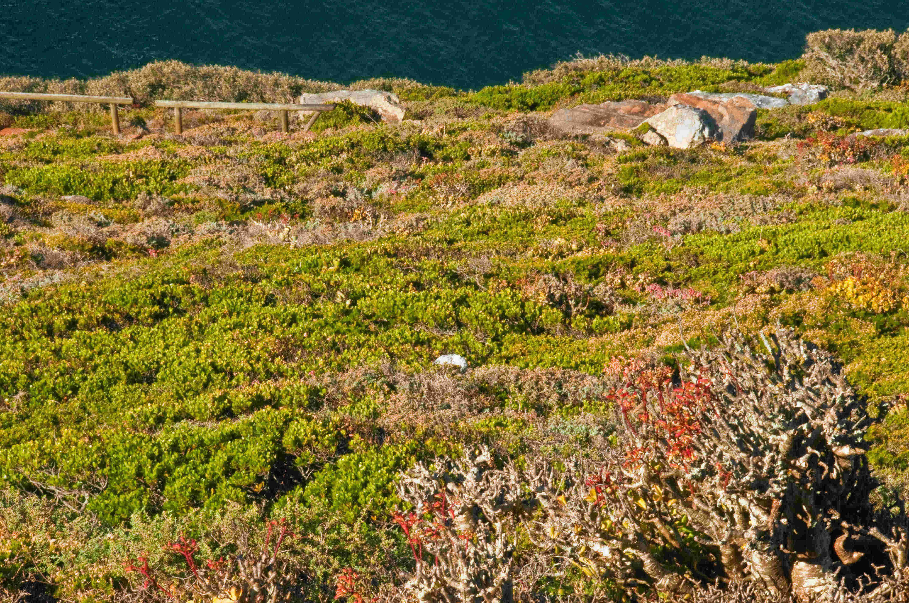

Figure 8.14: Fynbos in Cape Peninsula.

The lowlands of the fynbos have been developed for agriculture and wine farming. Due to this, various species of fynbos have been threatened. For this reason, the fynbos region must be protected and preserved. It is a major tourist destination.

## Discovering fynbos in South Africa

The astonishing richness and diversity of the Western Cape's natural resources is matched only by the resourcefulness and diversity of its many people. Historical patterns of unsustainable use of resources have led to the Cape Floristic Region (CFR) being listed as one of the world's threatened bioregions, and the scars are deeply etched in the land and its people.

Western Cape residents are exploring new and sustainable ways to value and benefit from these globally important assets.

South Africa's Cape Floristic region is legendary, and the unique nature of the **fynbos** biome has been celebrated by biologists, conservationists, development experts, and ecologist worldwide.

*(Adapted from speech by Tasneem Essop the Western Cape Provincial Minister for Environment, Planning and Economic Development)*

Write an essay on the **fynbos biome** and discuss the following aspects:

- What is the meaning of the term “fynbos”?
- Identify features of families/ indicator species that make up this vegetation type.
- Describe its ecological role in the environment.
- Describe the environmental impacts of destroying this type of vegetation.
- Describe the economical importance of fynbos for the people of the Western Cape.
- Describe management strategies involved in protecting it.

Your essay may be **written** or **typed**. Marks will be awarded for originality and own interpretation. Include a bibliography of three of more resources. **No marks** will be awarded for plagiarism.

**Project:  Learners to write an essay on the fynbos using the source information provided**

Write an essay on the **'Fynbos'** biome and discuss the following aspects.

- What is the meaning of the term “fynbos”?
- Identify features of families/ indicator species that make up this vegetation type.
- Describe its ecological role in the environment.
- Describe the environmental impacts of destroying this type of vegetation.
- Describe the economical importance of fynbos for the people of the Western Cape.
- Describe management strategies involved in protecting it.

Essay may be **written  or typed**. Marks will be awarded for originality and own interpretation. Include a bibliography of three of more resources.

The exact content of such an essay cannot be specified and is up to the individual teacher. The following may serve as a guideline only:

**Fynbos Biome**

**Definition**

Fynbos is the natural shrubland or heathland vegetation occurring in a small belt of the Western Cape of South Africa, in coastal and mountainous areas with a Mediterranean climate. The soil is acidic and nutrient-poor, while the climate is marked by cold wet winters and hot dry summers. It is the smallest of the world's six floral kingdoms.

**Indicator Species**

Small, fine-leafed, low-growing and tough evergreen plants. Fynbos includes legumes and bulbous plants (like *Watsonia* spp. and chincherinchees), but the three main indicator groups are **Ericas, Restios** and **Proteas **.

1. **Ericas**
    Ericas are related to European heathers - over 600 species, of which 100 rely on sunbirds for pollination. All are noted for their flowers. These are either open or closed bells or tubes that vary from a pinhead to about 6cm. Most are small, some are smooth, some hairy and some covered in a sticky secretion. Colours cover the spectrum, except for blue.
3. **Restios**Restios are reed or rush-like plants. They are found in dense stands in areas of poor drainage. Being hardy, they are not grazed, but locals harvest them for thatching.
5. **Proteas**
   Proteas are among the oldest flowering plants and come in many shapes and sizes. The most familiar are the Sugarbushes, with up to a hundred small flowers clustered together to create magnificent heads of various sizes. This also includes Conebushes, notably the widespread Geelbos and the Sunshine conebush, which grows only on the windswept salt flats. Pincushions, the third genus in the group, may be tiny, low-lying and inconspicuous or large, tree-like plants. They produce a jelly-like substance irresistible to ants.

**Ecological role**

This biome can’t support large animals due to lack of enough nitrogen, but the area has many smaller animals like baboons, klipspringers, grysbok, dassies, mongooses and mice. Many endemic sunbirds are found here, also highly endangered butterfly species, like those whose larvae actually eat ants and live inside the ant colonies. The geometric tortoise, the world’s second rarest tortoise, is found only here, as well as several endangered frog species.

**Biological impact of destruction**

Again, possible answers vary widely. They should mention the loss of biodiversity, the threat to our natural heritage, possible cures for disease in plants that have not yet been studied scientifically, the loss of ecotourism and the jobs / income associated with this, the fact that extinction is forever and cannot be reversed, etc.

**Economic impacts of this area for people**

- Products such as rooibos tea and honeybush tea are grown here.
- Buchu  plants provide oil for medicines and perfume.
- Many fynbos flowers are exported in fresh / dry form, as they last so long.
- Area provides recreational and relaxation opportunities.
- Huge numbers of research opportunities exist in the fynbos area.
- The natural beauty of the area cannot be overemphasised.
- There are several others – accept anything relevant.

**Management strategy and Protection**

- Removal of alien plants like pine trees, prickly pears, Australian blue gums and *Acacia* species.
- No developments like roads / power lines may happen here without approval.
- No agriculture will be allowed.
- No picking of flowers or removal of any plant parts.
- Encourage ecotourism to generate income and create jobs.
- Discourage the sale of curios, like shells of geometric tortoises for key rings.
- Several other relevant points may be accepted.

Below is a list of other miscellaneous facts that students may choose to include in their essays:

- Fynbos, meaning "fine bush", is a unique and strikingly beautiful group of flora endemic to a small section of the Western Cape of South Africa.
- Fynbos grows in a 100-to-200-km-wide coastal belt stretching from  Clanwilliam on the West coast to Port Elizabeth on the Southeast coast. It forms part of the Cape floral kingdom, where it accounts for half of the surface area and \(\text{80}\%\) of the plant varieties.
- The fynbos in the western regions is richer and more varied than in the eastern regions of South Africa.
- Of the world's six floral kingdoms, this is the smallest and richest per area unit. The diversity of fynbos plants is extremely high, with over 9000 species of plants occurring in the area, around 6200 of which are  endemic, i.e. they do not grow anywhere else in the world.
- Soil is made of rock and sandstone.
- Fire is required for seed germination and is also important to clear accumulated growth.
- Ants are important for seed dispersal and birds assist in pollination.
- Other animals found in the fynbos biome are the cape golden mole, geometric tortoise and ostrich.

**No marks** should be awarded for plagiarism.

**7. Thicket**

- **Location**: the thicket biome occurs along the coasts of KwaZulu Natal and the Eastern Cape.
- **Climate**: thickets develop in areas where the rainfall is fairly high; however, there may be dry periods that prevent the vegetation from developing into forests.
- **Soil and geography**: most thickets occur in river valleys.
- **Flora**: the vegetation of this biome includes short trees, low intertwining shrubs and vines. There are no distinct layers of trees and shrubs, with many large open spaces found in the thicket biome. Thickets in the Eastern Cape are comprised of dense impenetrable vegetation dominated by spiny, often succulent trees and shrubs.
- **Fauna**: examples of fauna found in thicket include kudu, monkey, bushbuck and elephant.

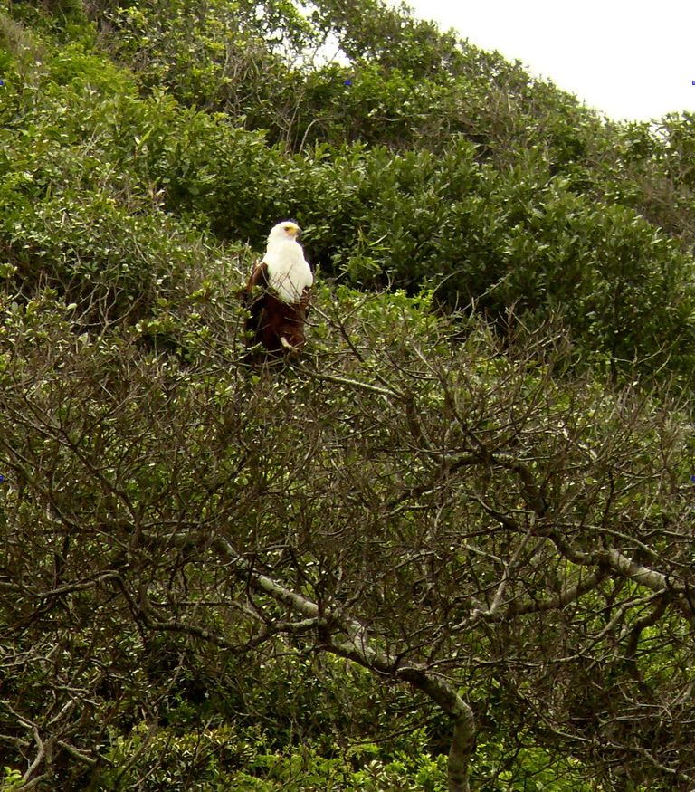

Thicket vegetation near Uitenhage, Eastern Cape.

**8. Desert Biome**

- **Location**: the Desert Biome is found largely in the Namib Desert along the coast of Namibia. The transition regions between deserts and grasslands are sometimes called semi-arid deserts.
- **Climate**: deserts are dry areas where evaporation usually exceeds precipitation. Rainfall is low, less than 25 centimetres per year, and can be highly variable and seasonal. The low humidity results in temperature extremes between day and night. Deserts can be hot or cold. Hot deserts (e.g. the Namib and Kalahari) are very hot in the summer and have relatively high temperatures throughout the year and have seasonal rainfall. This combination of low rainfall and high temperatures keeps the air very dry, increasing its evaporating power.
- **Soil and geography**: the soil consists mostly of sand, gravel or rocks.
- **Flora**: deserts have relatively little vegetation.
- **Fauna**: many insects and reptiles (lizards and snakes) occur in the desert biome.

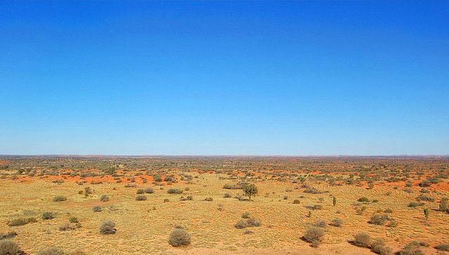

Figure 8.15: Kalahari desert.

<Callout type="note" title="Note">
Did you know that most of the animals in the desert can live without water for a long time? They have adapted in many ways to do this. For instance, they can store water internally, take water out of their prey, or peck at succulents and suck out the water stored inside them.
</Callout>

## Biomes Advertisement

### Aim

Getting to know the biomes of South Africa.

### Materials

- posters
- maps
- reference books
- adverts
- brochures
- Internet

Study some advertisements for ideas.

### Instructions

You work for an Advertising Agency that is bidding for the account of a top travel agency. The bid includes designing a full page advert (A4) for the *Getaway* Magazine. Presentation, appeal and accuracy will therefore be of top priority.

The travel agency has specified that they would like the following to be included in the ad, which is geared towards people looking for a different and fascinating holiday in a **specific biome**:

- A region in the biome of your choice, including cities and/or towns worth a visit
- Climate (of interest to tourists)
- Well-known geographical features in the region
- Mention of some interesting wildlife (i.e. birds, animals, plants) that may be seen
- Pictures
- Tour dates
- The name of the travel agency, with contact information

**Biomes Advertisement**

This is an optional activity that teachers may include if they want to. Assessment will be based on the fulfilment of the criteria given and may require the assistance of a member of the Language and /or Art department of the school, to ensure that the adverts are assessed for scientific accuracy, as well as artistic appeal and visual impact. It is recommended that a rubric be drawn up to guide assessment, such as the example given below. The teacher just ticks the relevant box and allocates the mark above that column:

Rubric to asses the biome poster

| Criteria to be assessed | 3 | 2 | 1 | 0 |
| --- | --- | --- | --- | --- |
| Name of biome: Assess for impact and relevance (2) | X |  |  |  |
| Climate: Clearly and accurately described (3) |  |  |  |  |
| Geographical features: Accuracy and relevance taken into account (3) |  |  |  |  |
| Wildlife: Accuracy, not overly detailed, flora AND fauna (3) |  |  |  |  |
| Pictures: – important: double marks Assess colour, layout, clarity, size, relevance, captions given (6) |  |  |  |  |
| Tour dates: Clearly indicated, all details present, correct size (3) |  |  |  |  |
| Agent details: All given? Check carefully! (3) |  |  |  |  |
| Overall impression: (2) | X |  |  |  |

**Total out of 25 marks:**

## Biome Poster

The following activity is to be done in groups of **four**

**Instructions**

1. Brainstorm a suitable set of criteria for assessment for poster and verbal report
3. Select **one** biome from the list given and do the following:
5. Use suitable references to obtain as much information as possible on the plants and animals found in your selected biome.
7. Make notes about the climate, landscape, flora and fauna, stating how some of these are adapted to their environment.
9. **Design** an attractive poster to illustrate the landscape as well as the dominant plants and animals that make up a food chain.
11. **Display** your poster on the classroom wall and each person of the group is to give a verbal presentation on an aspect of the biome you studied.

**Biome Project**

It is suggested that a rubric similar to the above be drawn up for assessment of the project. Such rubrics go a long way in standardising the assessment for different projects and they ensure that learners are given adequate feedback about what was correct / wrong about their project.

All teachers who have learners in this grade should come together and have a brainstorming session themselves, deciding on what the criteria are they will assess and what aspects will be taken into account within each criterion. The more clearly the criteria and sub-topics are defined in the beginning, the better.  This cannot be over-emphasised.

It should be made clear to learners that group work DOES NOT involve one or two members doing all the work and others sitting back as spectators. ALL of them have to get involved and make a contribution to the project. The teacher may ask that they allocate specific tasks, e.g.

- ALL: Decide on which biome to select and compile the food chain at the end.
- Person 1: Collect pictures and information on plants of the area.
- Person 2: Collect pictures and information on animals of the area.
- Person 3: Collect pictures and information on climate and landscape.
- Person 4: Design the poster and put it together.
- ALL: Each member gives a verbal report on one aspect of this biome (max 1-2 minutes each).
