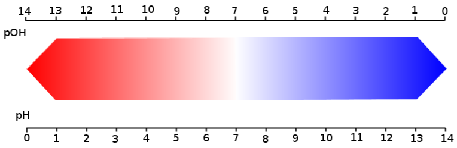
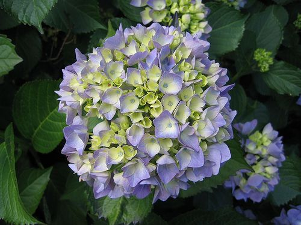

## 8.5 Ecosystems (ESGB4)

<Callout type="note" title="Note">
Ecology- rules for living on Earth

<VideoPlayer src="https://youtu.be/izRvPaAWgyw" title="Video: 2CVR" />
</Callout>

**TEACHER RESOURCES: **

- INTERACTIVE QUIZ: This link is useful for consolidating the concepts of ecology.
- INTERACTIVE QUIZ: This link is useful for consolidating the concepts of ecosystems.
- In this exercise, you will utilise an online calculator to examine your ecological footprint, compare it to the average footprint in your country and other countries, and critically examine ways to reduce it.
- Video that examines the types of interactions that exist among organisms in a community, from competition between consumers for specific resources to the relationship between predators and prey.
- In this Interactive Exercise, you will use a marine ecosystem to investigate the dynamic nature of ecosystems. You will explore the various regions of the bay, and then investigate some of the natural and human-imposed changes to which the bay responds.
- The study of the interaction between organisms and their environment

An ecosystem is a complex system that consists of all the living organisms in a particular area, as well as the environment with which the organisms interact. The living organisms and non-living components of the ecosystem interact in such a way as to maintain balance. Ecosystems are divided into **biotic** (living) and **abiotic** (non-living) components respectively.  Each component is discussed in detail below.

<Callout type="note" title="Note">
Learn more about biotic and abiotic components:

<VideoPlayer src="https://www.youtube.com/watch?v=woSO0D94VGA" title="Video: 2CVS" />
</Callout>

### Biotic components (ESGB5)

Biotic components are living things that shape the ecosystem. Each biotic factor needs energy to do work and for proper growth. To get this energy, organisms either need to produce their own energy using abiotic factors, or interact with other organisms by consuming them. Biotic components typically include:

- **Producers**: also known as **autotrophs** include all green plants. Producers make their own food using chemicals and energy sources from their environment. The producers include land and aquatic plants, algae and microscopic phytoplankton in the ocean. **Plants** use photosynthesis to manufacture sugar (glucose) from carbon dioxide and water. Using this sugar and other nutrients (e.g. nitrogen, phosphorus) taken up by their roots, plants produce a variety of organic materials. These materials include starches,lipids, proteins and nucleic acids.
- **Consumers**: are also known as **heterotrophs**. They eat other organisms, living or dead, and cannot produce their own food. Consumers are classed into different groups depending on the source of their food. **Herbivores** (e.g. buck) feed on plants and are known as *primary consumers*. **Carnivores** (e.g. lions, hawks, killer whales) feed on other consumers and can be classified as *secondary* consumers. They feed on primary consumers. *Tertiary consumers* feed on other carnivores. Some organisms known as **omnivores** (e.g.crocodiles, rats and humans) feed on both plants and animals. Organisms that feed on dead animals are called **scavengers** (e.g., vultures, ants and flies). **Detritivores** (detritus feeders, e.g. earthworms, termites, crabs) feed on
  organic wastes or
  fragments of dead organisms.
- **Decomposers**: (e.g. bacteria, fungi) also feed on organic waste and dead organisms, but they can digest the materials outside their bodies. The decomposers play a crucial role in recycling nutrients, as they reduce complex organic matter into inorganic nutrients that can be used by producers. If an organic substance can be broken down by decomposers, it is called *biodegradable.*

### Abiotic components (ESGB6)

Abiotic components are the non-living chemical and physical factors in the environment that affect ecosystems. Abiotic components play a crucial role in all of biology. Abiotic factors are broadly grouped into **physiographic**, **edaphic** and **climactic** factors and **atmospheric gases**.

**1. Physiographic factors**

Physiographic factors are those associated with the physical nature of the area. The main physiographic factors we will look at are slopes, aspect and altitude.

- **Slope**: is the gradient or steepness of a particular surface of the Earth. The slope affects the rate of water run-off. A steep slope encourages fast run-off of water and can cause soil erosion. The soil tends to be shallow and infertile with reduced plant growth. Plants are small and few animals are present. A gentle slope favours slower flow of surface water, reduces erosion, and increases availability of water to plants. The direction and steepness of a slope also influences the surface temperature of the soil.
- **Altitude**: is the *height* of the land above sea level. At high altitudes the temperature is lower, the wind speed is greater, and the rainfall less. Environments at higher altitudes are also more likely to experience snow conditions. Altitude plays a role in vegetation zones. At high altitudes, less  plant and animal species are found. Plants growing at mid-altitudes experience more stunted growth. Plants at sea-level are abundant.
- **Aspect**: refers to the position of an area in relation to the sun or wind or wave action. It is the direction that the slope faces i.e. North, East, West. In South Africa rain fall is more common on the south-eastern slopes, therefore these tend to be forested or rich in vegetation. The slopes facing the other way (north west) tend to be drier.

**2. Edaphic factors**

Edaphic factors are those factors related to the soil. The qualities that may characterise the soil include drainage, texture, or chemical properties such as pH. Edaphic factors affect the organisms (bacteria, plant life etc.) that define certain types of ecosystems. There are certain plant and animal types that are specific to areas of a particular soil type. The particular factors we will consider include the pH of the soil and soil structure.

- **pH of soil** is a measure of how acid or alkaline soil is and can be measured by using the pH scale. The pH scale ranges from 0 to 14. Neutral solutions have a pH value of 7. Acid solutions have a pH value of less than 7 and alkaline solutions have a pH value greater than 7. Litmus paper or  universal indicator can be used to determine whether a solution is acid or alkaline.

Figure 8.16: pH scale for soil.

<Callout type="note" title="Note">
Did you know that some species of Hydrangea flowers are natural pH indicators? The flowers of the *Hydrangea macrophylla* and *Hydrangea serrata* cultivars, can changes colour depending on the relative acidity of the soil in which they are planted. In an acidic soil with a pH below 7, the flowers will usually be blue. However in an alkaline soil with a pH above 7, the flowers will be more pink. Moving the plant from one soil to another results in a change in flower colour if the pH of the soil is different (see Figure 8.17).
</Callout>

Figure 8.17: Hydrangeas.

- **Soil Structure**: the decomposed organic matter, called humus gives topsoil its dark colour. It supplies plants with nutrients and helps the soil retain water. Soils rich in humus are fertile soils. The specific soil type is determined by the size of particles e.g sand has very large sized particles, clay has very small sized particles and loam has a mixture of particle sizes. If you roll moist soil between your fingers, clay soil feels sticky, sandy soil feels gritty and loam soil feels soapy. The water retention capacity of soils is the ability of soil to retain different amounts of water. Clay soil retains a large amount of water. Sandy soil retains very little water. Loam soil retains a moderate amount of water.

## Investigating the water-retaining properties of soil

### Aim

To investigate the water retaining properties of three soil types.

### Apparatus

- loam, sand and clay soil samples
- filter funnels and filter paper
- measuring cylinders
- water
- stop watches

### Method

1. Set up the three different 100 ml measuring cylinders, each with a funnel lined with filter paper.
3. Label each of the measuring cylinders either loam, sand or clay.
5. Add the same amount (e.g 50 gm) of each specific soil  sample to the corresponding labelled funnel with filter paper.
7. Carefully pour the same amount (50 ml) of water into each funnel.
9. Immediately start the stopwatch.
11. Allow the water to pass through the soil sample.
13. Wait until the water is no longer dripping into the cylinder before you record the time for each soil type.
15. Record how much water there is in the measuring cylinder.

### Results

1. Write down your results in a table:
   1. The time taken for the water to pass through the soil.
   3. The amount of water in the measuring cylinder.
3. Draw a bar graph to represent your results.

### Observations

1. Which sample of water retained the most water?
3. Which sample of water retained the least water?
5. Is the speed at which the water drains related to the amount of water that gets retained? Describe the relationship using your results.

### Conclusions

Explain your observations. Try to describe three properties that result in the different water-retaining capacities of different soil types. Use your experimental results to recommend which soil would you use for your pot plants.

**Investigation: to investigate the water retaining properties of three soil types**

This activity may be counted towards one of the investigations in the term project. Learners should bring soil samples from their chosen ecosystem to test in addition to the sand, loam and clay samples provided.

**Results**

This is easily shown as a table. Learners can copy this table before they start the investigation:

Table showing drainage and water retention of three different soil types:

| Soil type | Volume water poured into soil sample (ml) | Volume of water that ran into cylinder (ml) | Volume of water retained by soil (ml) | Time for complete drainage of water (sec) |
| --- | --- | --- | --- | --- |
| Sand |  |  |  |  |
| Loam |  |  |  |  |
| Clay |  |  |  |  |

Bar Graph comparing the water retention capacities of of three soil types:

Learners should draw a bar graph to show the amount of water retained by the three types of soil. They may also choose to draw a second bar graph showing how quickly each soil-type drained. One would expect clay to retain the most water, and sand to retain the least.

**Observations**

Questions

1. Which sample of water retained the most water?
3. Which sample of water retained the least water?

Answers

1. Clay retained the most water.
3. Sand retained the least water.
5. Clay soil drains the slowest and retains most water – very little runs through it; sandy soil drains very quickly and retains little water – most water runs through it; loam soil is intermediate – it retains a medium amount of water and drains a moderate amount. Therefore, it appears that the greater the water-retaining capacity of the soil, the slower water drains through it.

**Conclusions**

Three reasons for the difference in the water retention capacities of the soil types include:

1. size of the soil particles
3. air spaces between the particles
5. the amount of organic matter (humus)

- Clay soil has small particles and tiny air spaces, so it easily becomes waterlogged (muddy) and holds very little air for plant growth.
- Sandy soil has large particles and big air spaces, so it cannot retain much water. It dries out very quickly after rain, as soon as the sun shines on it.
- Loam soil has medium sized particles or a mixture of particle sizes. It retains a fair amount of water and does not become waterlogged easily. It also does not dry out very quickly.

Loam is the best soil for plant growth because it retains a  fair amount of water but doesn't become water logged.

**ALTERNATIVE METHOD:**

1. Place 30 g of each soil type in a filter funnel which is lined with filter paper.
3. Place each funnel on top of a 100 ml measuring cylinder.
5. Pour 50 ml of water into each funnel (slowly until all the water has been added to the soil).
7. Leave to stand for 2 minutes - record how much water is in the measuring cylinder.
9. After a further 2 minutes record any change to the amount of water in the cylinder.
11. After a further 2 minutes record any changes to the amount of water in the cylinder.
13. Record your results in a table. Add an extra column in which you calculate the amount of water retained.

| Variable | How controlled |
| --- | --- |
| Amount of water Amount of soil Time of experiment | 50ml with measuring cylinder 30g with electronic scale 2 minute intervals with watch/clock |

**3. Climatic factors**

- **Sunlight**: is essential for the process of photosynthesis. Producers, such as plants, rely directly on the sun. Heterotrophs, such as animals, use light from the sun indirectly by consuming plants or other heterotrophs. All organisms receive the energy required for survival through the break down of sugars and other molecular components that are produced by the autotrophs. These sugars are then broken to release the energy stored in them, by the process of cellular respiration.
- **Temperature**: varies greatly across different parts of the Earth and throughout the year. Temperature affects the rate of evaporation and transpiration and causes seasonal changes in weather. Seasonal variation in vegetation also occurs as the germination of seeds requires warm temperatures. Plants and animals have special adaptations that make them suited to the temperature of their specific environment. Temperature affects the rate at which photosynthesis, cellular respiration and decomposition take place. As you learnt in the earlier section on enzymes, this is linked to the optimal temperature profile for enzymes. The rate of reaction increases with increasing temperature and decreases at lower temperatures.
- **Water**: is one of the most important factors in the ecosystem. It is the main component of living cells and is essential for all living organisms. About \(\text{80}\%\) of the human body and \(\text{90}\%\) of the plant body consists of water. Water is not evenly distributed over the Earth. It is abundant in aquatic ecosystems and least abundant in deserts. Plants are adapted to the available amount of water in the following ways:
  - **Xerophytes** are plants that are able to live in dry habitats, or in regions with low annual rainfall. These plants are resistant to drought, have to cope with a shortage of water, high temperatures and light intensities and dry warm winds. We discussed in detail the adaptations developed by xerophytes in order to avoid water loss in the earlier chapter on plant structure.
  - **Mesophytes** are plants that need an average, regular supply of water.
  - **Hydrophytes** are plants that are able to live entirely or partially submerged in water or in very wet soil. These plants have to cope with a water surplus.

**4. Air/gases**

- **Wind**: speeds up evaporation and assists in pollination of plants and the dispersal of their seeds.
- **Air**: is composed of \(\text{78}\%\) nitrogen, \(\text{21}\%\) oxygen, \(\text{4}\%\) carbon dioxide and water vapour. Look ahead to the section on nutrient cycles to read more detail. Oxygen is used in cellular respiration and combustion and is returned to the environment by the process of photosynthesis. Carbon dioxide is a product of cellular respiration and decayed organic matter. It is removed from the atmosphere by plants during the process of photosynthesis. Nitrogen is needed by all living organisms for the synthesis of proteins. The amount of water vapour found in the air remains constant on average, however, it can vary greatly from one place to another. Some parts of the earth are prone to high humidity levels, while other locations have very dry air. Much of what we consider weather is caused by water vapour. The clouds in the sky are largely made up of it, and it is the condensation of this vapour into droplets that creates
  rain and snow.

<Callout type="note" title="Note">
Endothermic animals are able to regulate their body temperature so they are not affected by extreme temperatures, and are able to live in habitats over a wide range of temperatures. In cold regions, animals have developed a layer of insulating fat, or hibernate during the colder months. In very hot regions, animals have adapted by becoming nocturnal in their habitats. Ectothermic animals are unable to regulate their body temperature, and therefore the change in environmental temperature will affect their distribution and activities.
</Callout>

<Callout type="note" title="Note">
In Northern Hemisphere countries where the day length is substantially longer in the summer, the rate of growth of plants is very high.
</Callout>

## Identifying abiotic, biotic and cultural characteristics of a natural environment

### Aim

Identify abiotic, biotic and cultural characteristics of a natural environment near you.

### Instructions

1. Select an area that is undeveloped (e.g. no buildings, no pavement, no bulldozing, no spraying of pesticides, no farming, no grazing, etc.). Your area must be at least the size of a soccer field. Make a map of your province and show, approximately, where your area is located.
3. Identify at least 10 abiotic features of your area. Consider factors such as:
   - Edaphic factors
   - Physiographic factors
   - Physical factors
5. Identify at least 15 biotic features of the area. Consider things such as:
   - Plants (trees, shrubs, grasses, flowers etc.)
   - Insects (ants, bees, praying mantis etc.)
   - Amphibians, reptiles, and/or fish
   - Mammals
7. Identify at least 3 cultural components. Look for evidence of human influence. Consider things such as:
   - Recycling and conservation efforts
   - Pollution
   - Introduced species

### Analysis

Examine the data you collected when making your profile of your area. Use your collected data to answer the following questions. Discuss your answers afterwards in your group/with your partner.

1. What effect does the environment (abiotic) have on the organisms (biotic) living there? Give FIVE specific examples from your profile. *For example: Lily pads (biotic) are able to grow in my area because it is a natural wetland that has standing, stagnant water (abiotic) all year long. *
3. What effect do the organisms (biotic) have on the environment (abiotic)? Give THREE specific examples from your profile. *For example: The area is heavily shaded by spruce trees (biotic). The shade keeps the soil moist (abiotic) and reduces the air temperature.*
5. How do natural forces affect the area? Give ONE specific example from your profile. Consider the direction of the prevailing winds, the direction from which the sun's rays come, gravity (if you are on a slope) etc.
7. Predict how your area would change if the amount of rainfall doubled. Be sure to mention how this increase in rainfall would affect the abiotic and biotic factors.
9. How have humans affected your area (cultural)? Give ONE specific example.

**Project: Biotic, abiotic and cultural characteristics of a natural environment**

**NOTES TO TEACHERS:**

- There are many possible projects offered in this section. This activity is **optional**.
- It is suggested that this is done as **group work**, not individually.
- It may be very valuable to just examine an area near the school as a class group and answer the questions verbally in a class discussion.
- It is not necessary to asses this project formally if done as a class exercise.

**GUIDELINES:**

- The map can be hand drawn and can be relatively simple. Should include an arrow to indicate North and should preferably have a scale or indication of size. It is probably better to have a map of the local AREA, as part of the province.
- **ABIOTIC factors:**  Should include Edaphic factors, Physiographic factors and Physical factors.
- **BIOTIC factors:** Any animals and plants that are found in the area. They may not be able to find FIFTEEN. This should not be penalised – teachers just need evidence that they have tried to find different animals and plants. It may be useful to ask them to take photos of the organisms they find. This helps with later identification.
- **CULTURAL components:**  Learner-dependent answers. Encourage them to find DIFFERENT cultural components, not just litter, for example.
- **ANALYSIS section:**  it is clear enough what is expected. Learners may not be able to give detailed answers here.

## Studying a terrestrial ecosystem

**Aim and background information**

You are required to choose **one** ecosystem within a local biome for special study. The study will be conducted over two terms and will involve a number of investigations. You may work in groups. Each group will have to plan, collect, record, present, analyse and evaluate the data.

**1. Soil**

The type of soil found in your ecosystem will have an influence on the types of plant that will grow in that ecosystem. It is important to identify the types of soil found in your ecosystem by doing the following soil tests.

1.1 How to identify soil texture

1. Roll some wet soil into a ball.
3. Then try to roll the ball into a sausage shape.
5. Bend the sausage into a ring.

How to interpret your observations:

- if the sausage breaks as you bend it, the soil is sandy.
- if the sausage bend slightly, and then breaks, the soil is loamy.
- if the sausage bends easily the soil contains a lot of clay.

1.2 How to measure pH

You will need the following materials:

- spoon
- water
- jar with a lid
- plastic teaspoon
- soil sample
- red and blue litmus paper or universal indicator paper

1. Collect a small sample of soil to test.
3. Place a teaspoon of soil into the jar, stir it to loosen all the particles.
5. Carefully add water to fill the jar approximately half way.
7. Screw the lid onto the jar and shake the jar gently.
9. Stand the jar on a flat surface and wait until the soil settles and the water becomes clear. This may take a few days.
11. Unscrew the cap and using the plastic spoon, carefully remove some water from the jar.
13. Test the pH of the water by using the litmus paper.

How to interpret litmus paper observations:

- Blue litmus paper will turn red when placed in an acid solution.
- Red litmus paper will turn blue when placed in an alkaline solution.
- If using universal indicator paper, read the pH of the pH scale.

1.3 Measure the water-holding capacity of your soil sample/samples

You will need the following apparatus:

- filter paper
- water
- soil sample (preferably dry)
- a two litre plastic cool drink bottle with the top of the bottle cut off (the top will act as your funnel and the bottom will act as a water-collecting vessel)

1. Remove the bottle cap from the top part of the bottle (funnel).
3. Place the 'funnel' inside the bottom half of the bottle.
5. Measure out your soil sample to be tested (measure by mass or volume).
7. Place the piece of filter paper into the neck of the bottle.
9. Add the soil sample into the 'funnel'.
11. NOTE: If testing more than one soil sample, the same amount of soil and water must be added to each bottle top.
13. Very slowly add water to the bottle.
15. Observe how much water runs through the soil into the bottom of the bottle.
17. Once the soil has drained of the water, measure the amount of water that was filtered using a measuring cylinder.

**2. Temperature**

You will need the following apparatus:

- thermometer

1. Measure the air temperature using a thermometer. Record the temperature in your ecosystem at two different times of day.
3. Try and record the temperature at the same time on every day for one week in the third term and repeat the process for one week in the fourth term.
5. A table similar to the table below needs to be completed for your temperature recordings.
   | Date | Time | Daily  Temperature |
   | --- | --- | --- |
7. Use the information in the table to draw a line graph of the temperature over the study period.
9. Discuss whether there are any differences or general patterns in the daily temperature between the third and fourth terms.

**3. Light**

You will need the following apparatus:

- watch or clock

1. To measure the photoperiod  of your ecosystem, you are required to keep a record of the times of sunrise and sunset.
3. Record the times of sunrise and sunset for one week in the third term, and for one week in the fourth term.
5. Record the effects of the photoperiod on the behaviour of plants. An example is: daisies open during the day and close at night. Record what happens to your plants. Complete a table similar to the table below.
   | Date | Time Flower Opens | Time Flower Closes |
   | --- | --- | --- |
7. Draw two line graphs showing the times the flowers open and the time the flowers close.
9. Also record the times of sunrise and sunset.
11. From your graph discuss if the opening and closing of the flowers are related to sunrise and sunset.
13. Discuss whether you found any differences between the third and fourth terms.

**4. Physiographic Factors**

You will need:

- compass

1. If your ecosystem is on a slope, record the direction of the slope.

**5. Studying biotic factors**

If the ecosystem you are studying covers a large area, it may be difficult to observe all the living organisms. If this is the case, you can get some idea of the plant and animal diversity in the ecosystem you are studying by choosing a smaller sample area to study.

You will need:

- pencil
- wooden sticks
- string
- metre stick or measuring tape or string
- field guide to plants and animals in your ecosystem (if necessary)

1. Mark out an area of 4 square metres in your ecosystem.
3. Choose an area you think will contain the most plants and animals.
5. Wind the string around the wooden sticks so that you create a grid to study within your ecosystem.
7. Make a list of all the plants and animals found in your ecosystem.
9. Try and name the plants and animals. Use a reference book or the Internet to identify the plants and animals in your ecosystem.
11. Draw a distribution map showing where the different organisms were found in the ecosystem.
13. Give each organism you found a code.
15. Use the codes to make a map by showing where in the grid each organism was found.
17. Record how many different plants and animals were found in your ecosystem.
19. Which parts of your grid recorded the most plants and animals?
21. Briefly discuss which abiotic factors influenced your ecosystem.
23. Investigate what the animals in your ecosystem eat and then draw a food web for the ecosystem.
25. Why do the organisms you found in your ecosystem live in this habitat?
27. Write a short paragraph describing the ecological niche of one of the organisms you observed.

**6. The effect of humans on the ecosystem**

Determine if humans have had any effect on the ecosystem. These effects may be positive, negative, or a combination of both.

1. Write a short paragraph of 200 words on the effect of humans on your ecosystem.

**Write a scientific report on the ecosystem you have studied.**

Your report should include the following:

- A title
- Introduction
- Equipment or materials used
- Results (including tables)
- Observations
- Discussion
- Conclusion
- References
- You can use drawings and photographs to illustrate your report.

**Project: To study a terrestrial ecosystem**

**NOTES TO TEACHERS:**

- This is the type of project that has been recommended by CAPS. It provides learners with important links to the Grade 11 syllabus, and it is highly recommended that learners complete as many of the sections as possible.
- In this investigation learners are to choose a terrestrial ecosystem either at school or close to where they live.
- Educators to note that this investigation can be given to learners at the beginning of a term and then allow the learners to hand in their completed written report towards the end of the term.
- Alternatively if this investigation is done on the school property various deadline dates can be set for each section to be investigated.
- Learners to comment on their own findings and their work to be marked accordingly.

**INSTRUCTIONS:**

- **Soil texture: ** Note that some soils are so sandy, that they cannot even be rolled into a sausage – the ball breaks if one even tries to roll or squeeze it into a sausage shape.
- **Measuring pH: **It is acceptable to just dip the litmus or universal indicator into the water once it has settled – one does not have to remove water with a spoon. It is vital that the jar must be clean before the soil is added, as food remains etc inside the jar will affect the pH reading. It may yield surprising results to check the soil pH of different parts of the same general area – it is not necessarily the same across the entire area.
- **Water holding capacity: **The basic procedure is the same as that described in the previous investigation on the water-holding capacity of soil. Learners should use three dry soil samples – the same amount of soil and water is used in each case. If using 100 ml of water, the percentage water retained and drained can be calculated easily for comparison.
- **Temperature: **Ensure that the thermometers are placed in the same place at different times, not sometimes in the sun and at other times elsewhere in the shade. This is a better indication of the range of temperatures in the area at different times.
- **Photoperiod: **The Time flowers open / close goes on the vertical axis, and Day 1 / 2 / 3 goes onto the horizontal axis. Two separate graph lines will show Opening and Closing times – include a key. It is not strictly necessary to graph this – if they just record sunrise / sunset times, valid conclusions can be drawn.
- **Slope: **This should be noted in terms of direction, e.g. the area slopes down towards the east, etc.
- **Grid marked out: **This can be done in groups over different parts of the area. They are likely to find only small animals like insects. The groups can combine to draw a composite map of the area as a class.
- **Report: **The class as a whole can do a single report or separate groups can do their reports on their own if the teacher requires this.
