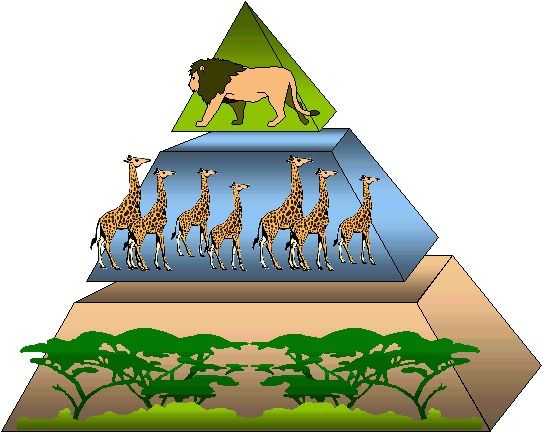
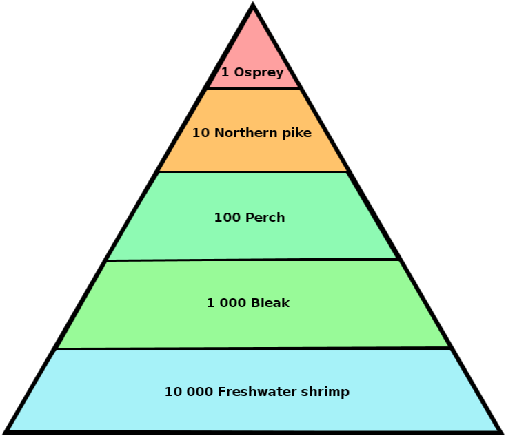
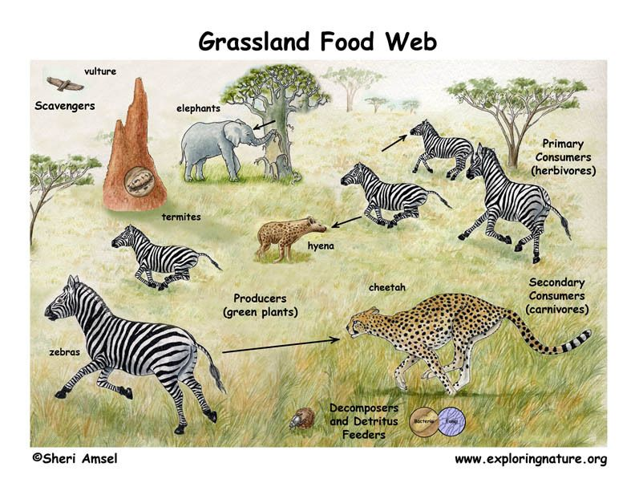

## 8.6 Energy flow (ESGB7)

**TEACHERS RESOURCE: **

- Use this lab to allow learners to "build their own" ecosystem, and explore the effects of these interrelationships:
  )
- Source of some food chain and food web examples to use in class:

In ecology, energy flow refers to the flow of energy through a food chain. In an ecosystem, we attempt to establish the feeding relationships between organisms living together. Each organism belongs to a 'trophic level' which refers to the position occupied by an organism in the food chain. Energy is passed on from every trophic level to the next and each time about \(\text{90}\%\) of the energy is lost with some being lost as heat into the environment and some being incompletely digested food. So primary consumers get about \(\text{10}\%\) of the energy produced by autotrophs while secondary consumers get \(\text{1}\%\) and tertiary consumers get \(\text{0,1}\%\). A general energy flow scenario is as follows:

- **Autotrophs**: solar energy is fixed by autotrophs (also called producers, such as green plants) into energy in the form of carbohydrates. This is done by photosynthesis.
- **Primary consumers**: part of the food made available by plants is consumed by primary consumers known as herbivores. The energy gained is converted to body heat or used to grow, reproduce, etc. Energy loss also occurs in the expulsion of undigested food by egestion.
- **Secondary consumers**: carnivores and omnivores consume the primary consumers, and use the energy obtained to grow, move, respire etc.
- **Tertiary consumers**: may be the major predators of an ecosystem, and feed on the primary and secondary consumers with some energy passed on and some lost as with other levels of the food chain.
- **Decomposers**: A final link in any food chain are the decomposers which break down the organic matter of the tertiary consumers and release the nutrients into the soil. They also break down plants, herbivores and other dead organic matter. Examples of decomposers are bacteria and fungi.

The flow of energy in an ecosystem can be explained in the form of a chain, web or pyramid.

### Food chain (ESGB8)

A food chain is a series of nutrient and energy changes that moves through a chain of organisms. It always begins with a producer and terminates with decomposers. Below is an example of a simple food chain in a grassland ecosystem. The **arrows** show the movement of energy from one organism to another.

**green plant** \(\rightarrow\) **impala** \(\rightarrow\) **leopard** \(\rightarrow\) **bacteria**

producer \(\rightarrow\) primary consumer \(\rightarrow\) secondary consumer \(\rightarrow\)  decomposer

<Callout type="note" title="Note">
A catchy song about food chains to help you remember:

<VideoPlayer src="https://www.youtube.com/watch?v=TE6wqG4nb3M" title="Video: 2CVT" />
</Callout>

## Understanding Food Chains

**Activity 1:**

Trace a **food chain** of the vegetables, fruit, cheese, eggs or meat that you had for breakfast or will have for dinner.

**Activity 2:**

1. In the food chain shown in the text which of the three organisms is the
   1. herbivore
   3. carnivore
   5. producer
3. Draw in the decomposers in the above food chain. Ensure that the direction of the arrows is correct.
5. What organism(s) will feed on the leopard?
7. Construct a new food chain showing at least four organisms.
9. Producers use sunlight to manufacture their own food. Write a word equation to depict this process. [Hint: think of the requirements and outcomes of the process of photosynthesis]

**Questions**

**Activity 1:**

Trace a **food chain** of the vegetables, fruit, cheese, eggs or meat that you had for breakfast or will have for dinner.

**Activity 2:**

1. In the food chain shown in the text which of the three organisms is the
   1. herbivore
   3. carnivore
   5. producer
3. Draw in the decomposers in the above food chain. Ensure that the direction of the arrows is correct.
5. What organism(s) will feed on the leopard?
7. Construct a new food chain showing at least four organisms.
9. Producers use sunlight to manufacture their own food. Write a word equation to depict this process. [Hint: think of the requirements and outcomes of the process of photosynthesis]

**Answers**

**Activity 1:**

Any logical food chain will be acceptable:

- rice \(\rightarrow\)  man  \(\rightarrow\) bacteria
- seeds \(\rightarrow\) chicken \(\rightarrow\) man  \(\rightarrow\) bacteria
- grass  \(\rightarrow\) cow  \(\rightarrow\) cream from milk becomes cheese  \(\rightarrow\) man  \(\rightarrow\) fungi

Do not accept ANY part of the food chain if it does not start with a producer or part of a producer.

**Activity 2:**

1. 1. Impala
   3. Leopard
   5. Green Plant
3. \(\rightarrow\) bacteria
5. Bacteria
7. - Flower bulbs \(\rightarrow\) rabbit \(\rightarrow\) eagle \(\rightarrow\)  bacteria
   - Leaves \(\rightarrow\)  locust \(\rightarrow\)  bird \(\rightarrow\) cat \(\rightarrow\)  bacteria
   - Any other acceptable food chain.
9. Sunlight + water + carbon dioxide \(\rightarrow\) sugars or starch + oxygen

### Food pyramid (ESGB9)

A food pyramid is another way of representing the relationships between organisms in an ecosystem.

**Trophic levels and the food pyramid**

- **Producers**: Plants are on the first level, or bottom of the pyramid, because they produce their own organic food using energy from the sun and therefore have a lot of energy to pass on.
- **Primary Consumers**: Herbivores are on the second level because they feed on plants. Herbivores consume plants; therefore, to maintain balance, there are far fewer herbivores than plants.
- **Secondary Consumers**: Carnivores feed on herbivores. Consequently, to maintain balance, there are fewer carnivores than herbivores. Carnivores get their energy from plants indirectly and are on the third level.

Figure 8.18: Food pyramid.

Trophic levels can be drawn as one of the following :

- **pyramid of numbers:** which shows the total number of organisms in each trophic level.
- **pyramid of biomass:** which shows the total amount of biomass (living matter) at each trophic level.
- **pyramid of energy:** which shows the total amount of energy contents in the biomass of each trophic level.

Most pyramids are drawn as **energy** pyramids, and are always triangular, whereas number pyramids are not.

Figure 8.19: Pyramid of numbers.

### Food web (ESGBB)

A food web is made up of a number of food chains. It represents the different feeding relationships in an ecosystem or a biome. It is usually more complicated than a food chain because organisms can get their energy or food from more than one source. The presence of a number of food sources makes the system more stable. If one organism is removed, the whole system will not collapse, unlike in a single food chain. A food web in a typical Savannah environment is shown in Figure 8.20.

Figure 8.20: The figure shows a food web in a typical Savannah environment.

## Understanding food chains and food pyramids

### Aim

Gain conceptual understanding of food chains and food pyramids

### Materials

- textbook
- resources provided by teacher

### Instructions

1. Look at any of the food webs or food chains in this chapter, or use a food chain or food web provided by your teacher.

### Questions

1. Identify a food chain that has three trophic levels.
3. Identify a food chain that has four trophic levels.
5. Name two:
   1. producers
   3. primary consumers
   5. secondary consumers
   7. tertiary consumers
7. There are very few tertiary consumers compared to the primary consumers. Why?
9. What will happen if the hyena is removed from the food web?

**Questions**

1. Identify a food chain that has three trophic levels.
3. Identify a food chain that has four trophic levels.
5. Name two:
   1. producers
   3. primary consumers
   5. secondary consumers
   7. tertiary consumers
7. There are very few tertiary consumers compared to the primary consumers. Why?
9. What will happen if the hyena is removed from the food web?

**Answers**

1. - acacia / tree   \(\rightarrow\)   giraffe  \(\rightarrow\)  lion
   - any other suitable example
3. - algae  \(\rightarrow\)  mosquito larvae  \(\rightarrow\)  frog  \(\rightarrow\) crane
   - grass  \(\rightarrow\)  zebra  \(\rightarrow\)  hyena  \(\rightarrow\)  vulture
   - any other suitable example
5. Learner-dependent answers. Some examples are provided below. Any two of:
   1. grass, trees, algae, aquatic plants
   3. insects, fish, snails, zebra, termites, elephant, giraffe
   5. rat, frog, fish, cheetah, hyena, lion
   7. snake, crane, duck, sparrow, vulture, decomposers, detritus feeders
7. The amount of energy available decreases as one moves up a food chain, so the number of organisms also decreases. An ecosystem cannot support equal numbers of tertiary consumers and primary consumers – there would be too many top predators. Predators would wipe out their food supply and then starve.
9. There are a few possibilities:
   - The number of herbivores would increase, as they are not being predated so heavily – they will only be eaten by cheetahs.
   - The place of the hyena will be filled by other predators or scavengers, such as lions and vultures. Predators and scavengers will increase in number, as they have more food available.
   - Regardless of whether one or both the above occur in an ecosystem, the result will be the same – a new balance will be achieved in the long term, even if the hyenas are removed.

<Callout type="note" title="Note">
Bill Nye the science guy talks about the food web:

<VideoPlayer src="https://www.youtube.com/watch?v=-YwW-iWxLr4" title="Video: 2CVV" />
</Callout>
