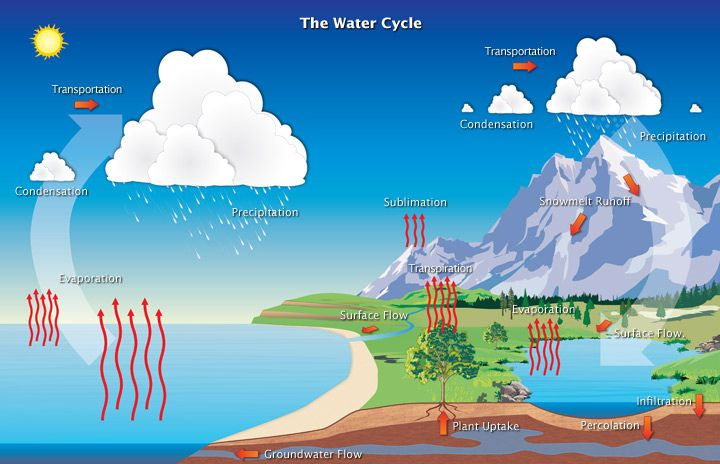
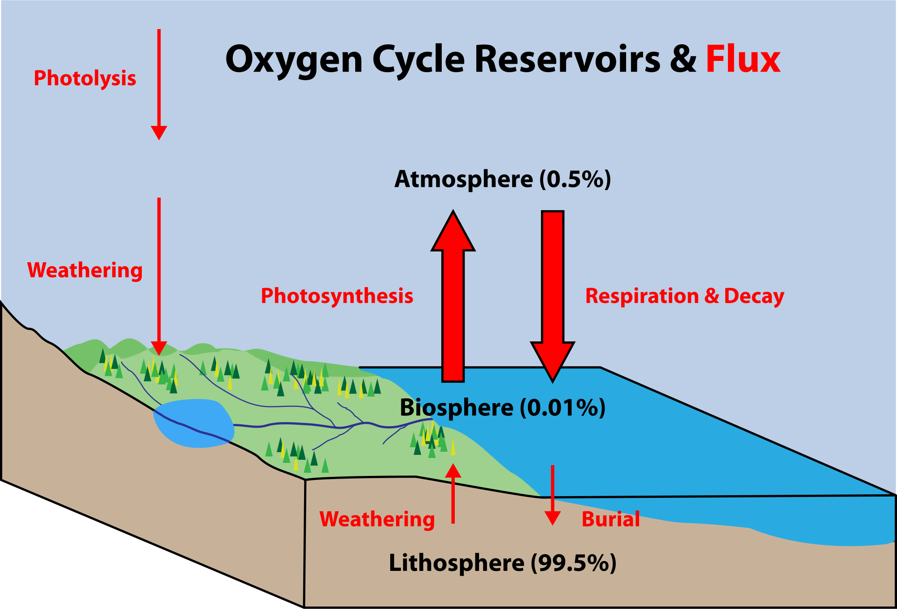
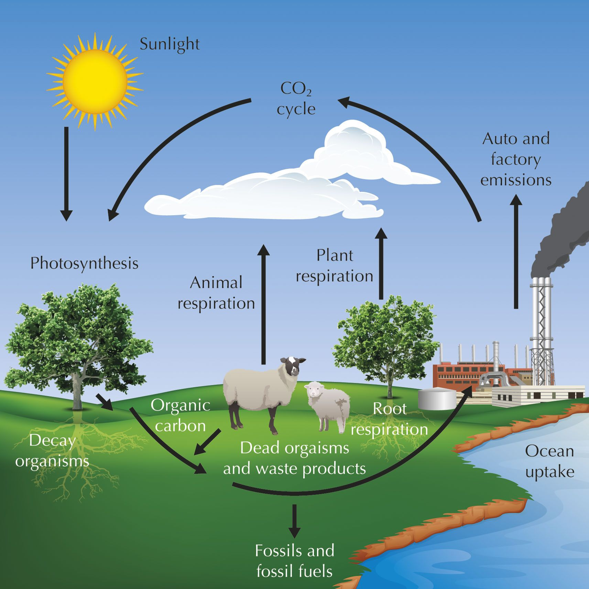
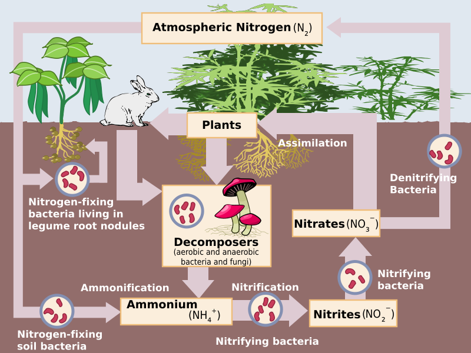

## 8.7 Nutrient cycles (ESGBC)

A nutrient cycle refers to the movement and exchange of organic and inorganic matter back into the production of
      living matter. The process is regulated by the food web pathways previously presented, which decompose organic
      matter into inorganic nutrients. Nutrient cycles occur within ecosystems. Nutrient cycles that we will examine in
      this section include water, carbon, oxygen and nitrogen cycles.

<Callout type="note" title="Note">
A simple video explaining nutrient cycling:

<VideoPlayer src="https://www.youtube.com/watch?v=AXWDbAYb-5c" title="Video: 2CVW" />
</Callout>

### Water cycle (ESGBD)

Over two thirds of the Earth's surface is covered by water. It forms an important component of most life forms,
        with up to \(\text{70}\%\) of plants and animals being composed of water. Vast quantities of water cycle through
        Earth's atmosphere, oceans, land and biosphere. This cycling of water is called the **water** or
        **hydrological** cycle. The cycling of water is important in determining our weather and climate,
        supports plant growth and makes life possible.

- **Evaporation**: Most water evaporates from the oceans, where water is found in highest
              abundance. However some evaporation also occurs from lakes, rivers, streams and following rain.
- **Transpiration**: Is the water loss from the surface area (particularly the stomata) of
              plants. Transpiration accounts for a massive \(\text{50}\%\) of land-based evaporation, and \(\text{10}\%\)
              of total evaporation.
- **Evapotranspiration**: The processes of evaporation and transpiration are often collectively
              referred to as evapotranspiration.
- **Condensation**: The process by which water vapour is converted back into liquid is called
              condensation. You may have observed a similar process occurring when dew drops form on a blade of grass or
              on cold glass. Water in the atmosphere condenses to form clouds.
- **Precipitation**: Water returns to Earth through precipitation in the form of rain, sleet,
              snow or ice (hail). When rain occurs due to precipitation, most of it runs off into lakes and rivers while a
              significant portion of it sinks into the ground.
- **Infiltration**: The process through which water sinks into the ground is known as
              infiltration and is determined by the soil or rock type through which water moves. During the process of
              sinking into the Earth's surface, water is filtered and purified. Depending on the soil type and the depth
              to which the water has sunk, the ground water becomes increasingly purified: the deeper the water, the
              cleaner it becomes.
- **Melting and freezing**: Some water freezes and is 'locked up' in ice, such as in glaciers
              and ice sheets. Similarly, water sometimes melts and is returned to oceans and seas.

The processes involved in the water cycle are shown in Figure
          8.21.

Figure 8.21: The water cycle.

**TEACHER RESOURCES: **

- This page is a part of PhysicalGeography.net, an educational website maintained by Dr. Michael Powdery, a
                member of the Geography Department at Okanagan University in British Columbia. In addition to this
                excellent introduction with tables and diagrams, the site also includes a glossary of terms, additional
                readings, and links to outside resources.
  [fundamentals](http://www.physicalgeography.net/fundamentals/8b.html)
- The Georgia state office of the US Geological Survey provides a very basic and kid-oriented site to
                explain various aspects of the water cycle, including following a single drop of water through the cycle's
                main stages. US Geological Survey: The Water Cycle:
  [water cycle](http://ga.water.usgs.gov/edu/watercycle.html)
- This is an animation of the water cycle
  ANIMATION: [animated water cycle](http://www.epa.gov/ogwdw/kids/flash/flash_watercycle.html)

### Oxygen cycle (ESGBF)

Oxygen is one of the main gases found in the air, along with nitrogen. Oxygen is re-cycled between the air and
        living organisms in the following ways:

- **Breathing and respiration**: organisms such as animals and plants take in oxygen from the air
            during breathing and gaseous exchange processes. The oxygen is used for cellular respiration to release energy
            from organic nutrients such as glucose.
- **Photosynthesis**: during photosynthesis, plants absorb carbon dioxide from the air to
            synthesise sugars, and release oxygen.
- There is a **complementary** relationship between photosynthesis and cellular respiration in
            that the former produces oxygen and the latter consumes oxygen.

The oxygen cycle is shown in Figure 8.22.

Figure 8.22: Oxygen cycle

<Callout type="note" title="Note">
Watch a video about the oxygen cycle. Focus on the first part of the video clip and the summary at the end.

<VideoPlayer src="https://www.youtube.com/watch?v=mUVX5rg1E0I" title="Video: 2CVX" />
</Callout>

### Carbon cycle (ESGBG)

Carbon is the basic building block of all **organic** materials, and therefore, of living
        organisms. Most of the carbon on earth can be found in the crust. Other reservoirs of carbon include the oceans
        and atmosphere.

<Callout type="note" title="Note">
Learn more about the carbon cycle in this video:

<VideoPlayer src="https://youtu.be/1r10LqX9kxA" title="Video: 2CVY" />
</Callout>

Carbon moves from one reservoir to another by these processes:

- **Combustion**: Burning of wood and fossil fuels by factory and auto emissions transfers carbon
            to the atmosphere as carbon dioxide.
- **Photosynthesis**: Carbon dioxide is taken up by plants during photosynthesis and is converted
            into energy rich organic molecules, such as glucose, which contains carbon.
- **Metabolism**: Autotrophs convert carbon into *organic* molecules like fats,
            carbohydrates and proteins, which animals can eat.
- **Cellular respiration**: Animals eat plants for food, taking up the organic carbon
            (carbohydrates). Plants and animals break down these organic molecules during the process of cellular
            respiration and release energy, water and carbon dioxide. Carbon dioxide is returned to the atmosphere during
            gaseous exchange.
- **Precipitate**: Carbon dioxide in the atmosphere can also **precipitate** as
            carbonate in ocean sediments.
- **Decay**: Carbon dioxide gas is also released into the atmosphere during the decay of all
            organisms.

**Photosynthesis** and **gaseous exchange**
        are the main carbon cycling processes involving living organisms. Figure 8.23 depicts the carbon cycle.

Figure 8.23: The carbon cycle.

**TEACHER RESOURCES: **

- This is a game you can play to learn more about the carbon cycle. GAME:
  [The carbon
                  cycle](http://www.windows2universe.org/earth/climate/carbon_cycle.html)

### Nitrogen cycle (ESGBH)

Nitrogen (N$_{2}$ ) makes up most of the gas in the atmosphere (about \(\text{78}\%\)). Nitrogen is important
        to living organisms and is used in the production of amino acids, proteins and nucleic acids (DNA, RNA).

<Callout type="note" title="Note">
This video summarises the nitrogen cycle.

<VideoPlayer src="https://youtu.be/VQAxPLUCLHk" title="Video: 2CVZ" />
</Callout>

- Nitrogen gas present in the air is **not** available to organisms and thus has to be made
            available in a form absorbable by plants and animals.
- Only a few single-cell organisms, like bacteria can use nitrogen from the atmosphere directly.
- For plants, nitrogen has to be changed into other forms, eg. nitrates or ammonia. This process is known as
            nitrogen fixation.

The nitrogen cycle involves the following steps:

- **Lightning**: Nitrogen can be changed to nitrates directly by lightning. The rapid growth of
            algae after thunderstorms is because of this process, which increases the amount of nitrates that fall onto
            the earth in rain water, acting as fertiliser.
- **Absorption**: Ammonia and nitrates are absorbed by plants through their roots.
- **Ingestion**: Humans and animals get their nitrogen supplies by eating plants or plant-eating
            animals.
- **Decomposition**: During decomposition, bacteria and fungi break down proteins and amino acids
            from plants and animals.
- **Ammonification**: The nitrogenous breakdown products of amino acids are converted into
            ammonia (NH$_{3}$ ) by these decomposing bacteria.
- **Nitrification**: Is the conversion of the ammonia to nitrates (NO$_{3}$ $^{-}$ ) by
            nitrifying bacteria.
- **Denitrification**: In a process called denitrification, bacteria convert ammonia and nitrate
            into nitrogen and nitrous oxide (N$_{2}$ O). Nitrogen is returned to the atmosphere to start the cycle over
            again.

The nitrogen cycle is shown in Figure 8.24.

Figure 8.24: The nitrogen cycle.
