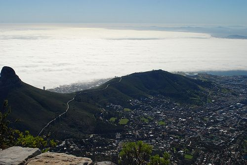

## 8.8 Ecotourism (ESGBJ)

This section enables learners to discuss the positive aspects of our country. In particular, learners need to focus on how South Africa's natural, cultural and historical treasures are a means of attracting tourists.

Learners will also need to critically assess how our environment and resources are managed. Specifically: are they managed sustainably, and according to sound principles?

The attraction of tourists can boost the economy and create employment for South African citizens. Tourism is not merely a cover for money-making ventures, but it is also a means to boost awareness of our indigenous plants and animals and the importance of conservation.

### The attractions of touring South Africa (ESGBK)

South Africa is a beautiful country that boasts great diversity in its flora and fauna. There are many interesting cultural, historical and environmental places that people from South Africa and other countries want to visit.

From what you learnt about the different biomes, you can see that South Africa has a range of ecosystems from desert, mountain, forest and marine systems to our own unique fynbos biome.

South Africa is one of the most biodiverse countries in the world. Although it only encompasses about 1,200,000 km$^{2}$, it is home to \(\text{10}\%\) of all plant species on earth. South Africa is considered mega diverse, along with 17 other countries, which means that together these countries contain \(\text{70}\%\) of the planet's biodiversity. South Africa's ability to support such a diverse population of plants and animals is due in large part to its unique geography. The combination of geography and wildlife makes South Africa an important travel destination to many.

Ecotourism is thought to be the idea of bringing tourism into a country while supporting the biodiversity.

<Callout type="note" title="Note">
South Africa is home to: The largest bird — ostrich
</Callout>

**Economic benefits of ecotourism**

- Tourism is one of the fastest growing sectors of South Africa's economy and is estimated to bring in up to R62 billion/ year
- Reinvesting some of the earnings from eco-tourism into the communities living near tourist destinations might be a means of alleviating poverty.
- Tourism provides jobs: e.g park operators, sellers of local crafts, guides, etc.
- Eco-tourism has the potential to create infrastructural development for communities that live around major tourist destinations. This is especially useful where major tourist locations are found in remote areas.

Figure 8.25: Cape Town, South Africa is a world-renowned tourist destination.

Figure 8.26: A baby impala in the Kruger National Park.

**Ethical issues**

While tourism has great economic potential and gives people access to unique places and cultures, it can have a negative impact. Sensitive ecosystems, such as wetlands and coasts, need to be protected so that the balance of organisms can be maintained. Too many visitors, and visitors who are not informed about their impact on the environment, can have a harmful effect. In the same way tourists need to be sensitive to the cultures and people that they visit.

To protect the plants and animals in the unique ecosystems of South Africa, many areas have been declared National Parks and have strict rules about how to behave.

In the same way, places that are historically or culturally important have been declared national heritage sites that are protected and maintained. South Africa is also proud to have eight UNESCO (The United Nations Educational, Scientific and Cultural Organisation) sites:

- **Cultural**
  - Fossil Hominid Sites of Sterkfontein, Swartkrans, Kromdraai, and Environs (1999)
  - Mapungubwe Cultural Landscape (2003)
  - Robben Island (1999)
  - Richtersveld Cultural and Botanical Landscape (2007)
- **Mixed**
  - UKhahlamba / Drakensberg Park (2000)
- **Natural**
  - Cape Floral Region Protected Areas (2004)
  - Greater St. Lucia Wetland Park (1999)
  - Vredefort Dome (2005)

### How to be a responsible ecotourist (ESGBM)

Many areas of South Africa are protected. When travelling to these areas, you need to respect the area and the people that you are visiting. These are a few tips:

- Learn a little about the place you are visiting before you go in order to be aware of the do's and don'ts. For example, littering is not allowed in any National Park in South Africa.
- South Africa is rich in cultural diversity, which means that people from different areas have different ways of doing things. Learn about the culture of local people so that you can make sure not to offend anyone by your behaviour.
- When you are in a protected area, do not damage plants or animals or buildings. For example, writing graffiti on historical buildings or sites. Remember the saying: take only pictures, leave only footprints.
