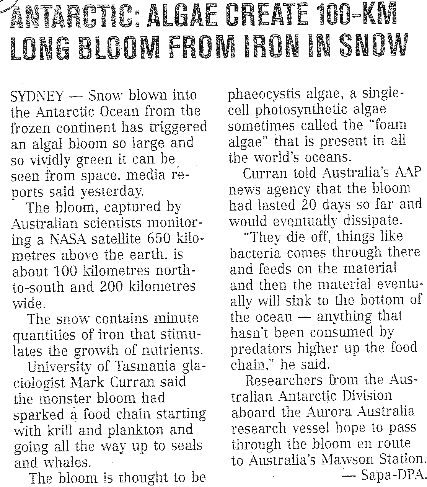

### Exercise 8.1

Read the article below and answer the questions that follow:

**Problem:**
Describe what you understand by the term algal bloom

**Solution:**
An algal bloom is a massive (very large) growth in the number of algae in an area, usually due to an unnatural increase in nutrients in the water.

**Problem:**
With reference to above article, name the abiotic factor that is responsible for the bloom and how the factor reached the Antarctic Ocean.

**Solution:**
The abiotic factor is extra iron that blew into the sea from the Antarctic mainland.

**Problem:**
Discuss the role decomposers could play in this ecosystem.

**Solution:**
Decomposers like bacteria will later come to the top and break down the algae and reduce the algal bloom.

Earthworms will burrow into the soil if they are on the surface and it is daylight. We can explain this behaviour by saying that they are either repelled by light or because they are attracted to the soil.

Describe an experiment that you could do to determine which explanation is correct. When designing your experiment, bear in mind that earthworms are living organisms.

Set out your design under the following headings:

**Problem:**
Hypothesis

**Solution:**
Earthworms will burrow into the soil because they are repelled by light OR Earthworms are attracted to soil.

(Accept any hypothesis directly related to the aim, as long as it is a statement, not a question and it is written in the future tense.)

**Problem:**
Aim

**Solution:**
To investigate if earthworms are attracted to soil and/or repelled by light.

(Accept any aim, as long as it is related to the instructions, but it MUST start with “To find out / To determine / To see … etc.")

**Problem:**
Apparatus and Materials

**Solution:**
Learner dependent answers. The answer depends on their design, but should be written in a bulleted list, be appropriate to the task, include at least 4 pieces of apparatus.

- earthworms of the same species
- lamp/ light source
- black basins with covers or other containers that block light
- black paper/ black plastic sheet
- soil
- sawdust
- timing device / stopwatch

**Problem:**
Method

**Solution:**
Method Example 1:

1. Earthworms were divided into four groups.
3. Two basins were filled with nutrient rich soil (A and B), two with sawdust (C and D).
5. A and C were covered with black paper on their covers.
7. B and D were placed under a neon lamp.
9. Earthworms were placed on the surface of the medium, appropriate covers were put in place.
11. After a 10 minute interval the number of worms at the surface of the medium were counted.
13. The procedures were repeated 5 times.
15. Counts were averaged and results compared.

|  | Medium condition | Container Light condition |
| --- | --- | --- |
| A | soil | Dark |
| B | soil | light |
| C | sawdust | Dark |
| D | sawdust | light |

Method Example 2:

1. Divide earthworms into two equal groups.
3. Put equal amount of soil into the large box on either side of the plastic separator sheet.
5. Put one group of worms onto the soil on each side of the sheet.
7. Shine a light onto one group and leave the other group in darkness.
9. Observe whether the worms have moved into the soil in the light or in darkness or in both cases.

Marking Rubric:

|  | Criterion | Marks |
| --- | --- | --- |
| 1. | List of points/bullets | 1 |
| 2. | Meets the aim that the pupil has given | 1 |
| 3. | Independent variables catered for (light/dark or soil/sawdust) | 1 |
|  | Dependent variables mentioned (number of worms remaining at the surface of the medium) | 1 |
|  | Controlled variables evident | 1 |
| 4. | Sufficient equipment used | 1 |
|  | Equipment used appropriately | 1 |
| 5. | Logical – recipe like | 1 |

Read the following information taken from UWC Enviro Fact sheet on the Fynbos and answer the questions that follow:

| Fynbos is the major vegetation type of the small botanical region known as the Cape Floral Kingdom. The Cape Floral Kingdom is both the smallest and the richest floral kingdom, with the highest known concentration of plant species: 1 300 per 10 000 km$^{2}$. The nearest rival, the South American rain forest has a concentration of only 400 per 10 000 km$^{2}$. Conservation of the Cape Floral Kingdom, with its distinctive fynbos vegetation, is a national conservation priority demanding urgent action. Over 7 700 plant species are found in fynbos, an astonishing number for such a small area. Of these roughly \(\text{70}\%\) are endemic to the area. Many of these are threatened with extinction. The richness of the fynbos is well demonstrated by its ericas or heaths, of which there are over 600 different species. There are just 26 in the rest of the world. Although the most striking features of the composition of fynbos are the presence of many conspicuous members of protea, erica and reed family that fill the niche usually occupied by grasses, the largest family in number of species is Asteraceae (daisy family), with just under 1000 species of which more than 600 are endemic. Furthermore, fynbos is very rich in geophytes (bulbous plants) and many species from the family Iridaceae have become household names, freesia, gladiolus, iris, and watsonia. Another remarkable feature of fynbos is the number of species found within small areas. For example, the total world range of some species consists of areas smaller than half a soccer or rugby field! Fynbos cannot support herds of large mammals since the nutrient poor soils on which it grows do not provide enough nitrogen for the protein requirements of large mammals. However, smaller mammals common to fynbos are baboons, grysbok, dassies, and the striped mouse. Fynbos does not support high numbers of birds. Fynbos also supports large numbers of butterfly species. Many are however at risk. The early stages (larvae) of many of these butterfly species are entirely carnivorous and live on a diet of ant brood. The butterfly larvae actually live inside the nest of their host ant. Although fynbos is not particularly rich in reptiles and amphibians, many of the species living there are both endemic and threatened. The very rare geometric tortoise is found in only a few surviving fynbos areas and is regarded as the world's second rarest tortoise. The Cape has more than half of South Africa's frog species. Fynbos also has a high concentration of threatened fish species, particularly in the Olifants River system. With the widespread occurrence of alien vegetation which use up more water than indigenous fynbos plants, many habitats are becoming restricted leading to local extinction of certain species of fish because isolated tributaries are drying up. http://www.bcb.uwc.ac.za/envfacts/fynbos/ |
| --- |

**Problem:**
The fynbos is said to be a very bio diverse habitat. List any three pieces of evidence from the text that show the idea of a rich biodiversity.

**Solution:**
- “The Cape Floral kingdom is the smallest and richest floral kingdom with the highest known concentration of plant species”.
- Fynbos has the highest known concentration of plant species: 1 300 per 10 000 km$^{2}$.
- There are 7 700 plant species are found in fynbos, \(\text{70}\%\) of which are endemic.
- The Asteraceae (daisy family), has just under 1000 species, of which more than 600 are endemic.
- Fynbos has over 600 different species of Ericas - the rest of the world has 26 species.
- Fynbos is very rich in geophytes (bulbous plants).
- Fynbos is home to more than half of South Africa's frog species.
- The total world range of some plants is an area smaller than half a soccer field.
- The geometric tortoise is found here and is the 2nd rarest tortoise in the world.
- There may be others that are relevant as well.

**Problem:**
Give three distinctive abiotic characteristics (excluding edaphic factors) of this biome.

**Solution:**
- Fire
- Hot, dry summer and cold, wet winter
- Low altitude/ coastal location
- Wind

Define the following terms mentioned in the text:

**Problem:**
endemic

**Solution:**
An organism found only in that area, nowhere else in the world.

**Problem:**
alien species

**Solution:**
A species that doesn’t naturally occur in that area, but was introduced from elsewhere in the world. They are usually harmful to the ecosystem.

**Problem:**
indigenous

**Solution:**
A species that has always been part of the natural flora / fauna of the area. This is not the same as ‘endemic’ – an indigenous species may occur in other areas as well.

**Problem:**
extinct

**Solution:**
A species that has been completely eliminated or destroyed. There are no more living specimens anywhere in the world.

**Problem:**
Construct a possible food chain of at least four organisms that would be found in this biome, use some organisms mentioned in the text. Label the levels of the organisms mentioned.

**Solution:**
- Grass seeds → ants → butterfly larvae → birds
- Geophyte → striped mouse → baboon → leopard
- Ericas → ants → butterfly larva → birds

Label can include: producer/autotroph, consumer/heterotroph- primary, secondary, tertiary

There are of course several others that can be constructed from the text. This is just an example.

**Problem:**
Discuss the characteristics of the soil found in the fynbos and the implications for animals in the area.

**Solution:**
The soil is very nutrient-poor (low nitrogen), sandy, porous and well aerated. Its poor quality makes it insufficient to sustain large animals.

The King Protea (*Protea cynaroides*), also known as Giant Protea, Honeypot or King Sugar Bush, is distinctive as it has the largest flower head in the genus. It found in the fynbos region, located in the southwestern and southern parts of South Africa.

**Problem:**
Into which kingdom is the protea placed?

**Solution:**
Plant Kingdom

**Problem:**
Why is this organism placed in the Kingdom named above?

**Solution:**
Because it is a multi-cellular organism with true plant tissues, has chlorophyll (thus autotrophic) and has cellulose cell walls.

**Problem:**
Give the genus and species of this protea. Be sure to use correct scientific notation.

**Solution:**
Genus:* Protea*. Species: *cynaroides *

**Problem:**
Which of the following are biotic components in an ecosystem?

1. air and water
3. plants and animals
5. light and temperature
7. rocks, soil and climate.

**Solution:**
plants and animals

**Problem:**
Which combination of the following processes takes place in the nitrogen cycle?

- i) Herbivores consume plant protein.
- ii) Decomposers break down dead organisms.
- iii) Bacteria change nitrites to nitrates.
- iv) Plants absorb nitrates from the soil.

1. i, ii and iii
3. i, ii, iii and iv
5. i and iv
7. i, ii and iv

**Solution:**
i, ii, iii and iv

**Problem:**
A soil has the following characteristics: large particles, large air spaces, holds little water, feels gritty. The type of soil is:

1. clay
3. sand
5. loam
7. silt

**Solution:**
sand

**Problem:**
Plants that are suited to live in areas with little water are called:

1. terrestrial
3. fynbos
5. xerophytes
7. hydrophytes

**Solution:**
xerophytes

**Problem:**
In a food chain, energy flows in the following direction:

1. producers \(\rightarrow\) primary consumers \(\rightarrow\) secondary consumers \(\rightarrow\) decomposers
3. decomposers \(\rightarrow\) producers \(\rightarrow\) primary consumers \(\rightarrow\) secondary consumers
5. primary consumers \(\rightarrow\) secondary consumers \(\rightarrow\) producers \(\rightarrow\) decomposers
7. producers \(\rightarrow\) secondary consumers \(\rightarrow\) primary consumers \(\rightarrow\) decomposers.

**Solution:**
producers \(\rightarrow\) primary consumers \(\rightarrow\) secondary consumers \(\rightarrow\) decomposers

**Problem:**
In a stable ecosystem, a wide variety of:

1. producers depend on plants for shelter and camouflage
3. micro-organisms depend on plants for carbon dioxide and nitrogen
5. animals depend on plants for food and oxygen
7. plants depend on micro-organisms for pollination and seed dispersal

**Solution:**
animals depend on plants for food and oxygen

**Problem:**
When a jackal kills and eats a rabbit, the jackal is the:

1. producer
3. prey
5. predator
7. saprophyte

**Solution:**
predator

**Problem:**
Which of the following refers to an organism's whole way of life and the use to which it puts the available environmental resources?

1. niche
3. habitat
5. community
7. ecosystem

**Solution:**
niche

**Problem:**
Organisms that live in water are called:

1. terrestrial
3. xerophytes
5. buoyant
7. aquatic

**Solution:**
aquatic

A giant oil tanker was wrecked at sea. The shallow waters of the coastline provided a rich source of edible crabs. Oil does not kill the crabs but harm their flesh, making them inedible and they cannot be sold. Samples of crabs were collected at sites A to D. The number of crabs is indicated by the size of the circle. The extent of the shaded part at each site represents the proportion of crabs with diseased flesh after the disaster.

| A | B | C | D |

**Problem:**
Which sample site (A to D) had the highest number of crabs?

**Solution:**
Sample site D

**Problem:**
In which sample site was the crabs only rarely found?

**Solution:**
Sample site C

**Problem:**
Name the agent of pollution that affected the crabs.

**Solution:**
Oil

**Problem:**
In which sample site was the most crabs affected compared to the population size?

**Solution:**
Sample B

**Problem:**
Explain your answer to the question above

**Solution:**
Sample B has a greater shaded portion

**Problem:**
List TWO strategies that could reduce the effects of oil pollution at sea.

**Solution:**
Regular service of oil tankers; Legislation on the amount of oil the oil tankers transport; Monitoring of travel routes; Use bacteria to dissolve the oil spill.
