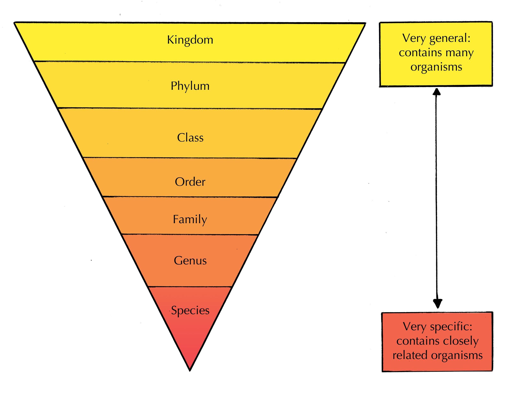
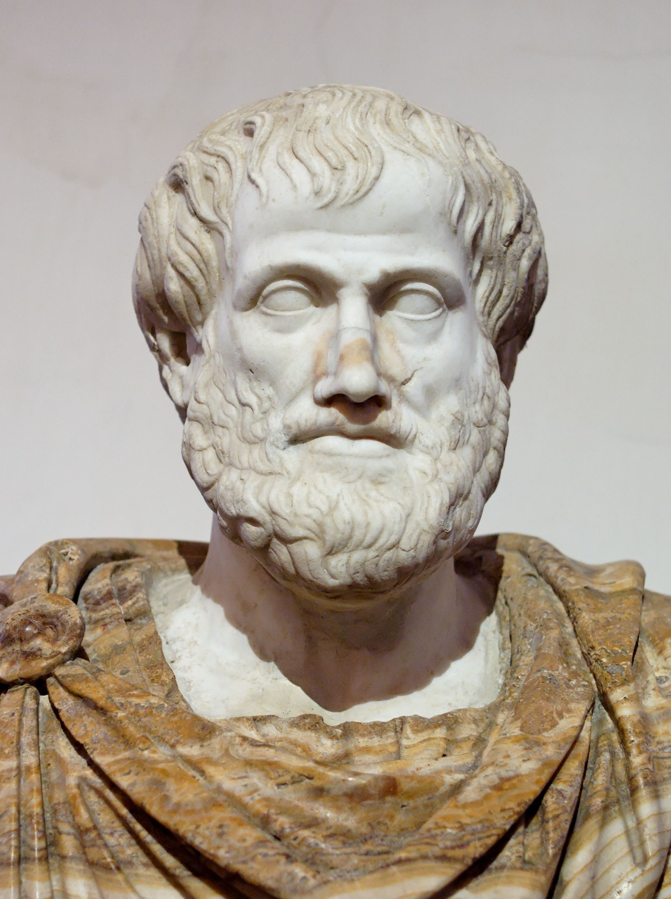
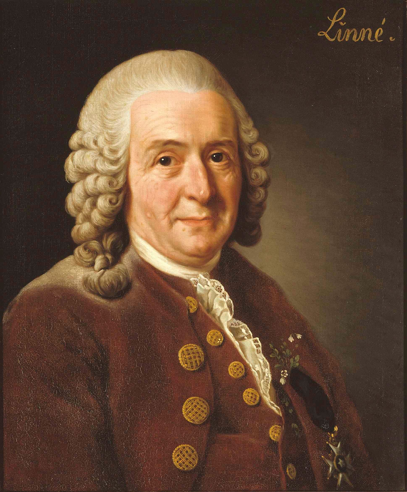
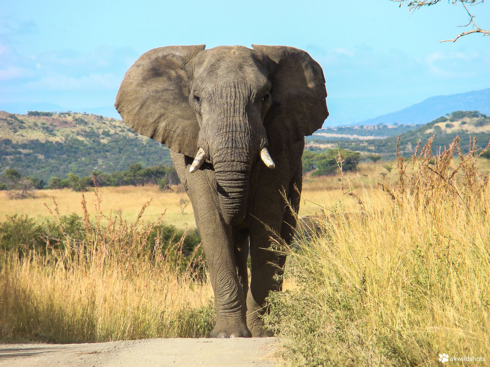
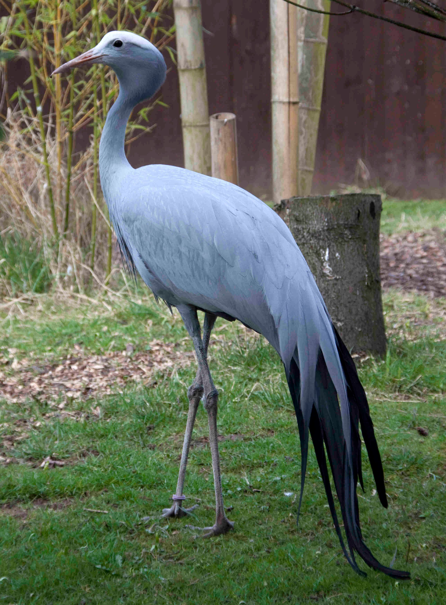

## 9.3 Classification schemes (ESGBS)

### Classification (ESGBT)

This section introduces learners to the concept of taxonomy, which is the classification of living organisms. The activity below allows learners to practice classification.

The practice of classifying organisms is referred to as **taxonomy**. Classification is usually a hierarchical process. One begins with general and broad differences, and then one systematically introduces more and more detailed and specific criteria.

We have prepared an activity in order to show why we try and classify living organisms, what sort of mental process it entails, and how it is done.  The activity below is not Life Sciences related, but conveys the process of classification. Try and think of the problems that arise while classifying the items below. Can BBC news be entertaining too? If so, should it not be under entertainment? Do you think that the final level of classification is the most definitive?

## Classification

### Aim

To understand how classification systems work.

### Materials

Pen and paper

### Instructions

1. Listed below are different TV programmes:
   - Carte-Blanche
   - Rocky
   - Isidingo
   - Rambo
   - Hitler's Bodyguards
   - Generations
   - Vietnam: Lost Films
   - BBC news
3. Divide these TV programmes above into 2 groups, under the headings: Entertainment and Documentary.
5. Now further subdivide the Entertainment group into Action and Soapies groups.
7. Do the same for Documentary using the headings: News/Current Affairs and History.

You have just drawn an example of a dichotomous branching diagram/ tree. All objects can be divided in this way. We call this a classification system.

**Activity: Classification**

In this activity learners are to try and think of the problems that arise while classifying the items below. Can BBC news be entertaining too? If so, should it not be under entertainment? Do you think that the final level of classification is the most definitive?

**ANSWERS **

| Entertainment | Documentary |
| --- | --- |
| Rocky Isidingo Rambo Generations | Carte Blanche Hitler's Bodyguards Vietnam: Lost Films BBC News |

| Entertainment | Documentary |
| --- | --- |
| Action | Soapies | News/ Current Affairs | History |
| Rocky Rambo | Isidingo Generations | Carte Blance BBC News | Hitler's Bodyguards Vietnam: Lost Films |

Classification can be a tricky business. Problems arise when something can be classified to greater detail, or when an object or organism could belong to more than one category. Biologists have faced these classification conundrums for centuries when trying to classify organisms in one category or another.

Artificial classification systems, such as the grouping of vehicles into those that provide transport on land, water or air, are based on arbitrary groupings and have little meaning. The biological classification system, however, is based on research in anatomy, physiology, chemistry, genetics and many other branches of science. It is a scientific method of classification that groups organisms that share common features.

This classification is not random, but rather it describes evolutionary relationships. As a consequence, it is always necessarily hierarchical, where the important features inherited from a common ancestor determine the group in which the organisms are placed. For example, humans and whales both feed their young on milk, which is a characteristic inherited from a common ancestor. This similarity places them under the same class, **mammals**, even though their habitats are completely different.

Each organism is grouped into one of five large groups or **kingdoms**, which are subdivided into smaller groups called **phyla** (singular: phylum) and then smaller and smaller groups with other names.

- Kingdom
- Phylum
- Class
- Order
- Family
- Genus
- Species

Figure 9.1: Schematic diagram showing hierarchy or ranking scheme used by taxonomists.

<Callout type="note" title="Note">
Watch a video about taxonomy: life's filing system

<VideoPlayer src="https://youtu.be/F38BmgPcZ_I" title="Video: 2CXD" />
</Callout>

When trying to identify animals, it is this hierarchy or ranking scheme that we follow. We start by identifying the kingdom to which an organism belongs, then its phylum, class, family, order, and so on. This is similar to explaining how to find your house to a being from another planet. You would have to say Earth first, then Africa, then South Africa, then KZN, then Durban, then the suburb, then the road name and finally the house number. He would have to start searching in a big place and gradually work down to smaller places (or groupings).

A way to remember it is "**K**waito **P**eople **C**ome **O**ut **F**rom **G**auteng **S**inging". By learning this mnemonic you are going to remember the sequence in the classification system:

- Kingdom - Kwaito
- Phylum - People
- Class - Come
- Order - Out
- Family - From
- Genus - Gauteng
- Species - Singing

## Constructing a mnemonic to remember the sequence of the classification system

### Aim

Construct a mnemonic in order to remember the classification sequence easily.

### Materials

- pen
- paper
- imagination!

### Instructions

Make an easy to remember memory aid to remember the sequence of levels of the classification system.

**Activity: Make you own mnemonic to remember the sequence of the classification system**

This activity allows the learners to be creative. Give the learners the freedom to choose which platform suits them best e.g. learners can do diagrams or rap songs. The learners have fun and learn the classification system at the same time.

### History of classification (ESGBV)

**Aristotle** (384-322 BC) was a 4th century Greek philosopher. He divided organisms into two main groups, namely plants and animals. His system was used into the 1600's. People who wrote about animals and plants either used their common names in various languages or adopted more-or-less standardized descriptions.

Figure 9.2: Aristotle (384–322 BC) devised one of the earliest classification schemes.

**Caspar Bauhin** (1560–1624) took some important steps towards the binomial system currently used by modifying many of the Latin descriptions to two words.

**Carolus Linnaeus (Carl Von Linne)** (1707–1778) was an 18th century Swedish botanist and physician. He classified plants and animals according to similarities in form and divided living things into two main kingdoms namely — plant and animal kingdoms. He named the plants and animals in Latin or used latinised names in his books *Species Plantarum* (1753) and *Systema Naturae* (1758). The two-kingdom classification system devised by Linnaeus is not used today. As scientists discovered more and more about different organisms, they expanded the system to include many more kingdoms and groupings. However, one of Linnaeus more enduring systems was the system of naming organisms- called **binomial nomenclature**. We will learn more about binomial nomenclature in the next section.

<Callout type="note" title="Note">
Watch a video about Carolus Linnaeus

<VideoPlayer src="https://www.youtube.com/watch?v=Gb_IO-SzLgk" title="Video: 2CXF" />
</Callout>

Figure 9.3: Carl Linnaeus developed a more advanced classification scheme and the system of naming organisms called binomial nomenclature.

**Ernst Haeckel** (1834-1919) was able to observe microscopic single-celled organisms and he proposed a third kingdom of life, the Protista, in 1866. Protista were single celled organisms that were neither plant nor animal, but could have characteristics of either.

**Herbert Faulkner Copeland** (1902–1968) recognised the important difference between the single-celled eukaryotes and single-celled prokaryotes. He proposed a four-kingdom classification, and placed the bacteria and blue-green algae (prokaryotes) in a fourth kingdom- Monera.

**Robert Harding Whittaker** (1920-1980) devised a five kingdom system in 1969. He recognised that fungi belonged to their own kingdom.  However, even today the five-kingdom system is under dispute. It is the nature of science that as more discoveries come to light, theories will continue to be improved upon and revised.

### Binomial Nomenclature (ESGBW)

One of Linnaeus' greatest contributions was that he designed a scientific system of naming organisms called **binomial nomenclature** (bi - 'two', nomial - 'names'). He gave each organism a two part scientific name - **genus** (plural - 'genera') and **species** (plural - 'species') names. The genus and species names would be similar to your first name and surname. **Genus name** is always written with a capital letter whereas **species name** is written with a small letter. The scientific name must always be either written underlined or printed in italics.

Since Latin was once the universal language of science among western scholars in medieval Europe, these names were typically in Latin.

For example the scientific name of the African elephant is *Loxodonta africana*.

Genus: *Loxodonta* Species: *africana*

Figure 9.4: Elephant (*Loxodonta africana*).

An organism will always have only one scientific name even though they might have more than one common name. For example  Blue crane, indwe (for amaXhosa) and mogolori (for Batswana) are all common names for South Africa's national bird (shown below). However, it has got only one scientific name which is *Anthropoides paradiseus*.

Figure 9.5: Blue crane, South Africa's national bird.

The scientific name of our human race is *Homo sapiens* *sapiens*. We are the only surviving members of the genus *Homo* — other more ancient or ancestral types such as *Homo ergaster* and *Homo neanderthalensis have all become extinct.*

### Prokaryotes and eukaryotes (ESGBX)

**Prokaryotes** are uni- or multicellular organisms made up of cells that do not have a nuclear envelope (pro - before, karyon - nucleus). The genetic material is not bound in a nucleus. They also lack cell organelles such as an endoplasmic reticulum, a Golgi apparatus, lysosomes, and mitochondria. Prokaryotes are divided into two main groups namely the Bacteria and the Archaea (ancient bacteria).

**Eukaryotes** are organisms that possess a membrane-bound nucleus that holds genetic material (eu - true, karyon - nucleus). Eukaryotes may contain other membrane-bound cell organelles, such as mitochondria and chloroplasts.  Eukaryotic organisms can be unicellular or multicellular. Eukaryotes include organisms such as plants, animals, fungi, and protists.

**Table: Differences between prokaryotes and eukaryotes.**

| Prokaryotes | Eukaryotes |
| --- | --- |
| Small cells | Large cells |
| Unicellular or multicellular | Often (but not always) multicellular |
| Genetic material is not contained within a nucleus | Genetic material is contained in a membrane-bound nucleus |
| Cells have a simple membrane internal system but no organelles   Example: no chloroplast, no mitochondria | Cells have a distinct membrane system with organelles   Examples: Chloroplast, mitochondria, golgi bodies |
