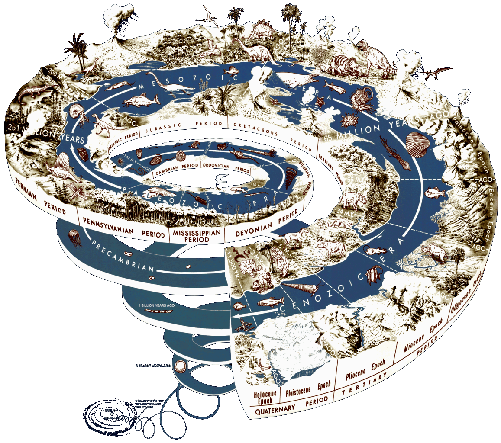

# Chapter 10: History of Life on Earth

## 10.1 Overview (ESGC8)

### Introduction (ESGC9)

In this final chapter, learners will be introduced to the history of life on Earth. This chapter should be linked to the previous chapters 'Biospheres to Ecosystems' and  'Biodiversity'. Learners need to understand that biodiversity varies not only from region to region, but also across time. The biodiversity on Earth at any given time is related to the prevailing climate and geography. The effect of climate and geography on the type of life forms seen can be linked to the interaction of biotic and abiotic factors that maintain balance in an ecosystem.

This chapter makes mention of many dates, and refers to species that may be unfamiliar to learners. Apart from a few key events and species (mentioned in the CAPS document) learners need not memorise specific dates or species, but should understand the sequence of events and underlying processes that shaped life on Earth.

| Key Concepts: Scientists use deductive reasoning to understand fossils and the history of life on Earth. Geological events often caused changes in climate, which in turn influence the emergence and disappearance of species. It takes special circumstances for fossils to form, and fossils can be dated by radiometric, radiocarbon or relative dating. Climate and geography helped shape the evolution of life on Earth. Geological timescales are divided into eons, eras and periods. The Cambrian explosion was a rapid explosion in the diversity of life-forms. All animal groups have their origin in the Cambrian explosion. Mass extinctions are massive losses in life, and there have been five mass extinction events in history. In the last 4 million years significant changes have occurred in species occurring in Africa, including the evolution of humans. Humans have a massive effect on biodiversity and the natural environment and are partially responsible for the '6th mass extinction'. South Africa is rich in many fossils from diverse time periods. Fossil tourism is a source of income and employment in fossil localities. |
| --- |

In this chapter we will learn about the history of life on Earth. We will first talk about tools (fossil dating) and theories, (continental drift) that help us understand our past. Next we will look at the geological time-scale and discuss three major eras: the Paleozoic, Mesozoic and Cenozoic. We will talk about the Cambrian explosion, which was a major explosion in the diversity of life, and we will discuss mass extinctions, which were mass losses in the diversity of life forms. We will also look at the evolution of humans in the last 4 million years. Throughout the chapter will look at fossil evidence from Southern Africa that originates from key periods in Earth's history.

<Callout type="note" title="Note">
- Scientists use deductive reasoning to understand fossils and the history of life on Earth.
- Geological events often caused changes in climate, which in turn influence the emergence and disappearance of species.
- It takes special circumstances for fossils to form, and fossils can be dated by radiometric, radiocarbon or relative dating.
- Climate and geography helped shape the evolution of life on Earth.
- Geological timescales are divided into eons, eras and periods.
- The Cambrian explosion was a rapid explosion in the diversity of life-forms. All animal groups have their origin in the Cambrian explosion.
- Mass extinctions are massive losses in life, and there have been five mass extinction events in history.
- In the last 4 million years significant changes have occurred in species occurring in Africa, including the evolution of humans.
- Humans have a massive effect on biodiversity and the natural environment and are partially responsible for the '6th mass extinction'.
- South Africa is rich in many fossils from diverse time periods.
- Fossil tourism is a source of income and employment in fossil localities.
</Callout>

