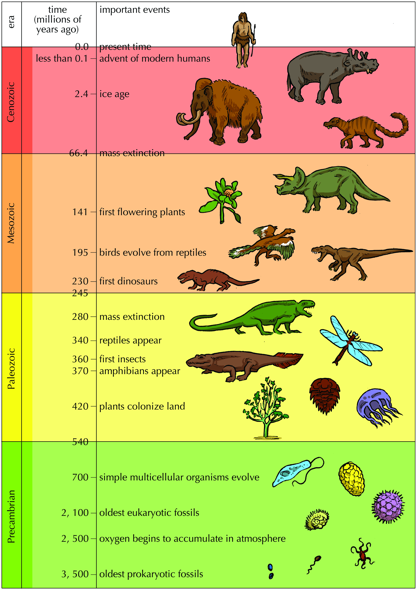
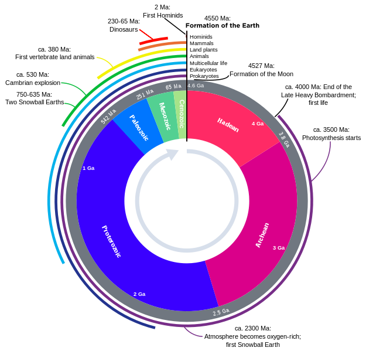
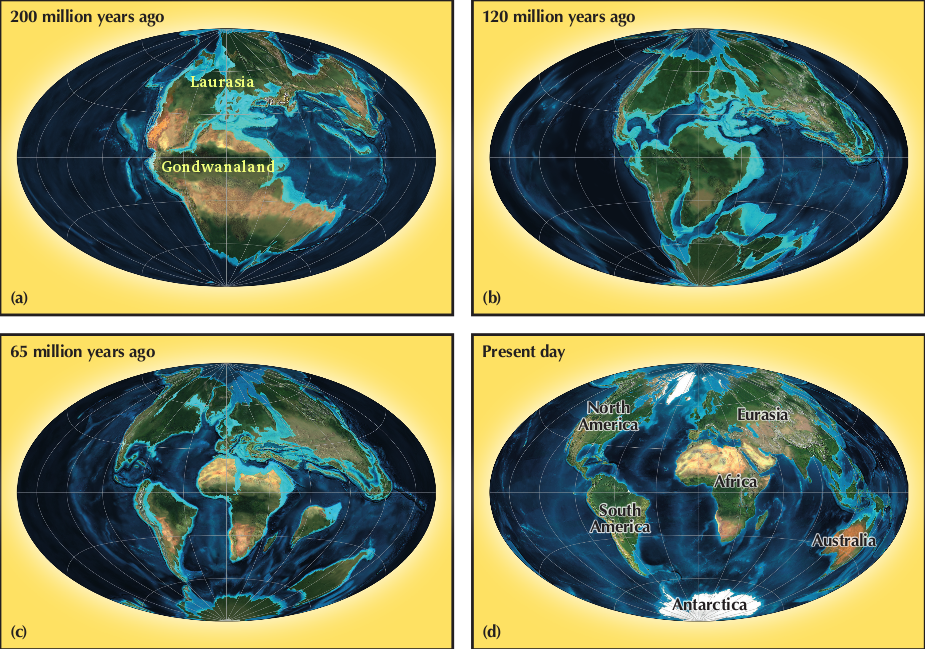
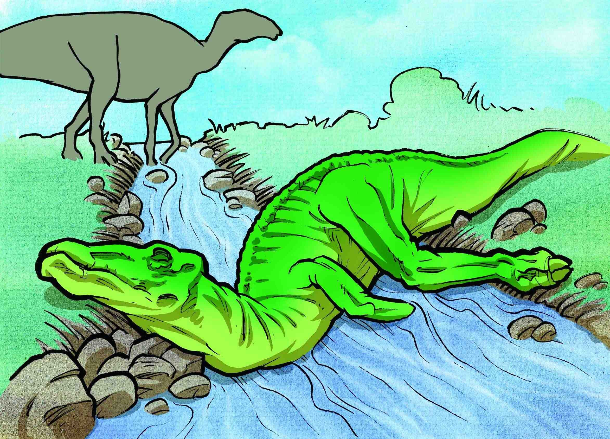
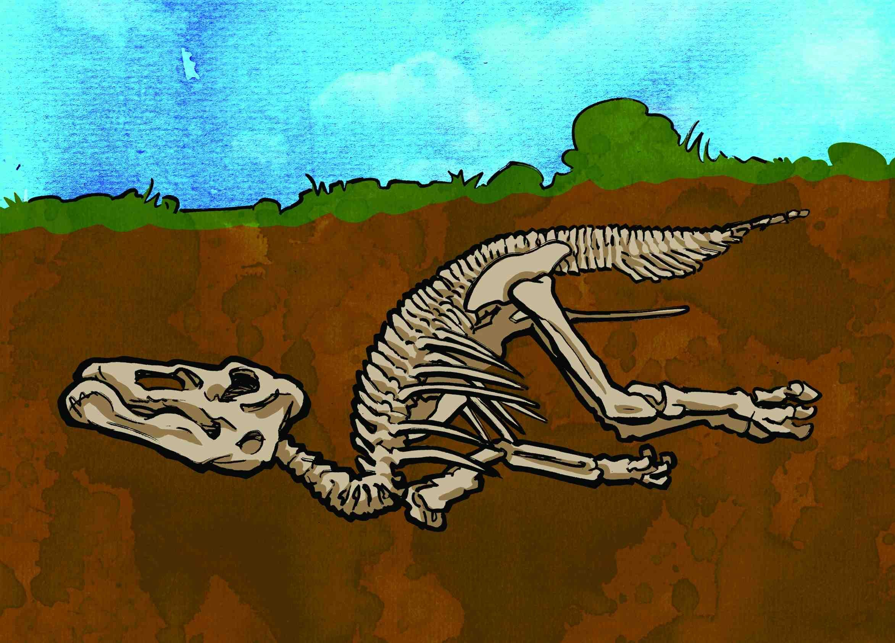
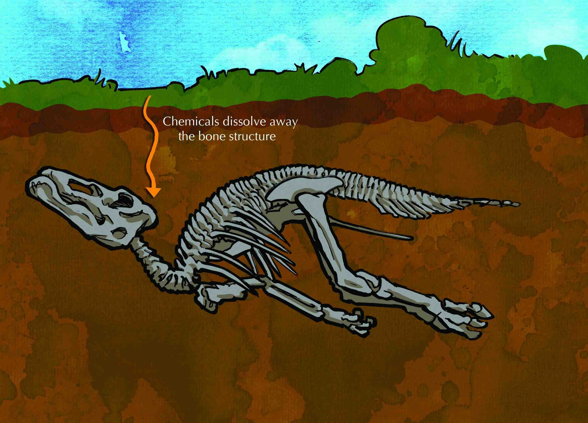
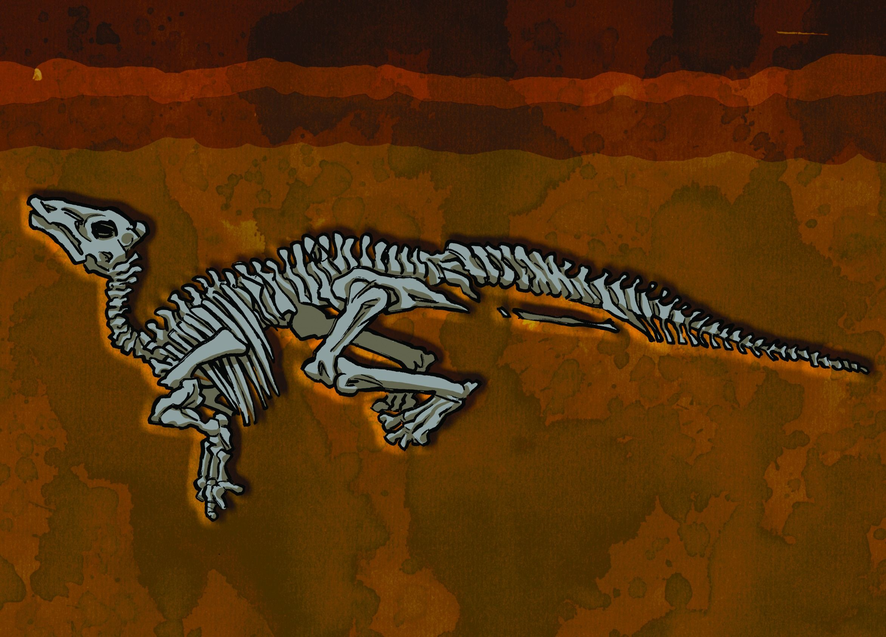
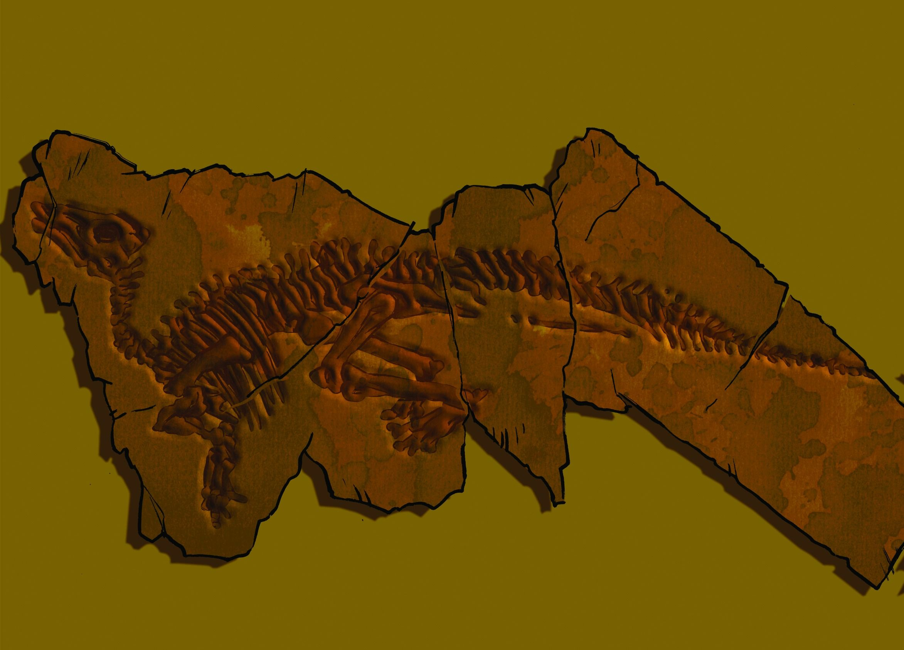
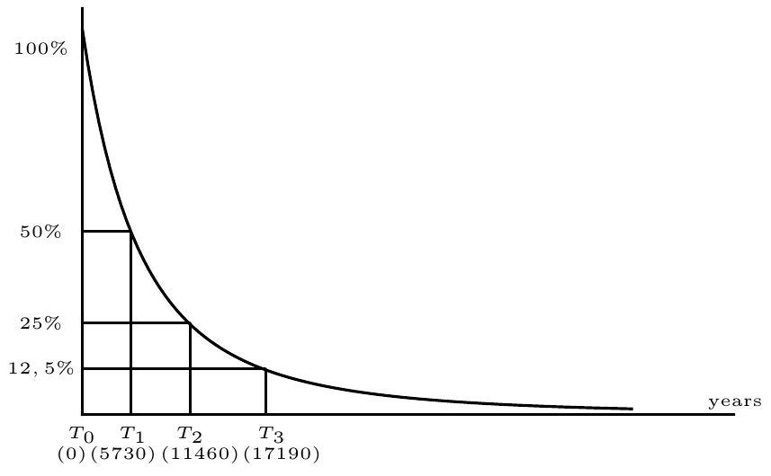
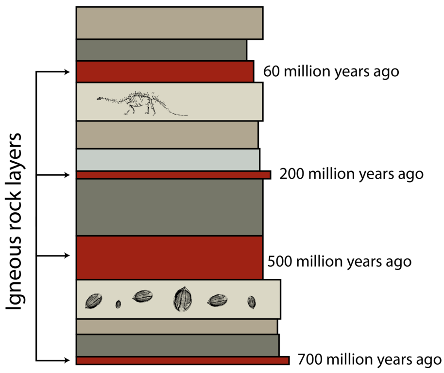

## 10.2 Representations of life's history (ESGCB)

The major focus of this section is to help learners understand how scientists use deductive reasoning to understand the past. Scientists can never know exactly what happened in the past, but they are able to use various forms of evidence (clues) to piece together a coherent picture. When evidence from many different areas start to agree with each other it lends more credibility to the theory. Different forms of evidence, such as that provided by geological records and fossil evidence, will be introduced.

Scientists have divided the history of life into different time periods using the **geological timescale**. In this section we will present the key evidence scientists have used to  construct this time scale. We will discuss the **continental drift** theory which explains how the continents were formed. We will also briefly touch on the theory of natural selection which explains how one life form can evolve into another over many years by adapting to its changing environment. We will then present the methods by which we are able to determine evolution of life forms over time through examining the **fossil record**.

### Geological timescale (ESGCC)

The geological timescale is a 'calendar' of events in the Earth's history. It shows major geological and climactic events, and how these events affected the emergence and disappearance of species over time. In order to help us make sense of this vast amount of time, scientists divided it into smaller units of time. In descending order, these units are: eons, eras and periods.

- **An Eon**: is defined as a unit of time equal to a billion years.
- **An era**: is a division of time within an eon but does not have a fixed number of years. The Mesozoic era for example lasted from 252 million years to 66 million years ago.
- **A period**: typically refers to a subdivision of an era and its length is determined by a system of dating based on examining fossil evidence belonging to a particular era.

Figure 10.1 below shows one method of representing the geological timescale:

Figure 10.1: Geological timescale with key events and characteristics shown.

While you will not be expected to remember the names of specific periods, you will be expected to understand the eras and their particular characteristics.

Another visually powerful way of representing Earth's history is via the use of the geological `clock' (Figure 10.2). Human history occupies just 2 million of the \(\text{4 500}\) million year long history of the Earth. On this clock, human existence constitutes less than a minute of the evolutionary history of life on Earth.

Figure 10.2: "Human history on Earth is a mere second on the clock". In this representation, the two million years' of human history constitute an effect too small to be visible on the timescale.

<Callout type="note" title="Note">
This website has an infographic showing geological time on a clock. Each hour on the clock corresponds to a period of the Earth's history, and shows the characteristics of each period and the key events within them.
</Callout>

## Construct a timeline of the key events in the history of life on Earth (Essential CAPS)

### Aim

In this exercise you will learn to combine all the information given on the history of life and depict it on a simple geological timescale of your own.

### Materials

- exercise book or cardboard
- coloured pens and pencils
- pictures and information from the Internet and books

### Instructions

Draw a timescale that stretches from `0 years ago' to \(\text{530}\) million years ago.

Depict the history of life on this timescale. On your timeline, show:

- Mesozoic, Paleozoic and Cenozoic eras
- Two major climate changes characteristic of each era
- Major changes to plant and animal life that took place during this time

**Activity: Construct a time-line of the key events in the history of life on Earth  (Essential CAPS)**

In this exercise learners are required to combine all the information given on the history of life and to depict this information onto a simple geological timescale of their own.

Learners can do this in poster format or as a class exercise. They may work individually or in small groups of 2 to 4. Pictures from the Internet to illustrate their time scale can be used.

**Any** time line drawn by a learner may be acceptable, provided that it meets the following criteria:

- It must have a TIME scale e.g. if it is a straight line, the times can written directly onto the line itself. If it is a circle, sections can be labelled with years.
- It must show all three recent eras, i.e. Palaeozoic, Mesozoic and Coenozoic.
- Colour use is optional, but it will make the scale look more attractive.
- It is essential that the relative sizes of the three eras is more or less correct.
- It must show two major climatic changes during each of the three eras.
- It must have major changes to the plant and animal life during the 3 eras.

### Continental Drift (ESGCD)

Learners do not need to know the dates involved in continental drift. These dates are only approximate and are given as a guideline and to give a sense of the time-scale.

**Continental drift** is the breakup and movement of the Earth's continents relative to each other by drifting across the Earth's surface. Since the initial continental drift hypothesis was proposed, the study of plate tectonics has helped us understand why continents move.

**Plate tectonics** is the study of the folding and faulting of the Earth's crust (lithosphere).

**Biogeography** is the branch of biology focusing on the geographical distribution of plants and animals. It has been instrumental in developing our understanding of the evidence for continental drift.

**Evidence for continental drift**

There is considerable evidence for the theory of continental drift that draws upon fossil evidence, plate tectonics theory and studies of glacier sediments. For example:

- Similar plant and animal fossils have been found on different continents' shores, suggesting that these were once joined. For example:
  - The *Mesosaurus* found in Brazil and South Africa.
  - The *Lystrosaurus* from rocks of the same age found in South Africa, South America, India, Australia and Antarctica
  - Earthworms found in South America and Africa suggest that these existed in a common habitat on a single continent.
- The complementary shapes of South America and Africa have enabled scientists to propose how these continents pulled apart due to various plate tectonic forces.
- The study of glaciers left over from the ice ages has provided an important line of evidence for continental drift. Glacial sediments from South America, Africa, India, Madagascar, Arabia, India, Antarctica and Australia showed evidence of having once been joined together, suggesting the existence of the supercontinent Gondwana.

Using this evidence, scientists have inferred that in the past the Earth existed as a super-continent known as Pangea until the early Mesozoic era. There were three major phases in the break-up of Pangea:

- **First phase**: about \(\text{175}\) million years ago, Pangea began to rift, giving rise to the supercontinents Laurasia and Gondwana.
- **Second phase**: began in the early Cretaceous period (\(\text{150}\)–\(\text{140}\) million years ago) when Gondwana broke and separated into multiple continents: Africa, South America, India, Antarctica and Australia.
- **Third phase**: occurred in the early Cenozoic era. During this phase, Laurasia split when North America/Greenland split from Eurasia resulting in the expansion of the Atlantic and Indian Oceans.

Figure 10.3: Diagram showing continental drift.

**TEACHER RESOURCES: **

Watch an animation of continental drift at the following link:

### Natural selection (ESGCF)

Through a process known as **natural selection**, adaptations that allow one organism to survive better than another and produce more off-spring, results in future generations of organisms who have acquired those traits. For Grade 10, you are required to understand the following key features of evolution by natural selection:

<Callout type="note" title="Note">
Natural selection is a process you will learn about in more detail in Grades 11 and 12.
</Callout>

<Callout type="note" title="Note">
This video explains how natural selection takes place!

<VideoPlayer src="https://youtu.be/0SCjhI86grU" title="Video: 2CXX" />
</Callout>

- Individuals in a species show a wide range of variation: .e.g. the many different types of dogs you see.
- The variation is caused by genetic differences.
- Individuals that are well-adapted to the environment in which they live are more likely to survive and produce more offspring.
- The genes that allowed the individuals to be successful are ** passed on to the offspring ** in the next generation.
- Over many hundreds (and thousands) of generations this results in changes in the physical appearance and habits of organisms.

### Fossil formation (ESGCG)

The **fossil record** is a key source of evidence that helps scientists understand life's history. Fossils are the remains, impressions or traces of animals and plants from the remote past. Fossils usually take the form of a mold or a cast in rock. Generally, a preserved specimen is regarded as a fossil if it is older than approximately \(\text{10 000}\) years (although this is not a strict definition).

Examples of common fossils are skeletons or parts of skeletons, shells or teeth. Sometimes plants or animals can leave imprints that get preserved as fossils.

The study of fossils across geological time, how they are formed, and how ancient organisms have evolved in relation to other phylogenetic groups, is called **palaeontology**.

**How fossils are formed**

1. For fossilisation to occur, a plant or animal must first die. Soft tissues decay quite quickly, therefore animals that have hard exoskeletons and woody plants tend to fossilise better than soft-bodied organisms.
   
3. The organism (plant or animal) must be buried beneath mud and or soil shortly after death. Although decay still takes place, the lack of oxygen slows it down. As more and more layers of mud and soil are added, the sediments become compressed.
   
5. Eventually, this compression turns the sediment into rock, which forms a mould around the shape of the original skeleton. Sometimes the original bone or shell softens and dissolves completely, sometimes the bone or shell remains. Water that is rich in dissolved minerals trickles in through the layers of sediment into the mould.
   
7. The mineral-rich water enters the hollow and crystallises to create a natural cast of the original organism. Otherwise, the minerals slowly seep into the skeleton, changing its chemical composition and making it capable of surviving for a long time.
   
9. Over many millions of years, rock that was once buried rises again to the surface and is eroded away, exposing the fossils.
   

<Callout type="note" title="Note">
If the rocks surrounding a fossil are distorted and squeezed by geological forces, it will result in distortion of the fossils within them.
</Callout>

Fossilisation is very rare and only happens when a plant or animal dies in exactly the right circumstances. Usually animal corpses are eaten by other animals or decomposed by bacteria before fossilisation can occur. Even hard parts, like bones and shells, are eventually destroyed through erosion and corrosion.

**TEACHER RESOURCE: **

This website has a video detailing the fossilisation of Lucy:

It takes a rare set of circumstances to turn a living creature into fossilised bone. In the case of Lucy, the famous hominid fossil discovered in Ethiopia's Great Rift Valley in 1974, there is no evidence that she met a violent death. No predator or scavenger found her body before it began rotting in the lake's soft sediments. Her bones, which settled in the mud, may have been cracked or shattered by animals roaming around the shore.

Heavy rains gradually washed in enough sand and gravel to bury her bones. These deposits built up over thousands of years, burying her remains hundreds of metres deep. The calcium in her bones, molecule by molecule, was replaced by minerals from these deposits, turning the bones to stone.

She remained buried over millions of years, while the Earth's crust moved constantly, forcing the remains of her body closer to the surface. Heavy storms beating down on the earth eroded the sediment and most likely brought her once again to the Earth's surface. Her exposure made it possible for anthropologists to later discover her remains some three million years after her death.

### Methods of dating fossils (ESGCH)

We have learnt how fossils are formed over geologic timescales. In this section we will learn how we determine the age of a fossil. There are two methods of dating fossils:

1. Radiometric dating
3. Relative Dating

**1. Radiometric Dating**

In order to understand radiometric dating, it is necessary to revise our understanding of the atom. The nucleus of an atom is made up of **protons** and **neutrons**. The number of protons in the nucleus define what type of element it is. However, the number of neutrons of an element may vary. Atoms with the same number of protons, but different numbers of neutrons are called **isotopes**.

Some isotopes are stable, while others are unstable. Unstable isotopes undergo a process called **radioactive decay**, whereby they spontaneously change to elements of a different type. We can never predict when a specific atom will undergo radioactive decay. However, when considering many atoms, we observe that the decay occurs at an **exponential decay rate**. Exponential decay means that over a certain period of time, called a **half life**, half of the unstable isotopes in a sample will undergo radioactive decay.

One of the most useful radiometric dating methods is radiocarbon dating.

**Radiocarbon dating **

<Callout type="note" title="Note">
Learn more about how radiocarbon dating works.

<VideoPlayer src="https://youtu.be/omYFF_tpZSw" title="Video: 2CXY" />
</Callout>

- The carbon atom exists as three different isotopes. These are carbon-12 (C-12), carbon-13 (C-13) and carbon-14 (C-14).
- All living organisms maintain an equilibrium of carbon-14 with the atmospheric carbon-14.
- After an organism dies, it no longer incorporates new carbon into its body.
- The carbon-14 present within them undergoes radioactive decay to nitrogen-14, and decreases from the original equilibrium with carbon-12.
- The half-life of carbon-14 is 5730 years. This means that if we start out with say 10 units of carbon-14, in 5730 years' time only 5 units will remain. In another 5730 years' time only 2.5 units will remain and so on.
- Thus, using radiocarbon dating, scientists can determine how much carbon-14 remains within a particular fossil, and thereby infer the age of the fossil.

**Radiometric dating:** Graph showing the half-life of C-14. The amount of carbon-14 halves every 5730 years.

The isotopes of different elements undergo decay at different rates; some decay much more rapidly than others.  This makes radiometric dating a useful tool as scientists can use different elements to date longer and shorter time-scales. Carbon has a relatively short half-life, and therefore it is not of much use when dating fossils that are millions of years old.

**Uranium-lead and potassium-argon  dating**

In order to date older fossils, scientists use **uranium-lead dating** and **potassium-argon dating**. The half-life of uranium-235 is 700 million years, and the half-life of potassium-40 is 1.3 billion years. In order to estimate the age of incredibly old fossils, scientists date the age of the igneous (volcanic) rock in which the fossils are  buried. This provides them with an estimate of the age of the fossils contained within them.

**2. Relative Dating**

- Relative dating is the method of determining the order of events from the fossil record.
- By studying the order in which fossils occur in the fossil record, geologists can determine the order of events as they occurred but not when exactly they occurred.
- Fossils found at the lowest layer of rock would be the oldest, as these would have been buried for the longest time, whereas fossils found closer to the surface would be buried more recently and therefore be younger.
- The geological time-scale you studied earlier was almost entirely developed by relative dating methods. It is a useful method of dating when fossil materials lack radioactive isotopes.

<Callout type="note" title="Note">
A video about discovering fossil evidence.

<VideoPlayer src="https://youtu.be/cGkhRSa00Hk" title="Video: 2CXZ" />
</Callout>

Figure 10.5: In relative dating, fossils are dated relative to layers of igneous (volcanic) rocks that they are near. Older layers are deeper in the Earth, younger layers are closer to the surface.

### Deductive reasoning to understand the past (ESGCJ)

Deductive reasoning combines the use of evidence and theories to make deductions about the past. Therefore scientists use their understanding of continental drift and natural selection theories, together with evidence of climate changes and extinct organisms from the fossil record, to piece together Earth's history.

- Scientists use the fossil record to make conclusions about the history of life through a process of **deductive reasoning**.
- Deductive reasoning involves combining our understanding of known principles to make conclusions about new evidence that we have uncovered.
- Our knowledge of the history of life is not based on radiometric dating methods alone. Rather, our understanding of the changes in Earth's climate and biogeography allow us to make conclusions about newly discovered fossil evidence.
- For example, from our knowledge of the changes to the Earth's early atmosphere, we know that the formation of the ozone layer blocked off the damaging rays of the sun's UV rays. This led to the growth of plant species which gradually made terrestrial existence possible.
- A transitional fossil is any fossilised remains that is common to an ancestral life form as well as to the group that is derived from it.
- Transitional fossils give us information about how an ancestral species evolved to form the existing species.
- An example of a transitional fossil is the *Archaeopteryx*. It is thought to belong to the genus of Theropod dinosaur which is closely related to the birds.

The exercise below requires you to understand the similarities between the *Archaeopteryx* and the modern bird.

## Comparing the skeleton of a modern bird to the Archaeopteryx

### Aim

To compare the skeletons of a modern bird (chicken) and Archaeopteryx

### Instructions

1. Use the pictures below to compare the skeletons of a dinosaur (Theropod), *Archaeopteryx* and a chicken (modern bird). Give four differences and four similarities between *Archaeopteryx* and dinosaurs, and between * Archaeopteryx* and modern birds.

**Solution to activity:**

| Archaeopteryx vs Dinosaur: SIMILARITIES: |
| --- |
| 1. Jaws have teeth |
| 2. Hand / arm has claws |
| 3. Long bony tail present |
| 4. Presence of gastralia or dermal ribs (not attached to spine) |
| Archaeopteryx  vs  Dinosaur: DIFFERENCES: |
| 1. Long forelimbs, like wings | Short forelimbs |
| 2. Feathers present | No feathers |
| 3. Hand has three claws | Hand has five claws |
| 4. Furcula / wish bone present | No furcula present |
| Archaeopteryx vs Modern bird SIMILARITIES: |
| 1. Feathers are present |
| 2. Forelimbs are long and wing-like |
| 3. Furcula / wish bone present (fused clavicles) |
| 4. Bones of the lower forelimb are separate |
| Archaeopteryx  vs  Modern bird DIFFERENCES: |
| 1. Teeth in jaws | No teeth in the beak |
| 2. Claws on forelimbs | Forelimbs without claws |
| 3. Long bony tail | Short tail bones / pygostral present |
| 4. No breast bone | Breast bone with a keel |
