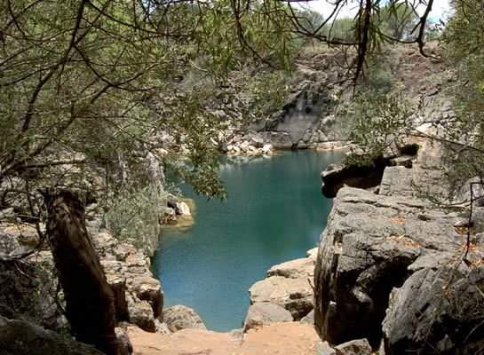
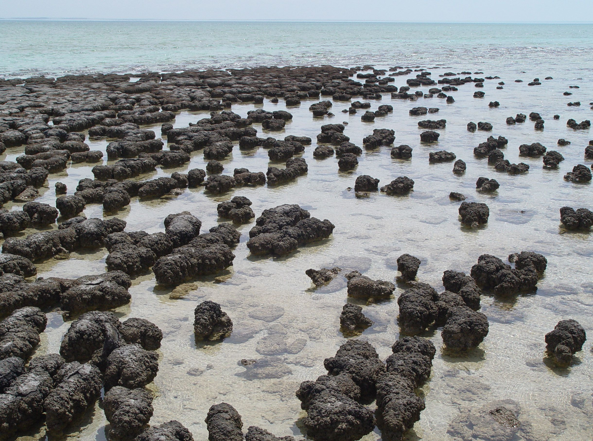
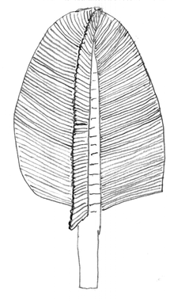
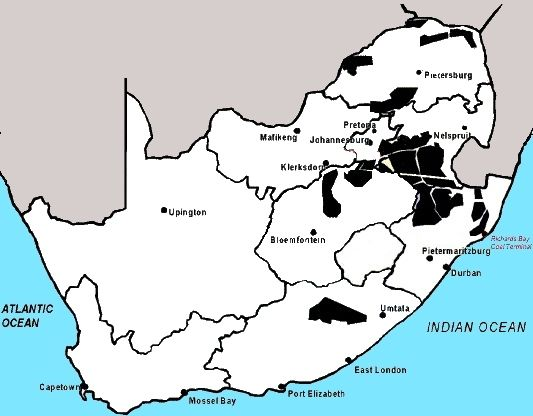
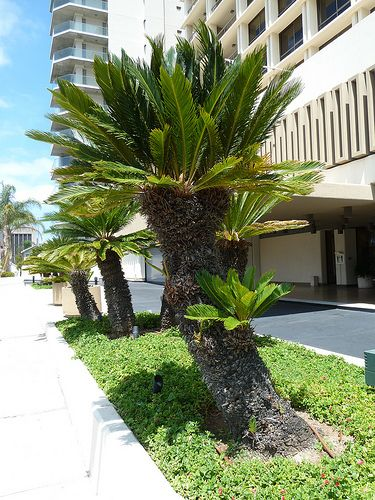
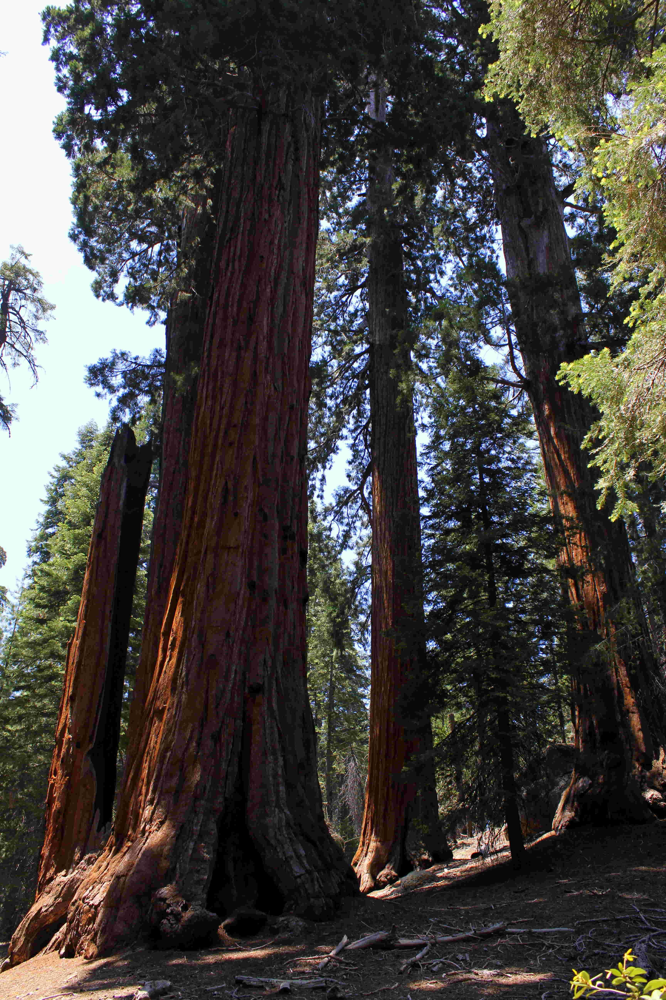
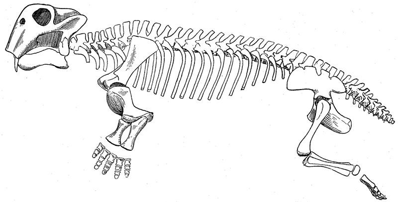
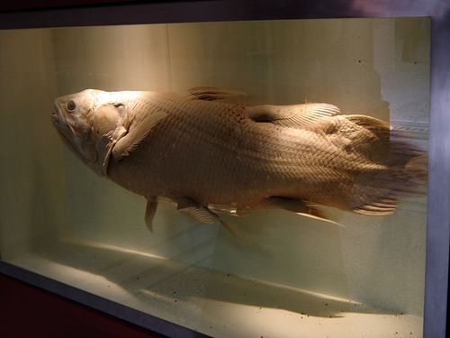
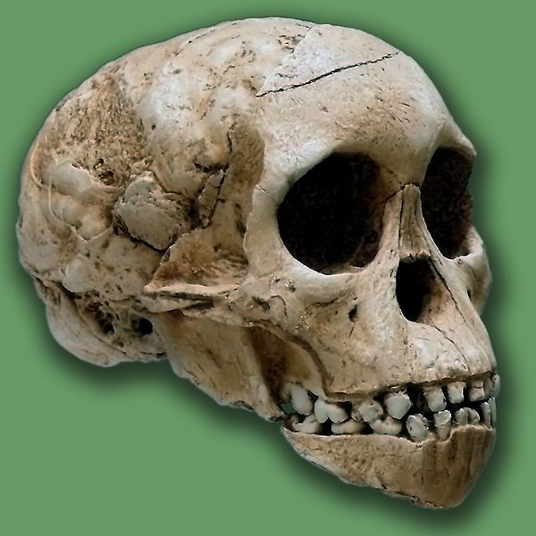

## 10.3 Life's History (ESGCK)

The section on the Hadean, Archean and Proterozoic are for interest only. Learners are not expected to learn these sections for exams. The educator is to discuss some of the major eras, such as Paleozoic, Mesozoic and Cenozoic. However, it must be emphasised to the learners that the periods within each era need not be memorised.

### Pre-Cambrian (ESGCM)

**Hadean**: the Earth we live on is approximately \(\text{4,6}\) billion years old. The conditions that allowed for the emergence of life lasted approximately \(\text{500}\) million years. It was an environment in which the Earth's crust cooled and the oceans and atmosphere began to form. In this environment, a variety of complex chemical reactions occurred, resulting in the production of the earliest molecules capable of making copies of themselves.

**Archean**: when life in the form of uni-cellular organisms first developed, the Earth's early atmosphere consisted entirely of volcanic gases, and there was no free oxygen. **Prokaryotes** evolved, with photosynthesising bacteria (known as **cyanobacteria**) emerging approximately 3 billion years ago. The presence of photosynthesising cyanobacteria resulted in the release of oxygen into the atmosphere.

The early single-celled organisms (bacteria and cyanobacteria) lived together in aquatic colonies. These colonies were formed by trapping sediments and minerals floating in water and by producing a mucus which bound everything together. As the colony of bacteria, minerals and sediments grew, so did the structure that they made, and layer upon layer built up. In order to capture as much sunlight as possible, the shape of the top of this sedimented algal mat was curved. These curved and multi-layered structures, called ** stromatolites**, were preserved and exist as fossils. Some stromatolites survive to this day, in scattered locations around the globe (Figure 10.6).

Figure 10.6: Stromatolites have been found at Wondergat, Northwest Province, South Africa.

Figure 10.7: Stromatolites in Shark Bay, Australia.

**Proterozoic**: over the next 800 million years, the earliest forms of sexual reproduction developed, thus greatly increasing the diversity of organisms. The first multicellular organisms consisting of cells specialised to perform specific functions began to evolve. The soft-bodied organisms, known as *Swartpuntia*, first appeared approximately \(\text{600}\) million years ago and went extinct by the start of the Cambrian, \(\text{543}\) million years ago. *Swartpuntia* fossils were discovered in Namibia and are some of the oldest fossils known to exist from before the Cambrian period.

Figure 10.8: Earliest soft-bodied animals found in Namibia. A simplified reconstruction of *Swartpuntia.*

<Callout type="note" title="Note">
Approximately \(\text{850}\)–\(\text{630}\) million years ago, a 'global glaciation' event is thought to have occurred, also known as an 'Snowball Earth'. At this time temperatures dropped dramatically and large parts of the Earth's surface were covered in ice. During this period it is thought that any life forms dependent on light would have gone extinct.
</Callout>

### Cambrian explosion (ESGCN)

From approximately \(\text{580}\)–\(\text{500}\) million years ago, a large diversity of creatures appeared. This event is called the **Cambrian Explosion**, and almost all of the animals alive today can trace their beginnings to this rapid expansion of diversity. The Cambrian Explosion was the relatively rapid appearance over millions of years of most of the main animal groups found in the fossil record.

<Callout type="note" title="Note">
Watch this fascinating video about some of the interesting organisms that lived after the Cambrian Explosion and left beautiful fossil remains.

<VideoPlayer src="https://youtu.be/a7fymvFQ0CQ" title="Video: 2CY2" />
</Callout>

In Cambrian times there was no life on land and little or none in freshwater — the sea was still very much the centre of living activity. From \(\text{580}\)–\(\text{540}\) million years ago, oxygen began to accumulate in the atmosphere, allowing for the formation of the ozone layer which blocked the damaging rays of the ultraviolet light from the sun, permitting the colonisation of land.

The Cambrian explosion was just the first period of the **Paleozoic era**. It is famous because of the sudden explosion in diverse morphologies, and the fact that is "sowed the seeds" for the continued evolution that occurred throughout the Paleozoic.

### Paleozoic era (542 to 251 million years ago) (ESGCP)

The massive supercontinent Pangaea formed during the Paleozoic, and this era also saw the diversification and evolution of many of the animal phyla that are still present today. During the Paleozoic:

<Callout type="note" title="Note">
Watch
   a video about trilobites.

<VideoPlayer src="https://www.youtube.com/watch?v=Epw-uKBYQVI" title="Video: 2CY3" />
</Callout>

- The first fish (chordates) appeared more than \(\text{500}\) million years ago, and it is from this common ancestor that vertebrates, including mammals (and humans) are ultimately descended. Fish developed bony spines and jaws with teeth which increased the size and diversity of the prey they could capture.
- Animals with shells and exoskeletons (e.g the trilobites) were in abundance early in the Paleozoic, but declined towards the end of the era.
- The earliest plants colonised land approximately \(\text{430}\) million years ago, having evolved from the nearby algae growing along lakes and other coastal areas.
- Forests of primitive plants covered the Earth's surface, resulting in increased oxygen levels and decreased carbon dioxide levels in the earth's atmosphere.
- The first insects appeared, and later on some species developed wings.
- Later in the Paleozoic amphibians became common and diverse and started moving onto land.
- Early reptiles (synapsids) colonised land.
- Towards the end of the Paleozoic gymnosperms (seed-bearing plants) replaced much of the earlier plant-types.

<Callout type="note" title="Note">
Hard shells fossilise more readily than soft bodied organisms, as they are better at resisting decay, take significantly longer to break down, and have a greater chance of surviving burial under layers of sediment. For this reason, hard-shelled organisms such as trilobites dominate the fossil record. Sometimes by pure luck, geologists find beautiful fossils of soft bodied creatures.  A good place for discovering softer bodied organisms is the Burgess Shale site.
</Callout>

The end of this period was marked by a mass extinction event (called the Permian-Triassic extinction event) which eliminated almost all marine life but had a less devastating impact on terrestrial species.

**South African fossil record**: fossils of early land plants such as clubmosses, lycopods, ancestral gymnosperms and algae were found near Grahamstown and Port Alfred. Fossils of plants belonging to the *Glossopteris* flora are found in the Karoo. This plant flourished throughout the ancient landmass of Gondwanaland. However, by the end of the Permian period this crop had become extinct. The fossilised remains of these plants are found in silts and in rocks throughout the country, where coal deposits can be found (Figure 10.9). Among the organisms that moved on to land at this time were the ammonoids, which are marine invertebrate animals with spiral-shaped shells, the fossils of which are found in the Makhatini flats in KwaZulu Natal.

Figure 10.9: Map of coal deposits in SA: often these deposits are the sites of plant and animal fossils as they are created by the same process.

**"Living fossils" in South Africa**: Cycads have been in existence for over 280 million years. There are several rare species of cycads found exclusively within South Africa. They grow very slowly and live for up to a 1000 years. Because they are such a rare species, there are several restrictions on what can be done to them. In South Africa, unless required for conservation purposes, it is illegal to collect, pluck, destroy, export or possess cycads without a special permit.

Figure 10.10: Cycads have been in existence for over 280 million years.

<Callout type="note" title="Note">
Cycads occur across much of the subtropical and tropical parts of the world including here in South Africa where their evolutionary importance has made them a 'protected species'.
</Callout>

### Mesozoic (251-72 million years ago) (ESGCQ)

The Mesozoic Era is often referred to as the 'age of reptiles' because throughout the marine and terrestrial habitats, reptiles (especially dinosaurs) were dominant. This era is divided into three major periods: Triassic, Jurassic and Cretaceous.

The major events of this era included significant changes in the **climate**, **evolutionary activity** and **land mass** of Earth.

- The climate of the Mesozoic fluctuated dramatically between cooling and warming periods.
- Until this point, the Earth existed as one giant land mass called Pangaea. During the Mesozoic era, this land mass broke up, and by the end of the era, the continents as we know them today drifted into their current positions.
- The extinction of nearly all animal species in the former Paleozoic era led to rapid evolution of many new life forms.
- Dinosaurs appeared on land, becoming the major terrestrial vertebrates for nearly 135 million years.
- Pterosaurs (flying reptiles) dominated the skies and aquatic reptiles such as ichthyosaurs were found in the oceans.
- During the Triassic, * Archaeopteryx*, a link between reptiles and birds was thought to evolve.
- The earliest birds appeared during the Jurassic period having evolved from an order of dinosaur called theropods.
- Dinosaurs became extinct around 65 million years ago, at the end of the Cretaceous period.
- The dominant land plant species of the time were the seed-producing plants known as the **gymnosperms**. These include the cycads and conifers.

<Callout type="note" title="Note">
The existing sequoia trees found mainly in the United States were also thought to have evolved in the Mesozoic.

Figure 10.11: Sequoia trees in California, USA.
</Callout>

**South African fossil examples**: The mammal-like reptile, *Lystrosaurus* was by far the most dominant terrestrial vertebrate during the Early Triassic period. Specimens of the *Lystrosaurus* were unearthed in the Balfour and Katburg formations in the Karoo. The discovery of *Lystrosaurus* in the Coalsack Bluff in the Transantarctic Mountains helped confirm the theory that the continents of the Earth were once joined, as *Lystrosaurus* had already been found in the Early Triassic fossil record of Southern Africa, India and China.

*Lystrosaurus* skeletal diagram.

**"Living fossils" in South Africa**: Coelacanths were thought to have gone extinct towards the end of the Cretaceous period but were re-discovered in 1938 off the northern coast of South Africa in KwaZulu-Natal. The coelacanth is thought to have evolved into its current form over 400 million years ago and is nicknamed a 'living fossil' because knowledge of the species was previously based on fossils, as it was thought to have gone extinct. Coelacanths and amphibians share a common ancestor- the lobe-finned fish. Lobe-finned fish have fleshy fins unlike fins in other fish which are joined to the body by a single bone. Pectoral and pelvic fins have articulations resembling those of tetrapod limbs. These fins evolved into legs in the earliest tetrapod land vertebrates which were amphibians. Living lobe-finned organisms include the coelacanths and lungfish.

<Callout type="note" title="Note">
When the coelacanth was initially discovered by an East London fisherman in 1938, and identified as such by Professor JLB Smith, this surprised scientists because they thought it had become extinct. Soon there were other such discoveries of the coelacanth off the coast of KwaZulu-Natal as well as Northern Madagascar. Coelacanths represent a link between fish and amphibians.
</Callout>

Figure 10.13: Coelacanths, which represent a link between fish and amphibians, were though to have gone extinct at the end of the Cretaceous period.

## Is the Coelacanth the missing link between fish and amphibians?

This activity is designed to help learners to understand whether coelacanths represent a link between fish and amphibians. Learners are to use resources such as the Internet, encyclopaedias and  magazines.

They are to find out what structural features lead scientists to suggest that coelacanths represent a link between fish and amphibians.

Once learners have completed their research, have a class discussion.

**Activity: Is the Coelacanth the missing link between fish and amphibians?**

This activity is designed to help learners to understand whether coelacanths represent a link between fish and amphibians. Learners are to use resources such as the Internet, encyclopaedias and  magazines.

They are to find out what structural features lead scientists to suggest that coelacanths represent a link between fish and amphibians.

Once learners have completed their research, have a class discussion.

The following is some useful information:

- Coelacanths grow to approximately 180 cm and weighs up to 95 kg.
- Coelacanths live to between 30 and 40 years.
- They are dark blue in colour and have distinctive pinkish white patterns on the body.
- Coelacanths have eight fins:
  - two dorsal fins
  - two pectoral fins
  - two pelvic fins
  - anal fin
  - caudal fin
- The first dorsal fin can be folded down or lifted.
- Most of the skeleton is made of cartilage.
- They have a notochord, rather than a vertebral column.
- The body is covered with hard scales with small tooth-like growths called denticles, which provide protection.
- Fertilisation takes place internally, and the eggs remain inside the mother until birth (ovoviviparous).

### Cenozoic era (65 million years ago to present) (ESGCR)

If the Mesozoic was the "age of dinosaurs", then the Cenozoic has been the "age of mammals". The Cretaceous-Paleogene extinction event occurred towards the end of the Mesozoic era and half the animal species on Earth, including the dinosaurs were wiped out. As a result mammals diversified to fill ecological niches.

- The continents moved into their existing locations, with Australia-New Guinea which split from Gondwana during early Cretaceous, drifting north and eventually colliding with Southeast Asia. Antarctica moved into its current position over the South Pole and the Atlantic Ocean widened and South America became attached to North America.
- \(\text{54}\)–\(\text{33}\) million years ago, Africa was an island, not yet joined to the Middle East and Europe.
- The climate warmed significantly until 55 million years ago, followed by long-term cooling since 49 million years ago.
- Many species of grass evolved from flowering plants between 33 and 24 million years ago.
- As the Earth cooled, grasslands began to expand and forests shrank.
- Animals evolved to fit the new, open landscape and many fast-running prey and predator species arose as a result.

It is during the Cenozoic Era that our species, *Homo sapiens* evolved into the anatomically modern humans we are today.

### The evolution of Homo sapiens : evidence from Africa (ESGCS)

<Callout type="note" title="Note">
In Grade 12 you will study the course of human evolution in great detail to gain a firm understanding of how we evolved. For Grade 10, we will learn some of the significant changes that have occurred in our species in Africa over the last four million years.
</Callout>

Humans are thought to have evolved from their ape-like ancestor over the last 6 million years. Human evolution has involved changes in **physical appearance** and **behavioural traits**. Some important physical developments include bipedalism, and a larger, more complex brain. **Bipedalism** is the ability to stand upright on two legs; it was an important adaptation as it freed the hands to be used in other tasks. Developments in behavioural characteristics include the ability to use fire, the ability to make and use tools, and the ability to communicate by means of language.

The most widely accepted theory of how anatomically modern humans evolved, suggests that *Homo sapiens* evolved in Africa approximately \(\text{200 000}\) to \(\text{150 000}\) years ago in what has now become known as the "Out of Africa" theory. Some of the evidence for the key events as found in Africa is shown in the table below.

Human ancestors evolved and migrated out of Africa in a series of 'waves'.

| Event in human evolutionary history | Evidence of event from Africa |
| --- | --- |
| Hominins and chimpanzees diverge from a common ancestor. | The earliest known human ancestor after the chimpanzee/ human separation is Orrorin tugenensis (Millenium Man, Kenya, around 6 million years ago). |
| Evidence of development of bipedalism in humans in Australopithecus afarensis. | Human-like footprints discovered on volcanic ash in Laetoli, Tanzania from \(\text{3,9}\)–\(\text{2,9}\) million years ago. |
| Bipedal austrolopithecines lose body hair \(\text{3}\)–\(\text{2}\) million years ago. | Loss of body hair occurs in parallel with the development of bipedalism. |
| Homo habilis is able to make and use tools \(\text{2,3}\)–\(\text{1,4}\) million years ago. | Fossil tools discovered in Olduvai Gorge, Tanzania and at Lake  Turkana, Kenya. |
| Approximately \(\text{200 000}\) years ago, anatomically modern humans evolved. | The earliest fossil evidence found is near Omo river in Ethiopia. |

**Fossil sites from South Africa providing evidence for pre-humans and humans**

South Africa has been the site of various fossil discoveries and has been home to some of the world's leading paleoanthropologists such as Robert Broom, Raymond Dart and Phillip Tobias. Fossils of pre-humans and humans found across the country have contributed significantly to our understanding of human history on Earth. The table below shows some of the evidence and where it is located in South Africa.

Figure 10.14: The 'Taung Child'.

| Fossil Evidence and Age | Location in South Africa | Importance |
| --- | --- | --- |
| Australopithecus africanus (the "Taung Child") (approximately \(\text{2,5}\) million years ago) | North West Province | Most direct ancestor of modern humans |
| Australopithecus sediba (approximately \(\text{2}\) million years ago) | Malapa Nature Reserve, Cradle of Humankind | First evidence of transition to tool-making in humans |
| Homo sapiens (approximately \(\text{75 000}\) years ago) | Klasies River Caves, Eastern Cape | Discovery of earliest anatomically modern humans |

<Callout type="note" title="Note">
Philip Tobias (October 1925–June 2012) was a South African palaeoanthropologist at the University of Witwatersrand, whose work has contributed enormously to our understanding of how humans evolved. He is best known for his work with fellow palaeoanthropologist Louis Leakey. He identified the ancestral species of human beings known as *Homo habilis*. His work at the Sterkfontein caves in Gauteng has led to it becoming a World Heritage site. He was also famous for his opposition to apartheid and gave speeches condemning apartheid at protest rallies and also to academic audiences.

</Callout>
