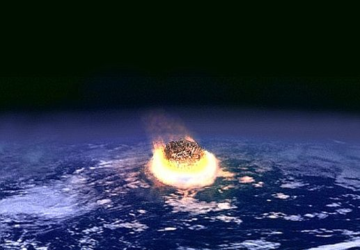
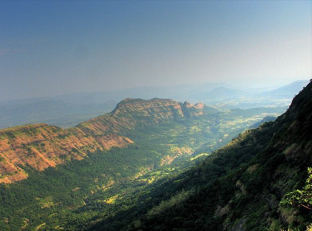

## 10.4 Mass extinctions (ESGCT)

This section introduces the learners to the mass extinctions that planet earth has experienced. Learners need to understand that a mass extinction is defined by a sharp decrease in the amount of plant and animal life. There have been five major mass extinction events in Earth's history.

<Callout type="note" title="Note">
Learn about the five major mass extinctions that occurred in Earth's history.

<VideoPlayer src="https://youtu.be/FlUes_NPa6M" title="Video: 2CY4" />
</Callout>

A mass extinction is a sharp decrease in the amount of plant and animal life. There have been five major mass extinction events in Earth's history. These are shown in the table given, along with the major events that characterised each.

| Major mass extinction event | Date of occurrence | Major events |
| --- | --- | --- |
| Cretaceous-Paleogene extinction event | \(\text{65}\) million years ago | Approximately  \(\text{75}\%\) of all species became extinct. Mammals and birds emerged as the  dominant land vertebrates. |
| Triassic-Jurassic event | \(\text{205}\) million years ago | Most non-dinosaur species were eliminated, leaving land dinosaurs with  no competition. |
| Permian-Triassic event | \(\text{250}\) million years ago | This was Earth's largest extinction event. It resulted in the loss of \(\text{96}\%\) of marine species and \(\text{70}\%\) of land species. The event had great evolutionary significance because it allowed the vacant habitats and ecosystems to be filled by new species through natural selection. |
| Late Devonian extinction | \(\text{375}\)–\(\text{360}\) million years ago | This was a prolonged period of extinction lasting up to \(\text{20}\) million years. During this period up to \(\text{70}\%\) of living species were eliminated. |
| Ordovician-Silurian extinction event | \(\text{450}\)–\(\text{440}\) million  years ago | Over \(\text{50}\%\) of all genera were eliminated during this period and is ranked as the second largest  mass extinction in Earth's history |

### Ongoing sixth mass extinction (ESGCV)

<Callout type="note" title="Note">
Earth's sixth mass extinction?

<VideoPlayer src="https://youtu.be/p7kpJLC_RzM" title="Video: 2CY5" />
</Callout>

- We are currently living through the 'sixth' mass extinction according to many scientists. The present rate of extinction is thought to be \(\text{140 000}\) species per year. This rapid extinction rate started in approximately \(\text{10 000}\) BC and has continued into the 21st century.
- The extinction includes disappearance of large mammals such as the woolly mammoth.
- The sixth extinction event is thought to be occurring at a rapidly increasing rate.
- The two major causes for the sixth extinction are thought to be human hunting and the rapid rise in human population. You will learn more about the impact of human activity on the environment in Grades 11 and 12.

<Callout type="note" title="Note">
The Golden Toad  of Costa Rica has been extinct since around 1989. Its disappearance has been attributed to a confluence of several factors, including global warming event known as El Nino, fungus, and the introduction of new species that out-competed it for habitat and food.
</Callout>

### Causes of mass extinctions (ESGCW)

<Callout type="note" title="Note">
Watch a video about the debate about what really killed the dinosaurs.

<VideoPlayer src="https://youtu.be/1iNcRJGzzxs" title="Video: 2CY6" />
</Callout>

There is still a lot of debate among scientists as to what caused the mass extinctions. To be a valid theory to explain what caused mass extinctions, the theory must:

- explain all the losses of species at a particular mass extinction event (not just specific losses e.g. dinosaurs).
- explain why some organisms died and others survived.
- be based on natural events and processes that are shown to have occurred around the time of extinction.

Two of the hypotheses put forward are:

- the impact theory of extinction
- massive volcanic activity

<Callout type="note" title="Note">
Watch a video about the meteor impact that may have caused the extinction of the dinosaurs.

<VideoPlayer src="https://www.youtube.com/watch?v=Rm1kmddFZLQ" title="Video: 2CY7" />

<VideoPlayer src="https://www.youtube.com/watch?v=Epw-uKBYQVI" title="Video: 2CY8" />
</Callout>

**Impact event**

Scientists believe that an asteroid was responsible for the mass extinction that occurred 65 million years ago. The meteorite that hit Earth was most likely 10 km in diameter, and upon impact it would have released an amount of energy that was 2 million times more powerful than the most powerful man-made device ever created. The massive impact caused earthquakes and volcanic eruptions that produced toxic gases, and ejected dust, soot and debris into the air, blocking out sunlight and preventing photosynthesis. The impact also resulted in the production of sulfur rich acid rain and caused forest fires and mega-tsunamis. The impact of an asteroid smashing into Earth may have caused food chains to collapse both on land and at sea. They believe this impact produced the 180 km wide Chicxulub crater found in the Gulf of Mexico.

Figure 10.15: Illustration of an impact event.

**Volcanic activity**

Some scientists believe that volcanic eruptions may have caused the mass extinction event at the end of the Cretaceous period that led to the extinction of among others, the dinosaurs. The researchers, through examining a trail of dead particles floating in the sea, spanning half a million years, developed a timeline that links mass extinction to large-scale eruptions of the Deccan Traps, an ancient volcanic range in Western India. Evidence suggests that the massive volcanic eruptions pumped out massive quantities of carbon dioxide and sulphur dioxide into the air, thus altering the climate and contributing to the mass extinction event at the end of the Cretaceous period.

Figure 10.16: Deccan traps, Mahabaleshwar, India.

## What caused the mass extinctions?

### Aim

To use understanding of fossil evidence and scientific method to demonstrate how each of the hypotheses for mass extinction arrives at its conclusion.

### Instructions

- What are the key requirements of a theory that attempts to explain the mass extinctions?
- Choose one of the two hypotheses discussed and describe it in your own words. List the evidence that supports the theory.
- Through your research on the Internet and by reading books in the library, list any other evidence that you found in support of your chosen hypothesis.

**Activity: What caused the mass extinctions?**

This is an optional activity. In this activity learners are to use their understanding of fossil evidence and scientific method to demonstrate how each of the hypotheses for mass extinction arrives at its conclusion. Learners can choose either the **Impact Theory** or the **Volcanic Theory** as an explanation for the mass extinction. Their description / discussion must be in their own words, not copied from the text given.

The key requirements of a theory that attempts to explain the mass extinctions must:

- Explain all the losses of species at the time, not just a few.
- Explain why some species survived, while others did not.
- Be based on natural events that are known to have occurred at about the same time as the extinction event.

By conducting their own research on the Internet and by reading books in the library, they are to list any other evidence that they found in support of their chosen hypothesis.

The learners can then present their information to the class which in turn can lead to further discussion.

## Observing fossils

### Aim

Examine fossils at a museum or fossil site or look at photographs of fossils.

### Materials

Some fossil sites have already been described.

- These websites provide a list of museums that contain fossils:
- A list of fossil sites around the world is given below. Identify the ones that are within South Africa:
  .
- If you are unable to visit the fossil sites or museums, the following website gives photographs and explanations of the major fossils that have shaped our understanding of the history of life:
  .

### Instructions

Travel to your nearest museum, fossil site or the website listed and observe any fossils on display. Find out how they have been preserved, describe the key features of each fossil, how they were dated and what they tell us about our past.

**Activity: Observing fossils**

Learners can be taken to museums or fossil sites or look at photographs of fossils to examine various fossils.

Some fossil sites have already been described.

- These websites provide a list of museums that contain fossils:
- A list of fossil sites around the world is given below. Identify the ones that are within South Africa:
  .
- If you are unable to visit the fossil sites or museums, the following website gives photographs and explanations of the major fossils that have shaped our understanding of the history of life:
  .

Depending on how you are going to do this activity with your learners, they will need to find out how they have been preserved, describe the key features of each fossil, how they were dated and what they tell us about our past.

This can be presented in a research report format, or may simply be done as a class exercise. Formal assessment is not necessary.

## Understanding evolutionary history based on evidence from South Africa

### Aim

We want to locate where the key events in the history of life occurred in South Africa, based on our earlier discussion of fossil evidence found in South Africa.

### Instructions

1. The table below lists evidence from South Africa on the history of life.
3. Draw a map of South Africa.
5. On your map, show where each piece of evidence listed in the table is located.
7. Also show what this evidence indicates about the history of life.
9. In the third column of the table, write down the era from which these fossils are likely to have emerged. The first part has been done for you.

| Evidence | Location | Era |
| --- | --- | --- |
| Stromatolites | False Bay, Cape Town | Paleozoic, Pre-Cambrian |
| Soft-bodied animals | Northern Cape |  |
| Early land plants | Grahamstown |  |
| Primitive plants e.g Glossopteris | Mooi River, Estcourt |  |
| Coelacanth | Northern KZN Coast |  |
| Mammal-like reptiles e.g. Lystrosaurus, Thrinadoxon | Karoo |  |
| Dinosaurs Euskylosaurus | Drakensberg and Maluti mountains, Ladybrand, Free State |  |
| First mammals | Lesotho, Eastern Cape |  |
| Humans and pre-humans | Gauteng, North West, Free State, KwaZulu-Natal, Limpopo |  |

**Activity: Understanding evolutionary history based on evidence from South Africa**

In this activity the learners are required to locate where the key events in the history of life occurred in South Africa, based on earlier discussion of fossil evidence found in South Africa.

Learners should:

- Draw a map of South Africa
- Show where each piece of evidence listed in the table is located on the map.
- Show what this evidence indicates about the history of life.
- Write down the period from which these fossils are likely to have emerged.

| Evidence | Location | Era |
| --- | --- | --- |
| Stromatolites | False Bay, Cape Town | Paleozoic, Pre-Cambrian |
| Soft-bodied animals | Northern Cape | Pre-Cambrian |
| Early land plants | Grahamstown | Paleozoic |
| Primitive plants e.g. Glossopteris | Mooi River, Estcourt | Paleozoic |
| Coelacanth | Northern KZN Coast | Paleozoic to present |
| Mammal-like reptiles e.g. Lystrosaurus, Thrinadoxon | Karoo | Lystrosaurus, : Late Paleozoic to Mesozoic; Thrinadoxon : Mesozoic |
| Dinosaurs Euskylosaurus | Drakensberg and Maluti mountains Ladybrand, Free State | Mesozoic |
| First mammals, Megazostrodon | Lesotho, Eastern Cape | Mesozoic |
| Humans and pre-humans | Gauteng, North West, Free State, KwaZulu-Natal, Limpopo | Cenozoic |
