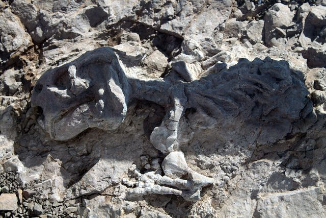
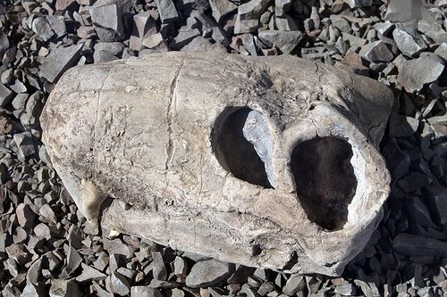

## 10.6 Fossil tourism (ESGCY)

Given the intense interest humans have in their origins and the deep knowledge of our past with which fossils provide us, fossil tourism is an important source of income and employment in areas in which fossils are located.

Figure 10.17: Fossil therapsid skull in Karoo National Park, South Africa.

South Africa has a number of sites rich in fossils, which attract tourists. The **Cradle of Humankind** in the Krugersdorp area of Gauteng (i.e. Sterkfontein, Swartkrans, Kromdraai and surrounding area) has been declared a World Heritage Site, since it has yielded so many significant fossils, such as Mrs Ples, Little Foot and the recently discovered Karabo Child (2008). There is a tourist centre at Maropeng near this site ("Maropeng" is the Tswana word for "origins").

Many other areas in South Africa also attract tourists due to their rich fossil deposits, such as Langebaan, Border Cave and the Karoo area.

Many South Africans can find jobs in such tourist areas. They can work as tour guides, hotel staff, game rangers, drivers, curio sellers and the like. It is important also that the local people see the tourist site as a potential source of income and employment, not merely as something academic that has nothing to do with them.

**TEACHER RESOURCES: **

- The following link shows information about the **Maropeng Visitors' Centre** near Krugersdorp in Gauteng:
- Watch a **short video interview with Prof Lee Berger**, who found a fossil of *Australopithecus sediba* near Sterkfontein in 2008:

<Callout type="note" title="Note">
A brief video about Maropeng and what you can do there. We can rightly be proud of this world class centre!

<VideoPlayer src="https://www.youtube.com/watch?v=Bj_KT-UDoY8" title="Video: 2CY9" />
</Callout>
