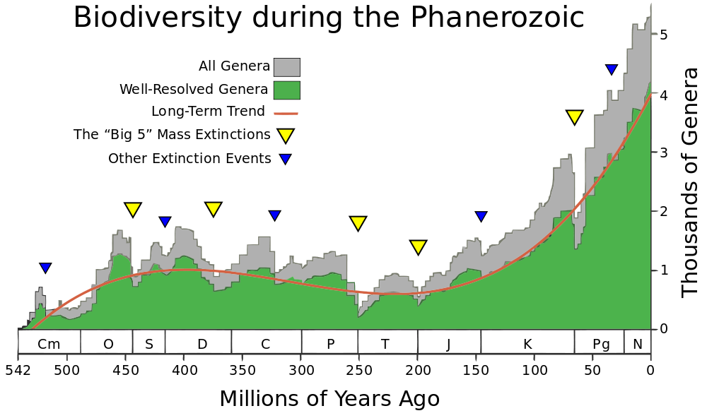

## End of chapter exercises

### Exercise 10.1

In each of the following cases write down the letter of the most correct alternative.

**Problem:**
Which of the fossils have been found in Namibia?

1. Mammal-like reptiles
3. *Glassopteris* leaves
5. Soft-bodied animals
7. Early mammals

**Solution:**
Soft-bodied animals

**Problem:**
A problem in the accuracy of radiocarbon dating is that:

1. scientists are not sure that radioactive decay actually occurs
3. the decay rate of minerals can change without warning
5. the rocks that contain the fossils can't be dated
7. the half-life of carbon-14 is relatively short, and most fossils are millions of years old

**Solution:**
the half-life of carbon-14 is relatively short, and most fossils are millions of years old

**Problem:**
Study the table below that shows the decay of carbon-14 over time and then answer the questions that follow:

| Decay of carbon-14 |
| --- |
| Years from present | 0 | \(\text{5 730}\) | \(\text{11 460}\) | \(\text{17 190}\) | \(\text{22 920}\) | X | \(\text{34 380}\) | \(\text{40 110}\) |
| Number of half-lives elapsed | 0 | 1 | 2 | 3 | 4 | 5 | 6 | 7 |
| Percentage of original carbon-14 remaining | 100 | 50 | 25 | \(\text{12,5}\) | \(\text{6,25}\) | Z | \(\text{1,56}\) | \(\text{0,78}\) |

1. State two types of methods used to determine the age of fossils.
3. Calculate the value of:
   1. X
   3. Z
5. Explain why it would not be possible to date the fossil of an organism that existed 80 million years ago using the decay of carbon-14.
7. Give two reasons why there are gaps in the fossil record.

**Solution:**
1. Any two of the following:
   - Radiometric dating using minerals in volcanic rock
   - Radiocarbon dating using organic fossils like bones
   - Relative dating, where one fossil is stated as being ‘younger or older’ than another, without giving a specific date or age
3. Calculate the value of:
   1. \(X = 5 \times \text{5 730} = \text{28 650} \text{ years}\)
   3. \(Z = \frac{\text{6,25}\%}{2} = \text{3,125}\%\)
5. A fossil that is 80 million years old has almost no carbon-14 left in it – the amount will be too small to be detected. Therefore carbon-14 dating would not give a reliable date or age.
7. Any two of the following:
   - Not all fossils have been found yet.
   - Fossilisation is rare, so not all dead organisms fossilise (conditions may have been wrong for them to fossilise).
   - Many fossils have been destroyed by movements of the Earth’s plates or by human activities like digging and dam building.
   - Soft-bodied organisms do not usually fossilise, so very few of them are present in the fossil record
   - Any other relevant fact may be accepted, e.g. people may not recognise an item as a fossil, so it goes unnoticed.

**Problem:**
Study the graph below which shows the major extinction events answer the questions that follow.

Figure 10.18: Graph of mass extinctions

1. When did the Cenozoic era begin?
3. Which mass extinction took place towards the end of the Paleozoic era?
5. Approximately how many genera of species went extinct at the end of the Paleozoic era? Show ALL working.
7. Explain why the number of genera of organisms increased rapidly after each mass extinction.

**Solution:**
1. Around 65 mya, after the last major extinction.
3. The Permian extinction.
5. Learners are required to read-off of the number of genera present at the start of the extinction and the number of genera remaining at the end of the extinction. The difference between these two figures would be the number of genera lost during the extinction. Learners will have to estimate from the graph as the axes are not clear. A range of answers should therefore be accepted. The answer should be around \(\text{80}\%\).
7. The number of genera increased rapidly after each extinction event, because many genera were wiped out completely during the extinction, so their niches were left open. These niches were rapidly taken over by other genera, who diversified and formed new genera by natural selection.

**Problem:**
The following questions are about the extinction of dinosaurs on Earth.

1. What evidence do scientists use to show that dinosaurs once existed on Earth?
3. How long ago did the dinosaurs become extinct?
5. Describe a hypothesis that has been proposed for the extinction of many species, including the dinosaurs during the extinction event at the end of the mesozoic.

**Solution:**
1. Fossils that were formed when the dinosaurs died, also animals like sharks, birds and crocodiles, that are closely related to dinosaurs.
3. Dinosaurs became extinct 65 mya.
5. The Earth was struck by an asteroid from outer space (at the Yucatan Peninsula off Mexico). This caused massive fires, earthquakes and tsunamis, as well as dust clouds that blocked the sun, so photosynthesis was severely reduced and global climate changed. Few animals survived, and these diversified to fill the vacant niches and multiplied to repopulate the earth. The mammals and flowering plants became the dominant life forms after the last mass extinction.
